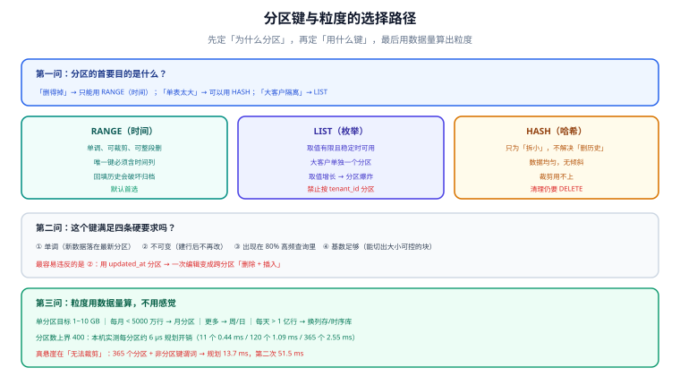

# 分区策略：分区键与粒度

分区键是这张表上**最难改的一个决定**。索引建错了可以 `DROP` 重建，分区键选错了基本等于重建整张表——因为所有历史数据都要按新键重新分布。这一页要回答三个问题：用哪种分区类型、拿哪个列当分区键、一个月切一刀还是一天切一刀。

## 判据族声明

本页判据族 `PS-A` ~ `PS-H`，共 8 条。定义表在第八节。

## 本页不讲什么

- 不讲 `ATTACH` / `DETACH` 的具体命令与默认分区的坑，归 [分区维护](../PartitionOps/index.md)。
- 不讲查询怎么写才能裁到，归 [跨分区查询](../CrossPartition/index.md)。
- 不讲跨库拆分的分片键（那是另一个问题），归 [分库分表](/docs/DB/Relational/Sharding/Strategy/index.md)。



## 一、三种分区类型的适用面

| 类型 | 语义 | 什么时候用 | 什么时候不能用 |
| --- | --- | --- | --- |
| `RANGE` | 按区间切（时间、ID 段） | **有单调递增的时间列**，且删除/归档按时间成段发生 | 时间列会被回填（补历史数据）时，中间分区会反复膨胀 |
| `LIST` | 按枚举值切（租户、区域、状态） | 取值集合**有限且稳定**，且不同值的数据量差异大（可以把大客户单独放一个分区） | 取值会持续增长（如按 `tenant_id` 分区，客户一多就是几千个分区） |
| `HASH` | 按哈希取模切 | 只想要「小表」而**不需要按值清理**（如把 10 亿行拆成 16 份降低单表维护成本） | 想靠它删历史——`HASH` 分区里的数据是混的，删一段时间仍然要 `DELETE` |

一条判据：**分区的第一目的如果是「删得掉」，只能用 `RANGE`（或按时间枚举的 `LIST`）**；`HASH` 只解决「单表太大」，不解决「历史怎么清」。

::: warning MySQL 的两条硬约束
1. **分区表达式里用到的所有列，必须包含在每个唯一键里**（含主键），否则建表直接 `ERROR 1491`。
2. **分区 InnoDB 表不支持外键**。

两条都意味着「已经有一堆外键 + 复合唯一键的存量表」想加分区，得先拆约束。PostgreSQL 的约束方向一致（唯一键必须含分区键），但外键是支持的。
:::

## 二、分区键的四条硬要求

| 要求 | 说明 | 违反的后果 |
| --- | --- | --- |
| **单调** | 新数据总落在「最新的那个分区」 | 分区键是 `updated_at`：一条老数据被更新，就跨分区搬家（`UPDATE` 变成 `DELETE` + `INSERT`） |
| **不可变** | 建行之后不再改 | 用 `status` 当分区键，状态一变就搬家，且 `UPDATE` 在分区表上可能悄悄变成跨分区操作 |
| **出现在高频查询里** | 至少 80% 的查询带这个条件 | 分区建了但查询从不带它 → 每次都是全分区扫描，只多了规划成本 |
| **基数足够** | 按这个键能切出「大小可控」的块 | 用 `region`（3 个值）当分区键 → 3 个巨大分区，等于没分 |

四条里最容易违反的是第二条。本机实测对照：

```sql
-- 反例：用 updated_at 分区，每次「编辑」都可能跨分区搬家
CREATE TABLE docs (id bigint, created_at timestamptz, updated_at timestamptz)
  PARTITION BY RANGE (updated_at);
-- 正例：用 created_at 分区，行一旦落定就不再移动
CREATE TABLE docs (id bigint, created_at timestamptz, updated_at timestamptz)
  PARTITION BY RANGE (created_at);
```

`updated_at` 的问题不在于「性能差一点」，而在于**它把一次单行更新变成了一次跨分区的删除 + 插入**，同时让「按时间归档」失去意义（历史数据会被后续修改不断拉到热分区里）。

## 三、粒度：一个月还是一天

粒度由两个数字夹出来：**单个分区的大小**和**分区总数**。

| 数据量 | 建议粒度 | 单个分区大小 | 13 个月的分区数 |
| --- | --- | --- | --- |
| 每月 < 100 万行 | 月 | < 1 GB | 13 |
| 每月 100 万 ~ 5000 万行 | 月 | 1 ~ 20 GB | 13 |
| 每月 > 5000 万行 | 周或日 | 1 ~ 10 GB | 52 ~ 365 |
| 每天 > 1 亿行 | 小时（配合列存 / 时序库） | 数 GB | 上千（该换引擎了） |

单分区目标定在 **1~10 GB** 是个经验区间，理由是可解释的：小于 1 GB 时元数据与规划开销占比过高；大于 10 GB 时「删一个分区」仍然是一次重活（`DETACH` 虽快，但底层文件删除与备库回放会集中在那一刻）。

## 四、分区数的上界：用规划耗时算出来

每多一个分区，优化器就多一次裁剪判断与代价估算。本机实测（`EXPLAIN ANALYZE` 的 `Planning Time`，点查、能裁剪）：

| 分区数 | 规划耗时（3 次） | 折算每分区 |
| --- | --- | --- |
| 11 | 0.492 / 0.439 / 0.643 ms | —— |
| 120 | 1.086 / 1.092 / 1.062 ms | ≈ 5.9 µs |
| 365 | 2.604 / 2.546 / 2.858 ms | ≈ 6.0 µs |

线性关系很清楚：**每个分区约 6 微秒**。把它外推：

| 分区数 | 预计规划耗时 | 评价 |
| --- | --- | --- |
| 100 | ~0.6 ms | 无感 |
| 365 | ~2.5 ms | 可接受（日分区、一年） |
| 1000 | ~6 ms | 开始显形（高频小查询会感觉到） |
| 3650 | ~22 ms | 不可接受（点查被规划拖死） |

**真正的悬崖不在「能裁剪」的情况，而在「裁剪不了」的时候**：同样的表，把谓词换成 `WHERE action = 'card.move'`（无法裁剪），365 个分区实测规划 **13.7 ms**，第二次 **51.5 ms**——因为优化器要为每个分区都生成并比较一遍计划。这个量级已经能毁掉一个 50 ms 的接口。

由此得到一条可执行的纪律：**分区数控制在 400 以内，且保证高频查询一定能裁剪**。两个条件缺一个，就该考虑「先聚合到汇总表」或「换列存引擎」。

## 五、二级分区什么时候用

`PARTITION BY RANGE (created_at) PARTITION BY HASH (tenant_id)` 这类二级分区只有一个合理动机：**一级分区的粒度被「保留期」定死了，但单个一级分区仍然太大**。

| 场景 | 是否用二级分区 | 理由 |
| --- | --- | --- |
| 按月保留 13 个月，单月 40 GB | 是（月 × 16 哈希） | 单分区 40 GB 的 `DETACH` 与备份都太重 |
| 按月保留 13 个月，单月 2 GB | 否 | 单分区已经很小，二级分区只是把分区数乘 16 |
| 按租户 `LIST` 分区，单租户 500 GB | 是（租户 × 月） | 大客户需要「按租户删」+「按月归档」两个维度 |
| 按 `HASH` 分 16 份降低单表维护成本 | 否 | 没有时间维度，二级分区无处可加 |

代价是分区数相乘：`13 × 16 = 208`，还在上界内；但 `365 × 16 = 5840` 就超了。

## 六、分区键选错的四种后果

| 后果 | 触发条件 | 表现 | 补救 |
| --- | --- | --- | --- |
| **分布倾斜** | 用低基数列（`status`、`region`） | 某个分区占 80% 数据，删它等于删全表 | 换键，或改 `LIST` 把大值单独拆出 |
| **裁剪永远失效** | 键不在查询条件里 | 每次全分区扫，`Append` 节点几十个 | 加冗余列（把时间冗余到高频查询的主表上） |
| **删不掉** | 用 `HASH` 或 `updated_at` | 历史数据混在所有分区里 | 重建表，或退化成 `DELETE` + 归档 |
| **唯一键被迫改设计** | 分区键不是业务主键的一部分 | 无法建 `UNIQUE (id)`，只能 `(id, 分区键)` | 设计阶段就定：唯一性交给序列 / 应用层 |

第一条可以量化。用 `LIST (region)` 分 3 个分区、其中一个区域占 90% 数据时，「删掉这个区域」的工作量是 90% 的全表——分区在这里完全没有帮上忙。

## 七、如何验证

```shell
# ① 分区类型与分区键
docker exec teamboard-sandbox-db-1 psql -U teamboard -d lab160 -tAc \
  "SELECT relname, pg_get_partkeydef(oid) FROM pg_class WHERE relname IN ('ev','ev_flat')"
```

**预期输出**：`ev|RANGE (ts)`，`ev_flat|`（空表示不是分区表）。分区键与设计文档不一致时，这里立刻能看出来。

```shell
# ② 各分区行数分布（倾斜检测）
docker exec teamboard-sandbox-db-1 psql -U teamboard -d lab160 -tAc \
  "SELECT tableoid::regclass, count(*) FROM ev GROUP BY 1 ORDER BY 2 DESC LIMIT 3"
```

**预期输出**：前三名的行数相差不超过 20%。若第一名是第二名的 5 倍以上，说明分区键基数或分布有问题。

```shell
# ③ 分区数与规划耗时（上界检查）
docker exec teamboard-sandbox-db-1 psql -U teamboard -d lab160 -tAc \
  "EXPLAIN (ANALYZE, TIMING OFF, COSTS OFF) SELECT * FROM ev365 WHERE ts = '2026-07-15 10:00:00+08'" \
  | grep "Planning Time"
```

**预期输出**：365 个分区时约 `2.5~2.9 ms`。显著高于这个量级说明统计信息缺失或分区数已超上界。

```shell
# ④ 高频查询是否都能裁剪（逐个跑 EXPLAIN，数 Scan 节点）
for q in "ts >= '2026-03-01' AND ts < '2026-04-01'" "action = 'card.move'"; do
  echo -n "$q -> "
  docker exec teamboard-sandbox-db-1 psql -U teamboard -d lab160 -tAc \
    "EXPLAIN (COSTS OFF) SELECT count(*) FROM ev WHERE $q" | grep -c "Scan on ev_"
done
```

**预期输出**：第一行 `1`，第二行 `12`。第二行就是「这条查询吃不到分区收益」的证据——如果它出现在高频路径上，分区键选错了。

```shell
# ⑤ 是否存在「更新会搬家」的隐患（分区键是否出现在 UPDATE 的 SET 里）
grep -rn "SET .*\(updated_at\|status\|region\)" src/main/resources/mapper/*.xml 2>/dev/null | head -5
```

**预期输出**：无输出，或命中的列都不是分区键。命中分区键说明每次更新都可能跨分区搬家。

```shell
# ⑥ 二级分区是否真的需要（单分区大小）
docker exec teamboard-sandbox-db-1 psql -U teamboard -d lab160 -tAc \
  "SELECT relname, pg_size_pretty(pg_total_relation_size(oid))
     FROM pg_class WHERE relname LIKE 'ev_2026%' ORDER BY pg_total_relation_size(oid) DESC LIMIT 2"
```

**预期输出**：最大分区 < 10 GB 时不需要二级分区；> 40 GB 时应该加。

```shell
# ⑦ 时间列是否会被回填（分区键的单调性）
grep -rn "created_at.*VALUES\|INSERT INTO .*created_at" src/main/resources/mapper/*.xml 2>/dev/null | head -5
```

**预期输出**：插入语句里 `created_at` 取 `now()` 或由服务端生成。若允许客户端传入任意历史时间，回填会写进历史分区，导致「已归档的分区又开始长」。

```shell
# ⑧ 分区键是否出现在索引里（裁剪与索引的配合）
docker exec teamboard-sandbox-db-1 psql -U teamboard -d lab160 -tAc \
  "SELECT indexrelid::regclass, pg_get_indexdef(indexrelid)
     FROM pg_index WHERE indrelid = 'ev_202601'::regclass"
```

**预期输出**：至少一个索引的首列是分区键。分区键不在任何索引里时，裁剪后的分区内仍然要走全分区扫描。

## 八、判据族定义

| 判据 | 规则 | 违反时的样子 | 验证方式 |
| --- | --- | --- | --- |
| `PS-A` | 分区的首要目的若是「删得掉」，只能用 `RANGE` 或时间型 `LIST` | 用 `HASH` 分区后仍然靠 `DELETE` 清历史 | 命令 ① |
| `PS-B` | 分区键必须单调、不可变、出现在 80% 以上的高频查询里、基数足够 | 数据分布倾斜或裁剪永远失效 | 命令 ②④ |
| `PS-C` | 禁止用会被 `UPDATE` 修改的列当分区键 | 一次编辑触发跨分区搬家 | 命令 ⑤ |
| `PS-D` | 单分区目标 1~10 GB，粒度按数据量推算而非拍脑袋 | 单分区 40 GB，`DETACH` 与备份都极慢 | 命令 ⑥ |
| `PS-E` | 分区数不超过 400，且高频查询必须能裁剪 | 规划耗时从 0.5 ms 涨到 50 ms | 命令 ③ |
| `PS-F` | 二级分区只在「一级粒度被保留期锁死、单分区仍过大」时使用 | 分区数相乘后破千，规划与维护成本翻倍 | 命令 ⑥ + 分区数统计 |
| `PS-G` | 分区键必须写进至少一个索引的首列 | 裁剪后分区内仍全扫 | 命令 ⑧ |
| `PS-H` | 时间列必须由服务端生成，禁止客户端回填到历史分区 | 已归档的分区又开始增长，归档流程失效 | 命令 ⑦ |

::: info 诚实标注
第三节的「单分区 1~10 GB」是经验区间，不是官方规定；第四节的规划耗时是本机 PostgreSQL 18.6 实测（同一容器、同一份数据、三次取样），**换硬件或换引擎后绝对值会变**，但「每分区约 6 µs」的线性关系在同机内稳定。第五节的二级分区建议来自分区数上界的推算，未在二级分区表上实测。
:::

## 参考资料

- [PostgreSQL · Table Partitioning](https://www.postgresql.org/docs/18/ddl-partitioning.html)——三种分区类型与 `PARTITION BY` 的完整语法
- [PostgreSQL · Partition Pruning](https://www.postgresql.org/docs/18/ddl-partitioning.html#DDL-PARTITION-PRUNING)——裁剪在计划期与执行期的两种时机
- [MySQL 8.4 · Partitioning Types](https://dev.mysql.com/doc/refman/8.4/en/partitioning-types.html)——`RANGE` / `LIST` / `HASH` / `KEY` 的语法差异
- [MySQL 8.4 · Partitioning Limitations](https://dev.mysql.com/doc/refman/8.4/en/partitioning-limitations.html)——唯一键与外键两条硬约束
- 本站 [分库分表 · 拆分策略与分片键设计](/docs/DB/Relational/Sharding/Strategy/index.md) · [索引设计方法论](/docs/DB/Relational/MySQL/IndexDeepDive/Design/index.md)
- 相邻：[分区维护](../PartitionOps/index.md) · [跨分区查询](../CrossPartition/index.md)
