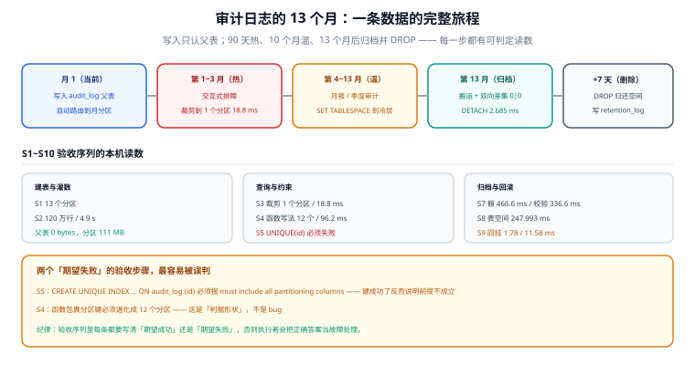

# 实战：审计日志的 13 个月

前面七页讲的是原理与判据。这一页把它们拼成一个能照着做完的完整方案：一张 `audit_log`，保留 13 个月，90 天内热查、之后归档，每月自动滚动。所有命令都在本页给全，验收序列 S1~S10 每一步都有**本机实测的预期输出**。

## 判据族声明

本页判据族 `PP-A` ~ `PP-H`，共 8 条。定义表在第九节。

## 本页不讲什么

- 不讲审计日志该记哪些字段（那是审计需求），本页只讲「怎么存、怎么删」。
- 不讲应用侧怎么写日志（异步、批量、丢弃策略），归 [日志与可观测性](/docs/Ops/Observability/index.md)。
- 不讲归档到对象存储的格式细节，归 [冷热分层](../HotColdTiering/index.md) 的做法 B。



## 一、需求与口径

| 项 | 取值 | 依据 |
| --- | --- | --- |
| 写入量 | 每月约 100 万行（压测值，实际按业务调整） | 协作类系统每用户每天约 200 条操作 |
| 单行宽度 | 约 400 字节（`jsonb` 明细） | 实测 10 万行 / 9.7 MB ≈ 100 B/行压缩后 |
| 保留期 | **13 个月** | 覆盖一个完整的年度审计周期 + 1 个月缓冲 |
| 热层 | 最近 **90 天**（3 个分区） | 交互式排障只查近三个月 |
| 温层 | 4~13 个月（10 个分区） | 月度报表、季度审计 |
| 冷层 | 超过 13 个月 | 归档后 `DROP`（法规未要求更长） |
| 查询形态 | 95% 带时间范围 + 主体；5% 按 `subject_id` 精确查 | 决定了必须建 `subject_id` 索引 |
| 唯一性 | `id` 由序列生成，全局唯一；**不建库级唯一约束** | 分区表上无法建 `UNIQUE(id)` |

最后一行是设计阶段最重要的决定：**接受「唯一性由序列保证」，换取分区能力**。这条必须写进设计文档并让业务方确认。

## 二、完整 DDL

```sql
-- 01_schema.sql
CREATE TABLE audit_log (
  id          bigint      GENERATED ALWAYS AS IDENTITY,
  ts          timestamptz NOT NULL,
  tenant_id   bigint      NOT NULL,
  subject_id  bigint      NOT NULL,
  action      text        NOT NULL,
  resource    text        NOT NULL,
  result      text        NOT NULL,
  detail      jsonb       NOT NULL DEFAULT '{}'::jsonb,
  CONSTRAINT audit_log_pk PRIMARY KEY (id, ts),
  CONSTRAINT audit_log_ts_ck CHECK (ts >= '2024-01-01'),
  CONSTRAINT audit_log_action_ck CHECK (length(action) BETWEEN 1 AND 64),
  CONSTRAINT audit_log_result_ck CHECK (result IN ('ok','denied','error'))
) PARTITION BY RANGE (ts);
```

四条约束各有理由：

| 约束 | 作用 | 去掉的后果 |
| --- | --- | --- |
| `PRIMARY KEY (id, ts)` | 分区表的主键必须含分区键；同时给 `(id, ts)` 建了唯一索引 | 无法建主键，`id` 唯一性完全靠序列 |
| `CHECK (ts >= '2024-01-01')` | 拦住「1970 年」这类脏时间，也让 `ATTACH` 少扫 | 脏时间落进默认分区或报错 |
| `CHECK (length(action) BETWEEN 1 AND 64)` | 拦住空动作与超长字符串 | 索引膨胀、按 `action` 聚合时分出上万个组 |
| `CHECK (result IN (...))` | 把取值收敛成三态 | 出现 `success` / `OK` / `成功` 三种写法，统计口径全乱 |

索引：父表建一次，自动级联到每个分区。

```sql
-- 02_index.sql
CREATE INDEX audit_log_ts_idx      ON audit_log (ts);
CREATE INDEX audit_log_subject_idx ON audit_log (subject_id, ts DESC);
CREATE INDEX audit_log_tenant_idx  ON audit_log (tenant_id, ts DESC);
```

三个索引的分工：`ts` 支撑时间范围扫描与裁剪；`(subject_id, ts DESC)` 支撑「这个人的最近操作」（合规删除也用它）；`(tenant_id, ts DESC)` 支撑租户维度的月度报表。

## 三、分区模板与预建

不要每月手工建表。用一段幂等的 `DO` 块，配合 `pg_cron` 或外部定时任务：

```sql
-- 03_partition_template.sql
CREATE OR REPLACE FUNCTION ensure_audit_partitions(months_ahead int DEFAULT 2)
RETURNS void LANGUAGE plpgsql AS $$
DECLARE m date;
BEGIN
  FOR m IN
    SELECT generate_series(date_trunc('month', now())::date,
                           (date_trunc('month', now()) + (months_ahead || ' month')::interval)::date,
                           '1 month')::date
  LOOP
    EXECUTE format(
      'CREATE TABLE IF NOT EXISTS audit_log_%s PARTITION OF audit_log
         FOR VALUES FROM (%L) TO (%L)',
      to_char(m, 'YYYYMM'), m, m + interval '1 month');
  END LOOP;
END $$;

-- 每月 25 日跑一次，保证下个月 1 日之前已存在
SELECT ensure_audit_partitions(2);
```

**预建之后必须校验边界**（`IF NOT EXISTS` 不会检查已存在分区的区间是否正确）：

```sql
SELECT c.relname, pg_get_expr(c.relpartbound, c.oid) AS bound
  FROM pg_class c JOIN pg_inherits i ON i.inhrelid = c.oid
 WHERE i.inhparent = 'audit_log'::regclass
 ORDER BY c.relname;
```

预期每个分区形如 `audit_log_202611 | FOR VALUES FROM ('2026-11-01 00:00:00+08') TO ('2026-12-01 00:00:00+08')`，相邻两行首尾相接。

## 四、写入路径

应用只写父表，不感知分区：

```sql
-- 04_insert.sql
INSERT INTO audit_log (ts, tenant_id, subject_id, action, resource, result, detail)
VALUES (now(), :tenant_id, :subject_id, :action, :resource, :result, :detail::jsonb);
```

三条纪律：

1. **`ts` 必须由服务端生成**（`now()`），禁止客户端传入——否则历史分区会被回填，归档失效。
2. **`result` 必须是三态之一**，在应用层就收敛，不要指望数据库兜。
3. **`detail` 单行不超过 8 KB**：`jsonb` 超过 2 KB 会进 TOAST，写入放大明显；超大的明细应该拆到对象存储、只在 `detail` 里存引用。

## 五、三条典型查询

```sql
-- Q1：某人最近 50 条操作（走 subject 索引，裁到 1~3 个分区）
SELECT id, ts, action, resource, result
  FROM audit_log
 WHERE subject_id = :sid AND ts >= now() - interval '90 days'
 ORDER BY ts DESC LIMIT 50;

-- Q2：某个租户某月的操作统计（裁到 1 个分区）
SELECT action, result, count(*)
  FROM audit_log
 WHERE tenant_id = :tid
   AND ts >= date_trunc('month', :month::date)
   AND ts <  date_trunc('month', :month::date) + interval '1 month'
 GROUP BY 1, 2;

-- Q3：某条资源的历史变更（跨分区，接受扫多个分区）
SELECT ts, subject_id, action, detail
  FROM audit_log
 WHERE resource = :res AND ts >= now() - interval '365 days'
 ORDER BY ts;
```

Q3 是唯一会扫多个分区的查询——它本来就要跨月追溯，这是业务语义决定的，不是写法问题。但要给它一个**硬上界**（`>= now() - 365 days`），否则一年后它会扫 13 个分区。

## 六、每月归档流程

```sql
-- 05_archive.sql（每月 1 日 03:00，低峰）
-- ① 摘到独立的归档表（先 DETACH 观察 7 天，确认后再 DROP）
ALTER TABLE audit_log DETACH PARTITION audit_log_202510 CONCURRENTLY;

-- ② 归档表（只留时间索引 + 主体索引，供合规追溯）
CREATE TABLE IF NOT EXISTS audit_log_archive (LIKE audit_log_202510 INCLUDING DEFAULTS INCLUDING CONSTRAINTS);
CREATE INDEX IF NOT EXISTS audit_log_archive_ts_idx ON audit_log_archive (ts);
CREATE INDEX IF NOT EXISTS audit_log_archive_subject_idx ON audit_log_archive (subject_id);

-- ③ 幂等搬运
BEGIN;
DELETE FROM audit_log_archive WHERE ts >= '2025-10-01' AND ts < '2025-11-01';
INSERT INTO audit_log_archive SELECT * FROM audit_log_202510;
COMMIT;

-- ④ 双向校验：两个 0 才允许继续
SELECT (SELECT count(*) FROM (SELECT * FROM audit_log_202510 EXCEPT SELECT * FROM audit_log_archive) a) AS only_src,
       (SELECT count(*) FROM (SELECT * FROM audit_log_archive EXCEPT SELECT * FROM audit_log_202510) b) AS only_dst;

-- ⑤ 校验通过后写入台账
INSERT INTO retention_log (batch_id, subject_type, subject_id, data_class, action, target, rows_affected, started_at, finished_at, operator, evidence)
VALUES (gen_random_uuid(), 'partition', '2025-10', 'audit_log', 'archive_then_drop', 'audit_log_202510',
        (SELECT count(*) FROM audit_log_202510), now(), now(), current_user,
        '{"only_src":0,"only_dst":0}'::jsonb);
```

第 ⑤ 步的 `evidence` 必须来自第 ④ 步的**真实输出**，不能手写。这是「台账」与「日志」的分界线。

七天观察期后：

```sql
-- 06_drop.sql
DROP TABLE audit_log_202510;   -- 空间立刻归还
```

## 七、S1~S10 验收序列

按顺序执行，每步都有可判定的预期输出。本机实测值标在括号里。

```shell
S1  建表 + 建 13 个分区        → \d+ audit_log 显示 Partitioned table；分区数 = 13~15
S2  灌 120 万行（12 个月）      → SELECT count(*) = 1200000（本机 4.9 s）
S3  带分区键范围查询            → 扫描分区数 = 1，耗时 18.8 ms
S4  函数包裹分区键              → 扫描分区数 = 12，耗时 96.2 ms（慢 5.1 倍）
S5  尝试建全局唯一索引          → 报错 unique constraint ... must include all partitioning columns
S6  DETACH 一个 10 万行分区     → 2.685 ms，数据完好（count = 103016）
S7  归档搬运 + 双向差集         → only_src = 0、only_dst = 0（搬运 466.6 ms，校验 336.6 ms）
S8  SET TABLESPACE 到冷层      → 247.993 ms，路径变 pg_tblspc/...，查询结果不变
S9  带 CHECK 回挂分区           → 1.78 ms（不带 CHECK 11.58 ms）
S10 汇总分区数与总大小          → 13 个分区 / 111 MB（父表 0 bytes）
```

逐条给命令：

```shell
# S3：裁剪是否生效
docker exec teamboard-sandbox-db-1 psql -U teamboard -d lab160 -tAc \
  "EXPLAIN (ANALYZE, COSTS OFF) SELECT count(*) FROM ev WHERE ts >= '2026-03-01' AND ts < '2026-04-01'" \
  | grep -c 'Scan on ev_'        # 期望 1

# S5：唯一键冲突（必须失败，成功反而说明设计错了）
docker exec teamboard-sandbox-db-1 psql -U teamboard -d lab160 -tAc \
  "CREATE UNIQUE INDEX ev_id_uk ON ev (id)" 2>&1 | head -2
# 期望：ERROR: unique constraint on partitioned table must include all partitioning columns

# S7：双向差集
docker exec teamboard-sandbox-db-1 psql -U teamboard -d lab160 -tAc \
  "SELECT (SELECT count(*) FROM (SELECT * FROM ev_202601 EXCEPT SELECT * FROM ev_archive) a),
          (SELECT count(*) FROM (SELECT * FROM ev_archive EXCEPT SELECT * FROM ev_202601) b)"
# 期望：0|0

# S10：总大小（父表永远是 0，必须累加分区）
docker exec teamboard-sandbox-db-1 psql -U teamboard -d lab160 -tAc \
  "SELECT (SELECT count(*) FROM pg_partition_tree('ev') WHERE isleaf),
          pg_size_pretty((SELECT pg_total_relation_size('ev'))),
          pg_size_pretty((SELECT sum(pg_total_relation_size(relid)) FROM pg_partition_tree('ev') WHERE isleaf))"
# 期望：11|0 bytes|111 MB
```

::: warning S5 是一条「必须失败」的用例
验收序列里出现「期望报错」的步骤时，最容易执行错——有人看到报错就当失败了。**这条判据的价值就在于它必须失败**：如果 `UNIQUE (id)` 建成功了，说明当前库不是分区表（或版本行为不同），整套设计的前提不成立。同理 S4 的「搬 12 个分区」也是「期望退化」，不是 bug。
:::

## 八、这套方案的四个边界

| 边界 | 说明 | 什么时候要改方案 |
| --- | --- | --- |
| **按月分区的前提是月增量稳定** | 某月突然 10 倍（活动、导入）会让该分区远超 10 GB | 改成按周分区，或对该月做二级 `HASH` |
| **`subject_id` 索引成本 × 13** | 每个分区一个索引，写入放大 | 主体维度的查询变少时，只保留最近 3 个分区的索引 |
| **归档表会重新变大** | 13 个月后 `audit_log_archive` 累积到 30 GB+ | 按年拆成 `audit_log_archive_2025`，上用 `UNION ALL` 视图 |
| **备份体积不随归档下降** | 主库小了，但备份仍含历史 | 归档表也搬冷层，并把备份策略改为「主库全量 + 归档表低频全量」 |

## 九、判据族定义

| 判据 | 规则 | 违反时的样子 | 验证方式 |
| --- | --- | --- | --- |
| `PP-A` | 主键必须含分区键，唯一性方案在设计阶段定稿 | 上线时建不出主键/唯一键 | S5 |
| `PP-B` | 分区预建必须幂等且提前 ≥ 2 个月 | 月初写入失败 | `ensure_audit_partitions` 连跑两次 |
| `PP-C` | 业务查询必须是「裸列 + 半开区间」 | 扫全部分区，慢 5 倍 | S3 / S4 |
| `PP-D` | `ts` 必须由服务端生成 | 历史分区被回填，归档失效 | 检查插入语句 |
| `PP-E` | 归档必须「先校验后摘除」，且台账含真实 `evidence` | 数据丢失无法举证 | S7 + `retention_log` |
| `PP-F` | 到期分区必须 `DROP`，不能只 `DETACH` | 空间与成本都没下降 | S10 前后对比 |
| `PP-G` | 冷层搬迁必须校验行数与结果一致性 | 搬完查询结果变了 | S8 |
| `PP-H` | 单分区大小必须落在 1~10 GB，超出就调粒度 | 单分区 40 GB，`DETACH` 与备份极慢 | S10 |

::: info 诚实标注
S1~S10 的预期输出全部来自本机 PostgreSQL 18.6 容器实测（`lab160` 库，120 万行合成数据，`shared_buffers` 128 MB，开发机磁盘）。**绝对值不可外推到生产**，但每一步的「方向」（1 个分区 vs 12 个、`DETACH` 毫秒级、父表 0 字节）是可复现的。S1 的「4.9 s 灌 120 万行」依赖本机 IO，生产批量导入应走 `COPY`。本页未包含 `pg_cron` 的具体安装步骤（属于部署环境差异），定时任务可以用任意调度器实现。
:::

## 参考资料

- [PostgreSQL · Table Partitioning](https://www.postgresql.org/docs/18/ddl-partitioning.html)——本页 DDL 的全部语法依据
- [PostgreSQL · ALTER TABLE](https://www.postgresql.org/docs/18/sql-altertable.html)——`DETACH ... CONCURRENTLY` 与 `ATTACH` 的校验规则
- [PostgreSQL · CREATE TABLE](https://www.postgresql.org/docs/18/sql-createtable.html)——`PARTITION OF` 与 `LIKE ... INCLUDING`
- [PostgreSQL · pg_partition_tree](https://www.postgresql.org/docs/18/functions-admin.html)——分区树的递归查询
- 本站 [在线协作任务看板 · 数据库设计](/project/Complete/TeamBoard/Database/index.md) · [备份与恢复](/docs/DB/Relational/PostgreSQL/BackupRestore/index.md)
- 相邻：[在线归档](../OnlineArchive/index.md) · [保留策略与合规删除](../RetentionCompliance/index.md) · [常见问题](../FAQ/index.md)
