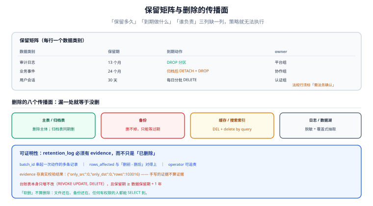

# 保留策略与合规删除

技术团队通常把「删除」当成一条 SQL，合规团队把它当成一次举证。两者之间的差距，就是这一页要填的坑：**保留多久、到期做什么、删完之后拿什么证明删干净了。**

## 判据族声明

本页判据族 `LC-A` ~ `LC-H`，共 8 条。定义表在第八节。

## 本页不讲什么

- 不讲归档怎么搬（搬运与校验），归 [在线归档](../OnlineArchive/index.md)。
- 不讲存储分层与成本，归 [冷热分层](../HotColdTiering/index.md)。
- 不讲数据分级分类的组织流程，归 [数据治理入门](/docs/DB/DataGovernance/index.md)。



## 一、保留矩阵：一张表回答四个问题

保留策略的最小可用形态是一张矩阵，每行一个数据类别，四列缺一不可：

| 数据类别 | 保留期 | 到期动作 | owner |
| --- | --- | --- | --- |
| 审计日志（`audit_log`） | 13 个月 | 第 13 个月 `DROP` 分区 | 平台组 |
| 业务事件（`board_events`） | 24 个月 | 第 25 个月归档后 `DETACH` + `DROP` | 协作组 |
| 用户会话（`session`） | 30 天 | 每日 `DELETE` 过期行 | 认证组 |
| 附件元数据 | 随业务对象 | 软删 30 天后硬删 | 存储组 |
| 支付流水 | 按财务要求（**需法务确认**） | 只归档不删除 | 财务系统 |

四点写法要求：

1. **保留期必须是「可计算的表达式」**，不能写「长期」。写「长期」等于没有策略，因为没人知道什么时候该删。
2. **到期动作必须是可执行的操作**（`DROP` / `DETACH` / `DELETE` / 归档），不能写「清理」。
3. **owner 必须是人或组**，不能写「DBA」——DBA 是角色，不是责任人。
4. **法规相关行必须标「需法务确认」**，技术文档不替代法律意见。

::: warning 两类常见的法规口径（需法务确认，非法律意见）
- **网络日志留存**：《中华人民共和国网络安全法》要求采取监测记录网络运行状态、网络安全事件的技术措施，并按规定留存相关的网络日志**不少于六个月**。落到技术上是「至少 6 个月、到期可删」，而不是「必须删」。
- **存储限制原则**：GDPR 第 5(1)(e) 条要求个人数据「以可识别的形式保存不超过实现处理目的所必需的期限」。落到技术上，**「永久保留」本身就是不合规**。

两者方向相反（一个要求「至少留」，一个要求「不能久留」），所以保留矩阵必须按**数据类别**分别写，不能一刀切。
:::

## 二、TTL 的三种实现

| 实现 | 做法 | 优点 | 缺点 |
| --- | --- | --- | --- |
| **分区 `DROP`** | 到期分区整个删掉 | 毫秒级、空间立刻归还、无膨胀 | 依赖分区；只能按分区键整段删 |
| **定时分批 `DELETE`** | 每批 5000 行，循环到删完 | 不依赖分区，可按任意条件删 | 慢、留膨胀、需要 `VACUUM`、要控制批次避免长事务 |
| **引擎内建 TTL** | MongoDB TTL 索引、Redis `EXPIRE`、ClickHouse `TTL` | 无需外部任务 | 粒度与语义受引擎限制；关系库没有通用方案 |

三条选择依据：

1. **能分区就分区**：`DROP` 是唯一「删了就把空间还回来」的方式。
2. **不能分区时用分批 `DELETE`**，且必须满足三条：单批 ≤ 5000 行、批间 sleep ≥ 50 ms、每批独立事务。一次删 100 万行会锁大量行、写满 WAL、把备库延迟拉起来。
3. **不要用「软删 + 定期硬删」当 TTL**：软删只是标记，数据还在库里、还在备份里，不满足「删除」。

本机实测的膨胀代价：删 93,046 行耗时 306.7 ms，表仍是 11 MB；`VACUUM` 103 ms 后降到 2080 kB。**每一轮定时删除都在制造一次膨胀与一次 `VACUUM`**，这是分批 `DELETE` 方案必须接受的固定成本。

## 三、软删不算删

「我们不物理删除，只把 `deleted_at` 填上」——这句话在合规语境下等于「我们没删」。

| 视角 | 软删的状态 |
| --- | --- |
| 应用查询 | 看不到（`WHERE deleted_at IS NULL`） |
| 数据库文件 | **完整保留**，可被任何有权限的人 `SELECT` |
| 备份 | 完整保留，且会随备份周期继续存在 |
| 合规审计 | **不构成删除**，无法举证 |

正确的软删定位是「**宽限期**」：软删 → 30 天宽限（可恢复）→ 硬删。宽限期的长度要有依据（误删恢复的平均时长），并且在矩阵里写明。

## 四、删除的传播面：八处都要过一遍

这是「删了但没删干净」的主要来源：

| 位置 | 为什么会有残留 | 处置 |
| --- | --- | --- |
| 主表 | —— | 删除的主体 |
| 归档表 / 冷层 | 归档时复制了一份 | 归档表同期删除，或在归档时就排除该主体 |
| 只读副本 | 流复制会自动同步 `DELETE` | 无需额外操作，但要确认副本没被延迟卡住 |
| **备份** | 备份是时点快照，删不掉历史备份里的那一份 | 只能等备份过期；要在矩阵里写明「备份保留期 = 数据保留期的上限」 |
| 缓存（Redis） | key 里带主体 ID | 删除时同步失效缓存（`DEL` 或按前缀扫） |
| **搜索索引**（ES） | 文档独立存储 | 发一条 `delete by query`，并验证文档数 |
| 日志平台 | 日志里可能有明文主体信息 | 按日志保留期自然过期；敏感字段应脱敏后再落盘 |
| 数据湖 / BI 抽取 | 每日全量抽取 | 下一轮抽取会覆盖；要确认抽取是「覆盖」不是「追加」 |

一条硬判据：**能列出「这个主体的数据分布在哪些系统」的人，必须存在**。列不出来，就谈不上删除。

## 五、按主体删除：分区的反例

分区表擅长「按时间删」，但合规请求往往是「按人删」——`DELETE FROM audit_log WHERE subject_id = ?`。这在按月分区的表上是**跨所有分区**的操作：

| 问题 | 表现 | 处置 |
| --- | --- | --- |
| 扫描全部 13 个分区 | 一次删除请求扫 13 个分区 | 在**每个分区**上建 `subject_id` 索引（父表索引会级联） |
| 长事务 | 一个事务删几千行、持锁到提交 | 按分区逐个删，每分区一个事务 |
| 归档里的那一份 | 已归档的分区不在父表里 | 归档表也要执行同样的删除（并记录） |
| 删除凭据 | 删完没人知道删了什么 | 写「删除台账」：主体、时间、涉及分区、影响行数 |

这也解释了为什么「按时间分区」与「按主体删除」天然冲突：分区键优化了时间维度，主体维度只能靠索引兜。**两个维度都要支持时，索引成本要提前算进去**（每个分区一个 `subject_id` 索引 × 13 个分区）。

## 六、可证明性：删除台账长什么样

```sql
CREATE TABLE retention_log (
  id           bigint GENERATED ALWAYS AS IDENTITY PRIMARY KEY,
  batch_id     uuid        NOT NULL,          -- 一次删除动作的标识
  subject_type text        NOT NULL,          -- 'tenant' | 'user' | 'partition'
  subject_id   text        NOT NULL,
  data_class   text        NOT NULL,          -- 对应保留矩阵的类别
  action       text        NOT NULL,          -- 'drop_partition' | 'delete_rows' | 'archive_then_drop'
  target       text        NOT NULL,          -- 'audit_log_202508' / 'audit_log'
  rows_affected bigint     NOT NULL,
  started_at   timestamptz NOT NULL,
  finished_at  timestamptz,
  operator     text        NOT NULL,          -- 人或系统
  evidence     jsonb       NOT NULL           -- 校验结果：差集计数、分区边界、备份批次
);
CREATE INDEX retention_log_subject_idx ON retention_log (subject_type, subject_id);
```

四个字段是关键：

- `batch_id`：一次删除可能涉及多个表/分区，用它把多条记录串成「一次动作」。
- `evidence`：存校验结果（例如 `{"only_src":0,"only_dst":0,"rows":103016}`）。**没有 evidence 的台账只是日志，不是证据。**
- `rows_affected`：删了多少行。这个数字要和「删前 count - 删后 count」对得上。
- `operator`：人或系统账号，用于追责。

`retention_log` 本身也要有保留期（通常 ≥ 数据保留期 + 1 年），且**只增不改**（`REVOKE UPDATE, DELETE`）。

## 七、如何验证

```shell
# ① 保留矩阵是否覆盖了所有大表（漏一张就是漏一类数据）
docker exec teamboard-sandbox-db-1 psql -U teamboard -d lab160 -tAc \
  "SELECT relname, pg_size_pretty(pg_total_relation_size(oid)) FROM pg_class
    WHERE relkind='r' AND pg_total_relation_size(oid) > 1024*1024 ORDER BY 2 DESC LIMIT 5"
```

**预期输出**：体积前 5 的表都能在保留矩阵里找到对应行。找不到的表就是「没人负责的数据」。

```shell
# ② 到期分区是否真的被删（不是只 DETACH）
docker exec teamboard-sandbox-db-1 psql -U teamboard -d lab160 -tAc \
  "SELECT count(*) FROM pg_class WHERE relname = 'ev_202501'"
```

**预期输出**：`0`。若为 1，说明只 `DETACH` 没 `DROP`——数据还在同一个库、同一块盘上，成本与合规都没解决。

```shell
# ③ 软删是否被当成了删除（残留行数）
docker exec teamboard-sandbox-db-1 psql -U teamboard -d lab160 -tAc \
  "SELECT count(*) FROM cards WHERE deleted_at IS NOT NULL
     AND deleted_at < now() - interval '30 days'"
```

**预期输出**：`0`。大于 0 说明宽限期后的硬删任务没跑，数据一直留着。

```shell
# ④ 删除台账是否有 evidence
docker exec teamboard-sandbox-db-1 psql -U teamboard -d lab160 -tAc \
  "SELECT count(*) FROM retention_log WHERE evidence = '{}'::jsonb"
```

**预期输出**：`0`。有记录但没有证据，等于只有「我说我删了」。

```shell
# ⑤ 搜索索引里的副本是否也删了（举例：按主体查文档数）
curl -s "http://localhost:9200/audit-*/_count" -H 'Content-Type: application/json' \
  -d '{"query":{"term":{"subject_id":"u_123"}}}'
```

**预期输出**：`{"count":0,...}`。大于 0 说明主库删了、索引还在。

```shell
# ⑥ 备份保留期是否 ≤ 数据保留期的上限（配置级检查）
grep -rn "retention\|keep_days\|expire_after" deploy/backup/ 2>/dev/null | head -5
```

**预期输出**：备份保留天数有明确配置，且能在矩阵里找到对应说明。备份留 90 天而数据保留 30 天，意味着「删掉的数据还能从备份恢复」——这未必违规，但必须写明。

```shell
# ⑦ 定时删除任务是否分批（避免长事务）
grep -rn "DELETE FROM" scripts/retention/ 2>/dev/null | grep -v "LIMIT"
```

**预期输出**：无输出（都带 `LIMIT`）。不带 `LIMIT` 的删除会在百万行表上锁住大量行。

```shell
# ⑧ 一次删除动作能否被追溯（按 batch_id 聚合）
docker exec teamboard-sandbox-db-1 psql -U teamboard -d lab160 -tAc \
  "SELECT batch_id, count(*) AS steps, sum(rows_affected) AS rows
     FROM retention_log GROUP BY batch_id ORDER BY 1 DESC LIMIT 3"
```

**预期输出**：每个 `batch_id` 有多条步骤记录，总和与预期一致。只有一个步骤且无 `evidence` 的记录不可信。

## 八、判据族定义

| 判据 | 规则 | 违反时的样子 | 验证方式 |
| --- | --- | --- | --- |
| `LC-A` | 每类数据必须有「保留期 + 到期动作 + owner」三要素 | 到期没人删、删了没人认 | 命令 ① |
| `LC-B` | 到期动作必须可执行，禁止写「长期」「清理」 | 策略存在但无法执行 | 命令 ① |
| `LC-C` | 能分区就用 `DROP`，不能分区才用分批 `DELETE`（单批 ≤ 5000 行） | 一次删百万行，长事务 + 备库延迟 | 命令 ⑦ |
| `LC-D` | 软删只作为宽限期手段，必须配置宽限后的硬删 | 数据「看起来删了」，文件里全在 | 命令 ③ |
| `LC-E` | 删除必须覆盖八处传播面（归档、缓存、索引、湖、日志等） | 主库删了，搜索结果还能查到 | 命令 ⑤ |
| `LC-F` | 按主体删除必须在每个分区上有对应索引，并逐分区提交 | 一次请求扫 13 个分区、持锁数分钟 | 见第五节 |
| `LC-G` | 每次删除必须写台账，且含 `evidence` 与 `rows_affected` | 只有「已删除」的口头结论 | 命令 ④⑧ |
| `LC-H` | 备份保留期必须与数据保留期对齐并在矩阵中说明 | 删了数据却能从备份恢复，合规结论自相矛盾 | 命令 ⑥ |

::: info 诚实标注
本页的法规表述为**技术落地视角的概括，不构成法律意见**，具体期限与适用范围须由法务确认（已在上文标注）。膨胀与 `VACUUM` 读数来自本机 PostgreSQL 18.6 实测；「单批 ≤ 5000 行」是工程经验值，不是标准，实际应按行宽与索引数量调整。第八条判据的「备份」一项，PostgreSQL 的 `pg_dump` / PITR 归档都无法「定向删除某个主体的历史备份」，这是备份技术的固有限制，只能靠备份过期解决。
:::

## 参考资料

- [PostgreSQL · Routine Vacuuming](https://www.postgresql.org/docs/18/routine-vacuuming.html)——`DELETE` 与空间回收的真实关系
- [PostgreSQL · REVOKE](https://www.postgresql.org/docs/18/sql-revoke.html)——把台账表设为只增不改
- [PostgreSQL · Table Partitioning](https://www.postgresql.org/docs/18/ddl-partitioning.html)——`DROP` 分区作为 TTL 手段
- [GDPR · Art. 5 Principles](https://gdpr-info.eu/art-5-gdpr/)——存储限制原则（storage limitation）
- [中华人民共和国网络安全法](https://www.gov.cn/xinwen/2016-11/07/content_5129723.htm)——网络日志留存的相关要求（具体适用需法务确认）
- 本站 [数据治理入门](/docs/DB/DataGovernance/index.md) · [备份与恢复](/docs/DB/Relational/PostgreSQL/BackupRestore/index.md)
- 相邻：[在线归档](../OnlineArchive/index.md) · [实战](../Practice/index.md)
