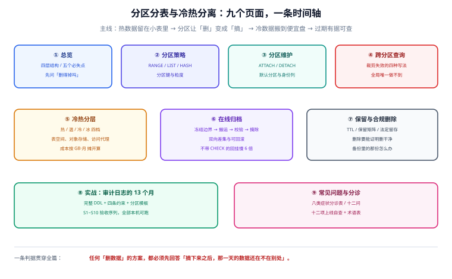

# 分区分表与冷热分离

大多数团队做分区，动机都是「表太大了，查得慢」。做完之后往往发现查询没快多少，反而多了一堆维护脚本——因为**分区从来不是查询优化手段**。它真正解决的是另外三件事：**删得掉**（把 `DELETE 8000 万行` 换成一次毫秒级的元数据操作）、**搬得走**（把冷数据整段挪到便宜存储上，SQL 不用改）、**算得清**（每个分区多大、多久没被访问、该留到什么时候，一目了然）。

本专题讲的就是这条时间轴：**热数据留在小表里 → 分区让「删」变成「摘」→ 冷数据搬到便宜盘 → 过期有据可查**。中间会大量用到本机 PostgreSQL 18.6 的实测数字，因为这一层最容易被「看起来应该很快」骗过去。

::: tip 一句话理解
分区的价值不在 `SELECT` 快了多少，而在 **`DROP` / `DETACH` 从「小时级、锁表、留下膨胀」变成「毫秒级、几乎不锁、空间立刻归还」**。如果你的删除压力不大、也没有冷热成本差异，那么分区只会给你增加维护负担。
:::

## 与相邻专题的分工

「分区分表」「分库分表」「冷热分离」「归档」四个词经常混着用，边界必须先写死：

| 专题 | 讲什么 | 与本专题的关系 |
| --- | --- | --- |
| 本专题 | **单库内的数据生命周期**：原生分区、分区维护、裁剪失效、冷热分层、在线归档、保留与合规删除 | —— |
| [分库分表](/docs/DB/Relational/Sharding/index.md) | **跨库跨实例**的拆分：分片键、分布式 ID、ShardingSphere、跨分片查询、平滑迁移 | 那边解决「一台机器放不下」，本专题解决「一台机器上放得下但删不动、搬不走」；**先分区，实在不行再分片** |
| [PostgreSQL 高级特性](/docs/DB/Relational/PostgreSQL/Advanced/index.md) | 声明式分区的**语法入门**：`PARTITION BY RANGE` / `LIST` / `HASH`、建分区、简单裁剪 | 那边是「怎么写出来」，本专题是「**为什么这么选、写错会怎样、怎么验证没坏**」 |
| [ClickHouse 分区与索引](/docs/DB/ClickHouse/PartitionIndex/index.md) | OLAP 引擎的分区目录（`PARTITION BY toYYYYMM()`）+ 主键索引 | 那边的分区是 **MergeTree 的目录单位**，月分区数控制在几十个；本专题讲 OLTP 行存的分区，约束完全不同（唯一键、外键、并发 DDL） |
| [B+ 树原理](/docs/DB/DatabaseInternals/BPlusTree/index.md) | 页、树高、分裂、填充因子 | 分区是**多棵小树**而不是一棵大树——树高从 4 降到 3 的收益在这里能算出来 |
| [SQL 优化 · 分页](/docs/DB/Relational/SQLOptimization/Pagination/index.md) | 深分页、游标分页 | 分区表的深分页会退化成「每个分区各翻一遍」，本专题的 [跨分区查询](./CrossPartition/index.md) 给实测 |
| [缓慢变化维与拉链表](/docs/DB/DataWarehouse/SCD/index.md) | 历史版本建模（拉链、快照） | 那边用**表结构**保存历史，本专题用**分区 + 归档**保存历史；两者可以叠加（归档分区里放拉链表） |
| [时序库存储与保留策略](/docs/DB/TimeSeries/Storage/index.md) | TTL、降采样、保留期 | 时序库把「保留期」做成了引擎内建能力；本专题讲**通用关系库**怎么用分区 + 定时任务做到同一件事 |
| [数据治理入门](/docs/DB/DataGovernance/index.md) | 元数据、血缘、质量、标准 | 治理回答「这条数据归谁、能不能删」，本专题回答「**怎么删、删完怎么证明**」 |
| [数据同步与 CDC](/docs/DB/CDC/index.md) | binlog 订阅、增量同步 | 归档到另一个库/湖时，CDC 是「持续小批量」路线，本专题的 [在线归档](./OnlineArchive/index.md) 是「按分区整段搬」路线，两者取舍写在那一页 |
| [在线协作任务看板 · 数据库设计](/project/Complete/TeamBoard/Database/index.md) | 上述原则在真实项目里的落地：`audit_log` 按月分区、`cards` 的索引与唯一键 | 那边是**施工**，本专题是**判据**；`audit_log` 的 13 个月生命周期是两边共同的验收对象 |

## 专题地图

| 页面 | 内容 | 适合谁读 |
| --- | --- | --- |
| [总览：四层结构与五个必失点](./Overview/index.md) | 表内分区 / 冷热分层 / 归档 / 删除四层分工；五个「看起来做了其实没做」的失效；五问决策树 | 所有人，先读 |
| [分区策略：分区键与粒度](./PartitionStrategy/index.md) | `RANGE` / `LIST` / `HASH` 的适用面、分区键选错的四种后果、粒度与分区数的量化上界 | 要建表的人，**重点读** |
| [分区维护：ATTACH、DETACH 与默认分区](./PartitionOps/index.md) | 日常运维操作、默认分区的锁代价、身份列不能带进分区、统计信息与 `VACUUM` 的继承行为 | DBA 与写迁移脚本的人，**重点读** |
| [跨分区查询：裁剪为什么没生效](./CrossPartition/index.md) | 四种写法实测（1 / 12 / 12 / 12 个分区）、全局唯一做不到、分区级连接与聚合、深分页退化 | 写 SQL 的人，**必读** |
| [冷热分层：四档存储与成本账](./HotColdTiering/index.md) | 热 / 温 / 冷 / 冰的判定维度、表空间与对象存储、透明访问的三种做法、按 GB·月 算账 | 做成本优化的人 |
| [在线归档：不停机搬走一段历史](./OnlineArchive/index.md) | 冻结边界 → 搬运 → 双向校验 → 摘除、幂等与回滚、`CHECK` 约束让回挂快 6 倍 | 要落地归档的人，**重点读** |
| [保留策略与合规删除](./RetentionCompliance/index.md) | 保留矩阵、TTL 的三种实现、硬删与软删、备份里的那份、删除的可证明性 | 合规、安全、架构评审 |
| [实战：审计日志的 13 个月](./Practice/index.md) | 完整 DDL + 四条约束 + 分区模板 + 定时任务 + S1~S10 验收序列（全部本机可跑） | 要照着做的人 |
| [常见问题与分诊](./FAQ/index.md) | 八类症状分诊表、十二问、十二项上线自查、术语表 | 所有人 |

## 四条底层判断（先记住这四句）

| 判断 | 含义 | 违反它的典型后果 |
| --- | --- | --- |
| **分区不加速全表扫描** | 全表 `count(*)` 反而略慢（本机实测 62.6 ms → 69.1 ms），因为要跨 11 个分区做 `Append` | 为「查询快」上分区，上线后发现没变化，却多了一套维护脚本 |
| **分区是「删」的基础设施** | `DELETE 9.3 万行` 306.7 ms 且空间不还；`DETACH` 一个 10 万行分区 2.7 ms 且空间立刻归还 | 用 `DELETE` 清历史：表越来越大、膨胀越来越重、`VACUUM` 越跑越久 |
| **冷热分层不改 SQL，改的是存放位置** | `SET TABLESPACE` 之后查询语句一个字都没变，只是文件落到了另一块盘上 | 把冷数据搬到「另一个库」，结果所有查询都要改 `UNION`，半年后没人敢动 |
| **归档必须先能证明「两边一致」** | 双向差集为 0 才能摘；摘掉之后原表不该再有那段数据 | 先删后搬、或搬完没校验：数据静默丢失，等审计来了才发现 |

## 成熟度五档

数据生命周期这件事最容易「上到一半」：建了分区表、也按月建了分区，但**从来没人验证过裁剪有没有生效、删掉的数据是否还在别处**。按下面五档对照：

| 档位 | 特征 | 只补一件事 |
| --- | --- | --- |
| L0 | 单张大表，历史数据靠 `DELETE ... WHERE created_at < ?` 清 | 改成按月 `RANGE` 分区，把删除换成 `DETACH`，见 [分区策略](./PartitionStrategy/index.md) |
| L1 | 有分区表，但查询里写 `date_trunc('month', created_at) = ?` | 改成**裸列 + 半开区间**，否则裁剪永远失效，见 [跨分区查询](./CrossPartition/index.md) |
| L2 | 裁剪正确，但分区靠手工 `CREATE TABLE`，经常忘记建下个月 | 引入**分区模板 + 定时预建**（提前 2~3 个月），见 [分区维护](./PartitionOps/index.md) |
| L3 | 分区自动建、旧分区自动摘，但摘下来的表还躺在同一个库的默认表空间里 | 做 [冷热分层](./HotColdTiering/index.md)：`SET TABLESPACE` 到便宜盘，或导出到对象存储 |
| L4 | 分层做完，但「留多久、谁能删、删完怎么证明」还是口头约定 | 落 [保留矩阵与合规删除](./RetentionCompliance/index.md)：每条保留期有 owner、有到期动作、有审计记录 |

## 判据族总览

九个页面各八条，共 **72** 条。写法统一为「规则 + 违反时的样子 + 怎么验证」，验证一节给出可执行命令与预期读数。

| 页面 | 判据族 | 覆盖的约定 | 条数 |
| --- | --- | --- | --- |
| [总览](./Overview/index.md) | `PL-A` ~ `PL-H` | 四层分工、五个必失点、决策树 | 8 |
| [分区策略](./PartitionStrategy/index.md) | `PS-A` ~ `PS-H` | 类型选择、分区键、粒度、分区数上界 | 8 |
| [分区维护](./PartitionOps/index.md) | `PO-A` ~ `PO-H` | ATTACH/DETACH、默认分区、统计信息 | 8 |
| [跨分区查询](./CrossPartition/index.md) | `PQ-A` ~ `PQ-H` | 裁剪、全局唯一、连接与聚合、深分页 | 8 |
| [冷热分层](./HotColdTiering/index.md) | `HT-A` ~ `HT-H` | 判定维度、存储档位、透明访问、成本 | 8 |
| [在线归档](./OnlineArchive/index.md) | `OA-A` ~ `OA-H` | 冻结边界、搬运、校验、回滚 | 8 |
| [保留与合规删除](./RetentionCompliance/index.md) | `LC-A` ~ `LC-H` | 保留矩阵、TTL、硬删软删、可证明性 | 8 |
| [实战](./Practice/index.md) | `PP-A` ~ `PP-H` | 审计日志 13 个月全流程 | 8 |
| [常见问题](./FAQ/index.md) | `PA-A` ~ `PA-H` | 分诊、自查、术语 | 8 |

## 事实与版本速览（2026-10 核对）

| 事实 | 口径 | 出处 |
| --- | --- | --- |
| PostgreSQL **18.0** 发布于 **2025-09-25**，当前小版本 **18.6**（2026-08-13） | 本机实测即 18.6 | 官方 release notes / pgPedia |
| PostgreSQL **18** 起 `VACUUM` / `ANALYZE` **默认处理继承子表**，旧行为需写 `ONLY` | 直接影响「分区表怎么清理」 | PG 18 release notes（不兼容项） |
| PostgreSQL **18** 起**禁止**创建或改成 `UNLOGGED` 分区表 | 迁移脚本里别写 `SET UNLOGGED` | 同上 |
| PostgreSQL **14** 起支持 `DETACH PARTITION ... CONCURRENTLY`，**但有默认分区时不可用** | 本机实测报错原文见 [分区维护](./PartitionOps/index.md) | PG 文档 + 本机实测 |
| MySQL **8.4**：分区表达式用到的列**必须包含在每个唯一键里**（含主键），否则 `ERROR 1491` | 建表阶段的硬约束 | MySQL 8.4 手册 26.6.1 |
| MySQL 8.4：分区 InnoDB 表**不支持外键** | 有外键的表要分区，得先拆约束 | MySQL 8.4 手册 26.1 |
| ClickHouse 的 `PARTITION BY` 是**目录单位**，月分区控制在几十个量级 | 与本专题的 OLTP 分区不是一回事 | 本站 ClickHouse 专题 |

::: warning 关于「版本目录」
本专题**不建版本目录**（没有 `v1/`、`v2/` 之类的并存版本），理由三条：① 分区语法在不同大版本间是**增量**变化（PG 10 引入声明式分区、11 加默认分区与执行期裁剪、12 加计划期裁剪、14 加并发摘除），同一套判据可以覆盖多版本，只需标注「最低版本」；② 版本差异已经收敛进上表的「最低版本」一列，拆目录会让同一条判据出现两份；③ 真正的并存版本差异属于**具体数据库专题**（[PostgreSQL](/docs/DB/Relational/PostgreSQL/index.md) 与 [MySQL](/docs/DB/Relational/MySQL/index.md) 各自维护），本专题只讲两者共有的生命周期模型。
:::

## 学习路径

1. **先读总览**，把四层分工和「五个必失点」记住——后面八页都是在补这五处的细节。
2. **建表前读分区策略**：分区键一旦定了，改它的代价接近重建整张表。
3. **上线前跑一遍跨分区查询的六条命令**：裁剪是否生效是唯一能在本地证伪的东西，别等线上慢查询报警。
4. **要清历史就读归档**，别直接写 `DELETE`——两页的差别是「2.7 毫秒」和「306 毫秒 + 一次 `VACUUM`」。
5. **合规同学参与时读保留与合规删除**：这一页的判据不是技术判据，是「能不能拿出证据」的判据。

## 三条最容易踩的坑

::: danger 三个会静默失效的写法
1. **查询里对分区键做函数或类型转换**：`WHERE date_trunc('month', ts) = ?`、`WHERE ts::date = ?`、`WHERE extract(month from ts) = 3` —— 三种写法全部扫 12 个分区（本机实测），而**执行计划里不会报错、结果也完全正确**，只是慢 5 倍。
2. **只给下界不给上界**：`WHERE ts >= '2026-03-01'` 看起来「只查三月以后」，实际扫了 10 个分区（往后的全扫）。裁剪只认**闭区间**。
3. **以为分区表能建全局唯一索引**：`CREATE UNIQUE INDEX ON ev (id)` 直接报错 `unique constraint on partitioned table must include all partitioning columns`。想在分区表上保住「业务主键唯一」，只能把分区键带进唯一键（`UNIQUE (id, ts)`），并接受「同一 `id` 在不同月份可以重复」这个事实——这一点必须在设计阶段就和业务对齐。
:::

## 参考资料

- [PostgreSQL 18 · Release Notes](https://www.postgresql.org/docs/18/release-18.html)——`VACUUM` 处理继承子表、禁止 `UNLOGGED` 分区表等不兼容项
- [PostgreSQL · Table Partitioning](https://www.postgresql.org/docs/18/ddl-partitioning.html)——声明式分区、裁剪、默认分区、`DETACH ... CONCURRENTLY` 的限制
- [PostgreSQL · ALTER TABLE](https://www.postgresql.org/docs/18/sql-altertable.html)——`ATTACH PARTITION` 的校验规则与 `SET TABLESPACE`
- [MySQL 8.4 · Partitioning Keys, Primary Keys, and Unique Keys](https://dev.mysql.com/doc/refman/8.4/en/partitioning-limitations-partitioning-keys-unique-keys.html)——唯一键必须包含分区列（`ERROR 1491`）
- [MySQL 8.4 · Partitioning Overview](https://dev.mysql.com/doc/refman/8.4/en/partitioning-overview.html)——分区 InnoDB 表不支持外键
- 本站 [分库分表](/docs/DB/Relational/Sharding/index.md) · [PostgreSQL 高级特性](/docs/DB/Relational/PostgreSQL/Advanced/index.md) · [ClickHouse 分区与索引](/docs/DB/ClickHouse/PartitionIndex/index.md)
- 相邻：[总览](./Overview/index.md) · [实战](./Practice/index.md) · [常见问题](./FAQ/index.md)
