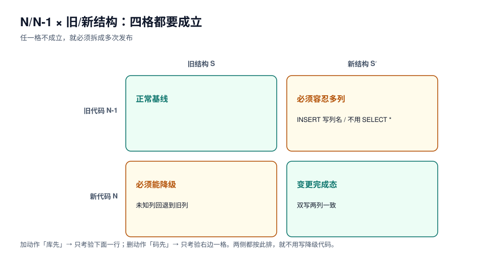

# 应用兼容：N/N-1 矩阵与回滚边界

滚动发布意味着有几分钟到几十分钟，线上**同时跑着两个版本的代码，而表结构只有一种**。这段窗口里能不能不出错，不取决于 DDL 写得多好，而取决于代码有没有为「两种结构」都留路。

本页把这件事做成一张 2×2 矩阵，并给出「哪种变更永远不会兼容」的清单。



## 一、2×2 矩阵：四种组合，逐格判定

记「旧代码」为 N-1、「新代码」为 N；「旧结构」为 S、「新结构」为 S'。发布过程中会经过的四种组合：

| 组合 | 什么时候出现 | 必须成立的条件 | 典型失败现象 |
| --- | --- | --- | --- |
| N-1 + S | 变更前 | —— | —— |
| N-1 + S' | **先改库、后发版**；或回滚了代码 | 旧代码不认识新列时必须不报错 | `Unknown column`、`INSERT` 列数不匹配、`SELECT *` 映射错位 |
| N + S' | 变更完成后 | —— | —— |
| N + S | **先发版、后改库**；或回滚了库 | 新代码容忍旧结构缺失 | 新代码写不存在的列、读不到列导致空指针 |

**任何一次变更，只要它的四种组合里有一格不成立，就必须拆成多次发布。** 这就是 [扩展-收缩](../ExpandContract/index.md) 的全部理由。

## 二、旧代码遇到新结构：三种写法会炸

### 1. `INSERT` 不写列名

```sql
-- 旧代码（错）：加列之后直接报错
insert into orders values (?, ?, ?, ?);
-- ERROR 1136: Column count doesn't match value count at row 1
```

```sql
-- 正确：永远写列名
insert into orders (id, user_id, amount, status) values (?, ?, ?, ?);
```

### 2. `SELECT *` + 位置映射

```java [LegacyMapper.java]
// 旧代码（错）：按列序号取值，加一列就整体错位
Long id = rs.getLong(1);
Long amount = rs.getLong(2);
String status = rs.getString(3);   // 加列后这里可能拿到别的列
```

```java [LegacyMapper.java]
// 正确：按列名取值
Long id = rs.getLong("id");
Long amount = rs.getLong("amount");
String status = rs.getString("status");
```

### 3. `NOT NULL` 且无默认值的新列

旧代码 `INSERT` 时不会写这一列，于是：

- MySQL 严格模式下 → `ERROR 1364: Field 'channel' doesn't have a default value`；
- 非严格模式 → 写入空串/0，**比报错更糟**。

::: danger 这就是「加列必须可空」的真正原因
不是为了「回填方便」，而是为了**旧代码还能写**。可空列对旧代码完全透明；非空 + 默认值也能兼容（旧代码不写时用默认值），但**非空且无默认值**在滚动发布期间必然失败。

结论：expand 阶段的新列，只有两种合法形态——**可空**，或**非空 + 常量默认值**。
:::

## 三、新代码遇到旧结构：三种降级写法

这个方向常被忽略，因为「新代码当然认识新列」。但发布顺序反过来，或数据库回滚时就会遇到：

```java [OrderMapper.java]
// 新代码写新列时，必须能降级到旧列（expand 阶段）
try {
    jdbc.update("update orders set amount = ?, amount_cents = ? where id = ?", cents, cents, id);
} catch (SQLException e) {
    if (isUnknownColumn(e)) {           // 1054 / 42703
        jdbc.update("update orders set amount = ? where id = ?", cents, id);
    } else {
        throw e;
    }
}
```

这段代码不好看，但它是「先发版、后改库」唯一安全的写法。**更好的答案是不要「先发版、后改库」**——见下一节。

## 四、部署顺序：三种排法，只有一种通用

| 排法 | 过程 | 适用 | 风险 |
| --- | --- | --- | --- |
| 库先、码后 | 先 expand（只加）→ 再发新版代码 | **通用推荐** | 窗口内旧代码遇到新结构，需要旧代码容忍加法（通常没问题） |
| 码先、库后 | 先发兼容两版的代码 → 再改库 | 需要代码能降级（上一节那种 `try/catch`） | 代码复杂度上升，容易漏 |
| 同时 | 停机发布 | 小系统、有维护窗口 | 停顿即故障，不可用于 7×24 |

::: tip 一句话规则
**加动作（expand）永远「库先」；删动作（contract）永远「码先」。** 因为「加」对旧代码无害，「删」对新代码致命。两侧都按这个规则排，就不需要写上面那种 `try/catch`。
:::

## 五、回滚边界：代码能回，数据回不去

发布回滚有个隐含假设：**代码回滚后，系统回到之前的状态**。改表打破了这个假设。

| 操作 | 代码回滚后 | 能否只靠回滚恢复 |
| --- | --- | --- |
| 加可空列 | 旧代码不写它，新代码写的值留着 | 能（数据留着无害） |
| 加非空列 + 默认值 | 旧代码写入走默认值 | 能 |
| 回填数据（回填写的是新列） | 新列值留着 | 能（但旧列可能是旧的） |
| 改列类型（`int → bigint`） | 类型已变，旧代码可能溢出/精度不符 | **不能**，要反向 DDL（又是一次重写） |
| 删除列 | 数据没了 | **不能**，只能恢复备份 |
| 改列名 | 旧代码找不到列 | **不能**，要么改回名字（再发一次） |

::: danger 「回滚脚本」这个词很危险
变更单里写「回滚：执行 rollback.sql」的，多数没有验证过。`DROP COLUMN` 的反向操作**不是** `ADD COLUMN`——加回来的是空列，数据在备份里。

判据：**回滚脚本必须在影子库跑通过一次，并记录耗时与数据丢失范围**。跑不通的，就老老实实写「恢复备份，RTO = X 分钟」。
:::

## 六、不可兼容的变更清单

以下操作**没有**能让新旧代码同时工作的写法，只能靠停机或三段式绕开：

| 操作 | 为什么不可兼容 | 绕法 |
| --- | --- | --- |
| 改列名 | 一个名字不能同时指向两列 | 加新列 + 双写 + 回填 + 切换 + 删旧列 |
| 类型收窄（`bigint → int`） | 旧值可能越界 | 先校验取值范围，再在维护窗口做 |
| 删除列 | 数据不可恢复 | 先停写 + 观察一个周期，再删 |
| 拆分表（1 表 → 2 表） | 事务边界变了 | 双写两表 + 读切换 + 停写旧表 |
| 合并表 | 主键语义变了 | 同上，且要处理主键冲突 |
| 改主键 | 所有外键、索引、游标分页全受影响 | 几乎总是「新表 + 迁移 + 切换」，当作新项目做 |

## 七、验证矩阵：四条断言覆盖四格

发布前用四条断言把矩阵填满，全部可自动化：

```sql
-- 断言 1（N-1 + S'）：旧代码的写入在加了新列之后仍然成功
insert into orders (id, user_id, amount, status) values (900001, 1, 100, 'created');
select count(*) from orders where id = 900001;   -- 期望 1

-- 断言 2（N-1 + S'）：旧代码的读取不因多列而错位（按列名取值的验证）
select id, amount, status from orders where id = 900001;

-- 断言 3（N + S）：新代码在旧结构上能降级（结构回滚后跑一次）
-- 由契约测试覆盖：同一份请求在「无新列」的表结构上必须 200

-- 断言 4（N + S'）：新代码在新结构上正常，且双写两列一致
select count(*) from orders where amount <> amount_cents;   -- 期望 0
```

## 八、本页判据

| 编号 | 判据 | 看什么现象 | 不满足时改哪里 |
| --- | --- | --- | --- |
| `SCA-A` | 2×2 四格逐格判定过 | 变更单有四行结论 | 补；缺一格就拆发布 |
| `SCA-B` | 旧代码的 `INSERT` 写了列名 | 代码检索 `insert into ... values` | 改；列数不匹配是必然 |
| `SCA-C` | 读取按列名而非序号 | 代码检索 `getLong(1)` | 改；`SELECT *` 是隐患 |
| `SCA-D` | expand 新列是可空或「非空 + 常量默认」 | DDL 形态 | 改；否则旧代码写不进去 |
| `SCA-E` | 部署顺序符合「加：库先；删：码先」 | 发布步骤顺序 | 调顺序；避免写降级代码 |
| `SCA-F` | 回滚脚本在影子库验证过 | 脚本 + 耗时 + 数据丢失范围 | 补验证；跑不通就写「恢复备份」 |
| `SCA-G` | 不可兼容清单里的操作有专门方案 | 有「新表 + 切换」等设计 | 补设计；不许硬上 |
| `SCA-H` | 四条断言进了 CI 或发布检查单 | 测试名/检查项 | 接 CI；人工点检会漏 |

## 参考资料

- Martin Fowler: *ParallelChange*、*BlueGreenDeployment*
- MySQL 8.4 Reference Manual: *Server SQL Modes*（严格模式下 `NOT NULL` 无默认值的行为）
- PostgreSQL 18 Documentation: *ALTER TABLE*、*Concurrency Control*
- [扩展-收缩](../ExpandContract/index.md)：本页矩阵对应的操作方法
- [实战](../Practice/index.md)：四条断言在真实变更里的落地
