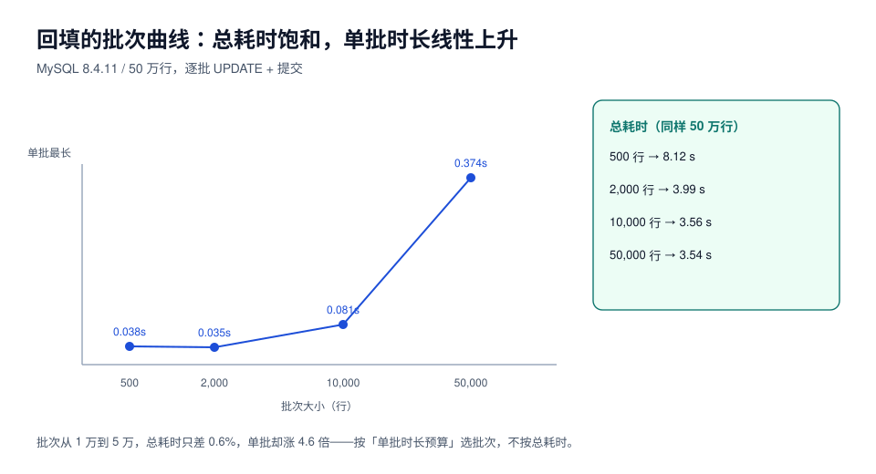

# 数据回填：批次、水位与速率控制

表结构改完只是「容器变了」，数据还在旧列里。回填（backfill）是把历史数据搬到新结构的那一步，也是唯一一个**会同时制造大量 undo/redo、把从库拖慢、还可能覆盖用户新数据**的步骤。

本页给三个东西：批量大小的实测曲线、可中断续跑的水位设计、以及「回填完了」的可验证判据。



## 一、先看两条实测曲线

### MySQL 8.4：50 万行，`payload` 不建索引，逐批 `UPDATE` + 提交

| 批次 | 批次数 | 总耗时 | 单批最长 | 折算速率 |
| --- | --- | --- | --- | --- |
| 500 | 1,000 | 8.12 s | **0.038 s** | 6.2 万行/s |
| 2,000 | 250 | 3.99 s | 0.035 s | 12.5 万行/s |
| 10,000 | 50 | **3.56 s** | 0.081 s | 14.0 万行/s |
| 50,000 | 10 | 3.54 s | **0.374 s** | 14.1 万行/s |

### PostgreSQL 18：100 万行，同样逐批 `UPDATE` + `COMMIT`

| 批次 | 批次数 | 总耗时 | 单批最长 | 折算速率 |
| --- | --- | --- | --- | --- |
| 1,000 | 1,000 | 13.66 s | 0.153 s | 7.3 万行/s |
| 5,000 | 200 | 21.03 s | **1.216 s** | 4.8 万行/s |
| 20,000 | 50 | 16.73 s | 0.549 s | 6.0 万行/s |
| 50,000 | 20 | 16.06 s | 0.993 s | 6.2 万行/s |

::: tip 两张表说的是同一件事
**批次放大到一定程度后，总耗时不再下降，但单批持锁时间线性上升。** MySQL 从 1 万到 5 万，总耗时只差 0.02 s（0.6%），单批却从 81 ms 涨到 374 ms（4.6 倍）；PG 从 2 万到 5 万，总耗时几乎不变，单批从 549 ms 涨到 993 ms。

所以批次大小不该按「总耗时最短」来选，而该按**「单批时长 ≤ 你的延迟预算」**来选。预算 100 ms 时，MySQL 选 1 万，PG 选 2 万——这两个值都在「总耗时已经饱和」的区间里。
:::

::: warning 读数说明
上表的「单批最长」包含事务提交与检查点抖动，PG 5,000 那条 1.216 s 就是一次检查点叠上去的结果——**同一批次大小重复跑，最长值会波动**，所以预算要按最长值算，不是平均值。另外两台容器共享同一台机器的 CPU 与磁盘，绝对值只用于横向比较。
:::

## 二、分页要用「键集」，不要用 `OFFSET`

```sql
-- 错：OFFSET 越翻越慢，且回填期间插入会导致漏行/重复
select id from orders order by id limit 1000 offset 900000;

-- 对：键集分页（keyset pagination），每批从上一批的最后一个 id 之后开始
select id from orders where id > :last_id order by id limit 1000;
```

`OFFSET` 在回填场景是**双重错误**：① 它要扫过前 N 行才能丢掉，越到后面越慢；② 回填期间如果有更小的 id 插入（自增回填、手工导入），行会整体位移，导致**某些行被跳过**。

键集分页的代价是「只能按有序键扫」，但这正好是回填需要的：**按主键顺序扫一遍，天然不重不漏**。

## 三、水位：让回填可以中断、可以重跑

「水位（watermark）」就是「我处理到哪了」的持久记录。三档实现，按可靠性递增：

| 做法 | 写法 | 中断后 | 适用 |
| --- | --- | --- | --- |
| 无状态 | 每次从 `min(id)` 开始，靠 `where new_col is null` 过滤 | 重跑安全但会重复扫已填行 | 小表、一次性 |
| 内存水位 | 进程变量 | 中断丢失，从头来 | 临时脚本，不推荐 |
| **持久水位** | 单独一张 `backfill_progress(task, last_id, updated_at)` | 从 `last_id` 续跑 | 大表、必须可中断 |

```sql
-- 水位表（MySQL 与 PG 通用写法）
create table backfill_progress (
  task       varchar(64) primary key,
  last_id    bigint      not null default 0,
  total_done bigint      not null default 0,
  updated_at timestamp   not null default current_timestamp
);
```

```sql
-- 每一批：更新数据 + 推进水位，放在同一个事务里
begin;
update orders set channel = 'web'
 where id > :last_id and id <= :next_id and channel is null;
insert into backfill_progress(task, last_id, total_done)
values ('orders.channel', :next_id, :done)
on duplicate key update last_id = values(last_id), total_done = values(total_done), updated_at = now();
commit;
```

::: danger 水位与数据必须同事务
如果「先更新数据、再更新水位」分两个事务，中间崩溃会导致**水位落后于数据**——重跑是安全的（因为有 `channel is null` 过滤）；反过来「先更新水位、再写数据」就会**跳过一批**，静默丢数据。

判据只有一句：**幂等的过滤条件 + 同事务推进水位**，两者缺一不可。
:::

## 四、回填必须幂等：三条防线

1. **过滤条件幂等**：`where channel is null`——重跑时已填的行不会被再写一次；
2. **写入幂等**：`update ... set channel = 'web' where id = ?` 天然幂等（同一个值写两次结果相同）；如果回填值依赖别的表（如「按订单类型推 channel」），要把推导逻辑写成**确定性函数**，不能带 `now()`、`random()`；
3. **可对账**：留一张「回填结果快照」或至少留 `updated_at` 区间，事后能回答「这批行是谁改的」。

```sql
-- 对账：回填值与来源表是否一致（以「渠道由首笔支付方式决定」为例）
select count(*) as mismatch
from orders o join payments p on p.order_id = o.id and p.seq = 1
where o.channel <> p.channel_code;
```

## 五、速率控制：别把从库拖死

回填是**写放大**操作。MySQL 上它产生 undo + redo + binlog；PG 上它产生新行版本（旧版本变死元组）。

PG 的膨胀实测（100 万行表，四轮共 400 万次 `UPDATE`）：

| 指标 | 回填前 | 回填后 | `VACUUM` 后 |
| --- | --- | --- | --- |
| 表总大小 | 171 MB | **559 MB（3.27×）** | 559 MB（**不缩小**） |
| 死元组 | — | 3,965,421 | 0 |

::: danger PG 上最反直觉的一条
`VACUUM` 把死元组标记为可复用，但**不把空间还给操作系统**——表文件仍然是 559 MB。要真正缩小只有 `VACUUM FULL`（重写全表 + 持 `ACCESS EXCLUSIVE`）或 `pg_repack`。

所以回填前要算的不是「回填多久」，而是「**回填后表会变成多大**」：单表单轮全表更新 ≈ 原体积 × 2~3。磁盘不够时，回填会以「磁盘满」的方式失败。
:::

MySQL 侧的对应控制：

| 控制项 | 手段 | 建议 |
| --- | --- | --- |
| 单批时长 | 批次大小 + `chunk-time` 思路 | 单批 ≤ 100 ms（见上表） |
| 批间间隔 | `select sleep(0.05)` | 给复制留追赶时间 |
| 复制延迟 | `pt-heartbeat` 或 `Seconds_Behind_Master` | 超阈值自动暂停 |
| 写入放大 | 只更必要的列，不写宽表整行 | 避免 `update ... set a=?, b=?, c=?` 全量覆盖 |

```shell
# 用 pt-heartbeat 做「延迟超阈值就停」的看门狗（回填脚本每批前检查）
pt-heartbeat --host=127.0.0.1 --database=heartbeat --update --daemonize
pt-heartbeat --host=127.0.0.1 --database=heartbeat --monitor --master-server-id=1
```

## 六、「回填完了」怎么证明

三条读数，缺一条都不算完成：

```sql
-- 1) 目标列没有 NULL（或没有「未填」的哨兵值）
select count(*) from orders where channel is null;

-- 2) 与来源一致（有来源表时）
select count(*) from orders o join payments p on p.order_id = o.id and p.seq = 1
where o.channel <> p.channel_code;

-- 3) 水位推到了终点，且没有跳过区间
select task, last_id, total_done from backfill_progress where task = 'orders.channel';
select max(id) from orders;
```

::: tip 第四条：抽样人工看
自动化判据只能证明「和规则一致」，证明不了「规则本身对」。抽 20 行不同渠道的订单，把 `payments` 原始记录和 `orders.channel` 并排看一眼——这一步花 5 分钟，能抓到「规则写反了但两边一致」这类自动化查不出的错。
:::

## 七、本页判据

| 编号 | 判据 | 看什么现象 | 不满足时改哪里 |
| --- | --- | --- | --- |
| `SCB-A` | 分页用键集，不用 `OFFSET` | SQL 里是 `where id > :last_id` | 改写法；`OFFSET` 会漏行 |
| `SCB-B` | 批次大小由「单批时长预算」反推 | 有「单批 ≤ 100 ms」的读数 | 按实测曲线重选 |
| `SCB-C` | 水位持久化且与数据同事务 | `backfill_progress` + 同事务提交 | 合并事务；否则会跳批 |
| `SCB-D` | 回填条件幂等 | `where new_col is null` 或等价 | 补过滤；重跑不许改错行 |
| `SCB-E` | 回填逻辑确定性 | 不含 `now()`/`random()`/外部接口 | 改成可重算的纯函数 |
| `SCB-F` | 有速率与延迟看门狗 | 超阈值暂停的日志 | 接 `pt-heartbeat` 或自建检查 |
| `SCB-G` | 算过回填后的体积膨胀 | 「原体积 × 2~3 ≤ 可用空间」 | 扩盘或分批分表 |
| `SCB-H` | 完成判据是三条读数 + 抽样 | null 数、mismatch 数、水位终点 | 补齐；「脚本跑完了」不算 |

## 参考资料

- PostgreSQL 18 Documentation: *Routine Vacuuming*、*VACUUM*（空间不归还 OS）
- PostgreSQL 18 Documentation: *Progress Reporting*
- MySQL 8.4 Reference Manual: *InnoDB Undo Logs*、*Purge Configuration*
- Percona Toolkit: `pt-heartbeat`、`pt-archiver`（分批搬迁的成熟实现）
- [扩展-收缩](../ExpandContract/index.md)：回填在整条变更链路上的位置
