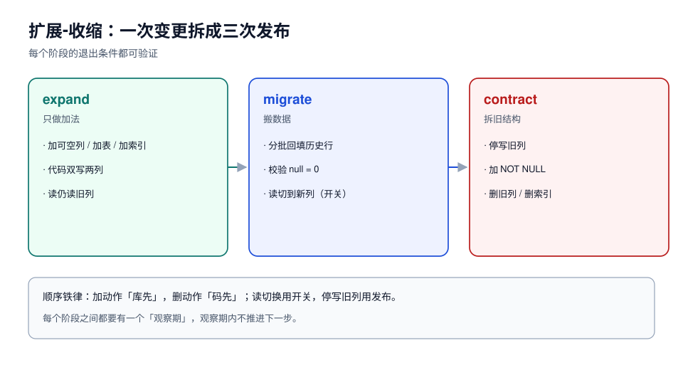

# 扩展-收缩：把一次变更拆成三次发布

「加一列并删一列」听起来是一个动作，实际是两个方向相反的动作：加是**向后兼容**的，删是**破坏性**的。把破坏性动作和发布绑在同一次上线里，就等于把「回滚代码」变成「回滚数据」。

扩展-收缩（expand / migrate / contract）解决的就是这件事：**先把新结构加进去并让代码同时会写两边，再搬数据，最后才拆旧结构**。



::: info 与「库表演进：expand-contract 四阶段」的分工
[那一页](../../../Backend/ContractEvolution/SchemaEvolution/index.md)从**契约**角度讲四阶段（expand / migrate / switch / contract，含 PG 200 万行读数与 `CES-A~CES-H`）；本页只讲它没展开的三件事：**何时不必拆**（失败能否只回滚代码）、**双写与读切换的实现形态**（单语句双写、开关而不是发版）、**contract 阶段的三条约束与快照**。两页共用同一套阶段命名，不冲突。
:::

## 一、三段各做什么

| 阶段 | 数据库 | 应用 | 退出条件 |
| --- | --- | --- | --- |
| **expand** | 只做兼容性加法：加列（可空）、加表、加索引 | 新代码双写（旧列 + 新列），读仍然读旧列 | 新列写入覆盖率 100%，持续一个发布周期 |
| **migrate** | 回填历史数据（分批，不锁表） | 读切换到新列，旧列继续写（保守） | 回填校验通过，读路径灰度 100% |
| **contract** | 删旧列 / 删旧索引 / 加非空约束 | 停止写旧列；代码里删掉旧字段 | 观察期内无旧代码副本，回滚不再需要旧列 |

三个阶段的**顺序不能换**，原因各自独立：

1. expand 必须在代码之前或同时——否则新代码写一个还不存在的列，直接报错；
2. migrate 必须在读切换之前——否则切过去读到一堆 `NULL`；
3. contract 必须在「旧代码彻底下线」之后——否则回滚到旧版本时旧列已经没了。

## 二、改个列名：四次发布才安全

把 `orders.amount`（分）改名为 `orders.amount_cents`（还是分），语义没变，只是名字更清楚。这条变更最小可行路径是四次发布：

```text
发布 1（expand）  : DB 加 amount_cents 可空列；代码写两列，读 amount
                   ↓ 观察 1 个发布周期，确认 amount_cents 无 NULL
发布 2（migrate） : 分批 UPDATE 回填历史行；校验 count(*) where amount_cents is null = 0
                   ↓
发布 3（switch）  : 代码读 amount_cents；继续写两列
                   ↓ 观察期内无回滚
发布 4（contract）: 代码只写 amount_cents；DB 加 NOT NULL；再下一个周期 DROP amount
```

::: danger 常见的「省一步」
「加列和回填放同一个事务」——在 1 万行的小表上没问题，在 100 万行上会持锁几十秒到几分钟，并且 undo 会膨胀到把表空间撑爆。回填**必须**分批提交，见 [数据回填](../Backfill/index.md)。

「改列名用 `RENAME COLUMN` 就够了」——MySQL 8.0+ 的 `RENAME COLUMN` 是纯元数据操作（很快），但它**同时让旧代码立刻失效**：滚动发布期间还有旧副本在写 `amount`，那一瞬间就开始报 `Unknown column`。改名这个动作在数据库侧很便宜，在**部署拓扑**上很贵。
:::

## 三、双写要写成「一个事务写两列」

双写最容易被写成两次独立写入，于是产生「一半成功」的行：

```java [OrderRepository.java]
// 错：两次 update，中间失败就只写了一边
jdbc.update("update orders set amount = ? where id = ?", cents, id);
jdbc.update("update orders set amount_cents = ? where id = ?", cents, id);

// 对：同一条语句写两列，天然原子
jdbc.update("update orders set amount = ?, amount_cents = ? where id = ?", cents, cents, id);
```

读侧在 expand 阶段要能容忍新列为 `NULL`：

```java [OrderMapper.java]
long cents = row.getAmountCents() != null ? row.getAmountCents() : row.getAmount();
```

这条「NULL 兜底」不是防御性编程，而是 expand 阶段的**规格**：回填还没跑完，新列本来就可能为空。等 `count(*) where amount_cents is null` 归零之后，这个兜底才可以删掉——**删兜底代码要排在 contract 之后**，顺序反了就是线上 NPE。

## 四、切换读的开关放在哪

三段式里最危险的一步是「读切换」，因为它不可逆（切回去要再发一次版）。两个做法：

| 做法 | 怎么切 | 优点 | 风险 |
| --- | --- | --- | --- |
| 代码分支 | 发布新版本，代码读新列 | 简单 | 回滚要再发一次版，窗口内新旧代码读不同列 |
| 开关（feature flag） | 配置中心切百分比 | 秒级回滚 | 开关本身要能读到；两套读路径都得测 |

::: tip 判断用哪个
**读切换用开关，写停用发布**。读切换要的是「出问题 10 秒内回去」，只有开关做得到；停止写旧列是「以后再也不写」，用发布更可靠——开关忘了关，数据就会一直往旧列写，而这件事没人会告警。
:::

## 五、contract 阶段的三个约束

1. **先加约束，后删列**：想给新列加 `NOT NULL`，先确认 `NULL` 行数为 0；想删旧列，先确认没有代码读它（`performance_schema` 里按列名搜不到，或代码全量检索为空）。
2. **删列要单独一次发布**：和别的变更混在一起，出问题时无法判断是哪一条导致的。
3. **删之前留一份快照**：`CREATE TABLE orders_amount_backup AS SELECT id, amount FROM orders` 的成本是「一次全表读 + 一份磁盘」，比恢复整库便宜得多。

```sql
-- contract 前的最后一道确认（MySQL）
select count(*) as null_rows from orders where amount_cents is null;   -- 必须是 0
select count(*) as mismatch from orders where amount <> amount_cents;  -- 双写期间必须也是 0

-- 留快照（大表要评估磁盘）
create table orders_amount_backup as select id, amount from orders;
```

PostgreSQL 上同样的确认，外加一条：**加 `NOT NULL` 不要直接加**，用「`CHECK ... NOT VALID` + `VALIDATE CONSTRAINT`」两步，前者只拿短暂锁、后者只拿 `SHARE UPDATE EXCLUSIVE`，不会挡住读写（实测 100 万行：直接 `SET NOT NULL` 158 ms 但持 `ACCESS EXCLUSIVE`；两步法 0.9 ms + 518 ms，全程不挡写）。

## 六、什么时候不需要三段式

不是所有变更都值得拆三次发布。判据是**「这一步失败时，能不能只回滚代码」**：

- 只加可空列、只加表、只加索引 → 一步到位，失败就回滚代码，表结构留着无害；
- 加非空列且没有默认值、改类型、改列名、删列、加唯一约束 → 必须拆。

::: warning 「留着无害」也要复查
「加一列留着无害」在**读路径**上不成立：`SELECT *` 的代码、行宽敏感的表（MySQL 单行 8126 B 限制）、`INSERT ... SELECT *` 的脚本都会因为多一列而出问题。所以 expand 阶段也要跑一遍「宽表 + `SELECT *`」的回归，见 [MySQL 8.4](../MySQL84/index.md) 的行宽一节。
:::

## 七、本页判据

| 编号 | 判据 | 看什么现象 | 不满足时改哪里 |
| --- | --- | --- | --- |
| `SCE-A` | 破坏性变更被拆成 ≥ 2 次发布 | 变更单里有 expand / contract 两个批次号 | 拆；一次发布只做同方向动作 |
| `SCE-B` | expand 只做加法，且新列可空 | DDL 里没有 `NOT NULL`（除非有常量默认值） | 改成可空，非空留到 contract |
| `SCE-C` | 双写是单语句写两列 | SQL 里两列在同一条 `UPDATE` | 合并语句；禁止两次独立写 |
| `SCE-D` | 读路径有 NULL 兜底 | 代码里有 `!= null ? :` 或 `coalesce` | 补兜底；兜底删除排在 contract 之后 |
| `SCE-E` | 读切换有开关，且演练过回切 | 开关名、回切耗时记录 | 补开关；不接受「回滚靠发版」 |
| `SCE-F` | 回填完成有可验证的判据 | `null 行数 = 0` 与 `mismatch = 0` 两条读数 | 补 SQL；不许用「跑完了」当结论 |
| `SCE-G` | contract 前有快照或备份 | `*_backup` 表或备份编号 | 补快照；无快照不许删列 |
| `SCE-H` | 不需要三段式的变更也写了「为什么不拆」 | 变更单里有一句理由 | 补理由；避免「顺手多拆」也避免「顺手不拆」 |

## 参考资料

- MySQL 8.4 Reference Manual: *Online DDL Operations* — 各操作是否支持并发 DML
- PostgreSQL 18 Documentation: *ALTER TABLE* — `ADD CONSTRAINT ... NOT VALID` 与 `VALIDATE CONSTRAINT` 的锁级别
- Martin Fowler: *ParallelChange*（expand/contract 模式的原始命名）
- [应用兼容](../AppSchemaCompat/index.md)：本页「为什么旧代码必须能容忍新列」的矩阵化展开
