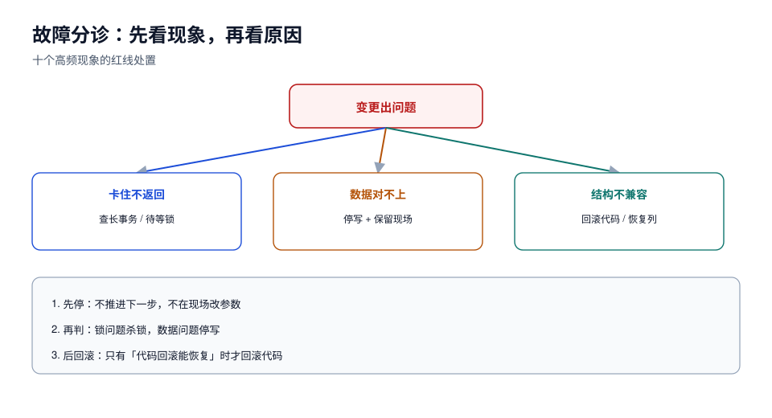

# 常见问题与分诊

这里按「现象」组织，而不是按「概念」组织——出问题时你看到的是现象，不是概念。



## 一、先分诊：现象 → 最可能的原因

| 现象 | 最可能原因 | 第一件事 | 详见 |
| --- | --- | --- | --- |
| 一条 `ALTER TABLE` 跑了很久没返回 | 在等元数据锁（有未提交事务） | 查 `innodb_trx` / `pg_stat_activity` 长事务 | [锁与队列](../LockQueue/index.md) |
| 改表期间**所有**查询都变慢 | DDL 排在队列里，后来的读也排队 | 立即 `KILL`/终止 DDL 或杀长事务 | [锁与队列](../LockQueue/index.md) |
| 以为加列是毫秒，实际跑了 10 分钟 | 版本不支持 INSTANT（5.7），或默认值易变 | 查版本 + 默认值是否常量 | [重写边界](../RewriteBoundary/index.md) |
| 加索引把写入阻塞了 | 用了普通 `CREATE INDEX` / 没写 `LOCK=NONE` | 换 `CONCURRENTLY` / `ALGORITHM=INPLACE, LOCK=NONE` | [MySQL 8.4](../MySQL84/index.md) |
| 建索引失败后查询还是不快 | `CONCURRENTLY` 失败留下 `indisvalid=false` 的索引 | 查 `pg_index`，`DROP INDEX CONCURRENTLY` | [锁与队列](../LockQueue/index.md) |
| 回填后数据对不上 | 回填覆盖了新写入，或漏行 | 比对来源表 + 查水位跳批 | [数据回填](../Backfill/index.md) |
| 回填后磁盘满了 | PG 死元组膨胀（实测 3.27 倍），`VACUUM` 不还空间 | 扩盘 / `pg_repack` | [数据回填](../Backfill/index.md) |
| 滚动发布期间报 `Unknown column` | 库先删了列，旧代码还在跑 | 停止发布，先恢复列或回滚代码 | [应用兼容](../AppSchemaCompat/index.md) |
| 旧代码 `INSERT` 报列数不匹配 | `INSERT` 没写列名 | 立刻补列名（热修复） | [应用兼容](../AppSchemaCompat/index.md) |
| 新列写入大量 NULL | 双写没覆盖所有写路径（有旁路脚本/导入） | 全量检索写 `orders` 的位置 | [扩展-收缩](../ExpandContract/index.md) |

## 二、十个高频问题

### 1. 加一列到底会不会锁表？

**会拿锁，但可能只拿毫秒。** 决定因素是算法：`INSTANT` 只改数据字典（实测 0.09 s），`COPY` 重建整表（实测 3.31 s/50 万行）。无论哪种，都要拿排他性元数据锁——**「锁表」的时长才是问题，「有没有锁」不是问题**。

### 2. 为什么我的 `ALGORITHM=INSTANT` 报错？

三种典型：`ERROR 1846`（这个操作不支持 INSTANT，比如改类型）、`ERROR 1845`（组合操作或删被索引的列）、`ERROR 1674`（默认值用了系统函数）。**报错是好事**，比静默降级成 `COPY` 安全。

### 3. 大表加索引要停写吗？

MySQL 8.4 上 `ALGORITHM=INPLACE, LOCK=NONE` 不停写，但要盯 `innodb_online_alter_log_max_size`（默认 128 MB）——索引构建期间的新写入都进这块缓冲，写爆就失败。PG 上 `CREATE INDEX CONCURRENTLY` 不停写，代价是要扫两遍表、且失败会留无效索引。

### 4. `VACUUM` 之后表怎么还是那么大？

因为 `VACUUM` 只把死元组标记为「可复用」，**不把页还给操作系统**。实测 559 MB 的表 `VACUUM` 后仍是 559 MB。要缩小只有 `VACUUM FULL`（重写 + 排他锁）或 `pg_repack`（在线，但要两倍空间）。

### 5. 回填能不能放在一个事务里？

小表可以，大表不行。理由不是「慢」，而是：① 长事务阻止 undo 回收 / 阻止 vacuum，整库都会被拖累；② 失败要整体回滚，几小时白跑；③ 持锁时间长，DDL 与它互相等待。**判据：单事务行数 × 单行成本 ≤ 你的锁预算。**

### 6. 回填要不要停写？

不要，但要**幂等 + 只填 NULL**：

```sql
update orders set channel = 'web' where id > ? and id <= ? and channel is null;
```

`channel is null` 保证「回填期间用户改过的值」不会被覆盖。停写是更贵的选择，只在无法写出幂等条件时才用。

### 7. 改列名真的那么危险吗？

数据库侧很便宜（MySQL 8.0+ 的 `RENAME COLUMN`、PG 的 `ALTER TABLE ... RENAME COLUMN` 都是元数据操作），危险在**部署拓扑**：滚动发布期间旧副本还在用旧名字，改名瞬间它们全部报错。正确做法是「加新列 + 双写 + 回填 + 切换 + 删旧列」，四次发布。

### 8. 在线工具（gh-ost / pt-osc）还要不要用？

在 MySQL 8.4 上，**大多数加列/加索引场景不再需要**（INSTANT / `LOCK=NONE` 足够）。仍然值得用的场景：改列类型、改字符集、需要限速与暂停的大表重建、以及**5.7 存量库**（那上面所有加列都重建）。

### 9. 变更窗口选在什么时候？

三个条件同时满足：业务低峰（QPS < 日均 20%）、**没有长事务在跑**（比低峰更重要）、有人能盯着面板 30 分钟。只满足第一条就上，是最常见的翻车方式。

### 10. 出事了先做什么？

按这个顺序：① 停止后续步骤（不要「再跑一步看看」）；② 判断是「锁问题」还是「数据问题」——前者杀 DDL / 杀长事务，后者立刻停写并保留现场；③ 只有在确认「代码回滚能恢复」时才回滚代码，否则回滚只会让状态更乱。

## 三、上线前自查清单（12 项）

- [ ] 变更单写了引擎与大版本（`MySQL 8.4.11` / `PostgreSQL 18.6`）
- [ ] 四类风险（锁 / 重写 / 数据 / 兼容）逐条有结论
- [ ] DDL 显式写了 `ALGORITHM=`（MySQL）或确认锁级别（PG）
- [ ] 执行前后对比了 `relfilenode`（PG）或表空间体积（MySQL）
- [ ] 持锁时长有算式：行数 × 单行成本 × 系数
- [ ] 磁盘增量算过，且确认可用空间 ≥ 2 倍表体积
- [ ] 执行前扫过长事务，处置有记录
- [ ] 新列是可空，或「非空 + 常量默认值」
- [ ] 回填有水位表、幂等过滤、单批 ≤ 100 ms
- [ ] 回填后算了膨胀，且知道 `VACUUM` 不还空间
- [ ] 回滚脚本在影子库跑通过（或明确写「恢复备份，RTO = X」）
- [ ] 终止条件三条阈值已配置，且有人盯面板

## 四、五条错误建议（听到就要警惕）

1. **「先加到从库，再切主」**——从库是只读副本，DDL 会通过复制回放，不存在「先在从库加」这条路（除非是独立逻辑复制或双写架构）。
2. **「用 `LOCK=NONE` 就不会锁」**——`LOCK=NONE` 只保证不阻塞 DML，元数据锁照样要拿，短事务也可能排队。
3. **「加个索引而已，直接上」**——加索引是重建索引结构，PG 上是全表扫两遍，MySQL 上要写在线日志缓冲，都有失败态。
4. **「回填用 `UPDATE ... WHERE 1=1` 一次搞定」**——大表上一次全量更新 = 一个超大事务，锁、undo、复制延迟三件事同时爆。
5. **「出问题就回滚代码」**——如果已经删了列 / 改了类型，回滚代码救不了数据，只会让两边的状态都停在错误的位置。

## 五、本页判据

| 编号 | 判据 | 看什么现象 | 不满足时改哪里 |
| --- | --- | --- | --- |
| `SCQ-A` | 故障能按「现象 → 原因」表定位 | 分诊表第一列能对上现场 | 补现场信息（锁/事务/DDL 语句） |
| `SCQ-B` | 处理顺序是「先停、再判、后回滚」 | 事故记录里的动作顺序 | 改流程；禁止「再跑一步看看」 |
| `SCQ-C` | 自查清单在变更前逐项勾选 | 勾选记录（不是口头） | 补；口头确认等于没确认 |
| `SCQ-D` | 团队知道五个错误建议 | 评审记录里出现过反驳 | 补培训；这类建议会反复出现 |
| `SCQ-E` | 每次事故留下「下次怎么防」而非「下次注意」 | 事故单的改进项是可执行动作 | 改写法；「注意」不可执行 |
| `SCQ-F` | 变更工具的默认值被显式覆盖 | 工具配置里 `lock_timeout` 等有值 | 补；默认值多半不适合生产 |
| `SCQ-G` | 回滚决策有唯一负责人 | 变更单上的 on-call 名字 | 补；多人决策等于没人决策 |
| `SCQ-H` | 事后把读数沉淀成基线 | 基线表（持锁/速率/单批） | 补；否则每次重新猜 |

## 参考资料

- MySQL 8.4 Reference Manual: *Online DDL Operations*、*Metadata Locking*、*InnoDB Locking*
- PostgreSQL 18 Documentation: *Routine Vacuuming*、*Explicit Locking*、*Building Indexes Concurrently*
- Oracle Lifetime Support Policy: MySQL Releases
- 本专题其余页面：每一行分诊都指向具体的方法页
