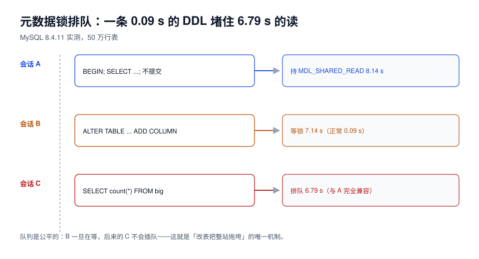

# 锁与队列：一条 DDL 怎么把读也堵死

大部分人以为改表的危险是「改表期间不能写」。真实事故的形态更阴险：**改表本身什么都没干，只是「在等锁」，就把后面所有查询一起堵住了。**

本页把这条链路拆开：谁在持锁、谁在排队、为什么一条只读查询会排在一个改表语句后面、以及怎么用超时和队列观测把它掐断。



## 一、锁不是「拿到」或「拿不到」，还有「在等」

DDL 需要一个和所有并发访问互斥的锁：

| 引擎 | DDL 需要的锁 | 普通读需要的锁 | 能不能共存 |
| --- | --- | --- | --- |
| MySQL | `MDL_EXCLUSIVE`（元数据锁） | `MDL_SHARED_READ` | 不能；且**排队是公平的** |
| PostgreSQL | `ACCESS EXCLUSIVE` | `ACCESS SHARE` | 不能；同样排队 |

关键在于「排队是公平的」：一旦 DDL 进入等待队列，**后来的读请求不会插队**，即使它与当前持锁者并不冲突。这是所有「改表把整站拖垮」事故的统一机制。

## 二、实测：一个 8 秒未提交事务引发的连锁

实验设计（MySQL 8.4.11，`orders` 50 万行）：

1. 会话 A：`BEGIN; SELECT count(*) FROM big LIMIT 1;` 然后停住不提交（持有 `MDL_SHARED_READ`）；
2. 会话 B（1 s 后）：`ALTER TABLE big ADD COLUMN zz9 INT;`（只需要元数据，正常 0.09 s）；
3. 会话 C（1.4 s 后）：`SELECT count(*) FROM big;`（只读，和 A 完全兼容）。

读数：

| 会话 | 语句 | 耗时 | 说明 |
| --- | --- | --- | --- |
| A | 持事务 + `sleep(8)` | 8.14 s | 持 `MDL_SHARED_READ` 8 秒 |
| B | `ALTER TABLE ... ADD COLUMN` | **7.14 s** | 全部时间都在等 A 释放 |
| C | `SELECT count(*)` | **6.79 s** | 排在 B 后面，等 B 拿到锁才轮到它 |

::: danger 这条读数为 0.09 s 的 DDL，把读拖了 6.79 s
C 和 A 的锁**完全兼容**，如果没有 B，C 会立刻返回。它慢的唯一原因是 **B 在队列里**。

放大到生产：一条 0.09 s 的 INSTANT 加列，遇到一个 8 秒未提交事务，就变成 8 秒的**全表读阻塞**。如果那个事务是 8 分钟（长报表、忘了提交的批处理），就是 8 分钟的故障。
:::

PostgreSQL 侧同构，读数同样干净（`big` 100 万行）：

| 会话 | 语句 | 耗时 |
| --- | --- | --- |
| A | `BEGIN; LOCK TABLE big IN ACCESS EXCLUSIVE MODE; SELECT pg_sleep(6);` | 6.16 s |
| B | `SELECT count(*) FROM big;` | 5.19 s |
| C | `SET lock_timeout='1s'; SELECT count(*) FROM big;` | **1.12 s → 报错** `canceling statement due to lock timeout` |

C 的行为是 PG 上最值得抄的一条实践：**给所有应用连接设 `lock_timeout`**，让请求快速失败而不是排队堆积。MySQL 侧对应的参数是 `lock_wait_timeout`，但它的默认值让人后背发凉：

```sql
select @@lock_wait_timeout, @@innodb_lock_wait_timeout;
-- 31536000  (一年)     50  (秒)
```

`lock_wait_timeout` 默认 **31,536,000 秒 = 1 年**。也就是说，一条等元数据锁的 DDL 默认会等一年——业务侧看到的不是报错，是**永远不返回**。

## 三、把「等锁」变成「快速失败」

三处都要设，缺一处就等于没设：

| 位置 | 参数 | 建议值 | 作用 |
| --- | --- | --- | --- |
| DDL 会话 | MySQL `lock_wait_timeout` | 3~5 s | DDL 抢不到锁就退出，不占队列 |
| DDL 会话 | PG `lock_timeout` | 3~5 s | 同上；`statement_timeout` 不替代它 |
| 应用连接 | PG `lock_timeout` | 1~2 s | 读请求不排队，快速失败后重试 |
| 应用连接 | MySQL `innodb_lock_wait_timeout` | 3~5 s（默认 50） | 行锁等待，与 MDL 不同层 |

```sql
-- MySQL：DDL 前先设超时，抢不到就重试，不把队列占住
set session lock_wait_timeout = 5;
alter table orders add column channel varchar(16) null, algorithm=instant;
-- ERROR 1205 (HY000): Lock wait timeout exceeded  → 说明有人在挡路，去杀掉长事务
```

```sql
-- PostgreSQL：先设 lock_timeout，再执行 DDL
set lock_timeout = '5s';
alter table orders add column channel varchar(16);
```

::: warning `statement_timeout` 挡不住锁等待
在 PG 里，一条语句卡在锁等待上时，`statement_timeout` 也会生效——但它会把「已经跑了 4 分钟、只差最后一步拿锁」的语句一起杀掉，代价更大。**锁等待用 `lock_timeout`，语句总时长用 `statement_timeout`，两个都要设。**
:::

## 四、DDL 拿锁的两段式：为什么有时看不到阻塞

MySQL 的 `INPLACE` 类操作（比如加索引）不是全程持 `MDL_EXCLUSIVE`，而是**开始/结束各拿一次，中间允许并发 DML**。这解释了一个常见困惑：「我加索引的时候业务明明没卡」。

| 操作 | 锁模式（`pg_locks` 实测 / MySQL 等价） | 并发读 | 并发写 |
| --- | --- | --- | --- |
| `CREATE INDEX`（PG，非并发） | `ShareLock` | 允许 | **阻塞** |
| `CREATE INDEX CONCURRENTLY`（PG） | `ShareUpdateExclusiveLock` | 允许 | 允许 |
| 加索引（MySQL `INPLACE`） | `MDL_SHARED_UPGRADABLE` → 结束阶段升级 | 允许 | 允许 |
| 改列类型（MySQL `COPY`） | `MDL_EXCLUSIVE`（全程） | 允许（但读的是旧表） | **阻塞** |

PG 的两种索引构建模式是实测出来的：

```text
CREATE INDEX              lock modes seen: ['ShareLock']
CREATE INDEX CONCURRENTLY lock modes seen: ['ShareUpdateExclusiveLock']
```

::: danger `CONCURRENTLY` 不是「更安全的 `CREATE INDEX`」，它有自己的失败态
本机实测：对一个有重复值的列建**唯一**索引并加 `CONCURRENTLY`，语句报 `could not create unique index`，但**索引对象留在系统里**：

```text
 idx    | indisvalid | indisready
 uq_bad | f          | f
```

`indisvalid = false` 的索引不会加速查询、却仍会在写入时维护，必须手工 `DROP INDEX CONCURRENTLY uq_bad`。**凡是 `CONCURRENTLY`，执行后必须查一次 `pg_index.indisvalid`。**
:::

## 五、等锁排查：三条查询定位到底是谁

```sql
-- MySQL 8.4：谁在等元数据锁
select object_name, lock_type, lock_status, owner_thread_id
from performance_schema.metadata_locks
where object_schema = 'shop' and lock_status = 'PENDING';

-- MySQL 8.4：谁在长事务里不放锁
select trx_id, trx_started, timestampdiff(second, trx_started, now()) as held_s,
       trx_mysql_thread_id, trx_query
from information_schema.innodb_trx order by trx_started;

-- 处置（确认是僵尸事务后）
kill 12345;
```

```sql
-- PostgreSQL 18：等锁的人 + 挡路的人
select pid, wait_event_type, wait_event, pg_blocking_pids(pid) as blocked_by, query
from pg_stat_activity where wait_event_type = 'Lock';

-- 处置
select pg_terminate_backend(12345);
```

::: tip 变更前的「清场三件事」
1. 杀掉/等掉所有超过阈值的空闲事务（`trx_state='RUNNING'` 但 `trx_query is null` 的最可疑）；
2. 确认没有正在进行的大查询（它会持有 `MDL_SHARED_READ` 直到结束）；
3. 确认连接池的 `idle in transaction` 为 0（PG 用 `state like 'idle in transaction%'` 查）。
:::

## 六、外部工具为什么能绕过锁

`pt-online-schema-change` 与 `gh-ost` 的共同思路：**不在原表上做 DDL**。

1. 建一张结构正确的新表（空表，DDL 无代价）；
2. 在原表上建触发器（pt-osc）或读 binlog（gh-ost），把增量同步到新表；
3. 分批把旧数据拷进新表；
4. 用 `RENAME TABLE` 原子换名（这一步仍需短暂 `MDL_EXCLUSIVE`，但只持续毫秒）。

| 维度 | pt-online-schema-change | gh-ost |
| --- | --- | --- |
| 增量捕获 | 触发器（在原表上写触发器，有额外写入开销） | 读 binlog（无触发器，但要求 `binlog_format=ROW`） |
| 对主库压力 | 拷贝 + 触发器双份 | 可切换为在从库拷贝 |
| 暂停/限速 | `--max-load`、`--critical-load` | `--max-load`、`--throttle-*`、可动态 `panic` |
| 换名瞬间 | `RENAME TABLE`（毫秒级 MDL） | 同 |

::: danger 工具也拿 MDL
两个工具在**开始**（建触发器/读位点）和**结束**（`RENAME`）时都要在原表上拿 `MDL_EXCLUSIVE`。所以「用 gh-ost 就不怕长事务」是错的——**长事务照样能让 `RENAME` 卡住**，只不过卡的是最后那一秒，而不是整个过程。
:::

## 七、本页判据

| 编号 | 判据 | 看什么现象 | 不满足时改哪里 |
| --- | --- | --- | --- |
| `SCL-A` | DDL 会话设了锁等待超时 | `lock_wait_timeout` / `lock_timeout` 有值且 ≤ 5 s | MySQL 默认一年，必须显式设 |
| `SCL-B` | 应用连接设了锁超时 | PG `lock_timeout`、MySQL `innodb_lock_wait_timeout` | 补参数；靠重试而不是排队 |
| `SCL-C` | 变更前扫过长事务 | `innodb_trx` / `pg_stat_activity` 输出 | 杀或等；不接受「先上」 |
| `SCL-D` | 知道 DDL 是否全程持排他锁 | 变更单标注「全程 X 锁」或「两段式」 | 按算法表核对 |
| `SCL-E` | `CREATE INDEX CONCURRENTLY` 后查了 `indisvalid` | `pg_index` 读数 | 无效索引立即 `DROP INDEX CONCURRENTLY` |
| `SCL-F` | 等锁时有观测，而不是等人反馈 | `metadata_locks` / `pg_locks` 面板 | 接监控；阈值 ≥ 3 s 告警 |
| `SCL-G` | 外部工具方案写明了「换名仍需 MDL」 | 变更单有该行 | 补；并安排换名窗口 |
| `SCL-H` | 事故预案里有「杀谁」 | 操作对象是 `trx_mysql_thread_id` / `pid` | 补预案；不许现场找 |

## 参考资料

- MySQL 8.4 Reference Manual: *Metadata Locking*、`lock_wait_timeout`、`performance_schema.metadata_locks`
- MySQL 8.4 Reference Manual: *Online DDL Operations* — 各算法的并发 DML 支持
- PostgreSQL 18 Documentation: *Explicit Locking*、`lock_timeout`、`pg_blocking_pids()`
- PostgreSQL 18 Documentation: *Building Indexes Concurrently* — 失败后留下无效索引的说明
- Percona Toolkit: `pt-online-schema-change` 文档；GitHub `gh-ost` 文档
