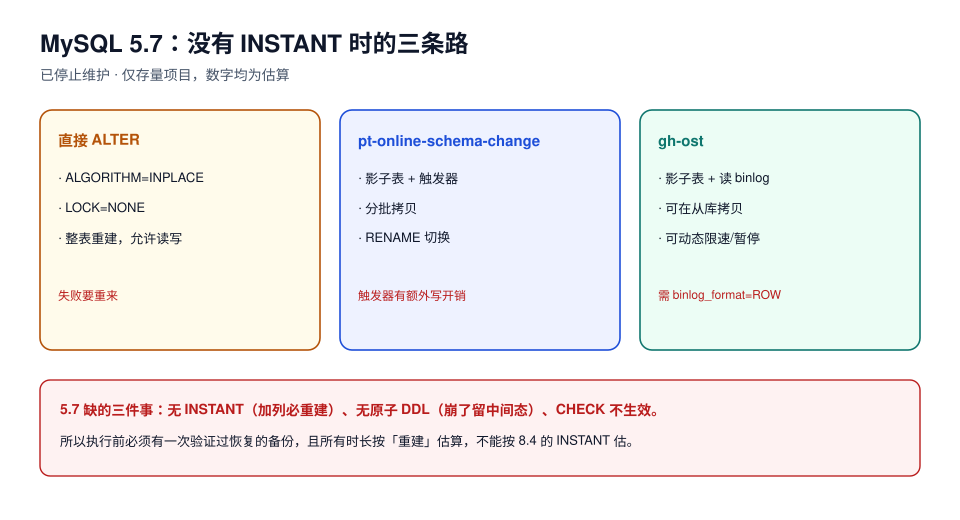

# MySQL 5.7：已停止维护的存量路径

::: danger 页面状态：已停止维护 · 仅存量项目
MySQL 5.7 的 GA 日期是 **2015-10-09**，Premier 支持在 **2020-10-31** 结束，**2023-10-31 已终止支持**（末版 5.7.44，来源：Oracle Lifetime Support Policy）。本页不介绍新特性、不推荐新项目使用，只回答一个问题：**手上还有 5.7 的库，改表该怎么改才不出事。**
:::

老库不会因为 EOL 就消失。5.7 的改表路径与 8.4 有**能力级**差异：缺 `INSTANT`、缺原子 DDL、`CHECK` 约束不生效。把 8.4 的结论直接搬过来，最小的事故是「以为毫秒，实际重建 40 分钟」。



## 一、5.7 到底缺什么

| 能力 | 5.7 | 8.4 | 对改表的直接后果 |
| --- | --- | --- | --- |
| `ALGORITHM=INSTANT` | **无**（8.0.12 引入） | 有 | 5.7 加列必然重建整表，只是可以并发 DML |
| INSTANT 删列 / 改列序 | 无（8.0.29 引入） | 有 | 删列一律 `COPY`/`INPLACE` 重建 |
| 原子 DDL | **无**（8.0 引入） | 有 | 5.7 上 DDL 执行中被 kill / 崩溃会留下**中间态**（表在、数据字典不一致），只能靠备份 |
| `CHECK` 约束 | **解析但忽略**（8.0.16 起才真正执行） | 执行 | 无法用「`CHECK NOT VALID` + `VALIDATE`」这类低锁技巧 |
| `RENAME COLUMN` | 无（8.0 引入） | 有 | 改名要 `CHANGE COLUMN`，属于重建类操作 |
| 在线改 `VARCHAR` 长度 | 仅「同一档内」（≤255 或 >255 各自内部）可 `INPLACE`，跨档要 `COPY` | 同规则 | 从 `varchar(100)` 扩到 `varchar(500)` 在 5.7 上可能直接重建 |
| 并行复制（`slave_parallel_type=LOGICAL_CLOCK`） | 有，但需显式开 | 默认 `WRITESET` 依赖 | 主库 10 分钟的重建，从库回放可能更久 |

::: warning 本页数字的标注方式
5.7 已 EOL，官方镜像与授权都不再提供，**本页没有 5.7 的实测读数**。凡涉及具体毫秒/秒的地方，一律写成「按 8.4 同名算法实测值 × 修正系数」或直接写「需在本库实测」，并在括号里标 `估算`。请勿把估算当基线。
:::

## 二、5.7 上唯一「不重建」的加列方式

5.7 没有 INSTANT，但 `ADD COLUMN ... NULL` 支持 `ALGORITHM=INPLACE, LOCK=NONE`：**重建整表，但期间允许读写**。

```sql
-- 5.7：可并发 DML 的重建式加列（注意：仍然重建整表）
alter table orders add column channel varchar(16) null, algorithm=inplace, lock=none;
```

算例要按行数而不是体积：

```text
4,000 万行 × 6.6 µs/行 × 冷缓存系数 2.5 ≈ 660 s ≈ 11 分钟
磁盘增量 ≈ 表体积 × 1.2（重建期间新旧两份）
```

**11 分钟的可读写重建**听起来可接受，但它有三个隐藏成本：redo/binlog 暴涨、从库延迟（单线程回放时会追不上）、以及**重建失败要重来**。

## 三、外部工具是 5.7 的主力方案

正因为 5.7 上「所有加列都重建」，`pt-online-schema-change` 与 `gh-ost` 在 5.7 时代是标配，而不是备选。

| 维度 | 直接 `ALTER`（`INPLACE`） | pt-osc / gh-ost |
| --- | --- | --- |
| 原表是否被重建 | 是 | 否（新建影子表，原表只做增量同步） |
| 失败影响 | 重建中途失败要回滚，耗时白费 | 影子表丢弃即可，原表没动 |
| 可暂停/限速 | 不可以 | 可以（`--max-load`、`--critical-load` 或动态 panic） |
| 额外写入开销 | 只有重建本身 | 触发器（pt-osc）或 binlog 解析（gh-ost） |
| 最后一步 | 无 | `RENAME TABLE`（毫秒级 `MDL_EXCLUSIVE`） |

```shell
# pt-osc：加列 + 加索引，一次做完（5.7 常用写法）
pt-online-schema-change \
  --alter "add column channel varchar(16) null, add index idx_channel (channel)" \
  --max-load Threads_running=40 \
  --critical-load Threads_running=80 \
  --chunk-size 1000 \
  --chunk-time 0.2 \
  D=shop,t=orders \
  --execute
```

```shell
# gh-ost：无触发器，读 binlog；可先在从库拷贝再切换
gh-ost \
  --host=127.0.0.1 --port=3306 --user=ghost --password='***' \
  --database=shop --table=orders \
  --alter="add column channel varchar(16) null" \
  --chunk-size=1000 --max-load='Threads_running=40' \
  --allow-on-master --execute
```

::: danger 5.7 上最容易踩的三个坑
1. **`CHECK` 约束不生效**：5.7 会接受 `ADD CONSTRAINT ... CHECK (...)` 但不执行。以为加了校验，其实什么都没加——排查时看到「约束存在」会更迷惑。
2. **非原子 DDL**：5.7 上 DDL 执行期间被 kill，可能留下「表还在、字典已改一半」的状态。**执行前必须有一次可用的全量备份**，且要验证过恢复。
3. **`ALTER ... ALGORITHM=INPLACE` 不代表「不重建」**：它只表示「不拷贝到临时表」。加列在 5.7 上仍然重建，`SHOW WARNINGS` 里不会有任何提示。
:::

## 四、从 5.7 往 8.x 走：先做兼容性收口

升级不是「换个镜像」。改表这件事上，升级前要做三件事：

1. **清掉保留字冲突**：8.0 新增了一批保留字（`RANK`、`GROUPS`、`LATERAL`、`SYSTEM` 等），5.7 上合法的列名在 8.0 上可能要加反引号。
2. **确认字符集**：5.7 的 `utf8` 是 `utf8mb3`，8.0 默认 `utf8mb4`。`utf8` 别名在 8.0 里仍可用，但索引长度计算与排序规则都会变，**改字符集是重写类操作**。
3. **去掉对 `ALGORITHM=COPY` 的隐式依赖**：有些团队靠「加列会重建表」顺带整理了碎片，升级后 INSTANT 不再重建，碎片会留着——需要单独安排 `OPTIMIZE TABLE`。

```sql
-- 升级前体检：找出会被 8.0 保留字影响的列名
select table_name, column_name
from information_schema.columns
where table_schema = 'shop'
  and upper(column_name) in ('RANK','GROUPS','LATERAL','SYSTEM','CUME_DIST','EMPTY','FIRST_VALUE');

-- 升级前体检：非 utf8mb4 的表
select table_name, table_collation
from information_schema.tables
where table_schema = 'shop' and table_collation not like 'utf8mb4%';
```

## 五、本页判据

| 编号 | 判据 | 看什么现象 | 不满足时改哪里 |
| --- | --- | --- | --- |
| `SCM-A` | 存量 5.7 有明确的退役计划 | 升级窗口、目标版本、责任人 | 补计划；EOL 后无安全补丁 |
| `SCM-B` | 不在 5.7 上使用 `CHECK` 做校验 | `information_schema.check_constraints` 有行但业务无校验 | 改用触发器/应用校验 |
| `SCM-C` | 大表加列走外部工具或明确的重建窗口 | 变更单写 pt-osc/gh-ost 或「重建 11 分钟」 | 二者选一；不许「直接 alter 试试」 |
| `SCM-D` | 执行前有可恢复的备份且演练过 | 备份编号 + 恢复耗时记录 | 补；5.7 非原子 DDL 没有后悔药 |
| `SCM-E` | 5.7 读数标注为估算 | 文中每处数字有 `估算` 或来源 | 补标注；不许冒充实测 |
| `SCM-F` | 升级前跑过保留字与字符集体检 | 两条体检 SQL 的输出 | 补；保留字冲突会在启动时炸 |
| `SCM-G` | 升级后安排了碎片整理 | `OPTIMIZE TABLE` 计划 | 补；INSTANT 不再顺带重建 |
| `SCM-H` | 从库延迟有监控再接大变更 | `Seconds_Behind_Master` 曲线 | 接监控；阈值 ≥ 30 s 告警 |

## 参考资料

- Oracle Lifetime Support Policy: *MySQL Releases*（5.7：GA 2015-10、Premier 2020-10、EOL 2023-10）
- MySQL 5.7 Reference Manual: *Online DDL Overview*、*Limits on InnoDB Online DDL*
- MySQL 8.0 Reference Manual: *Atomic Data Definition Statement Support*（5.7 无此能力）
- MySQL 8.0 Reference Manual: *Keywords and Reserved Words*（8.0 新增保留字）
- Percona Toolkit: `pt-online-schema-change`；GitHub `gh-ost`
- 本仓库相邻专题：[数据库大版本升级与切换](../../../Ops/DatabaseUpgrade/index.md)（换版本时的 DDL 冻结、锁与回填边界）
