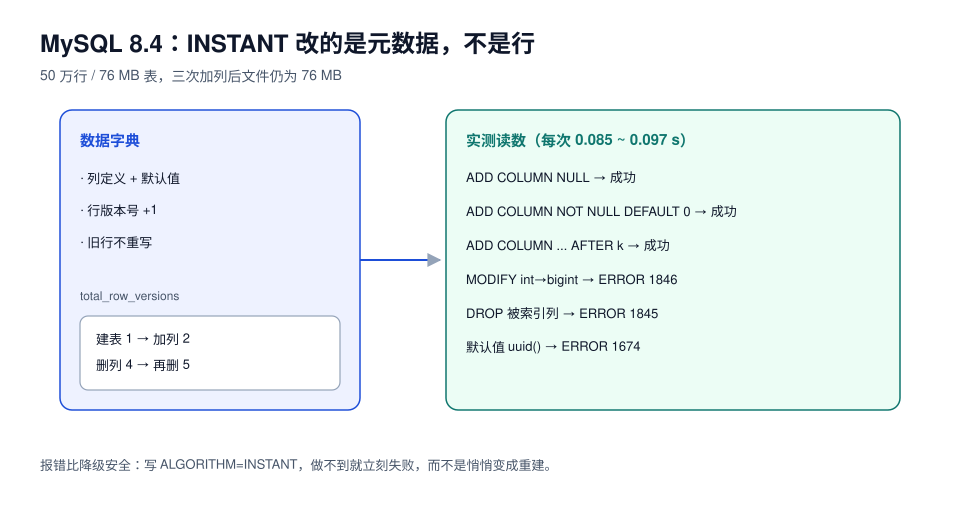

# MySQL 8.4：INSTANT、原子 DDL 与在线索引

::: info 页面状态：当前 LTS 基线
MySQL 8.4 的 GA 日期是 **2024-04-10**，Premier 支持至 **2029-04**，EOL **2032-04**（当前版本 8.4.11）。本页是**新部署的基线页**；8.0 作为过渡版本不单独立目录，差异在下方对照表里标注。9.x innovation 系列与 9.7 LTS 沿用同一套 DDL 语义，未单列。
:::

8.4 之于改表，最大的变化不是「更快」，而是**「加列变成了一件几乎免费的事」**——于是变更的瓶颈从「重建表」转移到「元数据锁」和「数据回填」。本页按这条转移讲。



## 一、三档算法在 8.4 上的实测边界

50 万行 / 76 MB 表（`id bigint pk auto_increment, k int, payload varchar(80)`，一个二级索引）：

| 操作 | 指定算法 | 结果 | 耗时 | 表空间 |
| --- | --- | --- | --- | --- |
| `ADD COLUMN c1 INT NULL` | `INSTANT` | 成功 | **0.091 s** | 76 MB → 76 MB |
| `ADD COLUMN c2 INT NOT NULL DEFAULT 0` | `INSTANT` | 成功 | **0.091 s** | 不变 |
| `ADD COLUMN c3 INT NULL AFTER k`（中间位置） | `INSTANT` | 成功 | **0.085 s** | 不变 |
| `MODIFY c2 BIGINT NOT NULL DEFAULT 0` | `INSTANT` | **`ERROR 1846`** | 0.080 s | 不变 |
| `MODIFY c2 BIGINT NOT NULL DEFAULT 0` | 默认（`COPY`） | 成功 | **3.310 s** | 仍 76 MB（原地重用） |
| `ADD INDEX idx_c1 (c1)` | `INPLACE` | 成功 | **0.673 s** | 76 → 84 MB |
| `DROP COLUMN c1`（列上有索引） | `INSTANT` | **`ERROR 1845`** | 0.080 s | 不变 |
| `DROP INDEX idx_c1` 后 `DROP COLUMN c1` | `INSTANT` | 成功 | **0.093 s** | 不变 |
| `ADD COLUMN c6 VARCHAR(36) NOT NULL DEFAULT (uuid())` | `INSTANT` | **`ERROR 1674`** | 0.080 s | 不变 |

::: tip 读这张表的三个要点
1. **加列真的免费**：三次 INSTANT 加列（含中间位置）表空间一个字节没变。
2. **「免费」有前提**：改类型、删被索引的列、带系统函数的默认值，全部出局。
3. **`ERROR 1846/1845` 是好事**：它在你写错算法时立刻告诉你「这条语句做不到」，比让它悄悄降级成 `COPY` 安全一百倍。**养成写 `ALGORITHM=` 的习惯。**
:::

## 二、INSTANT 的代价：行版本会累积

每次 INSTANT 加/删列，InnoDB 不会改写已有行，而是给表加一个「行版本」。读旧行时按版本把缺失的列补出来。

```sql
-- 看一张表积累了多少个行版本
select name, total_row_versions, row_format
from information_schema.innodb_tables
where name = 'lab/big';
```

实测序列（同一张表连续操作）：

| 步骤 | `total_row_versions` |
| --- | --- |
| 建表 | 1 |
| `ADD COLUMN d` (INSTANT) | 2 |
| `DROP COLUMN d` (INSTANT) | 4 |
| `DROP COLUMN b` (INSTANT) | 5 |

::: danger 两个必须知道的后果
1. **读旧行会变慢**：缺失列要按版本反查，行版本越多路径越长。这是「INSTANT 加列」的隐性成本，不会体现在 DDL 耗时里。
2. **不能无限加**：MySQL 对行版本数量有上限（历史版本上限 64，超过后 `ADD COLUMN` 只能退化为 `INPLACE`）。**别把「加列」当成日常操作**——每季度几十次的团队要安排 `OPTIMIZE TABLE` 或按业务分表。
:::

## 三、原子 DDL：8.4 上「改表失败」不再留中间态

8.0 起 InnoDB 支持原子 DDL：数据字典、存储引擎操作、binlog 写入在**同一个事务**里，失败要么全成要么全不成。

| 场景 | 5.7 行为 | 8.4 行为 |
| --- | --- | --- |
| DDL 执行中被 `KILL` | 可能留下「表在、字典半改」的中间态 | 回滚，表结构不变 |
| DDL 期间崩溃 | 需要人工修表 / 恢复备份 | 崩溃恢复后自动回滚 |
| `RENAME TABLE` 多表 | 非原子，可能只改了一半 | 原子 |

但要区分两件事：**原子 DDL 保证「结构不会半改」，不保证「数据不会半填」**。回填是 DML，中断就是中断，靠水位续跑（见 [数据回填](../Backfill/index.md)）。

## 四、在线索引：`LOCK=NONE` 与它的三条前提

```sql
-- 8.4：加索引并显式要求「不阻塞读写」
alter table orders add index idx_channel (channel), algorithm=inplace, lock=none;
-- 若做不到 LOCK=NONE，会直接报错而不是降级
```

`LOCK=NONE` 能成立的前提：

1. 表是 InnoDB，且 `innodb_online_alter_log_max_size` 足够大（默认 128 MB）。**索引构建期间的新写入会进这块日志**，写爆了语句失败；
2. 索引不改变行格式（改 `ROW_FORMAT` 不是在线操作）；
3. 没有触发「重建表」的附加子句（比如同一个 `ALTER` 里还带了改列类型）。

```sql
-- 加索引期间看进度（8.0+ 的 performance_schema）
select event_name, work_completed, work_estimated,
       round(100 * work_completed / nullif(work_estimated, 0), 1) as pct
from performance_schema.events_stages_current
where event_name like '%index%';
```

::: danger `LOCK=NONE` 挡不住元数据锁
即使整条语句允许并发 DML，它在**开始和结束**仍要拿 `MDL_EXCLUSIVE`。实测：一个 8 秒未提交事务，让一条 0.09 s 的 INSTANT 加列等了 7.14 s，并把后面所有查询一起堵了 6.79 s。**在线 ≠ 无锁**，见 [锁与队列](../LockQueue/index.md)。
:::

## 五、8.4 与 8.0 / 9.x 的差异对照

| 能力 | 8.0 | 8.4 | 9.x / 9.7 LTS |
| --- | --- | --- | --- |
| INSTANT 加列 | 8.0.12+ | 有 | 有 |
| INSTANT 删列 / 改列序 | 8.0.29+ | 有 | 有 |
| 原子 DDL | 有 | 有 | 有 |
| `CHECK` 约束生效 | 8.0.16+ | 有 | 有 |
| 默认字符集 | `utf8mb4` + `utf8mb4_0900_ai_ci` | 同 | 同 |
| `mysql_native_password` | 默认插件（8.0） | **默认禁用**（需显式启用） | 移除路径继续 |
| 备注 | 2026-04-30 EOL | 当前 LTS | innovation 系列按季度迭代，9.7 为 LTS |

::: warning 升级到 8.4 时最常被忽略的一条
8.4 默认**禁用 `mysql_native_password`**。老应用连上来会报 `Plugin 'mysql_native_password' is not loaded`。这不是改表问题，但会和你安排在同一次升级窗口里，导致「改表还没开始，应用先连不上」——**升级窗口的第一条验收永远是「应用能连上」**。
:::

## 六、8.4 上的标准加列流程

```sql
-- 1) 先探能力：能 INSTANT 就 INSTANT
alter table orders add column channel varchar(16) null, algorithm=instant;

-- 2) 需要默认值：先加可空列，再回填，再加默认值（都是元数据操作）
alter table orders alter column channel set default 'web';

-- 3) 需要非空：等回填完成、null 行数为 0 之后
alter table orders modify channel varchar(16) not null default 'web', algorithm=inplace;
```

第 3 步为什么不是 `INSTANT`？因为 `MODIFY ... NOT NULL` 需要校验既有行，属于「读全表」，8.4 上它走 `INPLACE`（重建或校验），不再是纯元数据。**顺序必须是「先回填把 NULL 消灭，再加约束」**，反过来一定失败。

## 七、本页判据

| 编号 | 判据 | 看什么现象 | 不满足时改哪里 |
| --- | --- | --- | --- |
| `SCN-A` | 所有 DDL 显式写了 `ALGORITHM=` | SQL 里有 `algorithm=instant/inplace` | 补；让引擎报错而不是降级 |
| `SCN-B` | 加索引写了 `LOCK=NONE` 并评估过日志上限 | `innodb_online_alter_log_max_size` 与写入量 | 调大或改窗口 |
| `SCN-C` | 加列批次里没有「改类型/删被索引列」混入 | 单条 `ALTER` 只做一件事 | 拆开；多操作组合会退化 |
| `SCN-D` | `total_row_versions` 有读数且受控 | `< 20`（建议），有整理计划 | 安排 `OPTIMIZE` 或重构 |
| `SCN-E` | 非空列走「加可空 → 回填 → 加约束」 | DDL 顺序与回填记录 | 改顺序；不许直接加非空 |
| `SCN-F` | 依赖原子 DDL 而不是「相信不会崩」 | 有备份 + 崩溃恢复演练 | 补演练；原子 DDL 不保护数据 |
| `SCN-G` | 8.4 升级窗口第一条验收是「应用能连上」 | 连接测试记录（认证插件） | 调 `mysql_native_password` 或改驱动 |
| `SCN-H` | 在线索引失败有回滚动作 | `SHOW WARNINGS` + 索引是否残留 | 失败后 `DROP INDEX` 再重试 |

## 参考资料

- MySQL 8.4 Reference Manual: *Online DDL Operations*、*Online DDL Performance and Concurrency*
- MySQL 8.4 Reference Manual: *Atomic Data Definition Statement Support*
- MySQL 8.4 Reference Manual: *InnoDB Row Formats* — instant 列与行版本
- MySQL 8.4 Reference Manual: *Authentication Plugins* — `mysql_native_password` 默认禁用
- Oracle Lifetime Support Policy: MySQL Releases（8.4：GA 2024-04、EOL 2032-04）
