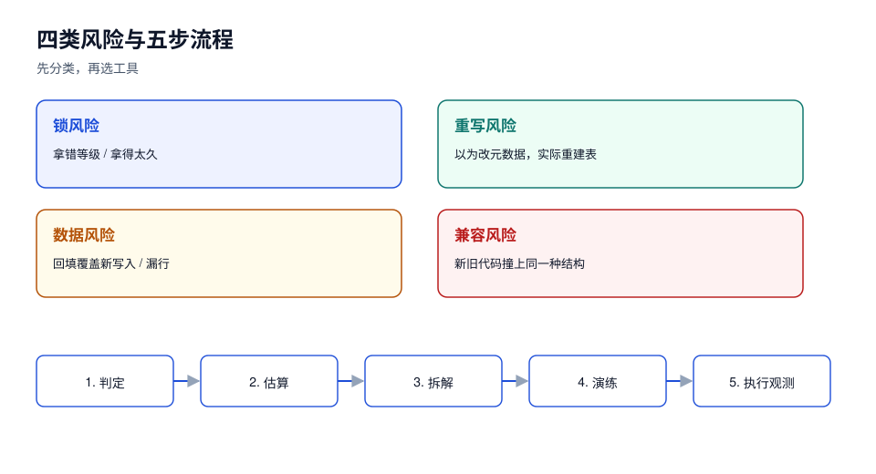

# 总览：四类风险与五步变更流程

在线改表的所有事故，最后都能归到四类风险里的一类。先把风险分类做对，后面的工具选择才有意义——**同一句 DDL，换一个分类就从「无感」变成「停服」**。



## 一、先分清「改结构」与「改数据」

很多团队把两件事混成一件，于是变更单里只写「给订单表加 `channel` 字段」，没写「需要把 800 万行历史数据算出来填进去」。这两件事的代价差两个数量级：

| 动作 | 典型语句 | 代价来源 | 影响面 |
| --- | --- | --- | --- |
| 改**元数据** | `ADD COLUMN ... NULL`、`SET DEFAULT`、`COMMENT` | 改数据字典，毫秒级 | 只在拿元数据锁的一瞬间 |
| 重建**表结构** | 改列类型、加索引（非在线）、改字符集 | 扫全表 + 写新表 + 重建索引 | 按行数线性增长，可能几十分钟 |
| 搬**数据** | `UPDATE ... SET new_col = ...`、回填 | 行版本/undo/binlog 放大 | 与批次、索引、复制链路都有关 |
| 删**数据或列** | `DROP COLUMN`、`DELETE`、`TRUNCATE` | 不可回滚，只可恢复备份 | 事故等级最高 |

::: danger 最容易误判的一类
「加一列并给默认值」在 MySQL 8.4 上是**元数据变更**（INSTANT，实测 0.09 s/50 万行），在 MySQL 5.7 上是**重建表**（`INPLACE` 但整表重建），在 PostgreSQL 11+ 上只有**常量默认值**不重写、**易变函数默认值**照样重写（实测 100 万行 4.1 s，体积 126 MB → 170 MB）。

同一句 SQL，三种代价。**判断依据是「引擎版本 + 默认值是否常量」，不是语句长相。**
:::

## 二、四类风险

### 1. 锁风险：拿错等级、拿得太久

改表首先要拿**元数据锁（metadata lock）**。危险的不是「拿不到」，而是「一直在等」：

- MySQL：DDL 等 MDL 时会进入队列，**队列后面的普通查询也要排队**（实测：一个持有 8 s 的未提交事务，让一条 INSTANT 加列等了 7.14 s，让一条普通 `SELECT count(*)` 等了 6.79 s）。
- PostgreSQL：`ALTER TABLE` 要 `ACCESS EXCLUSIVE`，等在队列里时，后面的 `SELECT` 同样排队（实测：持锁 6 s，普通查询等 5.19 s；带 `lock_timeout=1s` 的查询在 1.12 s 报错）。

### 2. 重写风险：以为改元数据，实际重建表

重建表意味着：磁盘上要能放下第二份数据、期间产生大量 redo/binlog、复制延迟上升、失败要整表回滚。判断方法、估算公式与各引擎矩阵见 [重写边界](../RewriteBoundary/index.md)。

### 3. 数据风险：回填写错、覆盖新写入

回填最典型的两种错：

- **覆盖**：`UPDATE ... SET status = 'paid'` 补历史数据时，把回填期间用户真实支付的状态覆盖掉；
- **漏行**：按 `id BETWEEN` 分批，回填期间有新插入落在已扫过的区间，永远补不到。

两种错都不会报错，只会在几天后以「数据对不上」的形式出现。

### 4. 兼容风险：代码不认识新结构，或新结构不认识旧代码

只要发布不是原子的（滚动发布、蓝绿、多副本），就一定有「新旧代码同时跑」的窗口。窗口里表结构只有一种，代码有两版：**旧代码遇到新列必须不报错，新代码遇到旧列必须能降级**。这一条在 [应用兼容](../AppSchemaCompat/index.md) 展开。

## 三、五步变更流程

| 步 | 产出 | 卡点（不通过就不许进下一步） |
| --- | --- | --- |
| 1. 判定 | 变更类型（四类之一）、锁等级、是否重写 | 判定结果写进变更单，含引擎与版本 |
| 2. 估算 | 预计持锁时长、磁盘增量、复制延迟 | 用「行数 × 单行成本」算，不许写「应该很快」 |
| 3. 拆解 | 拆成几次发布、每次谁先谁后 | 超过 1 次的变更必须有 `expand/contract` 设计 |
| 4. 演练 | 在等量级影子库跑一遍，记录读数 | 读数与估算偏差超过 50% 要重算 |
| 5. 执行与观测 | 变更窗口、观测面板、终止条件 | 触发终止条件的判据必须写成阈值 |

::: tip 一条便宜的经验
**能拆成「加」和「删」两步的，绝不合成一步**。加一列无害，删一列不可回滚；先加（代码双写）→ 回填 → 切换读 → 停止写旧列 → 观察一个发布周期 → 再删。多花两周，换掉一次「只能恢复备份」的可能。
:::

## 四、把五步写成可执行的命令

以 MySQL 8.4 为例，第 1、2 步在动手前就能跑：

```sql
-- 1) 表有多大：行数与数据/索引体积
select table_rows,
       round(data_length / 1024 / 1024, 1) as data_mb,
       round(index_length / 1024 / 1024, 1) as index_mb
from information_schema.tables
where table_schema = 'shop' and table_name = 'orders';

-- 2) 谁在挡路：当前未提交的长事务（DDL 会等它们）
select trx_id, trx_started, timestampdiff(second, trx_started, now()) as held_s,
       trx_rows_locked, trx_query
from information_schema.innodb_trx
order by trx_started asc;

-- 3) 有没有人在等元数据锁（已经出事了才看得到）
select object_name, lock_type, lock_duration, count(*) as n
from performance_schema.metadata_locks
where object_schema = 'shop'
group by object_name, lock_type, lock_duration;
```

PostgreSQL 侧对应三条：

```sql
-- 表体积与行数估算
select relname, n_live_tup,
       pg_size_pretty(pg_total_relation_size(relid)) as total
from pg_stat_user_tables where relname = 'orders';

-- 长事务（比 MySQL 更致命：它还会挡住 vacuum）
select pid, state, now() - xact_start as xact_age, query
from pg_stat_activity
where xact_start is not null and now() - xact_start > interval '1 minute';

-- 谁在等锁、等的是什么锁
select pid, wait_event_type, wait_event, pg_blocking_pids(pid) as blockers, query
from pg_stat_activity where wait_event_type = 'Lock';
```

::: warning 第 2 步的必备动作：先杀掉长事务
实测里那条「8 秒未提交事务」不是偶发——它可能是一个忘了提交的 `BEGIN`，也可能是某个 ORM 的连接池探活。**变更前 10 分钟扫一遍长事务，把超过阈值的连接找出来**，比事后分析为什么 DDL 卡住便宜得多。
:::

## 五、本页判据

| 编号 | 判据 | 看什么现象 | 不满足时改哪里 |
| --- | --- | --- | --- |
| `SCO-A` | 每次变更都标注了引擎与大版本 | 变更单里有 `MySQL 8.4.11` / `PostgreSQL 18.6` 这类字样 | 补基线；无版本的变更单直接打回 |
| `SCO-B` | 四类风险逐条判定过，不是只写「加字段」 | 变更单四行（锁/重写/数据/兼容）都有结论 | 补判定；缺哪行补哪行 |
| `SCO-C` | 持锁时长有算例，不是形容词 | 出现「行数 × 单行成本 = 秒」这类算式 | 用 [重写边界](../RewriteBoundary/index.md) 的公式重算 |
| `SCO-D` | 可拆的变更拆成了「加 / 回填 / 删」多步 | 变更单里有发布批次编号 | 拆；一次发布会话只做一件事 |
| `SCO-E` | 不可回滚操作单独标红 | `DROP` / 类型收窄 / `TRUNCATE` 有独立标注 | 标红并写恢复路径（备份 + 恢复演练记录） |
| `SCO-F` | 演练读数与估算偏差有记录 | 影子库读数、偏差百分比 | 偏差 > 50% 重算后再上 |
| `SCO-G` | 变更前扫过长事务并处理 | `innodb_trx` / `pg_stat_activity` 截图或输出 | 杀掉或等待；不许「先上再说」 |
| `SCO-H` | 有终止条件与观测面板 | 面板链接 + 三条阈值（延迟/错误率/锁等待） | 补阈值；无终止条件不上线 |
## 与「数据库参数与内核调优」专题的分工（第 199 天补充）

本页讲**怎么安全地改表**（扩展-收缩、锁、回填），[数据库参数与内核调优](../../ParameterTuning/index.md) 只提供其中一个参数：`maintenance_work_mem`，它决定建索引与 `VACUUM` 在维护窗口里要跑多久。

| 问题 | 本页（改表流程） | 参数专题（维护窗口） |
| --- | --- | --- |
| 哪些 DDL 会重写表、怎么分三次发布 | ✅ 讲清 | 不重复 |
| 建索引要多久、窗口开多长 | 给流程 | ✅ 给 `maintenance_work_mem` 读数 |
| autovacuum 会不会拖慢回填 | — | ✅ 见[维护参数](../../ParameterTuning/Maintenance/index.md) |

**这一页特有的一个坑**：按默认 `maintenance_work_mem`（64 MB）估维护窗口。本机实测（97 MB、100 万行表上 `CREATE INDEX`）**64 MB → 4,956 ms**、256 MB → 2,959 ms（1.68×）、**1 GB → 2,560 ms（1.94×）**。它同时影响 `CREATE INDEX`、`VACUUM`、外键验证，而且**不是每连接**的——但 `autovacuum_max_workers=3` 时会各拿一份，所以预算要按 3 倍算。

## 参考资料

- MySQL 8.4 Reference Manual: *Online DDL Operations*（第 17.12 节）
- MySQL 8.4 Reference Manual: *Metadata Locking*（第 17.7.6 节）
- PostgreSQL 18 Documentation: *Explicit Locking*、*Monitoring Database Activity*
- PostgreSQL 11 Release Notes: *Fast default values*
- [重写边界](../RewriteBoundary/index.md)、[锁与队列](../LockQueue/index.md)：本页两个「必失点」的展开
