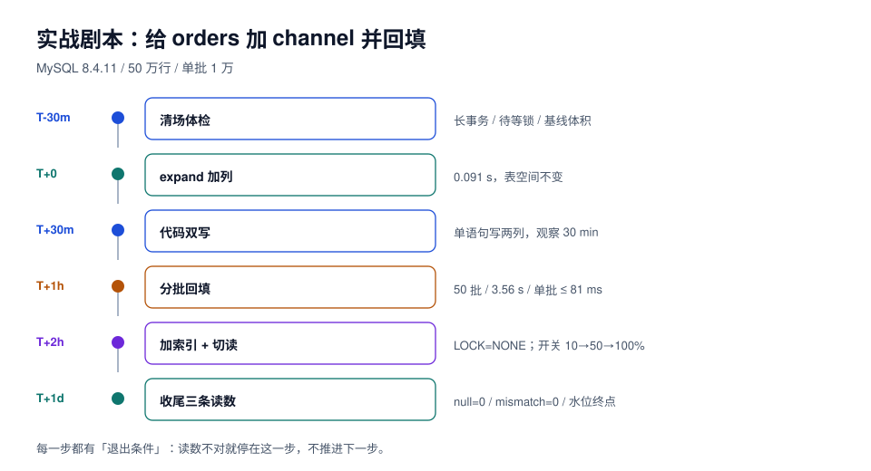

# 实战：给订单表加一列并回填

前面几页讲的是零件，这一页把它们装成一条**能照着执行的剧本**：给 `shop.orders` 加一个 `channel`（下单渠道），要求「不停写、可回滚、失败可续跑」。

场景设定：MySQL 8.4.11，`orders` 50 万行 / 76 MB，3 个二级索引，日订单峰值 300 单/秒，滚动发布（4 个副本）。



## 一、变更单（执行前必须写完）

| 项 | 内容 |
| --- | --- |
| 引擎/版本 | MySQL 8.4.11（`@@version` 实测） |
| 动作 | `ADD COLUMN channel varchar(16) NULL` + 回填 + `SET DEFAULT` + 加索引 |
| 风险判定 | 锁：元数据锁（毫秒）；重写：**否**（INSTANT，实测 0.091 s）；数据：回填 50 万行（实测 3.56 s，批 1 万，单批最长 81 ms）；兼容：旧代码不写该列，需可空 |
| 磁盘 | 加索引 +8 MB（实测 76 → 84 MB）；回填不新增表体积（同表原地更新） |
| 发布批次 | ① DB expand（本页剧本）② 代码双写 ③ 回填 ④ 读切换（开关）⑤ 后续 contract（删临时列/加非空） |
| 回滚 | 代码回滚即可；`DROP COLUMN channel` 需单独窗口（不回滚数据，列删了值就没了） |
| 终止条件 | 锁等待 > 3 s、从库延迟 > 30 s、错误率 > 0.5%，任一触发即停 |

## 二、执行前 30 分钟：清场与体检

```sql
-- ① 长事务：超过 60 秒的都列出来（这条是「DDL 被堵」的头号原因）
select trx_id, trx_mysql_thread_id as conn, timestampdiff(second, trx_started, now()) as held_s,
       trx_state, trx_query
from information_schema.innodb_trx
where timestampdiff(second, trx_started, now()) > 60;

-- ② 有没有人在等元数据锁（变更前应该是 0 行）
select object_name, lock_type, lock_status
from performance_schema.metadata_locks
where object_schema = 'shop' and lock_status = 'PENDING';

-- ③ 表体积与行数（写进变更单的基线）
select table_rows,
       round(data_length / 1024 / 1024, 1) as data_mb,
       round(index_length / 1024 / 1024, 1) as index_mb
from information_schema.tables
where table_schema = 'shop' and table_name = 'orders';
```

::: danger 一个必须接受的现实
上面第 ① 条查出来的事务，**你不能直接杀**——它可能是财务在对账，也可能是某个 batch 正在跑。处置顺序是：找业务方确认 → 能等就等 → 不能等就改窗口。**「先杀了再说」会把改表事故换成数据事故。**
:::

## 三、第 1 步：expand（加列，毫秒级）

```sql
set session lock_wait_timeout = 5;   -- 抢不到锁 5 秒就退出，不占队列

alter table orders add column channel varchar(16) null, algorithm=instant;

-- 验证：列存在、可空、无默认值
select column_name, is_nullable, column_default, data_type
from information_schema.columns
where table_schema = 'shop' and table_name = 'orders' and column_name = 'channel';

-- 验证：没有重写（表空间大小不变）
select round(file_size / 1024 / 1024, 2) as mb
from information_schema.innodb_tablespaces where name = 'shop/orders';
```

预期读数：DDL **< 0.2 s**（实测 0.091 s）；表空间 **不变**；`is_nullable = YES`。

::: warning 如果这一步就超时
`ERROR 1205 Lock wait timeout exceeded` 说明有事务在挡。**不要加大 `lock_wait_timeout` 重试**——那只会让队列更长。回去做第二节的第 ① 条。
:::

## 四、第 2 步：代码双写（发布一次）

```java [OrderWriter.java]
// 新代码：同一条语句写两列（amount 是旧列，amount_cents 是第 4 页例子里的新列）
// 本页的 channel 走「推导值 + 显式写入」，同样要求单语句完成
jdbc.update("""
    insert into orders (id, user_id, amount, amount_cents, status, channel)
    values (?, ?, ?, ?, ?, ?)
    """, id, userId, cents, cents, status, channelOf(paymentMethod));
```

老数据没有 `channel`，读路径在双写期要兜底：

```java [OrderReader.java]
String channel = rs.getString("channel");
if (channel == null) {
    channel = "unknown";   // 仅双写期；回填完成后删掉这段
}
```

发布后观察 30 分钟：新写入行的 `channel` 必须非空。

```sql
select count(*) as new_rows_without_channel
from orders where created_at > now() - interval 30 minute and channel is null;   -- 期望 0
```

## 五、第 3 步：回填（分批 + 水位）

```sql
-- 水位表（只需建一次）
create table if not exists backfill_progress (
  task varchar(64) primary key,
  last_id bigint not null default 0,
  total_done bigint not null default 0,
  updated_at timestamp not null default current_timestamp on update current_timestamp
);
```

```sql
-- 单批：更新 + 推进水位，同一事务；批量 1 万（实测单批最长 81 ms）
begin;
update orders
   set channel = case
       when payment_method in ('alipay', 'wechat') then 'app'
       when payment_method = 'card' then 'web'
       else 'unknown'
     end
 where id > :last_id and id <= :last_id + 10000
   and channel is null;
insert into backfill_progress (task, last_id, total_done)
values ('orders.channel', :last_id + 10000, :done)
on duplicate key update last_id = values(last_id), total_done = values(total_done);
commit;
```

```shell
# 驱动脚本的判据：每批之间检查从库延迟，超 30 s 就 sleep 3 s（伪代码，脚本不入库）
# while last_id < max_id: run_batch(); if replica_lag() > 30: sleep 3
```

预期读数（本机 50 万行）：批 1 万 → **50 批 / 3.56 s / 单批最长 81 ms**。生产按行数线性放大：5,000 万行 ≈ 100 s + 延迟等待。

::: danger 回填最容易出的两个错
1. **`where` 里漏了 `channel is null`**：重跑会把用户后来改过的渠道覆盖回推导值。实测过的判据是「重跑两次，结果集不变」。
2. **`case` 分支没覆盖全**：`payment_method` 出现新值时落到 `else 'unknown'`，看起来成功，实际是把未知归到了已知。回填前后各跑一次「`payment_method` 取值分布」，确认没有新增值。
:::

## 六、第 4 步：切换读 + 加索引

```sql
-- 索引：在回填之后加，避免回填期间维护索引（写放大）
alter table orders add index idx_channel (channel), algorithm=inplace, lock=none;

-- 验证索引真的建成了、且没有残留的失败态
select index_name, non_unique, seq_in_index, column_name
from information_schema.statistics
where table_schema = 'shop' and table_name = 'orders' and index_name = 'idx_channel';
```

读切换用开关（不用发版）：`orders.read_channel_from_new_column = 10% → 50% → 100%`，每档观察 15 分钟，看两个数：

| 指标 | 观测方式 | 阈值 |
| --- | --- | --- |
| 错误率 | 应用面板（按接口） | < 0.5% |
| 锁等待 | `performance_schema.metadata_locks` 的 `PENDING` 行数 | 持续 > 0 超 3 s 即告警 |

## 七、第 5 步：收尾（三条读数 + 抽样）

```sql
-- ① 没有未回填的行
select count(*) from orders where channel is null;                        -- 期望 0

-- ② 推导结果与来源一致
select count(*) from orders o
  join payments p on p.order_id = o.id and p.seq = 1
where o.channel <> case when p.method in ('alipay','wechat') then 'app'
                        when p.method = 'card' then 'web' else 'unknown' end;  -- 期望 0

-- ③ 水位推到终点
select last_id, total_done from backfill_progress where task = 'orders.channel';
select max(id) from orders;
```

再加一步人工抽样：随机取 20 行，把 `payments.method` 与 `orders.channel` 并排看。**自动化只能证明「和规则一致」，证明不了「规则对」。**

## 八、这次变更留下的三个数字

| 数字 | 值 | 用途 |
| --- | --- | --- |
| DDL 持锁 | 0.091 s | 下次同类变更直接引用，不必再演练 |
| 回填速率 | 14 万行/s（批 1 万） | 5,000 万行 ≈ 6 分钟纯计算 |
| 单批最长 | 81 ms | 决定「延迟预算 100 ms」是否成立 |

::: tip 把数字沉淀成基线
下一次给另一张表加列时，第一件事是拿这三条去对：行数是 10 倍就乘 10，索引多 2 个就乘 1.6。**没有基线的团队每次都在重新猜，有基线的团队 5 分钟出结论。**
:::

## 九、本页判据

| 编号 | 判据 | 看什么现象 | 不满足时改哪里 |
| --- | --- | --- | --- |
| `SCP-A` | 变更单在动手前写完，含四类风险与回滚 | 变更单文件/工单 | 补；边做边写等于没写 |
| `SCP-B` | 执行前查过长事务且处置有记录 | `innodb_trx` 输出 + 处置结论 | 补；不许直接杀 |
| `SCP-C` | expand 用 `ALGORITHM=INSTANT` 且验证未重写 | 表空间大小前后一致 | 改写法；不一致说明退化成重建 |
| `SCP-D` | 双写是单语句，且发布后 30 分钟无空值 | `new_rows_without_channel = 0` | 修 SQL；两次写会漏 |
| `SCP-E` | 回填有水位、有幂等过滤、单批 ≤ 100 ms | 水位表 + 批次读数 | 补；否则中断就得从头来 |
| `SCP-F` | 索引在回填之后建，并查过 `statistics` | 索引存在且列正确 | 调顺序；边回填边维护索引是双倍写 |
| `SCP-G` | 读切换用开关，且每档 15 分钟观察 | 开关变更记录 + 面板截图 | 补；发版切换回滚太慢 |
| `SCP-H` | 收尾三条读数 + 20 行抽样 | 三条 SQL 结果 + 抽样记录 | 补齐；缺抽样会漏「规则错」 |

## 参考资料

- MySQL 8.4 Reference Manual: *Online DDL Operations*、*Metadata Locking*
- MySQL 8.4 Reference Manual: `performance_schema.metadata_locks`、`information_schema.innodb_trx`
- PostgreSQL 18 Documentation: *ALTER TABLE*、*CREATE INDEX CONCURRENTLY*（PG 版本的等价剧本）
- [扩展-收缩](../ExpandContract/index.md)、[数据回填](../Backfill/index.md)、[应用兼容](../AppSchemaCompat/index.md)：本页三步的理论页
