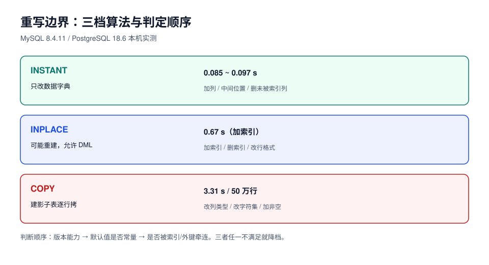

# 重写边界：哪些 DDL 真的会重建表

「这条 DDL 要不要重写整表」是变更单上第一个必须回答的问题。答错的代价不是慢，而是**在业务高峰把 40 GB 的表复制一遍**。

本页给两样东西：一张按引擎列的判定表，一个**执行前后各一条就能验证「有没有重写」的判据**。



## 一、先看结论

| 操作 | MySQL 8.4（50 万行 / 76 MB） | PostgreSQL 18（100 万行 / 126 MB） |
| --- | --- | --- |
| 加可空列 | **INSTANT**，0.09 s，文件大小不变 | 元数据，毫秒级，不重写 |
| 加列 + 常量默认值 + `NOT NULL` | **INSTANT**，0.09 s | 元数据，**1.19 ms**，体积不变 |
| 加列 + 易变函数默认值 | `ERROR 1674`（本机 `binlog_format=ROW` 仍拒） | **重写**，4,098.8 ms，126 → 170 MB |
| 加列到中间位置（`AFTER k`） | **INSTANT**（8.0.29+），0.09 s | 不支持列序（列序由 `attnum` 决定） |
| 改列类型 `int → bigint` | 只能 `COPY`，**3.31 s** | **重写**，2,171.6 ms |
| 加普通索引 | `INPLACE`，0.67 s，体积 76 → 84 MB | `CREATE INDEX` 355 ms；`CONCURRENTLY` 265 ms |
| 设置 `NOT NULL` | 需 `COPY`（除非列本来就没有 NULL 且走 `MODIFY ... NULL` 的元数据路径） | 直接 158 ms（持 `ACCESS EXCLUSIVE`）；两步法 0.9 + 518 ms（不挡写） |
| 删除列 | 列**被索引引用**时 `ERROR 1845`；先删索引再删列则 INSTANT | 元数据，毫秒级（不回收空间） |

::: danger 这张表不能背，要会查
上表是「本机 + 这两个版本」的读数，换版本就会变。例如 MySQL 8.0.12 之前加列一律重建；8.0.29 之前不支持 INSTANT 删列与改列序；PostgreSQL 11 之前加任何带默认值的列都重写。**判断顺序永远是：先看版本能力矩阵，再看默认值是否常量，最后看有没有索引/外键牵连。**
:::

## 二、MySQL 侧：`ALGORITHM` 三档与它们的真实行为

MySQL 的在线 DDL 把执行方式分成三档，写 DDL 时可以用 `ALGORITHM=` 强制，也可以让它自己选（默认 `DEFAULT`）：

| 算法 | 是否重建表 | 并发 DML | 典型操作 | 本机读数 |
| --- | --- | --- | --- | --- |
| `INSTANT` | 否（只改数据字典） | 允许 | 加列（含中间位置）、删列（未被索引引用）、改默认值、改列名 | 0.085–0.097 s |
| `INPLACE` | 不一定（可能重建但不许 DML） | 视操作 | 加/删索引、加全文索引、改 `ROW_FORMAT` | 加索引 0.67 s |
| `COPY` | 是（建影子表逐行拷） | **不允许** | 改列类型、改字符集、加 `NOT NULL`（无默认值） | 改 `int→bigint` 3.31 s |

三档的边界用「强制指定」来探，是最省事的判定方法：

```sql
-- 探一下：这条 DDL 到底能不能 INSTANT
alter table orders add column channel varchar(16) null, algorithm=instant;
-- 成功 → 元数据变更，可以放心在业务高峰做（仍要拿 MDL X，见下页）

alter table orders modify amount bigint not null default 0, algorithm=instant;
-- ERROR 1846 (0A000): ALGORITHM=INSTANT is not supported. Reason: ...
-- 说明必须 INPLACE/COPY，属于「要算时长」的变更
```

::: warning `ALGORITHM=INSTANT` 的三个真实边界（本机实测）
1. **易变默认值直接被拒**：`add column c6 varchar(36) not null default (uuid())` → `ERROR 1674`（语句被判为不安全）。想加这种列，只能加可空列再用回填填值。
2. **被索引引用的列不能 INSTANT 删**：`drop column c1` → `ERROR 1845`；先 `drop index idx_c1`（单独一条语句）再删列 → 0.09 s 成功。两条合并成一条 `drop index ..., drop column ...` 仍然失败，因为多操作组合本身不支持 INSTANT。
3. **INSTANT 会积累「行版本」**：每次 INSTANT 加/删列都会让 `information_schema.innodb_tables.total_row_versions` 加一（实测 2 → 4 → 5）。版本数很多之后，**旧行需要用「反查」方式补出缺失列**，读取会变慢——所以「INSTANT 很便宜」不等于「可以无限次 INSTANT」。
:::

## 三、PostgreSQL 侧：三种写法，三种代价

PG 的判定比 MySQL 简单，因为只有两个变量：**要不要重写**、**拿什么锁**。

### 1. 加列：常量默认值不重写，易变默认值重写

```sql
-- 不重写：默认值存在 pg_attribute.attmissingval，读旧行时补出来
alter table orders add column channel varchar(16) not null default 'web';

-- 重写：clock_timestamp() / gen_random_uuid() / random() 是 VOLATILE
alter table orders add column trace_id uuid not null default gen_random_uuid();
```

`now()` 是 `STABLE` 不是 `VOLATILE`，所以 `default now()` **不重写**——这一点很多人记反。判断方法是查 `pg_proc.provolatile`：

```sql
select proname, provolatile from pg_proc where proname in ('now','clock_timestamp','gen_random_uuid','random');
-- provolatile: i=immutable, s=stable, v=volatile；只有 v 会触发重写
```

### 2. 改类型：几乎总是重写

`int → bigint` 在 PG 里没有「就地扩展」的捷径，必然重写（实测 100 万行 2.17 s，200 万行约 4.3 s 线性放大）。想避免重写只有两条路：加新列 + 回填 + 切换（三段式），或者接受一次维护窗口。

### 3. 加约束：`NOT NULL` 有低锁写法

```sql
-- 高锁：全表扫描期间持 ACCESS EXCLUSIVE（实测 100 万行 158 ms）
alter table orders alter column channel set not null;

-- 低锁：两步，扫描期间只持 SHARE UPDATE EXCLUSIVE（实测 0.9 ms + 518 ms）
alter table orders add constraint orders_channel_nn check (channel is not null) not valid;
alter table orders validate constraint orders_channel_nn;
alter table orders alter column channel set not null;   -- 已有有效 CHECK，瞬间完成（1.06 ms）
alter table orders drop constraint orders_channel_nn;   -- 校验完就可以删掉这个临时约束
```

::: tip 为什么第二步那么快
`SET NOT NULL` 需要证明「没有 NULL」。如果已经存在一条**已校验**的 `CHECK (col IS NOT NULL)`，PG 直接采信它，不再扫表——这就是 1.06 ms 与 158 ms 的差别来源。注意 `NOT VALID` 的约束**不能**被采信，必须先 `VALIDATE`。
:::

## 四、验证「到底重写没重写」：一条查询就够

不要相信文档，也不要相信「感觉很快」。两个引擎各有一条**执行前后对比**的硬判据：

```sql
-- PostgreSQL：重写会换掉物理文件（relfilenode 变化）
select relfilenode, pg_size_pretty(pg_relation_size('orders')) from pg_class where relname = 'orders';
```

实测三次对比（20 万行 / 18 MB 表）：

| 操作 | `relfilenode` | 体积 | 结论 |
| --- | --- | --- | --- |
| 基线 | 16428 | 18 MB | — |
| `add column c1 int not null default 0` | **16428（不变）** | 18 MB | 未重写；`pg_attribute.atthasmissing = t` |
| `add column c2 timestamptz not null default clock_timestamp()` | 16440（变） | 21 MB | 重写 |
| `alter column k type bigint` | 16446（变） | 21 MB | 重写 |

```sql
-- MySQL：INSTANT 改的是数据字典，表空间文件大小不变；重建会让文件增长
select round(file_size / 1024 / 1024, 2) as mb
from information_schema.innodb_tablespaces where name = 'shop/orders';

-- 还能直接看「积累了几个行版本」
select name, total_row_versions from information_schema.innodb_tables where name = 'shop/orders';
```

## 五、时长估算：用「单行成本」算，不要用「上次花了多久」

实测得到的单行成本（同机、热缓存）：

| 引擎 | 操作 | 总耗时 | 行数 | 单行成本 |
| --- | --- | --- | --- | --- |
| MySQL 8.4 | `COPY` 改列类型 | 3.31 s | 500,000 | **6.6 µs/行** |
| PostgreSQL 18 | 重写改列类型 | 2.17 s | 1,000,000 | **2.2 µs/行** |
| PostgreSQL 18 | 易变默认值重写 | 4.10 s | 1,000,000 | **4.1 µs/行** |

估算式：

```text
预计持锁时长 ≈ 行数 × 单行成本 × 冷缓存系数(2~3) × 索引放大(1 + 索引数 × 0.3)
磁盘增量     ≈ 表体积 × (1 + 索引占比)        -- 重建期间新旧两份并存
```

算例：2,000 万行、3 个二级索引、热缓存 6.6 µs/行 → 132 s × 1.9 ≈ **250 s**，磁盘需要额外约 1.6 倍表体积。这个数字写进变更单，才有资格讨论「放哪个窗口」。

::: danger 三个把估算带偏的常见错误
1. **用「开发库 1 万行 0.1 秒」线性外推**：小表常常整表在缓冲池里，且不触发检查点，外推会低估 3~10 倍。
2. **忽略二级索引**：重建表要重建所有二级索引，索引越多越慢；上表 3 个索引的放大系数取 1.9 是保守估计。
3. **忽略复制**：主库 250 s 的重写，在从库上是同样的 250 s 单线程回放（MySQL 5.7 常见），延迟峰值会超过持锁时长。
:::

## 六、本页判据

| 编号 | 判据 | 看什么现象 | 不满足时改哪里 |
| --- | --- | --- | --- |
| `SCD-A` | 变更单写明引擎与版本 | `MySQL 8.4.11` / `PostgreSQL 18.6` | 补基线；不同版本判定表不同 |
| `SCD-B` | 用 `ALGORITHM=` 探过能力边界 | 有 `ERROR 1846` / `1845` 记录或成功记录 | 补探测；不许凭记忆 |
| `SCD-C` | 默认值区分常量与易变 | 变更单标注 `constant` / `volatile` | 易变默认值改「加可空列 + 回填」 |
| `SCD-D` | 执行前后对比 `relfilenode` / 表空间体积 | 两次查询输出 | 补读数；这是唯一硬证据 |
| `SCD-E` | 时长用单行成本算例，不是形容词 | 「行数 × µs = 秒」算式 | 按本页表格重算 |
| `SCD-F` | 磁盘增量算过且已确认可用空间 | 表体积 × 系数 ≤ 可用空间 | 扩盘或改窗口策略 |
| `SCD-G` | 从库延迟预算算过 | 复制延迟预估与阈值 | 加 `pt-heartbeat`/`pg_stat_replication` 观测 |
| `SCD-H` | `INSTANT` 次数有上限意识 | `total_row_versions` 读数 | 定期 `OPTIMIZE`/重建，或改设计避免频繁加减列 |

## 参考资料

- MySQL 8.4 Reference Manual: *Online DDL Operations*、*ALGORITHM* 选项、`ERROR 1845/1846` 说明
- MySQL 8.4 Reference Manual: *InnoDB Row Formats* — 行版本与 instant 列的读取路径
- PostgreSQL 18 Documentation: *ALTER TABLE* — `ADD COLUMN` 与 `atthasmissing`
- PostgreSQL 11 Release Notes: *Fast default values for columns added with ALTER TABLE*
- PostgreSQL 18 Documentation: *System Catalogs* — `pg_class.relfilenode`、`pg_attribute.atthasmissing`
- 本仓库相邻专题：[数据库大版本升级与切换](../../../Ops/DatabaseUpgrade/index.md)（换版本时的 DDL 冻结、锁与回填边界）
