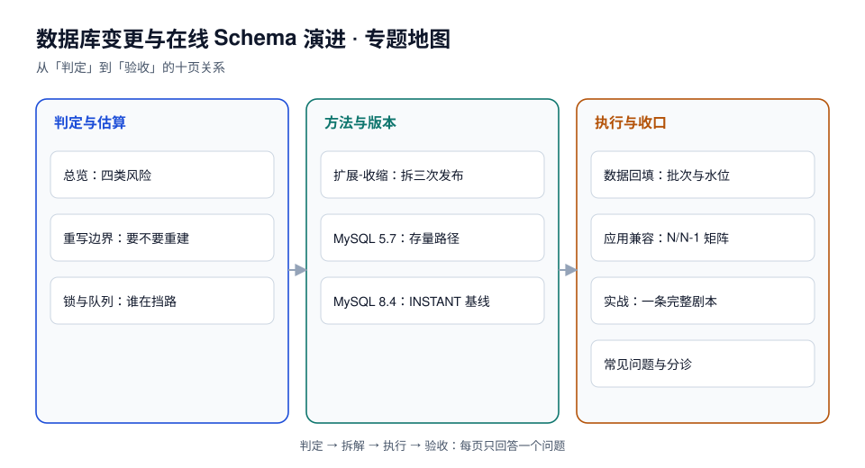

# 数据库变更与在线 Schema 演进

改一条表结构，在开发机上是一条 `ALTER TABLE`，在生产上是一次**带锁的、可能重写整张表的、无法中途撤销的**操作。它和发布代码不是一回事：代码回滚只要换回旧镜像，表结构回滚要把数据搬回去——很多时候搬不回去。

本专题面向要「在不长时间停写的前提下改表」的后端与 DBA：把「这次变更会拿什么锁、会不会重写、要多久、失败了怎么办」讲成上线前能算出来的四件事。

::: tip 一句话理解
在线改表的全部难点不是「怎么写 SQL」，而是**「这条语句在 1 亿行上会拿走什么锁、拿多久」**——锁的等级决定影响面，持锁时长决定故障窗口，而这两件事都能在执行前算出来。
:::

::: info 本专题与相邻专题的分工
- **表该怎么设计、范式与反范式怎么选** → [数据建模](../DataModeling/index.md)：那里定「表长什么样」，本专题定「已经上线的表怎么改成另一个样子」。
- **索引为什么快、执行计划怎么读** → [SQL 优化](../Relational/SQLOptimization/index.md) 与 [MySQL 索引深入](../Relational/MySQL/IndexDeepDive/index.md)：本专题只讲「加索引这个动作的代价」，不讲「该不该加这个索引」。
- **分区怎么切、历史数据怎么归档** → [分区分表与冷热分离](../PartitionArchival/index.md)：分区表上的 DDL 有额外语法（`ALTER TABLE ... EXCHANGE PARTITION`），那页讲分区本身，本页讲变更节奏。
- **发布怎么灰度、怎么回滚** → [变更管理与发布工程](../../Ops/ChangeManagement/index.md)：那里管「代码先上还是先上配置」，本专题管「代码与表结构谁先动、动几步」。
- **迁移脚本在工程里怎么组织、怎么进 CI** → [TeamBoard 工程骨架](../../../project/Complete/TeamBoard/Bootstrap/index.md) 与 [TeamBoard 迁移清单闸门](../../../project/Complete/TeamBoard/MigrationInventoryGate/index.md)：项目侧的落地形态。
- **一次拖动/一次下单的事务边界怎么写** → [TeamBoard 领域核心](../../../project/Complete/TeamBoard/DomainCore/index.md)：本专题改的是表，不是事务。
- **「库表是最硬的契约」这个视角、以及四阶段在 PG 200 万行上的读数** → [库表演进：expand-contract 四阶段](../../Backend/ContractEvolution/SchemaEvolution/index.md)：那页把四阶段当作**契约演进**讲（含 `CES-A~CES-H` 判据与本机读数），本专题不重复它的四阶段叙述，只补它没覆盖的三面——**锁与队列的机制、重写边界的引擎矩阵（含 MySQL 5.7/8.4 版本路径）、回填的批次与水位**。
:::

## 目录

- [总览：四类风险与五步变更流程](Overview/index.md)
- [扩展-收缩：把一次变更拆成三次发布](ExpandContract/index.md)
- [重写边界：哪些 DDL 真的会重建表](RewriteBoundary/index.md)
- [锁与队列：一条 DDL 怎么把读也堵死](LockQueue/index.md)
- [MySQL 5.7：已停止维护的存量路径](MySQL57/index.md)
- [MySQL 8.4：INSTANT、原子 DDL 与在线索引](MySQL84/index.md)
- [数据回填：批次、水位与速率控制](Backfill/index.md)
- [应用兼容：N/N-1 矩阵与回滚边界](AppSchemaCompat/index.md)
- [实战：给订单表加一列并回填](Practice/index.md)
- [常见问题与分诊](FAQ/index.md)

## 专题地图

## 判据纪律

沿用全库写法：**每页 8 条，编号形如 `SCO-A`**，逐页前缀唯一，可被 `utils/audit` 下的判据类巡检机械核对。每条判据都要能回答三件事：**看什么现象、判成什么、不满足时改哪里**。

| 页 | 判据族 | 条数 | 这一族管什么 |
| --- | --- | --- | --- |
| 总览 | `SCO-A` ~ `SCO-H` | 8 | 风险分类、流程卡点与变更单要件 |
| 扩展-收缩 | `SCE-A` ~ `SCE-H` | 8 | 三段式拆解、双写与下线条件 |
| 重写边界 | `SCD-A` ~ `SCD-H` | 8 | 算法判定、重写与否、体积与时长估算 |
| 锁与队列 | `SCL-A` ~ `SCL-H` | 8 | 锁等级、队列效应、超时与重试 |
| MySQL 5.7 | `SCM-A` ~ `SCM-H` | 8 | 存量 5.7 的可用算法与外部工具路径 |
| MySQL 8.4 | `SCN-A` ~ `SCN-H` | 8 | INSTANT、原子 DDL、在线索引与失败态 |
| 数据回填 | `SCB-A` ~ `SCB-H` | 8 | 批次、水位、幂等与速率上限 |
| 应用兼容 | `SCA-A` ~ `SCA-H` | 8 | N/N-1 矩阵、部署顺序与回滚边界 |
| 实战 | `SCP-A` ~ `SCP-H` | 8 | 端到端剧本与验收读数 |
| 常见问题 | `SCQ-A` ~ `SCQ-H` | 8 | 症状分诊与上线自查 |

合计 **10 族 80 条**。

## 事实与版本速览（2026-10 核对）

| 项 | 现状 | 对变更的影响 |
| --- | --- | --- |
| MySQL 5.7 | GA 2015-10-09，**2023-10-31 已停止支持**（末版 5.7.44） | 没有 `ALGORITHM=INSTANT`；加列只能 `INPLACE`（重建）或外部工具；无原子 DDL |
| MySQL 8.0 | **2026-04-30 停止支持**（末版 8.0.46） | 有 INSTANT（8.0.12 起加列、8.0.29 起删列与改列序），但已进入「不建议新部署」阶段 |
| MySQL 8.4 LTS | GA 2024-04-10，Premier 至 **2029-04**、EOL **2032-04**（当前 8.4.11） | 本专题「8.4 版」页的基线：INSTANT 默认、原子 DDL、`LOCK=NONE` 在线索引 |
| MySQL 9.x / 9.7 LTS | 9.x 为 innovation 系列；**9.7 为 2026-04 起的 LTS** | DDL 语义沿 8.4 血脉，本专题不单独建目录，差异并入 8.4 页标注 |
| PostgreSQL 18 | 2025-09 发布，当前主线 | 常量默认值加列**不重写**（PG 11 起）；`CREATE INDEX CONCURRENTLY`、`VALIDATE CONSTRAINT` 是低锁工具 |
| PostgreSQL 11 之前的「加列要重写」 | 2018 年以前的行为 | 老文章里「加列会锁表几十分钟」的结论，在 PG 11+ 只对**易变默认值**成立 |

::: warning 关于「实测」的诚实标注
本专题的数字分两类，正文逐处标注：

- **本机可复跑**：MySQL **8.4.11** 容器（`docker run mysql:8.4`，50 万行 / 76 MB 表）与 PostgreSQL **18.6** 容器（100 万行 / 126 MB 表），命令都写在页面里，**脚本本身不入库**（放在仓库外）。同一台机器（macOS x64、Docker Desktop 27.1.1），数字用于**比较不同写法的量级差**，不是你们生产库的绝对值。
- **公开口径**：MySQL / PostgreSQL 的版本生命周期与算法支持矩阵，逐条标来源与日期；凡属推算（容量、时长、批次上限）一律写「算例」。

两处必须说清的局限：① 容器里的表**在页缓存中**，真实库冷启动会更慢，所以「3.3 秒重建 50 万行」不能直接外推到 1 亿行（应按行数线性放大后再留 2 倍余量）；② MySQL 5.7 的读数**没有实测**——5.7 已 EOL，镜像与授权都不再提供，该页的结论全部来自官方文档与工具文档，页面内逐条标注。
:::

## 版本目录说明（为何建 MySQL57 / MySQL84 两个目录）

本专题是**少数需要建版本目录**的主题之一，因为 MySQL 5.7 与 8.4 在「怎么改表」这件事上是**两套可执行路径**，不是同一套用法的参数差异：

1. **能力不同**：5.7 没有 `ALGORITHM=INSTANT`，给大表加一列就会重建整表；8.4 加列默认走 INSTANT，只改元数据。同一句 `ALTER TABLE ... ADD COLUMN`，在两边是「几毫秒」与「几分钟」的区别。
2. **兜底手段不同**：5.7 时代的主流做法是用 `pt-online-schema-change` / `gh-ost` 在外部做影子表；8.4 上多数场景不再需要外部工具，工具退化为「改列类型」等少数场景的备选。
3. **读者不同**：仍跑 5.7 的系统是**存量维护**（不再新增功能，只求别出事），8.4 是**新部署基线**。把两者混在一页里，读者会拿着 8.4 的结论去操作 5.7 的库——这是本专题最想避免的事故。

因此两个目录并存、互不覆盖：`MySQL57/` 顶部标注「已停止维护 · 仅存量项目」，`MySQL84/` 标注「当前 LTS 基线」。8.0 作为过渡版本不单独立目录，差异并入 8.4 页的对照表并标注适用版本——理由与 [分布式调度专题](../../Backend/DistributedScheduling/index.md) 一致：**同一血脉的两个小版本不需要两套文档，两代能力才需要**。

## 三条底线

1. **变更必须能被执行前算出来**：锁等级、是否重写、预计持锁时长，三项写进变更单，写不出来就不上。
2. **应用永远先兼容两种结构**：表结构在某一刻只能是一种，但代码必须能同时对旧结构和新结构工作，否则发布顺序无解。
3. **不可回滚的操作要单独标出来**：`DROP COLUMN`、类型收窄、`TRUNCATE`、删除分区——这些没有「回滚脚本」，只有「恢复备份」，必须在变更单里写成红色。

## 参考资料

- MySQL 8.4 Reference Manual: *Online DDL Operations*、*InnoDB Online DDL Algorithm Support*、*Metadata Locking*
- MySQL 8.4 Reference Manual: *Atomic Data Definition Statement Support*
- MySQL 5.7 Reference Manual: *Online DDL Overview*、*InnoDB Locking*
- PostgreSQL 18 Documentation: *ALTER TABLE*、*Explicit Locking*、*Progress Reporting*（`CREATE INDEX` 进度）
- PostgreSQL 11 Release Notes: *Fast default values for columns added with ALTER TABLE*
- Oracle Lifetime Support Policy: MySQL Releases（5.7 / 8.0 / 8.4 / 9.7 的支持窗口）
- Percona Toolkit `pt-online-schema-change`、GitHub `gh-ost` 官方文档
- Martin Kleppmann《Designing Data-Intensive Applications》第 4 章（编码与 schema 演进）
- 本仓库相邻专题：[数据库大版本升级与切换](../../Ops/DatabaseUpgrade/index.md)（换版本时的 DDL 冻结、锁与回填边界）
