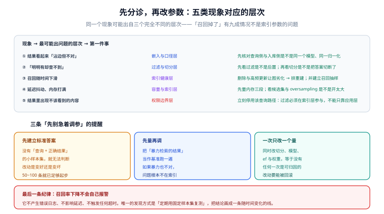

# 常见问题与最佳实践

这一页把前八页里最常被问到的问题集中回答，并给出一份可以直接拿去核对的上线清单。

**使用方式**：先看第一节的分诊表定位层次，再跳到对应页面看机制；**不要一上来就改参数**——同一个现象可能出自三个完全不同的层次。

## 一、分诊表：五类现象对应的层次

| 现象 | 最可能出问题的层次 | 第一件事 | 去读哪一页 |
| --- | --- | --- | --- |
| 结果看起来「沾边但不对」 | 嵌入与口径 | 核对查询侧与入库侧是否同一模型、同一归一化 | [概述](../Overview/index.md) |
| 「明明有却查不到」 | 过滤与切分 | 看过滤是否后置；看切分是否把答案切断了 | [过滤与元数据检索](../Filtering/index.md) |
| 召回随时间下滑 | 索引健康 | 统计删除/更新比例，安排重建 | [HNSW 原理深入](../HNSW/index.md) |
| 延迟抖动、内存打满 | 容量与索引 | 先量内存三段；看候选数与 oversampling | [运维与容量](../Operations/index.md) |
| 结果里出现不该看到的内容 | 权限边界 | **立刻停用该查询路径**，把过滤下推到索引层 | [实战](../Practice/index.md) |

::: danger 一条优先级最高的纪律
**越权类问题不排查、先止血。** 其余四类现象最多影响体验，这一类是安全事故。止血方式是把该查询路径的流量切走（或把过滤条件改成最严格的默认值），然后在非生产环境上复现与修复。
:::

## 二、高频十二问

### Q1：为什么不直接用暴力检索？

语料小于 10 万条时，暴力检索通常几毫秒就够，**而且召回率是 100%，不需要任何调参**。暴力检索的成本与数据量线性相关：100 万 × 768 维一次查询就是 7.68 亿次乘加。**先用它拿延迟基线，也用它生成召回率的标准答案。**

### Q2：HNSW 和 IVF-PQ 该选哪个？

看约束落在「三角」的哪一边：**内存够装「向量 + 图」就选 HNSW**（召回—延迟最好）；**内存是硬约束就选 IVF-PQ**（省内存的主力）；**内存不够但能容忍十~百毫秒延迟就考虑落盘/分区路线**。详见[索引算法全景](../IndexAlgorithms/index.md)。

### Q3：`ef`、`probes` 这些参数到底调的是什么东西？

它们都是「**检索时考察多少候选**」。调大 → 召回升、延迟升；调小反之。`efSearch`（HNSW）可以在查询时逐条调整；`M` / `efConstruction`（HNSW）和 `lists`（IVF）是**建索引参数**，改了必须重建。

### Q4：为什么我把 `M` 从 16 改成 32，检索没变化？

因为 `M` 是**建索引参数**：图的结构在建立时就固化了，改配置不重建不会生效，**而且不会有任何提示**。正确做法是把「改 `M`」当成数据迁移类变更，走「建新索引 → 对比召回 → 切流量 → 删旧索引」的流程。

### Q5：量化之后召回掉了很多，是不是量化不好？

先确认三件事：① **是否做了重排**（量化只用于找候选，最终排序必须用原始向量）；② **是否开了 oversampling**（候选数要放大到 `k × 3` 以上）；③ **量化档位是否与维度匹配**（低维向量上加二值量化损失不可逆）。三条都满足还掉得厉害，就退一档（如从 1 bit 退到 int8）。

### Q6：为什么加了 `WHERE` 之后结果条数不够？

因为过滤发生在检索之后：先取 top-k，再丢掉不合格的，条数自然变少。这是**最典型的过滤陷阱**。修法有三条：把过滤下推到引擎、让引擎按选择性自动选路（前置过滤 / 图内过滤 / 全量扫描）、或在 pgvector 上打开**迭代索引扫描**。详见[过滤与元数据检索](../Filtering/index.md)。

### Q7：过滤器写对了，为什么召回还是低？

可能的原因按概率排序：① **过滤字段没有标量索引**（引擎无法估选择性，选错路径）；② **该过滤形状确实很难**（例如覆盖约五分之一集合的宽值、或多条件 AND 的交集）；③ **候选集太小**；④ **索引已经劣化**。**「按过滤形状分别测召回」是唯一能区分这四种原因的做法。**

### Q8：RRF 的 `k` 要不要调？

默认 `k=60` 是一个很稳的起点，**多数情况不需要调**。`k` 越大，越强调「两腿共识」而不是「单腿自信」。真要调整，也必须是**在评估集上测出来的**，不能靠感觉。需要偏向某一腿时，用**加权 RRF**，而不是回去混原始分数。

### Q9：一次查询延迟忽高忽低，怎么回事？

按顺序查：① **候选数**（`ef` / `nprobe` / oversampling）是否被某个分支放大；② **内存是否开始 swap**（这是延迟长尾最常见的原因）；③ **是否发生了索引重建或合并**（此时新旧数据并存）；④ **过滤的选择性是否导致了路径切换**（同一集合上不同查询可能走完全不同的路径）。

### Q10：多久重建一次索引？

**不要按时间定，按更新量定**：累计删除 + 更新超过总量的 20%~30% 时触发。判据是「**重建后召回是否回到基线**」——如果没变化，说明重建周期定得太密，是白花的成本。

### Q11：换嵌入模型要怎么做？

因为新旧向量**不在同一个向量空间**，不能就地升级。标准流程：新建集合 → **双写** → 回填历史数据 → 用评估集对比召回 → **灰度切读** → 全量切换 → 删旧集合。**先删旧集合再切流量，等于删掉了回滚路径。**

### Q12：我怎么知道召回率掉了？

**建立一个每日抽样任务**：固定评估集（200~500 条真实查询 + 暴力检索生成的标准答案），每天跑一次算 recall@10，与基线对比，下降超过 3~5 个点告警。

**这是本页最重要的一条**：召回率不会出现在任何常规监控里——它不报错、不影响延迟、不触发超时。**不主动测，就只能等用户来投诉。**

## 三、上线自查二十项

提交上线前逐条核对。前十二项在配置与代码层面就能判定，后八项需要真实实例。

| # | 检查项 | 类别 |
| --- | --- | --- |
| 1 | 集合的维度、距离度量、索引参数与设计文档一致 | 配置 |
| 2 | 查询侧与入库侧使用同一模型、同一维度、同一归一化口径 | 口径 |
| 3 | 写入端对向量范数做了断言（用余弦距离时 `norm ≈ 1`） | 口径 |
| 4 | 每个要过滤的字段都建了标量索引 | 过滤 |
| 5 | 过滤条件在检索请求里可见，不是拿到结果后在代码里筛 | 过滤 |
| 6 | 可见范围由服务端注入，不能由客户端传入 | 权限 |
| 7 | `ef >= k`，且量化时 `候选数 >= k × 3` | 候选 |
| 8 | 量化已开启重排，原始向量仍被保留 | 量化 |
| 9 | 两条腿并发执行（延迟取 max 而不是 sum） | 融合 |
| 10 | 融合前按文档去重（避免结果页被同一文档占满） | 融合 |
| 11 | 每种过滤形状都有独立的召回记录，不只记平均值 | 召回 |
| 12 | 索引参数变更被当作「需要重建」的变更，而不是配置变更 | 变更 |
| 13 | 评估集已建立（≥ 200 条查询，含标准答案） | 召回 |
| 14 | 实测 recall@10 达到目标（建议 ≥ 0.90，编号类查询更高） | 召回 |
| 15 | p95 延迟在预算内，且长尾（p99）没有失控 | 性能 |
| 16 | 内存水位与磁盘余量有告警 | 容量 |
| 17 | 越权冒烟测试可自动重复执行，且返回 0 条 | 权限 |
| 18 | 语义删除（源数据删除 → 向量删除）已打通并验证过 | 边界 |
| 19 | 重建流程演练过一次（含回滚） | 运维 |
| 20 | 每日召回抽样任务已上线，且下降会告警 | 运维 |

## 四、十二条最佳实践

::: tip 逐条都是「代价很低、收益很高」的动作
1. **先跑暴力检索拿基线**：它是延迟基线与召回标准答案的唯一来源。
2. **先建评估集再调参**：50~100 条真实查询就够起步，没有它所有调参都是猜。
3. **先扫 `ef`（零成本、可回滚）再动 `M`（要重建）**：调整顺序决定了迭代速度。
4. **过滤一定要下推到索引层**：这既是性能问题，也是安全问题。
5. **每个要过滤的字段都建标量索引**：这是引擎正确选路的前置条件，不是优化。
6. **量化必配重排与 oversampling**：少了这两样，压缩比越高、答案越离谱。
7. **两腿并发 + 融合前去重**：前者省延迟，后者保多样性。
8. **一次只改一个量**：同时改切分、模型、参数，等于没有任何一次是可归因的。
9. **按过滤形状分别验收召回**：平均值会掩盖局部崩塌。
10. **把「索引重建」和「召回抽样」排进日历**：索引是会老的资产，劣化是静默的。
11. **变更都要能回滚**：尤其是换模型与重建索引——保留旧集合直到新路径稳定。
12. **如实标注验证状态**：没跑过的判据写「未跑 + 原因」，不要写成「已通过」。
:::

## 五、术语表

| 术语 | 英文 / 缩写 | 含义 |
| --- | --- | --- |
| 向量 | vector / embedding | 用数值数组表示的语义位置 |
| 近似最近邻 | ANN | 以可接受漏检率换取速度的检索 |
| 暴力检索 | Flat / brute force | 与全量数据逐一比较，召回 100% |
| 召回率 | recall@k | 前 k 条里命中真答案的比例 |
| 候选集 | ef / probes / nprobe | 检索时实际考察的候选数量 |
| 分层可导航小世界图 | HNSW | 多层近邻图索引 |
| 倒排文件 | IVF | 先聚类再在簇内检索的索引 |
| 乘积量化 | PQ | 切子向量 + 码本，压缩率最高的一档 |
| 标量量化 | SQ | 逐维降精度（如 float32 → int8） |
| 二值量化 | BQ / BBQ | 每维 1 bit，压缩 32× |
| 旋转量化 | RQ | 先旋转再分桶，多用于落盘与质心索引 |
| 重排 | rescoring / rerank | 用更精确的分数重排候选 |
| 过滤 | filter | 结合标量条件限制可检索范围 |
| 选择性 | selectivity | 过滤命中的比例，越低代表过滤越严 |
| 混合检索 | hybrid search | 稠密与稀疏两路召回后融合 |
| 倒数排名融合 | RRF | 只用名次完成融合，避免量纲不可比 |
| 最大边际相关性 | MMR | 在相关的前提下保持结果多样性 |
| 落盘索引 | disk-based index | 向量主体在磁盘，仅导航结构常驻内存 |
| 套娃表示学习 | MRL | 通过截断维度压缩向量的模型侧手段 |

## 参考资料

- 本专题机制页：[概述](../Overview/index.md)、[HNSW 原理深入](../HNSW/index.md)、[索引算法全景](../IndexAlgorithms/index.md)、[量化深入](../Quantization/index.md)、[过滤与元数据检索](../Filtering/index.md)、[混合检索](../HybridSearch/index.md)、[运维与容量](../Operations/index.md)、[实战](../Practice/index.md)
- pgvector 官方 README（参数与迭代扫描的权威出处）：<https://github.com/pgvector/pgvector>
- Qdrant 过滤与量化文档：<https://qdrant.tech/documentation/guides/quantization/>
- Elastic `dense_vector` 参考（量化默认值与额外磁盘开销）：<https://www.elastic.co/docs/reference/elasticsearch/mapping-reference/dense-vector>
- ANN Benchmarks：<https://ann-benchmarks.com/>
