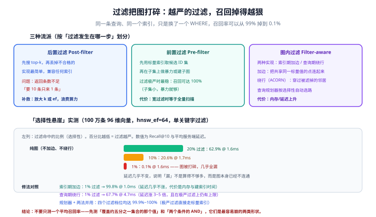

# 过滤与元数据检索

真实查询几乎从不「只按相似度」——它总是带着条件：**只看我有权限的、只看最近半年的、只看这一类目下的**。

过滤这件事看起来只是加一个 `WHERE`，但它**足以让索引的召回率从 99% 掉到 0.1%**。这一页讲清楚为什么，以及三种修法各自能把差距补回多少。

## 一、过滤为什么会让召回崩掉

以 HNSW 为例。图是靠「点与点之间的边」导航的，而这些边**完全无视标量条件**。当查询带着「只保留 1% 的数据」这样的条件时：

```text
图本身还是完整的（边都在）
→ 但沿着边走过去，绝大多数落点都不满足条件
→ 查询能走的距离被限制在「满足条件的那些点所构成的小岛」内
→ 真正相关的点如果在另一个小岛上，就永远走不到
```

于是出现一个反直觉的现象：**过滤越严，召回越差，而延迟几乎不变**。延迟不变这一点尤其具有欺骗性——它让人以为「查询很轻、系统很健康」。

::: danger 「先向量后过滤」是最常见的性能陷阱
很多应用层的写法是：先向向量库要 top-100，再在代码里 `filter()` 掉不满足条件的。这会同时踩两个坑：

1. **返回条数不足**：100 条里如果只有 2 条满足条件，调用方拿到的就是 2 条。
2. **掩盖了召回问题**：以为「过滤后只剩 2 条」是因为「符合条件的本来就少」，实际上库里可能有几百条符合条件，只是索引没找到。

**正确做法是把过滤条件下推到向量库**，让它参与索引层的检索决策。
:::

## 二、三种流派



| 流派 | 过滤发生在 | 实现复杂度 | 极严过滤 | 宽过滤 | 典型实现 |
| --- | --- | --- | --- | --- | --- |
| **后置过滤** | 检索之后 | 最低 | 差（返回不足） | 好 | 所有引擎都支持，但只适合宽过滤 |
| **前置过滤** | 检索之前 | 低（标量索引 + 二次检索） | **最好**（子集小，暴力就够） | 差（等于全量扫） | 各引擎的「全量扫描阈值」机制 |
| **图内过滤** | 检索过程中 | 最高 | 好（取决于实现） | 好 | Qdrant 的加边 HNSW、ACORN、pgvector 的迭代扫描 |

### 现实中的答案不是「三选一」

成熟引擎的做法是**让查询规划器三选一**，判据是**过滤的选择性**：

```text
估计过滤命中比例 p
  p 很小（如 < 0.1%）：直接走标量索引取候选，再对候选做暴力/子集检索
  p 中等（0.1% ~ 40%）：走带过滤的图检索（加边或绕行）
  p 很大（> 40%）：过滤几乎没筛掉什么，直接当普通图检索甚至全量扫
```

这就是为什么**同一个引擎在不同过滤条件下的表现能差几十倍**——它不是「行不行」的问题，而是「规划器有没有走在对的那条路上」。

## 三、「选择性悬崖」的实测

下述数据来自 Qdrant 官方博客对 ACORN 的实测（Qdrant v1.18.2，100 万条 deep-image-96 向量，96 维，`hnsw_ef=64`，单关键字过滤，Recall@10 对暴力基准计分）：

| 过滤命中比例 | 纯图（不加边、不绕行） | 仅查询期绕行（ACORN） | 仅索引期加边 | 规划器 + 两法并用 |
| --- | --- | --- | --- | --- |
| 20% | 62.9% @ 1.6ms | 98.9% @ 4.4ms | 94.8% @ 1.2ms | 100% @ 5.7ms |
| 10% | 20.6% @ 1.7ms | 98.1% @ 4.3ms | 99.0% @ 1.1ms | 99.9% @ 4.4ms |
| 1% | **0.1%** @ 1.6ms | 67.7% @ 4.7ms | **99.8%** @ 1.0ms | 100% @ 1.6ms |
| 10%（相关性过滤） | 88.4% @ 1.7ms | 98.6% @ 3.5ms | 99.0% @ 1.2ms | 100% @ 4.2ms |

从这张表能读出四件事：

1. **纯图在 1% 过滤下几乎全漏（0.1%）**，而延迟与 20% 过滤时几乎一样——「延迟正常」完全不能证明检索是对的。
2. **索引期加边几乎不付延迟代价**（1.0ms），但要用内存与建索引时间换。它的代价在写入侧，不在查询侧。
3. **查询期绕行把召回拉回来了，但延迟涨 2.9~6.7 倍**，且在极严过滤上仍有天花板（67.7%）。
4. **两法并用 + 规划器**在四个档位上都接近满分——**这是当前最接近「不用想」的方案**。

::: info 两种修法各自的机制
- **索引期加边（filterable HNSW）**：建索引时，为每一个标量值找出共享该值的所有点，在它们之间补边。这样「过滤到某个值」的查询仍然行走在一个连通的子图上。代价是额外的边（内存与建索引时间），而且**共享该值的点太多时会跳过不加边**——因为主图本身已经足够连通。
- **查询期绕行（ACORN）**：不改编索引，而是在检索时**穿过那些不满足条件的邻居**继续探索，从而跨越「被过滤掉的鸿沟」。代价是每次查询多走若干步。
:::

### pgvector 的做法：迭代索引扫描

pgvector 在 0.8.0 引入了**迭代索引扫描**，专门解决「HNSW 先取候选、再由 `WHERE` 削减」导致的召回塌陷：

```sql
-- 过滤很严时：让索引持续扫描，直到凑够合格行数
SET hnsw.iterative_scan = strict_order;   -- 严格保持精确顺序，较慢
-- 或 relaxed_order：允许顺序略微放松，换取更快收敛
SET hnsw.max_scan_tuples = 20000;         -- 扫描上限，防止个别查询失控
```

两个模式的区别在于**是否允许返回的结果「大致有序」**：`strict_order` 保证与精确排序一致，`relaxed_order` 更快但顺序可能有轻微偏差。**先上 `strict_order` 把召回修好，再评估是否值得为延迟换成 `relaxed_order`。**

::: warning pgvector 版本底线
pgvector **0.8.3 修掉了 HNSW 与 `VACUUM` 并发时的索引损坏问题**。任何在生产上跑 HNSW 索引、且表上有 autovacuum 的部署，都应当以 **0.8.4 及以上**为底线。这不是「顺手升级」，而是数据完整性修复。
:::

## 四、选择性之外：三种更隐蔽的过滤问题

| 问题 | 现象 | 原因 | 处置 |
| --- | --- | --- | --- |
| **过滤字段没有标量索引** | 查询慢，且规划器无法选路 | 只能顺序扫描标量字段 | 为每个要过滤的字段建索引；这不是「优化」，是**前置条件** |
| **多条件 AND 相互放大** | 单条件都还好，AND 后召回骤降 | 每个条件单独看都不严，交集却很严 | 把 AND 组合当成**独立的过滤形状**单独测 |
| **过滤值与向量分布强相关** | 某些租户/类目特别好，某些特别差 | 相关性过滤反而更容易（点本来就在一起） | 不能只测「随机分布」的过滤；要覆盖真实分布 |

**「每一个要过滤的字段都要有标量索引」**这句话要单独强调：图内过滤与规划器选路都依赖标量索引来做选择性估计。**没有标量索引，引擎只能猜**，而猜错就会走到那条召回 0.1% 的路上。

## 五、多租户与权限：把边界做成过滤条件

这是过滤在生产里最重要的用途，也是最容易做出安全缺陷的地方。

```text
❌ 反例：先检索全库，再在应用层按用户过滤
   → 越权数据进入了应用进程内存；一旦某个分支忘记过滤就是泄露
   → 还会放大「返回条数不足」问题

✅ 正例：把可见范围变成检索请求的一部分
   → 租户键 / ACL 前缀进过滤条件
   → 由向量库在索引层参与过滤
   → 之后再叠加一次应用层校验（两层）
```

| 方案 | 做法 | 优点 | 注意 |
| --- | --- | --- | --- |
| 租户键过滤 | 每条向量的 payload 带 `tenant_id`，查询必带该条件 | 实现最简单 | 必须保证**服务端强制注入**该条件，不能由客户端传入 |
| 物理隔离 | 每个租户（或租户组）一个集合 / 分片 | 隔离最彻底、性能最稳 | 集合数量与管理成本上升 |
| 前缀过滤 | 用路径式前缀（如 `dept:tech/`）做前缀索引 | 适合层级权限 | 前缀索引的查询语义要确认清楚 |
| 部分索引 | 为「最常用的一种可见性」建专用索引 | 查询最快 | 组合爆炸；只适合少数固定形态 |

::: danger 一条必须自动化的判据
**用无权用户的身份，跑一条「按文档标题必然命中」的查询，结果里必须出现 0 条越权文档。**

这条判据必须是**自动化、可重复执行**的，而不是「上线前手工验一次」。过滤条件写错是**静默**的——它不会抛异常，只会安静地返回不该返回的内容。
:::

## 六、验证方式

```shell
# 1) 先量出「过滤的选择性」，规划器选路是否正确就靠这个数
#    以 pgvector 为例：分别统计总量与各条件的命中量
psql -c "SELECT
           count(*) AS total,
           count(*) FILTER (WHERE tenant_id = 42) AS tenant_hits,
           round(100.0 * count(*) FILTER (WHERE tenant_id = 42) / count(*), 3) AS tenant_pct
         FROM docs;"

# 2) 对比「迭代扫描开/关」的召回差异（同一条查询、同一个过滤）
psql -c "SET hnsw.iterative_scan = off; SELECT count(*) FROM (
           SELECT id FROM docs WHERE tenant_id = 42
           ORDER BY embedding <=> (SELECT embedding FROM docs WHERE id = 1) LIMIT 10) t;"
psql -c "SET hnsw.iterative_scan = strict_order;
         SET hnsw.max_scan_tuples = 20000; SELECT count(*) FROM (
           SELECT id FROM docs WHERE tenant_id = 42
           ORDER BY embedding <=> (SELECT embedding FROM docs WHERE id = 1) LIMIT 10) t;"

# 3) 越权冒烟测试：结果必须为 0
psql -c "SELECT count(*) AS leaked FROM (
           SELECT id FROM docs
           WHERE tenant_id = 42          -- 冒充租户 42
             AND id IN (SELECT id FROM docs WHERE tenant_id <> 42)
           LIMIT 10) t;"
```

预期：第 1 条给出过滤的选择性百分比——**低于 0.1% 或高于 40% 都意味着你应该确认规划器走了哪条路**；第 2 条在迭代扫描打开后应能稳定返回 10 条（关闭时可能不足 10）；第 3 条必须为 **0**。

## 七、一张排查顺序表

过滤相关的问题，按这个顺序查，不要跳步：

| 顺序 | 检查项 | 判据 |
| --- | --- | --- |
| 1 | 过滤是否下推到了向量库 | 请求里能看到过滤条件，而不是拿到结果后在代码里筛 |
| 2 | 每个过滤字段是否有标量索引 | 至少确认「不加索引会走顺序扫描」 |
| 3 | 过滤的选择性是多少 | 量出来，不要估 |
| 4 | 规划器实际走了哪条路 | 用引擎的 explain / 诊断能力确认，而不是推断 |
| 5 | 该形状的召回率是多少 | 对暴力基准实测；每个形状单独测 |
| 6 | 越权冒烟测试是否通过 | 必须为 0 条越权结果 |

## 八、与企业知识库落地的分工（第 138 天补充）

本页第五节的标题是「多租户与权限：把边界做成过滤条件」——注意它的落点是**过滤条件怎么写、引擎怎么执行**。它不回答「**过滤条件由谁保证一定被带上**」，也不回答「身份从哪来」。

那两个问题归 [企业知识库落地 · 权限隔离](../../../AI/EnterpriseKB/AccessControl/index.md)，它是本页的**治理侧对照页**：

| 问题 | 本页（机制侧） | 企业知识库落地（治理侧） |
| --- | --- | --- |
| 过滤在哪一侧执行 | 预过滤 / 后过滤 / 迭代扫描的代价与选择性悬崖 | 该选哪一种，以及**怎么证明它一直在生效** |
| 条件从哪来 | 假设调用方已经构造好 | 从身份层来：令牌传递、组展开、缺条件必须拒绝 |
| 失败表现 | 「受限账号查不到」 | **这是缺陷还是他没权限** —— 两者必须能区分 |
| 兜底 | 无 | 删除对账、权限变更 SLO、审计留痕 |

::: warning 本页第三节那张「选择性悬崖」表，在企业场景要换一种读法
在本页的语境里，选择性低只是**精度损失**——结果变少、体验变差。

在企业场景里，同一件事的含义不同：**「受限账号什么都查不到」与「他本来就没有可看的内容」在界面与面板上完全同形**。前者是缺陷（可能是后过滤、也可能是过滤条件写错），后者是正常。区分二者的唯一办法是**同时用管理员账号跑同一个问题**：管理员能答、受限账号答不出、且源文档确实对其可见 → 这是缺陷。
:::

## 参考资料

- Qdrant：Filtered Vector Search: What ACORN Fixes, and What Fixes ACORN（本页实测数据来源）：<https://qdrant.tech/blog/filtered-vector-search-acorn>
- ACORN 论文（SIGMOD 2024）：<https://arxiv.org/abs/2403.04871>
- pgvector README（迭代索引扫描与参数）：<https://github.com/pgvector/pgvector>
- Filterable HNSW 原始说明（Qdrant 2019，Filterable HNSW Without Recall Loss）：<https://qdrant.tech/articles/filtrable-hnsw/>
- Weaviate 嵌套对象过滤（实测边界）：<https://weaviate.io/blog>
- 相邻页面：[HNSW 原理深入](../HNSW/index.md)、[混合检索](../HybridSearch/index.md)、[实战：企业知识库检索链路](../Practice/index.md)
