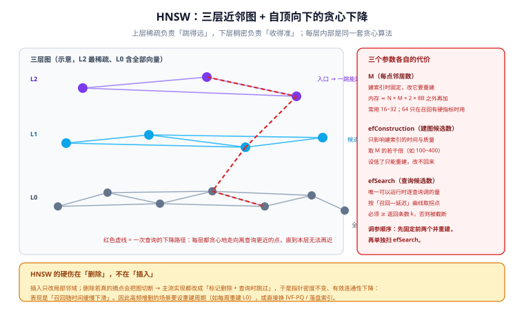

# HNSW 原理深入

**HNSW（Hierarchical Navigable Small World，分层可导航小世界图）** 是当前向量检索里使用最广的索引结构：它把「找最近邻」变成「在图上走一条越来越短的路径」。

它值得单独讲透，因为**绝大多数「检索效果不好」都不是模型的问题，而是 HNSW 的三个参数与删除策略的问题**。理解它的机制，才能知道每个旋钮为什么存在、拧过头会发生什么。

## 一、它到底在存什么

HNSW 存的不是「一份索引」，而是**一张多层图**：



| 层 | 内容 | 作用 | 规模 |
| --- | --- | --- | --- |
| L2（最上层） | 极少数「枢纽」点 | 一跳能跨越很大的距离 | 通常几条到几十条 |
| L1 | 比 L2 多一些的点 | 把搜索快速收敛到目标附近 | 约 L0 的 1/M² 量级 |
| L0 | **全部向量** | 最终的精确定位 | 与数据量相同 |

每一层内部都是同一套结构：**每个点保留 M 条边，连向它认为最近的邻居**。层数不是配置项，而是由随机过程决定的——新点被分到第几层服从指数衰减的概率，因此上层的点天然稀疏。

::: tip 为什么「分层」是关键
如果只有一层，从任意点出发走向目标，需要跨越的距离可能很长，而贪心算法在长距离上容易走进「局部最优」的死胡同。分层的作用是**让远距离的跳跃发生在上层**（上层点少、边长、图小），而**精确的收尾发生在下层**——这就是查询复杂度能压到对数级的根本原因。
:::

## 二、插入：一个新向量怎么进图

插入的算法可以拆成三步：

```text
1. 随机决定这个点最高出现在第几层（服从指数分布，越高越罕见）
2. 从最上层入口出发，逐层贪心地找到「离新点最近的那个点」，作为下一层的入口
3. 在它出现的每一层里，执行一次「候选搜索 + 选 M 个邻居 + 双向连边」
```

第 3 步里那个「候选搜索」的候选集大小，就是 `efConstruction`。它决定**建图时找邻居找得多认真**。

::: danger 两个必须注意的点
1. **`efConstruction` 设低了改不回来。** 它只影响建索引过程，索引一旦建完，这个值就固化在图的结构里。想改只能重建。设置过低的表现是：**批量导入后发现检索质量明显偏差**——这不是查询参数的问题，是图的邻居质量从第一刻起就不好。
2. **连边是双向的，所以要处理「邻居满了」。** 一个点的度数超过 M 时，需要按启发式裁剪。这意味着图的结构依赖**插入顺序**——同样的数据、不同的插入顺序，会得到两张不完全一样的图（但召回率水平相当）。
:::

## 三、查询：自顶向下的贪心下降

一次查询的实际过程：

```text
从最上层的入口点开始
  在当前层反复做：考察当前点的所有邻居 → 如果有更近的，移过去；没有则本层结束
  下沉到下一层，以刚才的落点作为入口，重复上述过程
到了 L0：把候选集按距离排序，返回前 k 条
```

L0 上的候选集大小就是 `efSearch`（很多实现里叫 `ef`）。**这是唯一一个可以在运行时逐查询调整的参数。**

一个必须记住的约束：**`ef` 不能小于 k**。如果 `ef=10` 而 `k=50`，L0 只会保留 10 个候选，返回结果不足——很多实现会静默返回少于 k 条，看起来像「库里数据不够」。

## 四、三个参数各自的代价

| 参数 | 生效时机 | 调大的收益 | 调大的代价 | 可运行时调整 |
| --- | --- | --- | --- | --- |
| `M` | 建索引 | 图更连通、召回更稳 | **内存线性增长**、建图更慢 | ❌ 需重建 |
| `efConstruction` | 建索引 | 邻居质量更好、长期召回更高 | 建索引时间与 CPU 上升 | ❌ 需重建 |
| `efSearch` | 查询 | 召回上升 | 延迟上升 | ✅ 逐查询 |

### 数量级的直觉

| 场景 | M | efConstruction | efSearch |
| --- | --- | --- | --- |
| 内存受限 | 16 | 100 | 64 |
| 常规（延迟与召回平衡） | 16~32 | 200 | 100~128 |
| 召回有硬指标 | 32~48 | 300~400 | 256~400 |

| 数据规模 | M | efConstruction | efSearch（recall@10 ≈ 95% / 99%） |
| --- | --- | --- | --- |
| 1 万 ~ 100 万 | 16 | 100 | 20 / 40 |
| 100 万 ~ 1000 万 | 16~32 | 200 | 40 / 100 |
| 1000 万 ~ 1 亿 | 32 | 300~400 | 100 / 200 |

::: warning 这张表只能用来「定起点」
上表是社区广泛使用的经验区间，**不是保证**。召回—延迟曲线取决于你数据的**内在维度**与分布，公开基准（如在 glove / SIFT 上测出来的数字）迁移到你的语料上经常差很多。**用你的数据、你的查询、对暴力检索的基准答案测一遍，是唯一的办法。**
:::

### 经验规律：ef 与延迟的关系

在中等规模数据集上，把 `ef` 从 10 提到 100，通常能看到 recall@10 从 85% 量级升到 98% 以上，而查询延迟上升 3~4 倍——但两者都还在毫秒级区间。这就是为什么**先扫 `ef`、再考虑动 `M`**：前者成本低、可回滚，后者要重建。

## 五、内存估算

这是选型时最容易算错的一段。总内存是**两段相加**，不是只算向量：

```text
向量部分 = N × d × 4 B              （float32；量化后按压缩比替换）
图部分   = N × M × 8 B × 2          （每个点 M 条边，每条边存两侧）
总计     = 向量部分 + 图部分
```

以 1000 万 × 768 维、M=32 为例：

| 项 | 计算 | 结果 |
| --- | --- | --- |
| 向量（float32） | 1e7 × 768 × 4 | 28.6 GB |
| 图（M=32） | 1e7 × 32 × 8 × 2 | 4.8 GB |
| **合计** | | **33.4 GB** |
| 若改为 int8 量化 | 向量部分 ÷ 4 | 7.2 + 4.8 = **12.0 GB** |
| 若改为 1 bit 量化 | 向量部分 ÷ 32 | 0.9 + 4.8 = **5.7 GB** |

::: danger 三条会静默出错的估算写法
1. **只算向量、忘了图。** M=32 时图约占向量的 17%；M 提到 64 就翻倍。**「我明明按 30 GB 买的机器，为什么进程被 OOM 杀了」多数源于此。**
2. **把磁盘当内存算。** 有些实现支持把向量或图 `on_disk`，但此时延迟取决于 IO，量级会变（毫秒 → 十毫秒到百毫秒）。**把「on_disk 能省内存」与「延迟不变」两条一起写进方案，是同一个错误的两半。**
3. **忘了段副本与合并余量。** 支持增量写入的实现会把新数据放在独立的段里，段数量上升时内存会额外膨胀；合并（compaction）期间新旧两份同时存在。**把「算出来的内存 × 1.3~1.5」作为机器预留**是稳妥做法。
:::

## 六、删除：HNSW 的硬伤

插入只改局部邻域，代价可控。**删除不一样**：

真正把一个点从图里摘掉，会同时让它邻居之间的连通性下降；频繁删除最终会把图切成互不相连的几块，而**查询只能走到它所在的那一块**。于是主流实现普遍采用**标记删除（tombstone）**：不摘点，只是查询时跳过。

由此产生一个很隐蔽的现象：

```text
写入量一直在涨（标记也一直在涨）
→ 索引里的「有效邻居」比例下降
→ 同样的 ef 考察的实际有效候选变少
→ 召回率随时间缓慢下滑，而延迟指标完全正常
```

### 处置方式

| 做法 | 代价 | 适用 |
| --- | --- | --- |
| 标记删除 + 查询时跳过 | 召回缓慢劣化 | 删除量小（< 10%） |
| 定期重建索引 | 重建期间需要额外资源 | 高频增删的常规做法 |
| 换 IVF-PQ 路线 | 召回上限略低 | 写入极其频繁 |
| 换落盘 / 分区路线（如 HFresh） | 延迟量级上升 | 写入频繁 + 内存受限 |

::: tip 重建周期怎么定
不要按时间定（「每周重建一次」），按**更新量**定：当累计删除 + 更新条数超过总量的某个比例（如 20%~30%）时触发重建。**判据是「重建后召回是否回到基线」**——如果重建后召回没变化，说明重建周期定得太密，是白花的成本。
:::

## 七、一套可复现的调参流程

固定顺序，每一步都有产出：

```text
第 0 步：建评估集
  · 200~500 条真实查询（覆盖：关键词型、语义型、带过滤型）
  · 每条查询用暴力检索算出「正确答案集」（recall@10 的基准）

第 1 步：定 M 与 efConstruction（要重建）
  · 先固定 efSearch = 128，扫 M ∈ {16, 32, 48}
  · 记录 召回率 / 索引构建耗时 / 内存占用 三个数
  · 选「召回接近平台、内存还没失控」的那一档

第 2 步：扫 efSearch（不用重建）
  · 画 (ef, recall) 与 (ef, p95 延迟) 两条曲线
  · 取召回曲线进入平台的拐点

第 3 步：按过滤形状复测
  · 对每一种过滤条件单独测一遍（见「过滤与元数据检索」一页）
  · 平均召回率好看不代表没问题

第 4 步：把结论写进配置
  · M 与 efConstruction 进索引配置（变更需重建，写清代价）
  · efSearch 进查询参数（可按查询重要性分档：交互式用低档、离线任务用高档）
```

### 检索端配置示例

::: code-group

```python [hnswlib 最小示例]
import hnswlib
import numpy as np

dim, n = 768, 200_000
data = np.float32(np.random.rand(n, dim))
query = np.float32(np.random.rand(100, dim))

# M 与 ef_construction 只在建索引时生效，改它们必须重建
index = hnswlib.Index(space="cosine", dim=dim)
index.init_index(max_elements=n, M=32, ef_construction=200)

# 数据量大时可以分批加入，num_threads 控制构建并行度
index.add_items(data, np.arange(n), num_threads=8)

# ef 是查询参数：调大提升召回、增加延迟
index.set_ef(128)
labels, distances = index.knn_query(query, k=10)

print(labels.shape, distances.max())
```

```python [Faiss 的等价写法]
import faiss
import numpy as np

d, n = 768, 200_000
xb = np.float32(np.random.rand(n, d))

index = faiss.IndexHNSWFlat(d, 32)          # 第二个参数就是 M
index.hnsw.efConstruction = 200             # 建索引质量
index.hnsw.efSearch = 128                   # 查询时候选集
index.add(xb)

D, I = index.search(xb[:5], 10)             # 查询 5 条，各取 10 个近邻
print(I.shape, D[:, 0])
```

```sql [pgvector：建索引时要写参数]
-- m 与 ef_construction 是 CREATE INDEX 的参数，改它们需要 REINDEX
CREATE INDEX CONCURRENTLY idx_docs_embedding
  ON docs USING hnsw (embedding vector_cosine_ops)
  WITH (m = 32, ef_construction = 200);

-- ef_search 是会话级参数，可逐事务调整
SET hnsw.ef_search = 128;
SELECT id, 1 - (embedding <=> $1) AS score
FROM docs
ORDER BY embedding <=> $1
LIMIT 10;
```

:::

```json [Qdrant：集合级 HNSW 配置]
{
  "vectors": { "size": 768, "distance": "Cosine" },
  "hnsw_config": {
    "m": 32,
    "ef_construct": 200,
    "full_scan_threshold": 10000
  }
}
```

`full_scan_threshold` 是 Qdrant 的一个实用旋钮：**当集合足够小（或过滤后候选足够少）时，直接全量扫描比走图更快也更准**。它的单位是「向量数据量」，过滤很严的查询常常会被自动路由到这条路径。

## 八、易错点与最佳实践

::: danger 六个高频错误
1. **`ef` 小于返回条数 `k`。** 结果条数不足，且不报错。正确做法：在应用侧断言 `ef >= k`，或直接把 `ef` 设为 `max(k * 4, 64)`。
2. **改 `M` 后只重启服务、没有重建索引。** 图的结构已经固化，配置改了不生效，而监控上一切正常。正确做法：把「改索引参数」当成**数据迁移类变更**，走重建流程。
3. **批量导入时把 `efConstruction` 设得很低以「导入快一点」。** 导入快了几分钟，之后所有查询都背上这个代价。正确做法：导入用足 `efConstruction`，导入完成后再切查询参数。
4. **用「平均召回率」验收。** 平均 0.95 的集合里，可能有一个过滤条件只有 0.4。正确做法：按过滤形状分别验收。
5. **高频删除后长期不重建。** 召回下滑没有告警，靠人眼发现往往已经是几个月后。正确做法：把召回抽样做成定期任务。
6. **拿不同归一化口径的向量混在同一个索引里。** 用余弦距离就必须全部归一化；混入未归一化的向量会让排序整体错乱，而「相似度分数」看起来仍然正常（都在 0~1 之间）。
:::

::: tip 五条最佳实践
1. **先扫 `ef` 再动 `M`**：前者零成本、可回滚，后者要重建。
2. **建评估集是前置条件，不是可选项**：没有标准答案，所有调参都是感觉。
3. **`ef` 按查询重要性分档**：交互式请求用低档保延迟，离线批处理用高档保召回。
4. **重建要能在线进行且可回滚**：建新索引 → 校验召回 → 切流量 → 删旧索引。
5. **把「召回抽样」纳入常规监控**：它不会自己报警，只能定期测。
:::

## 九、验证方式

以下三条在本机即可执行，不需要生产数据：

```shell
# 1) 确认 ef 与 k 的关系被正确断言（ef < k 时应能发现问题）
python3 - <<'PY'
k, ef = 50, 10
print("危险：ef < k，结果最多只有", ef, "条，而调用方期望", k, "条")
print("建议 ef =", max(k * 4, 64))
PY

# 2) 内存估算：1000 万 × 768 维，M 从 16 扫到 48
python3 - <<'PY'
n, d = 10_000_000, 768
vec = n * d * 4 / 2**30
print(f"向量 float32: {vec:6.1f} GB   int8: {vec/4:5.1f} GB   1bit: {vec/32:5.1f} GB")
for m in (16, 32, 48):
    graph = n * m * 8 * 2 / 2**30
    print(f"  M={m:2d} 图 {graph:5.1f} GB → 合计 {vec + graph:6.1f} GB（float32）")
PY

# 3) 建一个可复现的小基准：对比暴力检索与 HNSW 的召回差异
python3 - <<'PY'
import numpy as np
rng = np.random.default_rng(0)
n, d, k = 20_000, 128, 10
x = rng.random((n, d), dtype=np.float32)
q = rng.random((50, d), dtype=np.float32)
truth = np.argsort(-(q @ x.T), axis=1)[:, :k]      # 暴力基准（余弦、未归一化的点积）
print("基准答案形状:", truth.shape, " 首条前 3:", truth[0][:3])
print("→ 把这份 truth 存下来，任何索引改动都拿它算 recall@10")
PY
```

预期：第 2 条会打印出 M=16/32/48 三档的图开销（约 2.4 / 4.8 / 7.2 GB）与对应合计；第 3 条打印出基准答案集合——**这个集合就是后续所有索引调参的判分标准**。

## 参考资料

- HNSW 原论文：<https://arxiv.org/abs/1603.09320>
- hnswlib（论文作者的 C++/Python 实现）：<https://github.com/nmslib/hnswlib>
- Faiss 官方 Wiki：<https://github.com/facebookresearch/faiss/wiki>
- pgvector README（HNSW 参数与迭代扫描）：<https://github.com/pgvector/pgvector>
- Qdrant HNSW 配置文档：<https://qdrant.tech/documentation/concepts/indexing/>
- ANN Benchmarks（召回—延迟公开曲线）：<https://ann-benchmarks.com/>
- 相邻页面：[索引算法全景](../IndexAlgorithms/index.md)、[量化深入](../Quantization/index.md)
