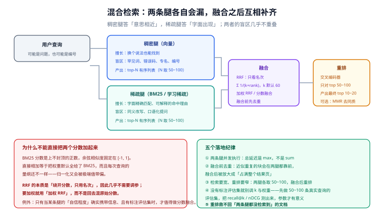

# 混合检索

**单一稠密向量检索必然漏掉一类查询**：那些「答案就在原文里、但字面必须精确匹配」的查询——错误码、编号、专名、型号、法令条款。

混合检索（hybrid search）就是补上这一块：**同时跑一条词法腿和一条语义腿，再把两路结果融合成一份**。它看起来只是多跑一个检索，**真正难的是融合**。

## 一、两条腿的盲区几乎不重叠



| 查询例子 | 稠密腿（语义） | 稀疏腿（词法） |
| --- | --- | --- |
| 「怎么让部署少出错」 | ✅ 能理解「少出错」≈「降低故障率」 | ❌ 文档里没有「少出错」这几个字 |
| 「ERR_1042 报错原因」 | ❌ 可能匹配到其它错误码的文档 | ✅ 精确命中这个编号 |
| 「Smith 诉 Jones 2019 年过失判决」 | ⚠️ 部分有效 | ✅ 案名与年份精确命中 |
| 「有没有办法降低文档的困惑度」 | ✅ 语义泛化是强项 | ❌ 字面完全不重合 |

**这就是混合检索的全部理由**：两条腿的强项互补，弱项也互补。单独跑一条，长尾查询的失败率会明显高于跑两条。

::: tip 一个反直觉的经验
很多「嵌入模型不行」的诊断，实际上是「**没跑词法腿**」。当查询里含有一个只在少数文档出现的精确字符串时，稠密向量不会有任何优势——它把所有文字都压成了一个语义向量，罕见字符串的信息在压缩过程中被稀释了。**先用混合检索跑一遍，再决定要不要换模型。**
:::

## 二、四条技术路线

2026 年的生产栈里，这两条腿已经分化成四种可选组件：

| 组件 | 代表 | 特点 | 存储成本 |
| --- | --- | --- | --- |
| BM25（经典稀疏） | Lucene 系列、Postgres 全文 | 无需训练、可解释、生态最成熟 | 倒排索引，最省 |
| 学习稀疏 | SPLADE 类、BGE-M3 的稀疏输出 | 兼具词法精确与一定的语义泛化 | 稀疏向量，比倒排大 |
| 稠密向量 | 各类嵌入模型 | 语义泛化最强 | 每维度 4 字节起 |
| 后期交互 | ColBERT 类 | 每个 token 一个向量、MaxSim 打分，精度最高 | **存储最贵**（每 token 一个向量） |

后期交互（late interaction）的定位要特别说清楚：**它不是第一阶段的检索器，而是重排器**。因为它的存储成本随 token 数增长，主流用法是「BM25 + 稠密检索候选 → 融合 → 用后期交互模型精排」。ColBERT 类模型的压缩已经从早期版本改进很多（ColBERTv2 把存储压到原来的 1/6~1/10 量级），但仍然远高于单向量方案。

## 三、融合：为什么不能直接把分数加起来

这是混合检索里最容易做错的一步。

### 问题的本质：两个分数不在同一个量纲上

```text
BM25 分数：上不封顶的正数（某文档可能得 42.7，另一个 8.3）
余弦相似度：固定在 [-1, 1]（某文档 0.83，另一个 0.41）
```

**直接相加等于把权重默认全给了 BM25**——不是因为它更准，只是因为它的数值大。而归一化（如 min-max）也不稳：每次查询的极值不同，同一对文档在不同查询里的相对权重会漂移。

### RRF：绕开分数，只看名次

**RRF（Reciprocal Rank Fusion，倒数排名融合）** 的做法是彻底丢弃分数，只用「排第几」：

```text
score(d) = Σ over 每一路检索器 r : 1 / (k + rank_r(d))

k 是平滑常数，通常取 60（Cormack 等人 2009 年论文的经典取值）
某一路上没出现的文档不参与求和
```

它的三个好处：

1. **免归一化**：名次天然同质，不需要把两套分数映射到同一个区间；
2. **免调参**：`k=60` 就是一个很稳的默认值，几乎不需要按语料调整；
3. **鲁棒**：某一路上某条结果分数虚高，也不会因为数值优势霸占融合后的首位——它最多只贡献「名次第一」这一个信号。

`k` 的作用是**平滑顶部名次的影响**：`k` 越大，第 1 名与第 10 名的差距越小，于是「两条腿都认可」比「某一条腿极力推荐」更重要。这与混合检索的初衷一致——**我们要的是两路共识，而不是任何一路的自信**。

### 加权 RRF：要加权的时候就加在名次上

如果确实需要偏向某一腿（例如语料里有大量编号，词法腿应该更重），正确做法是**加权 RRF**：

```text
score(d) = Σ w_r / (k + rank_r(d))
```

而不是回去混原始分数。加权 RRF 保留了「只看名次」的鲁棒性，同时给了权重旋钮。

| 融合方式 | 需要评估集 | 鲁棒性 | 什么时候用 |
| --- | --- | --- | --- |
| RRF（等权） | 不需要 | 最高 | **默认起点** |
| 加权 RRF | 需要 | 高 | 已有标注、明确知道某腿更重要 |
| 分数归一化后加权 | 需要 | 低 | 某腿的「自信程度」确实携带信息 |
| 相对分数融合 | 需要 | 中 | 引擎默认值如此（需按引擎文档确认） |

::: info 引擎默认值不一样，别假设
不同引擎的默认融合策略并不相同。历史上 Qdrant 从 1.10 起提供服务端 RRF；Weaviate 在 1.24 把默认融合算法从 RRF 改成了相对分数融合（Relative Score Fusion），同时保留 RRF 可选。**「默认是 RRF」这个假设不成立——上生产前先查当前版本的默认值，并显式写出你用的是哪一个。**
:::

## 四、落地形态：retrieve wide, rerank narrow

标准的三段式：

```text
① 两条腿并发执行，各取 N 条（N 通常 50 ~ 100）
② 融合成一份候选（RRF / 加权 RRF）
③ 对融合后的 top M（M 通常 50 ~ 100）做重排（交叉编码器或后期交互模型）
   最终返回 top 10 ~ 20
```

四个关键决策点：

| 决策 | 建议 | 理由 |
| --- | --- | --- |
| 腿的候选数 N | 50~100（不是 top 10） | 融合需要足够的名次空间，两腿的「第 30 名」可能在另一腿是「第 2 名」 |
| 融合前去重 | 必须做 | 近似重复的块会在两腿都靠前，融合后被放大成「占满结果页」 |
| 重排深度 M | 按延迟预算定，通常 50~100 | 交叉编码器的成本随 M 线性增长 |
| 两腿是否并发 | 必须并发 | 串行执行会让延迟变成两腿之和 |

::: danger 四个会静默降低效果的做法
1. **两腿各只取 top 10 就融合。** 名次空间太窄，融合几乎等价于「两腿取并集」，RRF 的价值没有了。
2. **融合前不去重。** 同一篇文档的相邻块会同时出现在两腿前列，融合后占据整个结果页——用户看到「五个几乎一样的答案」。
3. **没有评估集就调 `k` 和权重。** 「感觉变好了」在检索任务上极不可靠；50~100 条真实查询的评估集是最低门槛。
4. **认为重排能救回漏检。** 重排只能重新排列**检索到的**候选。如果两条腿都没检索到某文档，任何重排模型都无能为力。**优化顺序永远是：先提召回，再提精度。**
:::

## 五、多样性：结果页不能全是同一个意思

融合之后常见的一个问题是**同质化**：top 10 里有 7 条在说同一件事，只是措辞不同。这在 RAG 场景里尤其浪费——把 7 条近似内容塞给大模型，等于浪费上下文预算。

**MMR（Maximal Marginal Relevance，最大边际相关性）** 是常用的解法：在挑选结果时同时考虑「与查询的相关性」与「与已选结果的差异性」，让结果页在相关的前提下更分散。

| 手段 | 作用 | 代价 |
| --- | --- | --- |
| 融合前去重 | 去掉近似重复的块 | 需要相似度阈值，阈值过大会误删 |
| MMR 重排 | 在结果之间保持多样性 | 会牺牲少量相关性；需调平衡参数 |
| 结果聚合（按文档归并） | 同一文档只出现一次，块级分数取最大 | 需要块到文档的映射 |
| 业务去重（同类目/同来源限流） | 防止单一来源垄断结果页 | 规则维护成本 |

Weaviate 在 1.39 把 MMR 提升到正式可用，并让它可以作用在混合检索结果上；这是「多样性」从应用层往引擎层下沉的一个信号——**当一件事实在太多人手里都做错时，它就会变成引擎的一个开关。**

## 六、可运行的融合实现

下面这段是 RRF 的最小实现，可以直接用来验证「融合是否有收益」：

```python
# scripts/rrf.py —— 最小可运行的 RRF 融合
# 用法：python3 scripts/rrf.py
# 判据：融合后的结果里应同时出现「A 路独有」与「B 路独有」的条目
from collections import defaultdict


def rrf(rank_lists: list[list[str]], k: int = 60, weights: list[float] | None = None) -> list[tuple[str, float]]:
    """rank_lists: 每一路的有序 id 列表（第 0 项就是第 1 名）"""
    if weights is None:
        weights = [1.0] * len(rank_lists)
    assert len(weights) == len(rank_lists), "权重个数必须与路数一致"

    scores: dict[str, float] = defaultdict(float)
    for w, ranked in zip(weights, rank_lists):
        for rank, doc_id in enumerate(ranked, start=1):   # rank 从 1 开始
            scores[doc_id] += w / (k + rank)
    return sorted(scores.items(), key=lambda kv: -kv[1])


if __name__ == "__main__":
    dense = ["d1", "d2", "d3", "d4"]        # 稠密腿结果
    sparse = ["s1", "d1", "s2", "d3"]       # 稀疏腿结果
    fused = rrf([dense, sparse])

    print("融合结果（id, 分数）：")
    for doc_id, score in fused:
        print(f"  {doc_id}  {score:.5f}")

    # 判据：两腿都出现的条目应排在前列，而只在单腿出现的条目仍应保留下游位置
    assert fused[0][0] == "d1", "两腿都靠前的条目应当排在首位"
    tails = {doc_id for doc_id, _ in fused}
    assert {"d2", "d4", "s1", "s2"} <= tails, "单腿条目不应被丢失"
    print("OK：融合保留了两腿的独有结果，且共识条目获得提升")
```

运行后的预期输出（`d1` 同时出现在两腿的前列，因而得分最高）：

```text
融合结果（id, 分数）：
  d1  0.03252
  d3  0.03150
  s1  0.01639
  d2  0.01613
  s2  0.01587
  d4  0.01562
OK：融合保留了两腿的独有结果，且共识条目获得提升
```

读这张表要注意一件事：**`d2` 是稠密腿的第 2 名，却排在稀疏腿第 1 名 `s1` 之后**。这不是 bug，而是 RRF 的正常行为——它把「某一路的第一名」看得比「另一路的第二名」更重，因为第一名代表的是「这条腿的最强信号」。这也提示了一件事：**RRF 的结果不会保持任何单腿的原始顺序**，评估时必须用「相对暴力基准的召回」而不是「与某腿的相似度」。

::: tip 这段代码的两个判断，其实是两条设计原则
1. **共识条目胜出**（`d1` 在两腿都在前 2 名 → 融合第一）：这是 RRF 的核心价值。
2. **单腿条目不被丢弃**（`d2` / `d4` / `s1` / `s2` 都还在）：这是混合检索的意义——**如果融合会把某一路的独有结果全部挤掉，那融合就退化成「选了其中一条腿」**。这个断言值得写进你的测试里。
:::

## 七、效果怎么量

混合检索的收益必须量出来，否则无法判断「加了这一腿值不值得」。

| 指标 | 怎么算 | 判据 |
| --- | --- | --- |
| recall@k（单腿 vs 混合） | 对暴力基准算命中率 | 混合应显著高于任一单腿 |
| nDCG@10 | 需要带相关性等级（或至少二值标注） | 混合应高于单腿 |
| 两腿独有率 | 某腿独有且正确的文档占比 | 若接近 0，说明这条腿没在干活 |
| 延迟（并发 vs 串行） | p95 | 并发应接近 max(两腿) 而不是 sum |
| 同质化率 | top 10 里来自同一文档或同一段落的条数 | 应 ≤ 2 |

**「关掉一条腿后指标掉多少」是最省事的判据**：掉得很少说明这条腿可以砍掉（省一半资源）；掉得很多说明它正在承担关键覆盖。**这个实验只要改一个开关，比任何理论分析都直接。**

## 八、验证方式

```shell
# 1) 跑融合的最小实现（判据见上文注释）
python3 scripts/rrf.py

# 2) 对比「单腿」与「混合」的候选重叠率：重叠越低，融合收益越大
python3 - <<'PY'
dense  = {"d1","d2","d3","d4","d5"}
sparse = {"s1","d1","s2","d3","s3"}
inter = dense & sparse
print(f"稠密独有 {len(dense-inter)}  稀疏独有 {len(sparse-inter)}  共有 {len(inter)}")
print(f"独有占比 {(len(dense|sparse)-len(inter))/len(dense|sparse):.0%} → 越高说明两腿互补越强")
PY

# 3) 延迟口径核对：并发 vs 串行
python3 - <<'PY'
dense_ms, sparse_ms = 18, 7
print(f"串行 {dense_ms + sparse_ms} ms   并发 {max(dense_ms, sparse_ms)} ms   "
      f"节省 {(dense_ms + sparse_ms - max(dense_ms, sparse_ms)) / (dense_ms + sparse_ms):.0%}")
PY
```

预期：第 2 段的「独有占比」越高，说明两条腿的互补性越强、融合收益越大；第 3 段展示并发相对串行的收益（本例约 72%）——**这就是「必须并发」的量化理由**。

## 九、扩展到三路：视觉多向量作为第三路（第 157 天补充）

本页的两路（稀疏 + 稠密）解决的是「字面对不上」；多模态场景还要再加一路「**外观对不上**」。第三路的接入有三条与本页结论不同的地方：

1. **候选深度必须与另两路一致**。视觉多向量的 MaxSim 分数与 BM25 不在一个量纲，用 RRF 时深度不一致等于给这一路加权。
2. **必须在路内先按文档折叠**。一页有几百个 patch，同一页面会以多个 patch 命中，不折叠会把名额占满。
3. **多向量字段不要建 HNSW**。它用于精排而非首轮召回，Qdrant 的标准做法是 `hnsw_config` 的 `m=0`，只存图不算图。

融合公式与 `k=60` 的定值理由仍以本页第三节为准；「三路怎么分工、patch 预算怎么算」见 [多模态检索与重排 · 混合召回](../../../AI/MultimodalRetrieval/HybridRecall/index.md)。

## 与「全文检索与搜索工程」专题的分工（第 167 天补充）

本页讲**语义召回与融合**：向量怎么生成、RRF 怎么加权、两路分数为什么不可直接相加。字面检索那一路的工程质量（分析链、字段权重、索引重建、召回评估）归 [全文检索与搜索工程](/docs/DB/FullTextSearch/index.md)。

分工可以用一句话说清：**向量路解决「说法不同」，字面路解决「说法相同但那 90% 的流量」**。

| 查询形态 | 主要靠哪一路 | 原因 |
| --- | --- | --- |
| 产品名、错误码、订单号、函数名 | 字面（BM25 / `tsvector`） | 向量对精确标识符不敏感，容易召回「语义相近」的错误结果 |
| 「怎么把权限配给新同事」 | 语义 | 字面词项与文档用词可能完全不重合 |
| 混合（长句里带标识符） | 两路并行 + 融合 | 缺一路就有一类查询归零 |

::: danger 只上向量，编号类查询会静默退化
向量检索对 `ERR-4021`、`v2.3.1`、`GET /api/cards` 这类**低频精确标识符**几乎无能为力：它们没有语义邻域，embedding 落在哪里取决于模型，召回结果往往是「主题相近但编号不对」的文档。

这类查询在演示时不会暴露——演示用的都是自然语言问题。上线后第一批投诉一定来自「搜单号搜不到」。所以只要产品里有标识符检索需求，字面路就必须保留，且要有独立的评估子集（见专题的 [召回评估](/docs/DB/FullTextSearch/Evaluation/index.md)）。
:::

## 与「代码搜索与索引工程」的分工

| 问题 | 归谁 | 关键差别 |
| --- | --- | --- |
| HNSW/IVF 参数、过滤下推、量化 | 本页（向量库侧） | 存与查的算法细节 |
| 「要不要加语义」「加在哪一层」 | [语义检索与混合排序](../../../Tools/CodeSearch/SemanticSearch/index.md) | 决策与判据，不是算法 |
| 两路召回的评测怎么做 | 本页 + [RAG 的评估](../../../AI/RAG/Evaluation/index.md) | recall@k 与分桶 |

**这一页特有的一个坑**：RRF 的分数只依赖名次，所以**两路候选数量不等时会有系统性偏差**——词法只返回 1 条（精确命中），语义返回 50 条，融合后语义的前几名会与那唯一一条精确命中同分甚至更高。这不是 RRF 的缺陷，是「把两种不同意图的结果放在一张榜上」的必然结果；处置是把完全匹配单独置顶（判据 `CSM-B`），而不是去调 `k`。

## 参考资料

- RRF 原始论文（Cormack 等，SIGIR 2009）：<https://dl.acm.org/doi/10.1145/1571941.1572114>
- Weaviate 混合检索与融合策略文档：<https://docs.weaviate.io/weaviate/search/hybrid>
- Qdrant 混合查询文档（含服务端 RRF）：<https://qdrant.tech/documentation/concepts/hybrid-queries/>
- Elasticsearch RRF 参考：<https://www.elastic.co/docs/reference/elasticsearch/rest-apis/reciprocal-rank-fusion>
- ColBERTv2 论文（后期交互的压缩）：<https://arxiv.org/abs/2112.01488>
- MMR 原始论文（Carbonell & Goldstein, 1998）：<https://dl.acm.org/doi/10.1145/290941.291025>
- 相邻页面：[过滤与元数据检索](../Filtering/index.md)、[实战：企业知识库检索链路](../Practice/index.md)
