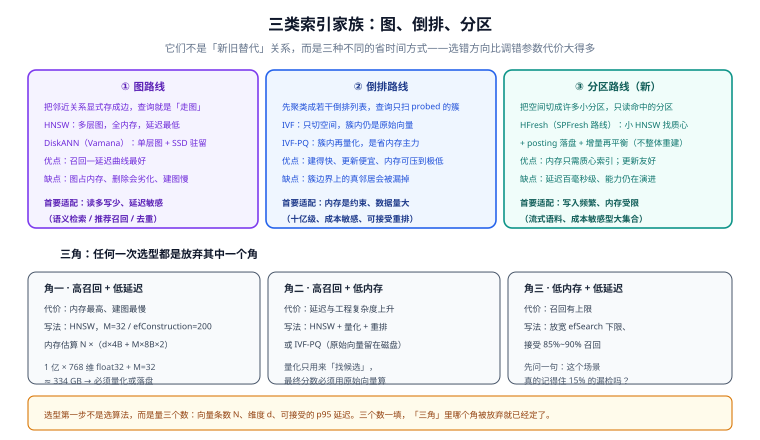

# 索引算法全景

**索引算法的选择，决定了系统的上限**——参数调优只能在选定路线之内改善，换不了方向。

这一页把三类主流路线（图、倒排、分区）拆开讲：**各自省时间的方式、各自最怕什么、以及在什么约束下它才是对的答案**。

## 一、先按「省时间的方式」分类

所有 ANN 索引都在做同一件事：**避免与全量数据比较**。差别在于「用什么理由跳过大部分数据」：



| 家族 | 跳过的理由 | 代表 | 结构成本 |
| --- | --- | --- | --- |
| 图 | 「从近的点出发，更近的点大概率在它旁边」 | HNSW、DiskANN（Vamana） | 每条边都要存 |
| 倒排 | 「空间可以切成簇，真邻居大概率在邻近的簇」 | IVF、IVF-PQ | 只需要簇心与归属 |
| 分区 | 「把空间切成很多小块，只读命中的那几块」 | SPFresh / HFresh | 质心索引 + 落盘分区 |

**这张表是本页的核心**：选型时先问「我的瓶颈是内存、还是延迟、还是写入」，答案会直接指向一个家族，而不是一个产品。

## 二、图路线：HNSW 与 DiskANN

### HNSW

机制与参数在[HNSW 原理深入](../HNSW/index.md)一页已展开，这里只留结论：

| 维度 | 表现 |
| --- | --- |
| 召回—延迟 | **三家族里最好**，毫秒级且曲线陡峭（`ef` 一调就见效） |
| 内存 | 最高：向量 + 图都要常驻 |
| 建索引 | 慢（要逐点找邻居） |
| 更新 | 插入便宜；**删除是硬伤**，靠标记 + 重建 |
| 最怕 | 高频增删；内存不足；过滤把图打碎 |

### DiskANN（Vamana）

DiskANN 换了一个前提：**允许一部分数据在 SSD 上**。它的做法是：

1. 用**单层图**（不是多层），但图被特意构造得「直径小」；
2. 把图与向量压缩后放在 SSD 上；
3. 在内存里只保留**压缩后的向量**用于快速筛选，命中候选后再从磁盘读原始向量做精算。

::: info 什么时候考虑 DiskANN 这一类
判据是「**内存装不下，但还能接受十毫秒到百毫秒级的延迟**」。如果延迟预算是个位数毫秒，落盘路线基本不成立——因为每次查询都要发生若干次磁盘随机读。部分产品把这类能力做成了集合级开关（如 Elasticsearch/OpenSearch 的 `bbq_disk` 索引类型、Weaviate 的 HFresh），此时「换索引类型」比「换产品」更划算。
:::

## 三、倒排路线：IVF 与 IVF-PQ

### IVF（Inverted File）

思路是把空间粗分成若干簇（数量记为 `lists` 或 `nlist`）：

```text
建索引：对训练样本做 k-means → 得到 lists 个簇心 → 每条向量归到最近的簇
查询： 计算查询向量到所有簇心的距离 → 取最近的 nprobe 个簇 → 在这几个簇内逐一算距离
```

`nprobe`（有的实现叫 `probes`）就是延迟—召回的旋钮：**扫的簇越多越准，也越慢**。

### IVF-PQ：省内存的主力

在 IVF 基础上叠加乘积量化（PQ），把簇内向量也压成短码，于是内存可以降到原来的 1/10 ~ 1/30。**十亿级数据集的主流方案到今天仍然是 IVF-PQ 加一次重排。**

| 维度 | 表现 |
| --- | --- |
| 内存 | **三家族里最低**（配合 PQ） |
| 召回—延迟 | 中等：召回天花板低于图路线，且对簇边界敏感 |
| 建索引 | 快（k-means 是并行的），但 PQ 码本要训练 |
| 更新 | 便宜：删一条只是从倒排表移除 |
| 最怕 | 真邻居落在簇边界上；`nprobe` 调小以保延迟时召回掉得快 |

::: danger IVF 的三个参数各有各的陷阱
1. **`lists` 与数据量不匹配。** 常见经验是 `lists ≈ sqrt(N)` 量级（如 100 万条取约 1000~4000），但对**每簇至少要有若干条**也要有下界。簇太多会让建索引变慢、每簇数据太少而召回不稳。
2. **`nprobe` 默认值往往偏小。** 很多实现默认 `nprobe=1`（只扫一个簇），召回会明显低于预期。**先测 nprobe=1 / 8 / 32 三档的召回**，再决定默认值。
3. **IVF 需要足够的数据来训练簇心。** 数据量少于簇数级别时，k-means 训不出有意义的簇心，此时暴力检索反而更好。
:::

## 四、分区路线：SPFresh / HFresh

这是 2025-2026 年走到生产可用的一类新结构，代表是 Weaviate 的 **HFresh**（1.36 起技术预览，1.38 起正式可用），灵感来自 **SPFresh**。

它的机制可以概括成两句话：

```text
把向量按空间邻近切成许多小分区（posting），分区落在磁盘上（LSM 存储）
内存里只放一个「质心索引」（一个很小的 HNSW 图）
查询 = 用质心索引定位相关的几个分区 → 只从磁盘读这几个分区 → 分区内精算
```

于是内存开销与数据量的关系被解耦：**只需质心索引在内存**。

| 维度 | 表现 |
| --- | --- |
| 内存 | **最低**：与数据量近似无关（只随分区数增长） |
| 更新 | 好：更新通常只影响局部；靠**增量再平衡**（拆分过大的分区、合并过小的分区）维持质量，不必整体重建 |
| 延迟 | 百毫秒级（受磁盘 IO 限制） |
| 成熟度 | 仍在演进：能力与参数会变 |
| 最怕 | 个位数毫秒的延迟预算是硬指标时 |

分区路线的关键增量在于「**不重建也能保持新鲜**」。图路线面对高频写入时的老问题是「图会劣化、只能重建」；分区路线把这一步换成了局部的拆分与合并——**代价是延迟量级上升，收益是写入友好**。

## 五、召回—延迟—内存三角

任何一次选型，本质上都是**放弃其中一个角**：

| 想要的组合 | 放弃的角 | 典型写法 |
| --- | --- | --- |
| 高召回 + 低延迟 | 内存 | HNSW，M=32~48，全量 float32 常驻 |
| 高召回 + 低内存 | 延迟与复杂度 | HNSW + 量化 + 重排；或 IVF-PQ；或落盘索引 |
| 低内存 + 低延迟 | 召回上限 | 收小 `ef` / `nprobe`，接受 85%~90% 召回 |

::: tip 第三个角往往可以谈
「低召回」听起来很糟，但要看场景：**推荐候选召回**里漏掉 10% 通常无感（用户根本不知道还有什么没被推荐）；**去重**场景漏掉 10% 意味着重复内容还会出现；**权限相关的检索**漏检则是安全问题。**同一个数字在不同场景下的可接受度差很多，先问「漏了会怎样」。**
:::

## 六、选型决策路径

不要从产品列表开始，从三个数开始：

```text
① N = 向量条数        （决定内存量级）
② d = 维度            （决定单条占用与量化收益）
③ p95 延迟预算        （决定能不能落盘）

然后按顺序问四个问题：
Q1 内存够不够装下「向量 + 图」？
   ├─ 够 → 图路线（HNSW）是默认答案
   └─ 不够 → Q2
Q2 延迟预算能否放宽到十~百毫秒？
   ├─ 能 → 落盘 / 分区路线（DiskANN 类、HFresh）
   └─ 不能 → Q3
Q3 能否接受「量化 + 重排」的额外工程复杂度？
   ├─ 能 → HNSW + SQ/BQ（或 IVF-PQ），把向量压到原来的 1/4 ~ 1/32
   └─ 不能 → Q4
Q4 能否分片（按租户 / 时间 / 业务域切开放到多台机器）？
   ├─ 能 → 分片 + 每片 HNSW
   └─ 不能 → 接受更低召回，或重新评估需求
```

**写入模式是第二条主线**，它会推翻上面对「图路线优先」的默认答案：

| 写入模式 | 更适合 |
| --- | --- |
| 一次性导入、之后基本不变 | 图路线（HNSW）——最优召回与延迟 |
| 持续小批量新增、很少删除 | 图路线（HNSW），定期重建即可 |
| 高频更新与删除（如会话记忆、日志） | 倒排路线（IVF-PQ）或分区路线（HFresh） |
| 每日全量重建（离线批） | 任何路线都行，选召回最好的 |

### 一个可复述的对照表

| 算法 | 内存 | 延迟 | 召回上限 | 建索引 | 增删 | 一句话定位 |
| --- | --- | --- | --- | --- | --- | --- |
| Flat（暴力） | 只向量 | 随 N 线性 | 100% | 无 | 极便宜 | 小语料与「基准答案」 |
| HNSW | 最高 | 最低 | 最高 | 慢 | 增便宜、删麻烦 | 默认首选 |
| IVF | 低 | 低~中 | 中 | 快 | 便宜 | 内存受限 |
| IVF-PQ | 最低 | 中 | 中低 | 中（需训练） | 便宜 | 十亿级省钱 |
| DiskANN 类 | 中（压缩后常驻） | 中 | 中高 | 中 | 较便宜 | 内存不够但能容忍 IO |
| HFresh 类 | 最低 | 中高 | 中 | 快 | 好 | 写入频繁 + 内存受限 |

## 七、六个常见误区

::: danger 逐条给出正确做法
1. **「HNSW 是最先进的，所以选它」。** 它只是在「内存充足 + 读多写少」这个前提下最好。**先确认前提成立**。
2. **「量化是免费的加速」。** 量化省的是内存，代价是精度，而且**必须配重排**才能把精度买回来。把它当纯收益会得到「内存省了、答案不对了」。
3. **「平均召回率 0.95 就够用了」。** 平均值会掩盖个别过滤形状上的崩塌。**按过滤形状分别验收**。
4. **「建索引慢一点没关系，反正是离线的」。** 建索引慢会直接压缩你的发布窗口——一次重建超出窗口，下一步就可能演变成「不敢改配置」。**把重建耗时当成一项硬指标来测**。
5. **「先用 HNSW，以后再换 IVF」。** 换索引路线通常意味着**索引格式与调参体系全部重来**，还要重跑整个评估集。**换路线是项目级决策，不是配置项。**
6. **「索引建好了就不用管了」。** 索引是**会老的资产**：删除会劣化图、数据分布会漂移、模型会换代。**重建周期与召回抽样必须排进日历。**
:::

## 八、验证方式

选型必须在自己的数据上验证。下面三段本机可跑：

```shell
# 1) 数据画像：先看清分布，再谈选谁
python3 - <<'PY'
import numpy as np
rng = np.random.default_rng(0)
n, d = 50_000, 128
x = rng.normal(size=(n, d)).astype("float32")
x /= np.linalg.norm(x, axis=1, keepdims=True)      # 归一化，配合余弦距离
q = x[:20]                                          # 用库内向量自问自答，答案已知
sim = q @ x.T
print("单条查询对全量的最大相似度:", float(sim.max()))
# 用自问自答的好处：正确结果一定包含「自己」，可以直接验证检索是否漏掉自己
PY

# 2) 量化后的内存对比（同一份数据的三档）
python3 - <<'PY'
n, d = 50_000, 128
for name, bits in (("float32", 32), ("int8", 8), ("1bit", 1)):
    print(f"{name:>8}: {n * d * bits / 8 / 2**20:7.1f} MiB")
PY

# 3) IVF 的 nprobe 敏感性：扫三档看召回变化
python3 - <<'PY'
# 这里只演示口径：把 nprobe 当成唯一变量，其它参数固定
for nprobe in (1, 8, 32):
    scanned = nprobe / 1024          # 假设 1024 个簇
    print(f"nprobe={nprobe:2d}  扫过簇比例 {scanned:.1%}  ← 延迟与召回同向变化")
PY
```

预期：第 1 段打印出接近 1.0 的最大相似度（因为查询就来自库内），**这条「自问自答」是最省事的召回冒烟测试**；第 3 段打印出扫簇比例随 `nprobe` 线性上升——这就是延迟与召回同向变化的原因。

## 参考资料

- HNSW 原论文：<https://arxiv.org/abs/1603.09320>
- DiskANN（Vamana）：<https://github.com/microsoft/DiskANN>
- SPFresh 论文（HFresh 的算法来源）：<https://arxiv.org/abs/2301.03458>
- Weaviate HFresh 说明：<https://weaviate.io/blog/weaviate-1-36-release>
- Faiss Wiki（IVF / PQ 参数与训练要点）：<https://github.com/facebookresearch/faiss/wiki>
- ANN Benchmarks：<https://ann-benchmarks.com/>
- 相邻页面：[HNSW 原理深入](../HNSW/index.md)、[量化深入](../Quantization/index.md)、[运维与容量](../Operations/index.md)
