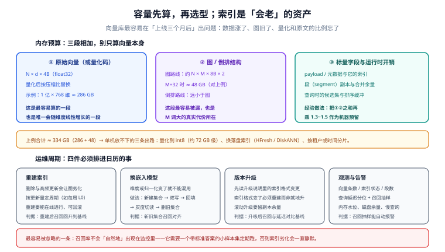

# 运维与容量

向量库最典型的故障不是「上线就挂」，而是**上线三个月后慢慢不对**：数据涨了、图旧了、量化的原文被删了、没人测召回。

这一页把三件事讲清楚：**容量怎么算、集群怎么切、哪四件事必须排进日历。**

## 一、容量预算：三段相加，缺一段就会 OOM



| 段 | 构成 | 为什么要算 | 常见疏漏 |
| --- | --- | --- | --- |
| ① 向量本身 | `N × d × 4 B`（float32；量化后按压缩比替换） | 随维度线性增长 | 只算这段，然后被 OOM 杀掉 |
| ② 索引结构 | 图路线约 `N × M × 8 B × 2`；倒排路线远小于此 | `M` 翻倍即翻倍 | 调大 `M` 前没算过这笔账 |
| ③ 标量字段与运行时 | payload、标量索引、段副本、合并余量、查询缓冲 | 与数据的「宽度」相关 | 只按向量条数买机器 |

**经验做法**：把 ① + ② 之和再乘 **1.3 ~ 1.5** 作为机器预留，覆盖段副本、合并与查询缓冲。

### 一个完整算例

前提：1000 万条、768 维、HNSW、`M=32`、目标 p95 < 50ms。

```shell
python3 - <<'PY'
n, d, m = 10_000_000, 768, 32
vec_f32 = n * d * 4
vec_i8  = n * d
graph   = n * m * 8 * 2

def gb(b): return b / 2**30

print(f"① 向量 float32 : {gb(vec_f32):7.1f} GB")
print(f"① 向量 int8    : {gb(vec_i8):7.1f} GB")
print(f"② 图 (M={m})    : {gb(graph):7.1f} GB")
for label, v in (("float32", vec_f32), ("int8", vec_i8)):
    total = gb(v + graph)
    print(f"→ {label:>7} 合计 {total:6.1f} GB，含 1.4× 预留 {total*1.4:6.1f} GB")
PY
```

输出：

```text
① 向量 float32 :    28.6 GB
① 向量 int8    :     7.2 GB
② 图 (M=32)    :     4.8 GB
→ float32 合计   33.4 GB，含 1.4× 预留   46.7 GB
→    int8 合计   11.9 GB，含 1.4× 预留   16.7 GB
```

**这两个数字就是选型的直接依据**：float32 要一台 64 GB 内存的机器，int8 只要 32 GB。**在 int8 精度损失可接受的前提下，这就是一次「换机器」与「换量化档位」的取舍**——而量化没有额外机器成本。

::: danger 容量规划里最贵的三个误解
1. **「磁盘大就够了」。** 索引默认形态是**常驻内存**；把「磁盘 1 TB」当成「能装 1 TB 向量」是最贵的误解。
2. **「加了量化就不用管原文了」。** 重排需要原始向量，主流实现会把它留在磁盘上（额外开销约 3%~25%，取决于量化档位）。**量化省的是内存，不是存储总量。**
3. **「数据量按现在的 3 倍预留就行」。** 向量条数增长往往不是线性的——**引入「按段落切分」之后，条数会按平均段落数倍增**。容量规划要按「预计的块数」而不是「文档数」算。
:::

## 二、分片与副本

单机装不下时，有两条切法，判据不同：

| 切法 | 切什么 | 适用 | 注意 |
| --- | --- | --- | --- |
| **按租户 / 业务域切** | 一个租户（或一组）一个集合 / 分片 | 多租户、权限边界清晰 | 热点租户会集中到一个分片 |
| **按数据本身切** | 哈希 / 范围把同一集合的向量打散到多分片 | 单一大集合 | 每个分片是独立索引，查询要广播合并 |
| **按时间切** | 冷热分层（近 30 天在内存，更早的落盘或归档） | 时效性强的场景 | 跨分片查询要合并结果 |

### 副本解决什么、不解决什么

| 副本能解决 | 副本不解决 |
| --- | --- |
| 读吞吐（多个副本分摊查询） | 单条查询的延迟（每个副本都要走完同样的检索） |
| 节点故障时的可用性 | 内存占用（每个副本都要各自的索引内存） |
| 滚动升级时的连续服务 | 召回率（副本的索引与主分片一致，一样近似） |

::: warning 一个常被忽略的组合问题
**分片 + 量化 + 副本**三者的内存开销是相乘的：`分片数 × 每片内存 × 副本数`。在规划时如果只算了「每片内存 × 分片数」，上线后加上副本就会超配。

同时要注意：**分片会稀释图的质量**。HNSW 的导航能力建立在「图足够连通」之上，把 1000 万条切成 10 片、每片 100 万条，每片内部仍然是 100 万条规模的图，**召回水平通常不是简单下降，而是基本保持**——但跨分片查询需要**每一片各自返回 top-k、再在归并层合并**，此时如果每片只取 k 条，全局的 top-k 会不准。**正确做法是每片取 k × 分片数 条再合并**，或者让引擎统一处理这类归并。
:::

## 三、四件必须排进日历的运维事项

### 事项一：重建索引

**什么时候要重建**：

- 累计删除 + 更新超过总量的 20%~30%（图劣化）；
- 改了 `M` 或 `efConstruction`（图结构固化，只能重建）；
- 升级后索引格式发生变化（见事项三）。

**重建怎么做才安全**：

```text
① 用新参数（或新版本）建立新索引，与旧索引并存
② 用固定评估集对比新旧索引的召回（必须对齐或更好才继续）
③ 切换读路径到新索引（可灰度：按流量比例）
④ 观察一段时间后删除旧索引
```

**判据**：**重建后召回回到基线**。如果重建后召回没有变化，说明重建周期定得太密——这是白花的成本，应该把周期放宽。

### 事项二：换嵌入模型

换模型是向量库里**唯一不能就地升级**的变更：**新旧向量不在同一个向量空间，混在一起检索结果是错的**。

正确的迁移流程：

| 步 | 动作 | 判据 |
| --- | --- | --- |
| 1 | 新建集合（新维度、新索引配置） | 新集合可写入、可检索 |
| 2 | **双写**：新数据同时写入新旧两个集合 | 两边条数差在可接受范围 |
| 3 | 回填历史数据（用新模型重算全部向量） | 新集合条数 = 源数据块数 |
| 4 | 用评估集对比新旧集合的召回 | 新集合不低于旧集合 |
| 5 | **灰度切读**（按流量比例或按用户分批） | 灰度期间无异常 |
| 6 | 全量切换并观察 | 稳定后删除旧集合 |

::: danger 换模型时最容易犯的三个错
1. **只对新数据用新模型。** 结果是同一个集合里有两种向量空间的数据，检索结果「部分是准的、部分是乱序的」——**而且没有报错**。
2. **忘记归一化口径。** 旧模型输出已归一化、新模型没有（或相反），余弦距离的计算就直接错了。
3. **没有回滚方案。** 灰度切读的前提是旧集合还在、还能被切回去。**先删旧集合、再切流量，等于没有回滚。**
:::

### 事项三：版本升级

向量库的升级比其他中间件更需要注意，因为**索引格式可能变化**：

| 升级类型 | 典型做法 | 判据 |
| --- | --- | --- |
| 补丁版本（如 1.19.1 → 1.19.2） | 滚动升级，按官方说明执行 | 升级后召回与延迟对比基线无退化 |
| 小版本（如 1.18 → 1.19） | 先读变更日志，确认有无破坏性变更 | 同上 |
| **索引格式变更** | **必须重建索引**，不能就地升 | 重建后召回对齐 |
| 大版本（如 Milvus 2.6 → 3.0） | 按官方迁移指南走，通常会改数据组织方式 | 迁移演练 + 对账 |

::: info 一条值得记住的版本教训
**补丁版本也可能带数据完整性问题。** pgvector 的 0.8.3（2026-06-17）修的正是「HNSW 与 `VACUUM` 并发时的索引损坏」——受影响的部署看起来一切正常，但索引已经损坏。这类修复的判断口径是：**如果变更说明里出现「corruption / 数据完整性」字样，就不是「顺手升级」，而是必须优先升级**。
:::

### 事项四：观测与告警

这是四件事里最容易被跳过的，因为**召回率不会自己出现在监控里**。

| 层 | 指标 | 告警阈值怎么定 |
| --- | --- | --- |
| 数据 | 向量条数、集合数、段数、标量索引状态 | 条数变化率异常（突增 / 突降） |
| 内存 | 进程内存水位、是否发生 swap、是否 OOM 重启 | 水位 > 80% 预警、> 90% 告警 |
| 磁盘 | 数据目录余量、合并（compaction）积压 | 余量 < 20% 预警 |
| 性能 | 查询 p50 / p95 / p99、QPS、慢查询条数 | 基于历史基线推阈值，不要照抄绝对数字 |
| **质量** | **定期用固定评估集测 recall@k** | **相对基线的下降超过 3~5 个点即告警** |

最后一行是**本页最重要的一条**：

::: tip 召回抽样怎么做
1. 准备一个固定的评估集：**200~500 条真实查询 + 每条的正确结果集**（用暴力检索生成）。
2. 做成定时任务（如每天一次），跑这批查询、算 recall@10。
3. 把结果画成一条线，**对比基线**；下降超过阈值就告警。
4. 同时按「**过滤形状**」分组统计（见[过滤与元数据检索](../Filtering/index.md)）——平均值正常不代表每个形状都正常。

**成本很低**（几千条查询，几十秒），但它能发现的是一类完全没有其他手段能发现的缺陷。
:::

## 四、成本核算

向量库的成本结构与普通服务不同，主要落在内存与存储上。核算时至少覆盖五项：

| 成本项 | 怎么估 | 备注 |
| --- | --- | --- |
| 内存 | 见本页第一节的三段预算 × 1.3~1.5 | **主要成本项** |
| 存储 | 原始向量 + 索引文件 + 段副本，注意量化会额外留原文 | 量化不省总存储 |
| 计算 | 查询 QPS × 单次查询的 CPU 时间；建索引时的峰值 | 量化能同时降低查询 CPU |
| 嵌入调用 | 入库条数 × 单价（换模型时要重算全量） | **换模型是一次性的大额支出** |
| 网络 | 跨可用区副本同步、跨服务传输 | 分片越多越明显 |

### 一个降低成本的排序

按「性价比」从高到低：

1. **量化到 int8**：内存降 4×，精度损失小，几乎没有工程成本。**先做这个。**
2. **减少无效向量**：删掉过期的、重复的、低质量的块。**很多集合里 20%~30% 的向量从未被检索到。** 这是最被低估的一项。
3. **缩短维度**（MRL 截断或换更小的模型）：内存与计算同时下降。
4. **冷热分层**：把很少访问的数据落到更便宜的存储上。
5. **减少副本**（在对可用性影响可接受的范围内）。
6. **换更便宜的硬件**（放最后，因为前面几步做完之后需求本身可能已经变小）。

::: warning 「先加机器」为什么通常是最差的选择
加机器能立刻缓解症状，但它**同时保留了三笔浪费**：无效向量还在占内存、没有量化、冷热数据混在一起。**先做 1 和 2，再决定要不要加机器**——很多情况下做完前两步，容量缺口就已经消失了。
:::

## 五、易错点

::: danger 运维期的八个坑
1. **只按向量算内存**，忽略图（M=32 时约占向量 17%）。
2. **调大 `M` 前不算内存**，调完发现机器不够，又得重建一次。
3. **把索引参数变更当成配置变更**（改完重启就以为生效了），实际需要重建。
4. **高频删除后长期不重建**，召回缓慢下滑且无告警。
5. **换模型时新旧向量混在同一集合**，结果部分错乱且无报错。
6. **先删旧集合再切流量**，回滚路径被自己删掉了。
7. **召回率从不测量**，因为「它不在监控里」。
8. **用十进制 GB 做预算、用二进制 GB 看监控**，两边相差约 7%，一直对不上账。
:::

## 六、验证方式

```shell
# 1) 容量预算：跑一次就能拿到本页算例的数字
python3 - <<'PY'
n, d, m = 10_000_000, 768, 32
vec_f32, vec_i8, graph = n*d*4, n*d, n*m*8*2
gb = lambda b: b / 2**30
print(f"float32 {gb(vec_f32+graph):6.1f} GB   int8 {gb(vec_i8+graph):6.1f} GB   "
      f"1bit {gb(n*d//8+graph):6.1f} GB")
print(f"含 1.4× 预留: {gb(vec_f32+graph)*1.4:6.1f} GB / {gb(vec_i8+graph)*1.4:6.1f} GB")
PY

# 2) 分片 + 副本后的总内存（最容易被漏算的一步）
python3 - <<'PY'
per_shard_gb, shards, replicas = 12.0, 8, 2
print(f"总内存 = {per_shard_gb} × {shards} × {replicas} = {per_shard_gb*shards*replicas:.0f} GB")
PY

# 3) 跨分片合并的正确取数：每片必须取 k × 分片数 条
python3 - <<'PY'
k, shards = 10, 8
print(f"要全局 top-{k}，每片至少取 {k*shards} 条再归并（只取 {k} 条会漏结果）")
PY

# 4) 召回抽样的落地形态（判据是「与基线对比」，不是绝对值）
python3 - <<'PY'
base = 0.961          # 上线时测出的基线 recall@10
today = 0.932         # 今天抽样测得
delta = (base - today) * 100
print(f"基线 {base:.3f}  今天 {today:.3f}  下降 {delta:.1f} 个点 → "
      f"{'告警' if delta > 3 else '正常'}")
PY
```

预期：第 1 条与本页算例一致（33.4 GB / 11.9 GB / 5.7 GB，预留后 46.7 / 16.7）；第 4 条会打印「告警」——**下降 2.9 个点在阈值边缘时要不要告警，这个阈值应当先定下来再测，而不是看到数字后再调阈值。**

## 参考资料

- Qdrant 量化与内存调优文档：<https://qdrant.tech/documentation/guides/quantization/>
- Milvus 容量与资源规划说明：<https://milvus.io/docs/>
- pgvector README（索引构建、`maintenance_work_mem` 与升级要点）：<https://github.com/pgvector/pgvector>
- Weaviate 关于磁盘索引与内存的说明：<https://weaviate.io/blog/weaviate-1-36-release>
- Elastic 关于量化带来的额外磁盘开销：<https://www.elastic.co/docs/reference/elasticsearch/mapping-reference/dense-vector>
- 相邻页面：[索引算法全景](../IndexAlgorithms/index.md)、[量化深入](../Quantization/index.md)、[常见问题与最佳实践](../FAQ/index.md)
