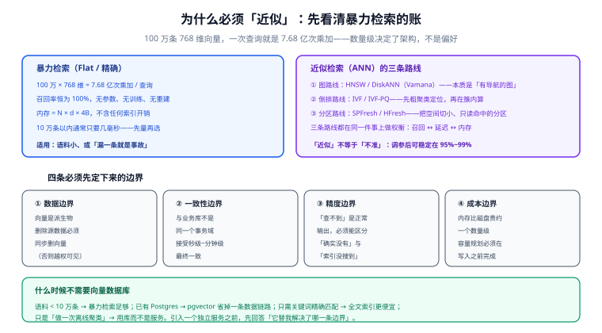

# 概述：向量检索的四条边界

「向量数据库」这个词容易让人以为它是一个**存储产品**。它其实是一个**近似检索引擎**——存只是附带能力，真正的工作是「在上亿条向量里，用几十毫秒找出最像的那几十条」。

这一页先回答三件事：**为什么必须近似、近似有哪几条路、以及在你动手之前必须先定下哪四条边界。**

## 一、先把「近似」这件事算清楚

### 暴力检索的账

不建任何索引也能查：把查询向量和库里每一条都算一遍距离，排序取前 k。这叫**暴力检索**（brute force / Flat / 精确检索），它的召回率恒为 100%。

它的问题只有一个，但无法绕过：

| 数据量 | 维度 | 一次查询的乘加次数 | 直觉 |
| --- | --- | --- | --- |
| 10 万 | 768 | 7,680 万 | 通常是几毫秒，可以接受 |
| 100 万 | 768 | 7.68 亿 | 已经进入「每次请求都在打满 CPU」的区间 |
| 1 亿 | 768 | 768 亿 | 单次查询就是秒级到十秒级，不可能交互式使用 |

::: tip 先用暴力检索量一遍
**在引入任何索引之前，先用暴力检索跑一次**。它有两个用途：① 拿到延迟基线，判断「其实不用索引」；② 拿到**召回率的基准答案**——后面所有索引调参，都是拿它的结果当标准答案来算召回率。跳过这一步，后面所有「效果好像变好了」的判断都只是感觉。
:::

### 「近似」不是「不准」

近似检索（Approximate Nearest Neighbor，ANN）的承诺是：**以很小的概率漏掉真正的最近邻**。工程上常见的水平是 recall@10 落在 95%~99% 之间，而查询速度快 10~1000 倍。

代价是它引入了一类**新的失败模式**：查询返回了结果，看起来正常，但真正的答案没在里面。这一类失败**不报错、不超时、不进日志**——这是本专题反复强调「要建立标准答案集」的根本原因。

## 二、ANN 的三条路线



三条路线在机制上完全不同，但都在同一件事上做权衡：**召回率 ↔ 延迟 ↔ 内存**。

| 路线 | 代表算法 | 省时间的方式 | 最好的场景 | 最怕的场景 |
| --- | --- | --- | --- | --- |
| **图路线** | HNSW、DiskANN（Vamana） | 把邻近关系存成边，查询变成「走图」 | 读多写少、延迟敏感 | 高频增删（图会劣化） |
| **倒排路线** | IVF、IVF-PQ | 先粗聚类，只扫命中的几个簇 | 内存受限、数据量极大 | 真邻居落在簇边界上 |
| **分区路线** | SPFresh / HFresh | 切成许多小分区，只读命中的分区 | 写入频繁、内存受限 | 需要百毫秒级以外的低延迟 |

三者不是「新旧替代」关系。**IVF-PQ 到今天仍是十亿级数据集最常用的方案**，而 HFresh 这类分区路线是 2026 年才走到 GA 的新成员。选谁，取决于你的约束条件落在三角的哪一边。

## 三、四条必须先定下来的边界

这四条不属于「调优」，属于**设计前提**。它们定错了，后面所有参数调整都是白费。

### 边界一 · 数据边界：向量是派生物

向量是文本、图片、商品这些**源数据**算出来的。由此推出一条容易被忽视的硬规则：

**删除源数据时，必须同步删除它的向量。**

否则会出现一种非常难看的情况：一份已经下架或撤回的文档，仍能被检索出来并进入答案。这不是「缓存没刷新」，而是**数据边界没有闭合**。

落地做法是把向量库的标识符与业务主键绑定，并在业务侧删除时走同一条删除路径（软删除 + 定期物理清理，或直接同步删除）。

### 边界二 · 一致性边界：接受最终一致，但要定义窗口

向量库与业务库**不在同一个事务域**。写入链路通常是：

```text
业务库提交 → 发消息（或 CDC）→ 嵌入模型 → 写入向量库 → 可被检索
```

这条链路存在一个**可见性延迟窗口**。要定下来的不是「怎么做到强一致」（做不到，也不值得），而是两件事：

1. **窗口有多大**（例如「写入后 5 秒内可检索」）；
2. **窗口内的行为是什么**（例如「先写后删」的文档在窗口内可能出现「存在但未更新」的旧向量，而不是消失）。

::: danger 三个常见的一致性写法错误
1. **先删向量、再写业务库**：业务库写失败时，数据丢了向量还在，出现「检索到不存在的文档」。正确顺序是**先写源、后动向量**。
2. **把「写入成功」当成「可检索」**：两者之间隔着嵌入与索引两段。正确做法是给出**可检索的判据**（例如按主键回查向量是否存在）。
3. **用向量库的条数做业务对账**：向量库条数会因为「同一条数据被切成了多个块」而与业务条数不相等。对账要按**去重后的主键集合**做。
:::

### 边界三 · 精度边界：要能区分「没有」与「没找到」

ANN 查询返回空结果有两种完全不同的含义：

| 情况 | 含义 | 处置 |
| --- | --- | --- |
| 库里确实没有相关数据 | 正常的「没有」 | 直接告诉调用方「无结果」 |
| 索引没找到（召回失败） | 系统性缺陷 | 要能通过调参或换索引改善 |

如果接口只返回一个空数组，这两种情况就**无法区分**。可用的做法是让检索接口至少返回三样东西：`hits`、`search_params`（本次用的 `ef` 等）、以及一个 `reason` 字段（`no_data` / `below_threshold` / `index_miss_suspected`）。

### 边界四 · 成本边界：内存比磁盘贵一个数量级

向量索引的默认形态是**常驻内存**。这意味着一句很朴素的话决定了预算：

```text
内存 ≈ N × (d × 4B + 图开销)
```

100 万 × 768 维 float32 的原始向量约 2.9 GB；1 亿条就是 **286 GB**，再加上约 48 GB 的图结构，**单机根本放不下**。因此在写入之前就要回答：**用哪种压缩、用哪种索引形态、要不要分片**。

## 四、量化与索引是两条正交的轴

初学者常把「HNSW / IVF」与「int8 / 二值」混在一起谈。它们是两个独立维度：

- **索引**决定「怎么少算」——查哪些候选；
- **量化**决定「一条向量占多大」——用多少位表示。

于是有了这些组合：HNSW + int8、HNSW + 二值、IVF + PQ（即 IVF-PQ）、落盘索引 + 旋转量化。

| 组合 | 压缩 | 典型用途 |
| --- | --- | --- |
| HNSW（不量化） | 1× | 延迟最敏感、内存充足 |
| HNSW + SQ（int8） | 4× | **生产默认起点**，精度损失很小 |
| HNSW + BQ / BBQ | 32× | 高维（≥1024）向量、可接受重排开销 |
| IVF-PQ | 10~30× | 数据量极大、内存是硬约束 |
| 落盘索引 + RQ | 4~32× | 内存只需要放质心索引 |

**所有量化的共同前提是「重排」**：量化只用来找候选，最终顺序必须用原始向量重算。少了这一步，压缩比越高、答案越离谱。

## 五、最小起步三步

真要从零上手，三步就够，每一步都有可验证的收尾：

```shell
# 1) 起一个单机实例（以容器为例，具体镜像按所选产品官方文档）
docker run -d --name vdb -p 6333:6333 qdrant/qdrant:v1.19.2

# 2) 确认它能用：拿到版本号与集合列表
curl -s localhost:6333/ | head -c 200; echo
curl -s localhost:6333/collections

# 3) 建一个小集合（3 维便于肉眼核对），写入两条向量后做一次检索
curl -s -X PUT localhost:6333/collections/demo \
  -H 'Content-Type: application/json' \
  -d '{"vectors":{"size":3,"distance":"Cosine"}}'
curl -s -X PUT localhost:6333/collections/demo/points \
  -H 'Content-Type: application/json' \
  -d '{"points":[{"id":1,"vector":[1,0,0],"payload":{"t":"a"}},
                  {"id":2,"vector":[0,1,0],"payload":{"t":"b"}}]}'
curl -s -X POST localhost:6333/collections/demo/points/query \
  -H 'Content-Type: application/json' \
  -d '{"query":[1,0,0],"limit":2}'
```

第 3 步的预期结果：`id=1` 排在 `id=2` 之前（与查询向量同向）。**看到这个顺序，说明写入、索引、检索三段都通了**——比任何「部署成功」的日志都可靠。

## 六、什么时候不需要向量数据库

引入一个独立服务是有成本的：多一条数据链路、多一处一致性窗口、多一份运维负担。下面五种情况**先别引入**：

| 情况 | 更合适的做法 |
| --- | --- |
| 语料 < 10 万条 | 暴力检索（内存里算）通常几毫秒就够，不需要索引 |
| 已经在用 Postgres | 先用 `pgvector`，省掉一整套同步链路 |
| 只需要精确关键词匹配 | 全文索引（倒排）更便宜也更准 |
| 只在离线任务里做聚类 / 去重 | 用**库**（如 Faiss）而不是**服务** |
| 需求本质是「结构化筛选 + 少量语义排序」 | 先用 SQL 缩小范围，再对少量候选算相似度 |

判断口径很简单：**这个向量数据库替我解决了上面四条边界里的哪一条？** 一条都答不上来，就说明它现在只是架构图上的一个装饰。

## 七、术语对齐

| 术语 | 英文 / 缩写 | 一句话含义 |
| --- | --- | --- |
| 精确检索 | Flat / brute force | 与全量数据逐一比较，召回 100% |
| 近似最近邻 | ANN | 以可接受的漏检率换取速度 |
| 召回率 | recall@k | 前 k 条里命中了多少比例的真答案 |
| 候选集 | ef / probes / nprobe | 检索时实际考察的候选数量，是延迟与召回的旋钮 |
| 量化 | quantization | 降低每条向量的表示精度以省内存 |
| 重排 | rescoring / rerank | 用更精确的分数重排候选，弥补近似带来的损失 |
| 过滤 | filter | 结合标量条件限制可检索范围 |
| 混合检索 | hybrid search | 稠密向量与稀疏词法两路召回后融合 |
| 选择性 | selectivity | 过滤条件命中的比例，越低代表过滤越严 |
| 落盘索引 | disk-based index | 向量主体存磁盘，只把导航结构放内存 |

## 八、验证方式

本页的三条结论都可以在本机复核，不需要生产数据：

```shell
# 1) 暴力检索确实随数据量线性变慢（用随机向量做一次量级验证）
python3 - <<'PY'
import numpy as np, time
for n in (10_000, 100_000, 1_000_000):
    x = np.random.rand(n, 768).astype("float32")
    q = np.random.rand(768).astype("float32")
    t = time.perf_counter(); _ = x @ q; dt = (time.perf_counter() - t) * 1000
    print(f"n={n:>9} 一次全量点积 {dt:8.1f} ms")
PY

# 2) 内存估算公式与真实占用对齐（以 100 万 × 768 维为例）
python3 -c "n,d,m=1_000_000,768,32; print(f'向量 {n*d*4/2**30:.1f} GB, 图 {n*m*8*2/2**30:.1f} GB')"

# 3) 量化档位的压缩比核对
python3 -c "n,d=1_000_000,768; print('float32',n*d*4//2**20,'MB     int8',n*d//2**20,'MB     1bit',n*d//8//2**20,'MB')"
```

预期：第 1 条随 `n` 线性增长；第 2 条输出向量约 **2.9 GB**、图约 **0.5 GB**；第 3 条三档约 **2929 MB / 732 MB / 91 MB**。三个数字都对得上，说明本页的容量口径可以直接拿去用。

::: tip 单位口径
本页与后续页面统一按 **1 GB = 1024³ B（即 GiB）** 计算，`python3` 里的 `/ 2**30` 就是这个口径。云厂商账单常见的是十进制 GB（1 GB = 1000³ B），两者相差约 7%——**算容量时先约定用哪一个，否则「为什么预算比算出来的多了一成」会变成一个查不出来的问题**。
:::

## 参考资料

- HNSW 原论文（分层可导航小世界图）：<https://arxiv.org/abs/1603.09320>
- DiskANN（Vamana，面向 SSD 的图索引）：<https://github.com/microsoft/DiskANN>
- Faiss 官方 Wiki（IVF / PQ 的经典实现与参数）：<https://github.com/facebookresearch/faiss/wiki>
- ANN Benchmarks（公开的召回—延迟基准）：<https://ann-benchmarks.com/>
- 相邻应用侧专题：[向量库与索引](/docs/AI/RAG/VectorStore/index.md)、[嵌入与向量基础](/docs/AI/RAG/Embedding/index.md)
