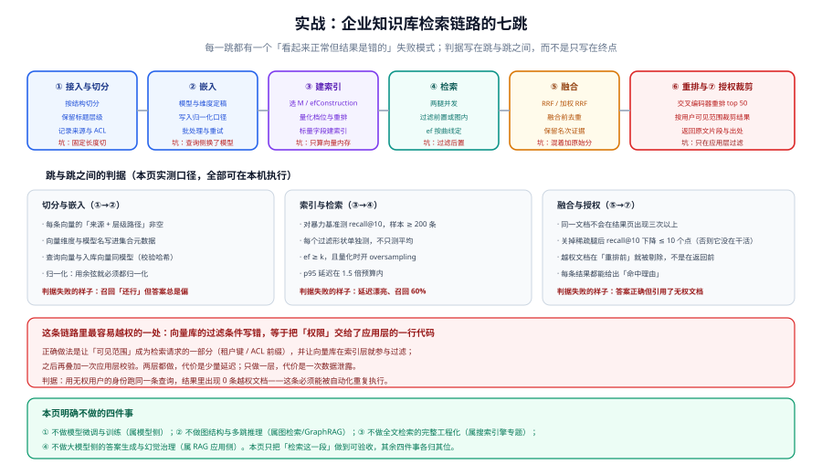

# 实战：企业知识库检索链路

前八页讲的是机制。这一页把它们串成一条**可以照着搭起来、并且可以验收**的检索链路：**企业知识库**——把内部的制度文档、技术文档、工单记录索引起来，让员工能问、系统能答，而且**只能看到自己有权看的内容**。

选择这个场景的原因是它同时压住了本专题的所有难点：**语料结构不统一**（切分难）、**查询类型混杂**（既有编号检索也有语义提问，必须混合）、**权限边界严格**（过滤不能出错）、**容量会持续增长**（量化与重建都躲不过）。

## 一、目标系统与范围



### 要做到什么

| 编号 | 目标 | 验收方式 |
| --- | --- | --- |
| G1 | 员工用自然语言提问，能检索到相关段落 | 评估集 recall@10 ≥ 0.90 |
| G2 | 输入工单号、错误码、制度编号能精确命中 | 编号类查询 recall@3 = 1.0 |
| G3 | 用户只能检索到有权查看的文档 | 越权冒烟测试返回 0 条 |
| G4 | p95 检索延迟 ≤ 300ms（含两条腿与融合） | 压测报告 |
| G5 | 索引劣化可被发现 | 每日召回抽样，下降 > 3 个点告警 |

### 明确不做的四件事

| 不做 | 归属 |
| --- | --- |
| 微调嵌入模型 | 模型侧；本页只用现成模型 |
| 多跳推理与实体图谱 | 图检索 / GraphRAG |
| 全文检索的完整工程化（同义词、拼音、纠错） | 搜索引擎专题 |
| 大模型的答案生成与幻觉治理 | RAG 应用侧 |

**把这四件事写清楚，是为了让本页的范围可验收。** 「检索这一段做得对不对」是可以判定的；把生成也拉进来，验收就变成主观的。

## 二、七跳链路

| 跳 | 动作 | 关键决定 | 失败的样子 |
| --- | --- | --- | --- |
| ① 接入与切分 | 从文档系统拉取、解析、切块 | **按结构切**（标题层级）而不是按固定长度 | 答案被切在两块中间，两块的向量都不够近 |
| ② 嵌入 | 调嵌入模型生成向量 | 模型与维度定稿、**归一化口径写死** | 查询侧换了模型，召回整体偏 |
| ③ 索引 | 建向量索引 + 标量索引 | 选 `M` / 量化档位 / 过滤字段建索引 | 只算了向量内存，OOM |
| ④ 检索 | 两腿并发召回 | `ef` 与两腿候选数为 50~100 | 过滤后置、候选不足 |
| ⑤ 融合 | RRF 融合两腿 | **融合前去重** | 结果页被同一文档的相邻块占满 |
| ⑥ 重排 | 交叉编码器精排 top 50 | 只重排候选，不指望它救漏检 | 把重排当成召回手段 |
| ⑦ 授权裁剪 | 按用户可见范围过滤 | **过滤下推到索引层 + 应用层二次校验** | 答案正确但引用了无权文档 |

## 三、数据模型与集合设计

### 向量库侧的结构

```json [集合结构示意（以通用形态描述，字段名按各自客户端 API 调整）]
{
  "collection": "kb_chunks",
  "vectors": {
    "dense": { "size": 1024, "distance": "Cosine" },
    "sparse": { "type": "sparse" }
  },
  "payload_fields": ["doc_id", "chunk_no", "dept", "acl_prefix", "doc_type", "updated_at", "title_path"],
  "indexed_fields": ["dept", "acl_prefix", "doc_type", "updated_at"]
}
```

| 字段 | 类型 | 用途 | 是否建标量索引 |
| --- | --- | --- | --- |
| `doc_id` | 字符串 | 源文档主键（删除与对账的锚点） | 是 |
| `chunk_no` | 整数 | 块序号（融合前按它去重并聚合） | 否 |
| `dept` | 字符串 | 部门范围 | **是** |
| `acl_prefix` | 字符串 | 可见范围前缀（如 `dept:tech/`） | **是** |
| `doc_type` | 字符串 | 制度 / 技术 / 工单 | **是** |
| `updated_at` | 时间戳 | 时效过滤与排序 | **是** |
| `title_path` | 字符串 | 标题层级路径（用于给结果补充上下文） | 否 |

::: danger 两个必须写进设计的约定
1. **每个要过滤的字段都必须有标量索引。** 没有它，引擎无法估计过滤的选择性，也就无法正确选路——这会直接表现为「某些查询召回极低」。**这不是优化项，是前置条件。**
2. **`acl_prefix` 必须由服务端注入，不能由客户端传入。** 一旦允许客户端传可见范围，权限就由客户端决定了。服务端应当从登录态里解析出可见范围，拼进检索请求。
:::

### 与业务库的对账

向量库与业务库之间必须能对账，否则「删了但没删掉」这类问题无法发现：

```sql
-- 业务库侧：导出「应当存在」的块指纹集合
SELECT doc_id || '#' || chunk_no AS chunk_key, updated_at
FROM kb_chunks_expected
ORDER BY chunk_key;

-- 向量库侧：导出实际存在的块
-- GET /collections/kb_chunks/points/scroll  → 逐页拉取 payload 中的 doc_id / chunk_no

-- 两边的差集就是三类问题的答案：
--   业务有、向量库无 → 漏索引（写入链路断了一环）
--   向量库有、业务无 → 幽灵向量（删除没同步，最危险的一类）
--   两边都有但 updated_at 不同 → 更新未回填
```

**对账按「去重后的 `doc_id#chunk_no` 集合」做，不要按条数比。** 条数相等但集合不同是常见情况（漏了一条又多了另一条）。

## 四、切分与嵌入

### 切分：按结构，不按长度

```text
① 先按标题层级切成段落（H1 → H2 → H3 逐级下降）
② 对超长的段落再做二级切分（保留重叠区 10%~15%）
③ 每个块写入「标题路径」到 payload（如「考勤制度 / 请假 / 年假」）
④ 过短的块与其相邻块合并（阈值按语料实测）
```

**为什么不用固定长度切分**：

| 切分方式 | 优点 | 问题 |
| --- | --- | --- |
| 固定长度（如每 500 字） | 实现最简单 | **把表格、步骤、条款切断**；检索到的块缺上下文 |
| 按结构（标题层级） | 语义完整、可用标题路径补充上下文 | 需要解析各类文档格式 |
| 按语义（句子边界/模型切分） | 边界自然 | 计算成本高、边界不稳定 |

::: tip 一个省事的判据
切分好坏的表现是「**检索到的块单独看能不能回答查询**」。准备 20 条查询，把检索到的块打印出来人工看一遍——**如果有一半的块缺主语或缺前提，说明切分方式不对**，此时任何索引调优都救不回来。
:::

### 嵌入：把口径写死

| 口径 | 必须记录在哪里 | 为什么 |
| --- | --- | --- |
| 模型名与版本 | 集合元数据 + 代码常量 | 换了模型必须重建（新旧向量空间不同） |
| 维度 | 集合配置 | 维度不符会直接报错（这一项反而安全） |
| 是否归一化 | 集合元数据 + 代码常量 | 不写下来就会「有人加了未归一化的向量」 |
| 距离度量 | 集合配置 | 余弦 / 内积 / L2 不能混 |

**建议在写入端做一次断言**：新向量必须满足 `abs(norm(v) - 1) < 1e-3`（如果用余弦距离）。这条断言的成本是一行代码，能挡掉一整类静默错误。

## 五、索引与量化配置

按第七页的容量算法，先算再配。假设语料 200 万块、1024 维：

```python
# 容量测算（在本机跑一次，用真实数字替换）
n, d, m = 2_000_000, 1024, 32
vec_f32, vec_i8 = n * d * 4, n * d
graph = n * m * 8 * 2
gb = lambda b: b / 2**30
print(f"float32 {gb(vec_f32 + graph):5.1f} GB   int8 {gb(vec_i8 + graph):5.1f} GB")
```

结论（输出 **8.6 GB / 2.9 GB**）：配 int8 量化后，**单机 4 GB 内存不够、8 GB 即可富余**；而不量化就需要 16 GB。**这就是量化带来的实际差别——一次「换机器」与「换量化档位」的取舍，而量化不增加机器成本。**

### 配置

```json [集合的索引与量化配置（参数名按各自客户端 API 调整）]
{
  "hnsw_config": { "m": 32, "ef_construct": 200 },
  "quantization_config": {
    "scalar": { "type": "int8", "quantile": 0.99, "always_ram": true }
  },
  "search_params": { "hnsw_ef": 128, "oversampling": 3.0 }
}
```

三个参数各自的依据：

| 参数 | 取值 | 依据 |
| --- | --- | --- |
| `m` | 32 | 200 万条规模、召回有指标要求（按第三页的数量级表定起点，实测确认） |
| `ef_construct` | 200 | 取 `m` 的 6 倍量级，一次性导入时不需要省这点时间 |
| `quantile` | 0.99 | 裁掉两端各 0.5% 的离群值，避免个别极端值撑大映射区间 |
| `hnsw_ef` | 128 | 按「召回—延迟」曲线的拐点定，需实测 |
| `oversampling` | 3.0 | 量化后必须放大候选；从 3 起步，按召回上调 |

::: warning 建索引时的三个操作纪律
1. **导入用足 `ef_construct`，不要为了「导入快一点」降它。** 导入快的是几分钟，之后所有查询都背着这个代价。
2. **导入完成后才切查询参数。** 建索引期间谈 `hnsw_ef` 没有意义。
3. **`M` 或 `ef_construct` 改了要重建索引**——它们是索引参数，不是运行时参数。
:::

## 六、检索：两腿并发与融合

### 一次请求的完整流程

```python
# app/retrieval.py —— 检索主流程（关键片段）
import asyncio
from collections import defaultdict

K = 10              # 最终返回条数
LEG_N = 80          # 每腿候选数（远大于 K，给融合留名次空间）
RERANK_N = 50       # 重排深度
RRF_K = 60


async def retrieve(query: str, user_scope: dict) -> list[dict]:
    # ① 可见范围由服务端注入，绝不接受客户端传入
    flt = build_filter(user_scope)          # dept / acl_prefix / doc_type 的组合

    # ② 两条腿并发，总延迟取 max 而不是 sum
    dense_task = asyncio.create_task(search_dense(query, flt, limit=LEG_N))
    sparse_task = asyncio.create_task(search_sparse(query, flt, limit=LEG_N))
    dense, sparse = await asyncio.gather(dense_task, sparse_task)

    # ③ 融合前去重：同一文档的相邻块只保留分数最高的那个
    dense, sparse = dedupe_by_doc(dense), dedupe_by_doc(sparse)

    # ④ RRF 融合（只看名次，不做分数归一化）
    fused = rrf_fuse([dense, sparse], k=RRF_K)

    # ⑤ 只对候选重排，不指望它救漏检
    top = fused[:RERANK_N]
    reranked = await rerank(query, top)

    # ⑥ 返回前做一次应用层复核（第二道防线）
    return [r for r in reranked[:K] if is_visible(r, user_scope)]


def rrf_fuse(rank_lists, k=60):
    scores = defaultdict(float)
    for ranked in rank_lists:
        for rank, doc in enumerate(ranked, start=1):
            scores[doc["chunk_key"]] += 1.0 / (k + rank)
    return sorted(scores.items(), key=lambda kv: -kv[1])
```

### 三个决定的关键理由

| 决定 | 理由 |
| --- | --- |
| 每腿取 80 而不是 10 | 融合需要名次空间；只取 10 等于把 RRF 退化成「并集」 |
| 融合前按文档去重 | 同一文档的相邻块在两腿都会靠前，融合后会把结果页占满 |
| 过滤放服务端、最后再复核一次 | 过滤写错是静默的；两层防护把「一次失误」的成本降到「一条被拦住的越权结果」 |

## 七、权限裁剪：两层防护

```text
第一层（索引层）：过滤条件进入检索请求 → 引擎在检索时就排除不可见内容
第二层（应用层）：返回前再按用户可见范围复核一次
```

**为什么两层都要**：

- 只有应用层：越权内容进入了应用进程内存，任何一个分支忘记过滤就是泄露；而且会放大「返回条数不足」问题。
- 只有索引层：过滤条件由某一段代码拼装，拼错一次就静默失效，没有任何兜底。

两层叠加后，**任何一层出错都不会直接导致泄露**。代价是少量延迟与一点代码重复——对可信度来说这笔账很划算。

### 可见范围的三种典型形态

| 形态 | 过滤条件 | 适合 |
| --- | --- | --- |
| 部门树 | `dept IN (...)` | 组织架构清晰 |
| 前缀路径 | `acl_prefix STARTSWITH "dept:tech/"` | 层级权限 |
| 显式名单 | `acl_group IN (...)`（组 ID 列表） | 项目制、跨部门协作 |

**推荐用前缀路径**：它天然支持层级（给某个部门开放时只需要给它自己的前缀），而且过滤值不会随人数增长而膨胀。

## 八、验收判据（VD-A ~ VD-H）

沿用「判据唯一性」纪律：本页不新增机制级判据，只登记**链路级**判据，机制层面的判据仍归前几页各族。

| 编号 | 判据 | 类别 | 本机可判？ |
| --- | --- | --- | --- |
| VD-A | 每个要过滤的字段都有标量索引，且过滤条件在请求中可见（不是拿到结果后筛） | 过滤是否下推 | ✅ 配置级 |
| VD-B | 查询侧与入库侧使用同一模型、同一维度、同一归一化口径 | 口径是否一致 | ✅ 配置级 |
| VD-C | `ef >= k` 且量化开启 oversampling，候选数满足 `>= k × 3` | 候选是否充足 | ✅ 配置级 |
| VD-D | 两腿并发执行，融合前按文档去重 | 融合是否有效 | ✅ 代码级 |
| VD-E | 每条结果都能返回「命中来源」（哪一腿、原名次）与出处 | 可解释性 | ✅ 输出级 |
| VD-F | 越权冒烟测试返回 0 条越权结果，且可自动重复执行 | 权限边界 | ⏳ 需实例 |
| VD-G | 评估集 recall@10 ≥ 0.90，且**按过滤形状分别统计** | 召回是否达标 | ⏳ 需实例 |
| VD-H | 存在每日召回抽样任务，且「下降 > 3 个点」会告警 | 劣化是否可见 | ⏳ 需实例 |

**如实标注验证状态**：本页不声称任何一条动态判据「已通过」——`VD-A`~`VD-E` 是配置与代码级，可以在代码评审阶段判定；`VD-F`~`VD-H` 需要真实实例与语料，必须实跑才能勾选。

## 九、可执行的验证脚本

```shell
# scripts/check-retrieval.sh —— 检索链路的冒烟检查
# 用法：BASE=http://localhost:6333 COL=kb_chunks bash scripts/check-retrieval.sh
set -u
BASE="${BASE:-http://localhost:6333}"
COL="${COL:-kb_chunks}"
fail=0

check() {  # check <编号> <描述> <期望> <实际>
  if [ "$3" = "$4" ]; then echo "  OK   $1 $2"; else echo "  FAIL $1 $2  期望=$3 实际=$4"; fail=1; fi
}

echo "== VD1 集合存在且向量已就绪 =="
count=$(curl -s "$BASE/collections/$COL" | grep -o '"points_count":[0-9]*' | head -1 | cut -d: -f2)
check VD1 "points_count 大于 0" "yes" "$([ "${count:-0}" -gt 0 ] && echo yes || echo no)"

echo "== VD2 每个过滤字段都有标量索引 =="
for f in dept acl_prefix doc_type updated_at doc_id; do
  hit=$(curl -s "$BASE/collections/$COL" | grep -c "\"$f\"")
  check VD2 "字段 $f 已声明" "yes" "$([ "$hit" -gt 0 ] && echo yes || echo no)"
done

echo "== VD3 带过滤的查询能返回足量结果（不足即过滤后置或候选太小） =="
got=$(curl -s -X POST "$BASE/collections/$COL/points/query" \
  -H 'Content-Type: application/json' \
  -d '{"query":[0.1,0.2],"limit":10,"filter":{"must":[{"key":"dept","match":{"value":"tech"}}]}}' \
  | grep -o '"id":' | wc -l | tr -d ' ')
check VD3 "返回 10 条" "10" "$got"

echo "== VD4 越权冒烟测试：不应出现非本部门内容 =="
leak=$(curl -s -X POST "$BASE/collections/$COL/points/query" \
  -H 'Content-Type: application/json' \
  -d '{"query":[0.1,0.2],"limit":20,"filter":{"must":[{"key":"dept","match":{"value":"tech"}}]}}' \
  | grep -o '"dept":"[^"]*"' | grep -cv '"dept":"tech"')
check VD4 "越权条数为 0" "0" "$leak"

echo "== VD5 两腿并发：延迟应接近单腿最大值，而不是两者之和 =="
echo "  手工核对：查一次 dense 与 sparse 各自耗时，再看混合查询耗时"

echo "== VD6 召回抽样：与基线对比（需评估集） =="
echo "  运行 scripts/recall_sample.py --baseline 0.961 --today 0.932"
echo "  判据：下降 > 3 个点则告警"

echo
[ "$fail" -eq 0 ] && echo "RESULT: PASS" || echo "RESULT: FAIL"
exit "$fail"
```

::: danger 这个脚本里最重要的两条是 VD3 与 VD4
- **VD3 期望「恰好 10 条」**：如果返回不足 10 条，最可能的原因是**过滤被放在了检索之后**，或者 `ef` / 候选数太小。这条断言是「过滤是否下推」最直接的证据。
- **VD4 期望「0 条越权」**：它必须自动化、可重复。过滤写错不会抛异常，只会安静地返回不该返回的内容——**只有断言能发现它。**

其余四条（VD1/VD2/VD5/VD6）分别覆盖「数据是否就绪」「标量索引是否齐全」「并发是否真的并发」「劣化是否可见」。
:::

## 十、常见失败模式

| 现象 | 最可能的层次 | 第一件事 |
| --- | --- | --- |
| 语义问题答得还行，编号类查询全空 | 混合检索 | 确认稀疏腿是否在跑、是否参与融合 |
| 带过滤的查询返回条数不足 | 过滤 | 检查过滤是否后置；把 `hnsw_ef` 与该形状的召回一起测 |
| 上线一个月后召回慢慢降 | 索引健康 | 统计删除/更新比例；安排重建 |
| 结果页全是同一篇文档的相邻块 | 融合 | 融合前按 `doc_id` 去重 |
| 换了嵌入模型后部分查询「莫名其妙」 | 口径 | 检查集合里是否混了两种向量空间的数据 |
| 一次查询偶尔慢 10 倍 | 容量 | 看候选数与 oversampling 是否被放大；看内存是否开始 swap |

## 参考资料

- 相邻机制页：[HNSW 原理深入](../HNSW/index.md)、[量化深入](../Quantization/index.md)、[过滤与元数据检索](../Filtering/index.md)、[混合检索](../HybridSearch/index.md)、[运维与容量](../Operations/index.md)
- 应用侧专题：[向量库与索引](/docs/AI/RAG/VectorStore/index.md)、[检索优化](/docs/AI/RAG/Retrieval/index.md)
- 权限与方法论：[完整项目交付](/docs/Others/ProjectDelivery/index.md)、[AI 应用观测与评估](/docs/AI/LLMObservability/index.md)
- 基准与数据集：ANN Benchmarks <https://ann-benchmarks.com/>、VectorDBBench <https://github.com/zilliztech/VectorDBBench>
