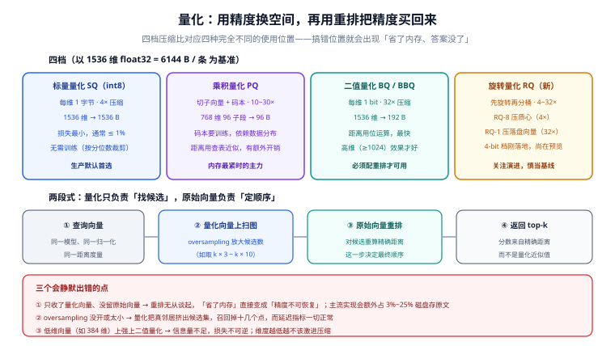

# 量化深入

**量化（quantization）是把每条向量的表示精度降下来，用精度换内存**。它是向量库唯一能带来数量级内存改善的手段——不量化，十亿级集合在内存这一关就直接出局。

但量化有一个**前提条件**，忘了它的方案几乎必然失败：**量化只负责「找候选」，最终顺序必须用原始向量重算一遍**。

## 一、量化在架构里的位置

初学者容易把「选 HNSW 还是 IVF」与「用 int8 还是二值」混在一起谈。它们是**两条正交的轴**：

| 轴 | 决定 | 典型取值 |
| --- | --- | --- |
| 索引 | 怎么少算：考察哪些候选 | HNSW / IVF / DiskANN / 分区 |
| 量化 | 一条向量占多少位 | float32 / int8 / int4 / 1 bit / PQ 短码 |

任意组合都有意义：HNSW + int8、HNSW + 二值、IVF + PQ、落盘索引 + 旋转量化。**先定轴一，再定轴二。**



## 二、四档量化一览（以 1536 维 float32 = 6144 B / 条 为基准）

| 档位 | 每条字节数 | 压缩比 | 精度损失 | 是否需要训练 | 典型位置 |
| --- | --- | --- | --- | --- | --- |
| float32 | 6144 B | 1× | 无 | 否 | 基准 |
| SQ（int8） | 1536 B | 4× | 很小（≤ 1% 量级） | 否（按分位数裁剪） | **生产默认起点** |
| SQ（int4） | 768 B | 8× | 中等 | 否 | 内存紧张时 |
| BQ / BBQ（1 bit） | 192 B | 32× | 较大，需重排补偿 | 否 | 高维（≥1024）向量 |
| PQ（m=96，8 bit/段） | 96 B | 64× | 中等，依赖数据分布 | **是**（码本） | 十亿级省内存 |
| RQ-1 / RQ-8（旋转量化） | 192 B / 1536 B | 32× / 4× | 与同 bit 宽度相当 | 是（旋转矩阵） | 落盘索引与质心索引 |

::: info 关于 4-bit 这一档
4-bit 是 2026 年竞争最激烈的一档：Elasticsearch 的 `bbq_disk` 支持 2 / 4 / 7 bit（9.4 起），Weaviate 在 1.39 把 **RQ4（4-bit 旋转量化）**推到预览，Qdrant 在 1.18/1.19 引入 **TurboQuant** 4-bit 存储。它们都指向同一个取舍：**1 bit 太粗，8 bit 又不够省**，4 bit 是中间地带。这一档的能力与 API 仍在变动，**采用前先确认当前版本的正式/预览状态**。
:::

## 三、标量量化（SQ）：最稳的一档

**做法**：对每一维独立做线性映射，把 `float32` 映射到 `int8`（或 `int4`）区间。高精度实现还会先按分位数**裁剪离群值**，避免个别极端值把映射区间撑得过大。

```python
# 演示原理：按分位数定界，再线性映射到 int8
import numpy as np

rng = np.random.default_rng(0)
x = rng.normal(size=(1000, 8)).astype("float32")

lo, hi = np.quantile(x, [0.005, 0.995])          # 裁掉两端各 0.5% 的离群值
lo, hi = float(lo), float(hi)
scale = (hi - lo) / 255.0

q = np.clip(np.round((x - lo) / scale), 0, 255).astype("uint8")
deq = q.astype("float32") * scale + lo           # 反量化

err = np.abs(deq - np.clip(x, lo, hi))
print(f"单维最大误差 {err.max():.4f}  平均误差 {err.mean():.5f}")
print(f"内存：{x.nbytes} B → {q.nbytes} B（{x.nbytes / q.nbytes:.0f}×）")
```

**为什么它适合做默认起点**：

- 不需要训练，也就没有「码本与数据分布不匹配」这类失败模式；
- 压缩比 4× 已经能解决大部分「装不下」的问题；
- 精度损失小，**配合重排后召回通常接近 float32**。

**什么时候不用它**：内存缺口远大于 4×。此时要上二值或 PQ。

## 四、乘积量化（PQ）：省内存的主力

**做法**分三步：

```text
1. 把 d 维向量切成 m 段（例如 768 维切成 96 段，每段 8 维）
2. 对每一段单独做 k-means，得到 256 个「段内质心」（8 bit 可表示 0~255）
3. 每条向量只存「每段最近质心的编号」——m 段 × 8 bit = m 字节
```

距离计算不再逐维算，而是**查表**：预先算好「查询向量的每一段到该段 256 个质心的距离表」，然后对候选向量逐段累加。

| 维度 | 说明 |
| --- | --- |
| 压缩 | 768 维：3072 B → 96 B（32×）；1536 维：6144 B → 96 B（64×） |
| 训练 | **必须有足够数据训练码本**；数据分布变了要重训 |
| 精度 | 依赖数据分布：段内变化越平滑，量化误差越小 |
| 变体 | 对「残差」（向量减去簇心）做 PQ，比直接做 PQ 更准（IVF-PQ 的常见形态） |

::: danger PQ 的三个真实坑
1. **数据量不够就训不出好码本。** 每段的 k-means 需要足够样本；数据量少于码本规模量级时，PQ 的误差会显著上升。**小集合不要用 PQ。**
2. **数据分布漂移后码本失效。** 追加大批新领域语料后，旧码本可能已经不适配，此时召回会整体下滑——**而索引本身「看起来」一切正常**。
3. **PQ 的候选集必须更大。** 量化后的距离是近似值，如果候选集取得很小，真邻居会被近似误差挤掉。**PQ 必须配合 oversampling + 重排。**
:::

## 五、二值量化（BQ / BBQ）：极致压缩

**做法**：每一维只保留符号位（> 0 记 1，否则记 0）。距离用 XOR + 位计数（POPCNT）计算，速度极快。

| 维度 | 说明 |
| --- | --- |
| 压缩 | 32×（1536 维：6144 B → 192 B） |
| 速度 | 最快（位运算） |
| 精度 | 损失明显，**高维向量（≥1024）表现好得多**；低维（如 384 维）信息量不足，损失可能不可接受 |
| 必备 | **重排**：先二值找候选，再用原始向量精算 |

Elasticsearch 的做法值得参考：**自 9.1 起，`dense_vector` 在维度 ≥ 384 时默认使用 `bbq_hnsw`，维度 < 384 时默认 `int8_hnsw`**；`bbq` 本身要求维度 > 64。这是一条很实用的边界经验：**维度越低，越不该激进压缩**。

::: tip 为什么二值量化「意外地好用」
高维向量的信息是高度冗余的：每个维度携带的语义量很小，但**符号的方向性**（在与查询相同的一侧还是相反的一侧）仍然携带了大量排序信息。维度越高，这种「方向共识」越可靠。低维向量没有这个冗余度，所以二值化后就显得粗糙——**同一套方法在不同维度上表现完全不同，这是维度决定的，不是实现决定的。**
:::

## 六、旋转量化（RQ）与落盘路线

**做法**：先对向量做一次随机旋转（把信息更均匀地摊到各维上），再按目标位宽分桶。旋转的作用是**让各维分布的方差更均匀**，从而让固定位宽的量化误差更小。

| 档位 | 位宽 | 压缩 | 典型用途 |
| --- | --- | --- | --- |
| RQ-8 | 8 bit/维 | 4× | 压缩**质心索引**（保留选分区的精度） |
| RQ-4 | 4 bit/维 | 8× | 中间档（新，预览状态） |
| RQ-1 | 1 bit/维 | 32× | 压缩**落盘分区**（只为候选筛选） |

在 HFresh 这类分区索引里，RQ 是**分层使用**的：质心索引用 RQ-8（保留精度，因为选错分区就什么都找不到），落盘分区用 RQ-1（只为快速筛选，最终排序仍用原始向量）。**这是一个很好的设计范式：对「决定去哪找」的部件保护精度，对「只是筛一筛」的部件允许激进压缩。**

## 七、两段式：找候选 + 重排

无论用哪一档量化，生产上的正确形态都是**两段式**：

```text
① 在量化向量上检索，并且把候选数放大（oversampling）
     候选数 ≈ k × 3 ~ k × 10
② 对这批候选，用原始向量重算精确距离
③ 用精确距离排序，返回 top-k
```

为什么必不可少：第 ① 步的排序是**近似排序**，误差来自量化本身。如果直接把它的排序结果返回，压缩比越高、错得越离谱。第 ② 步用一个小的计算量把顺序修正回来——**代价是候选数变多，收益是召回几乎回到 float32 水平**。

::: danger 「省了内存、精度不可恢复」是怎么发生的
常见写法是「只把量化向量写进去，原始向量不存（反正检索只用量化码）」。这会让重排**在物理上不可能**——因为你已经没有精确值了。

主流实现的做法是：**量化码用于检索，原始向量仍然保留在磁盘上**（用于重排、重建索引、后续提高量化精度）。代价是额外占用：Elasticsearch 官方给出的额外磁盘开销约为 int8 增加 25%、int4 增加 12.5%、bbq 增加 3.1%。**做容量规划时这笔开销必须算进去。**
:::

### 重排的配置示例

```python
# 以「量化找候选 + 原始向量重排」为例说明流程（伪代码，参数按各自客户端 API 替换）
K = 10
OVERSAMPLING = 5

candidates = index.search_quantized(query, k=K * OVERSAMPLING)   # ① 量化检索
# ② 用原始向量对候选重算精确距离
scored = [(cid, exact_cosine(query, raw_vectors[cid])) for cid in candidates.ids]
# ③ 精确排序
top = sorted(scored, key=lambda kv: -kv[1])[:K]

assert len(top) == K, "候选不足：检查 oversampling 与 ef/probes 是否太小"
```

## 八、MRL：完全不同的另一条路

量化是「降低每条向量的**精度**」；**MRL（Matryoshka Representation Learning，套娃表示学习）**是「降低向量的**维度**」。

支持 MRL 的嵌入模型在训练时就把最重要的语义塞进最前面的维度，于是可以**直接截断尾部维度**（如 1536 → 512 → 256），检索质量下降很小。这是一种「模型侧」的压缩手段：

| 手段 | 压缩对象 | 谁来做 | 优点 | 限制 |
| --- | --- | --- | --- | --- |
| 量化 SQ/PQ/BQ | 精度（位宽） | 向量库 | 不改模型、可叠加 | 需要重排补偿 |
| MRL 截断 | 维度 | 嵌入模型 | 计算量也同步下降 | 必须用支持 MRL 的模型 |
| 子向量索引 | 部分维度参与索引 | 向量库 | 精度与空间的细粒度取舍 | 不同维度段效果差异大 |

**两者可以叠加**：先用 MRL 把维度从 1536 降到 512，再对 512 维做 int8——压缩比是相乘的。但叠加的每一步都要重新测召回，**不要靠「两个都省」推断「叠加也安全」**。

## 九、什么时候不该量化

| 情况 | 理由 |
| --- | --- |
| 内存完全够用 | 量化换不来什么，却引入了精度风险与一层复杂度 |
| 维度很低（如 ≤ 256） | 信息冗余不足，激进压缩的损失不可逆 |
| 集合很小（几万条） | 省下的内存绝对值很小，不值得 |
| 漏检代价极高（权限、合规、去重） | 召回率的每一点下降都要评估；宁可加机器 |
| 尚未建立评估集 | 量化改动**必然**影响召回，而此时你测不出来 |

## 十、验证方式

三段都可以在本机跑，结论直接可用：

```shell
# 1) 四档压缩比的差距（768 维，100 万条）
python3 - <<'PY'
n, d = 1_000_000, 768
base = n * d * 4
for name, size in (("float32", base), ("int8", n * d), ("int4", n * d // 2),
                   ("1bit", n * d // 8), ("PQ m=96", n * 96)):
    print(f"{name:>8}: {size/2**20:8.1f} MiB  压缩 {base/size:5.1f}×")
PY

# 2) 量化误差随位宽的变化（能解释「为什么 4-bit 是中间地带」）
python3 - <<'PY'
import numpy as np
rng = np.random.default_rng(0)
x = rng.normal(size=200_000).astype("float32")
for bits in (8, 4, 2, 1):
    levels = 2 ** bits
    lo, hi = np.quantile(x, [0.005, 0.995])
    scale = (hi - lo) / (levels - 1)
    q = np.clip(np.round((x - lo) / scale), 0, levels - 1)
    err = np.abs(q * scale + lo - np.clip(x, lo, hi))
    print(f"{bits} bit: 平均绝对误差 {err.mean():.5f}")
PY

# 3) 候选集放大倍数与「真答案是否还在候选里」的关系
python3 - <<'PY'
import numpy as np
rng = np.random.default_rng(1)
n, d, k = 10_000, 64, 10
x = rng.random((n, d), dtype="float32"); q = rng.random(d, dtype="float32")
exact = np.argsort(-(x @ q))[:k]                       # 精确答案
# 模拟量化带来的排序噪声：给每个点加一点扰动后重排
for mult in (1, 3, 10):
    noisy = np.argsort(-(x @ q + rng.normal(scale=0.02, size=n)))[: k * mult]
    hit = len(set(exact.tolist()) & set(noisy.tolist()))
    print(f"候选放大 {mult:2d}× → 候选集 {k*mult:3d} 条，命中真答案 {hit}/{k}")
PY
```

预期：第 1 段会看到 float32 与 1bit 之间的**32 倍差距**（约 2929 MiB → 91 MiB）；第 2 段的误差随位宽下降而增大，且 8 bit → 4 bit 的增幅小于 4 bit → 2 bit、2 bit → 1 bit；第 3 段显示**候选放大倍数越大，真答案被保住的越多**——这就是重排前必须 oversampling 的量化证据。

## 参考资料

- Faiss Wiki：Product quantization 与训练要点：<https://github.com/facebookresearch/faiss/wiki>
- Elastic 官方 `dense_vector` 参考（量化档位默认值与额外磁盘开销）：<https://www.elastic.co/docs/reference/elasticsearch/mapping-reference/dense-vector>
- Weaviate RQ / HFresh 说明：<https://weaviate.io/blog/weaviate-1-36-release>
- Qdrant 量化文档（Scalar / Binary / TurboQuant）：<https://qdrant.tech/documentation/guides/quantization/>
- MRL 原论文（Matryoshka Representation Learning）：<https://arxiv.org/abs/2205.13147>
- 相邻页面：[索引算法全景](../IndexAlgorithms/index.md)、[运维与容量](../Operations/index.md)
