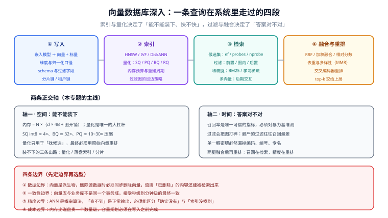

# 向量数据库深入

**向量数据库**解决的问题只有一句话：**把「意思相近」变成一次可以在毫秒级完成的查询**。

它要回答的却不是「用哪个产品」，而是三个更硬的问题：**索引凭什么快、量化凭什么省、过滤为什么会让召回崩掉**。这三个问题答不上来，选型就只是抽签。

::: tip 一句话理解
向量检索没有「最优算法」，只有**与你的数据量、延迟预算、内存上限同时匹配的那一组参数**。它是一次**用召回率换速度**的交易，而交易条款要自己谈。
:::

## 与相邻专题的分工

本专题讲**索引、量化、过滤、融合这些机制本身**，以及它们在生产里的判据；向量怎么算出来、检索出来之后怎么用，由库内既有专题承担。下表写死边界，避免重复阅读：

| 相邻专题 | 它讲什么 | 本专题讲什么 | 判据（什么时候该看哪边） |
| --- | --- | --- | --- |
| [向量库与索引](/docs/AI/RAG/VectorStore/index.md) | 应用侧选型：选哪家、集合怎么建、版本与迁移 | 索引内部的算法与参数、量化、过滤、融合**为什么这么设计** | 「我要建一个集合」→ RAG 专题；「为什么改了 `ef` 召回就变了」→ 本专题 |
| [嵌入与向量基础](/docs/AI/RAG/Embedding/index.md) | 嵌入模型怎么选、向量表示什么 | 向量存进索引之后的**工程问题** | 「维度选多少」→ RAG 专题；「768 维 1 亿条要多少内存」→ 本专题 |
| [检索优化](/docs/AI/RAG/Retrieval/index.md) | 应用侧的重排、查询改写、多路召回 | 稀疏腿与稠密腿**怎么融合**、名次融合为什么比分数融合稳 | 「怎么让答案更准」→ RAG 专题；「RRF 的 k 是什么、要不要调」→ 本专题 |
| [Elasticsearch](/docs/DB/NoRelational/Elasticsearch/index.md) | 全文索引与倒排引擎的完整用法 | 它的**向量侧**（`dense_vector` / 量化档位 / kNN 与 RRF）以及与其他引擎的对照 | 「怎么建倒排索引」→ ES 专题；「BM25 与 kNN 怎么合」→ 本专题 |
| [PostgreSQL](/docs/DB/Relational/PostgreSQL/index.md) | 关系型数据库本身的用法 | pgvector 扩展的**索引与调参**（HNSW / IVFFlat / 迭代扫描） | 「SQL 怎么写」→ PostgreSQL 专题；「为什么加了 WHERE 召回就掉」→ 本专题 |
| [图数据库 Neo4j](/docs/DB/Neo4j/index.md) | 显式的图结构与图算法 | 向量空间里的**隐式近邻图**（HNSW 的边不是业务关系） | 「实体关系怎么建模」→ Neo4j 专题；「近邻图怎么遍历」→ 本专题 |
| [时序数据库](/docs/DB/TimeSeries/index.md) | 指标型数据的模型与压缩 | 高维向量的**近似检索**（同属「非精确检索」，但压缩思路完全不同） | 数据是带时间戳的标量 → 时序库；数据是高维向量 → 本专题 |
| [大数据生态](/docs/DB/BigData/index.md) | 批流链路的组件与选型 | 向量索引**能不能直接在湖表上建**（湖原生路径的边界） | 「链路怎么搭」→ 大数据专题；「湖上的向量怎么建索引」→ 本专题 |
| [分布式缓存深入](/docs/Backend/DistributedCache/index.md) | 缓存的分层、一致性、热点治理 | 索引常驻内存时的**容量与劣化**问题 | 「怎么少查一次库」→ 缓存专题；「索引本身怎么变慢」→ 本专题 |
| [AI 应用观测与评估](/docs/AI/LLMObservability/index.md) | 端到端的 Trace、在线评估、成本归因 | 检索这一段**自己怎么被量出来**（召回抽样与延迟分位） | 「整条链路有没有问题」→ 观测专题；「检索这一段准不准」→ 本专题 |

## 专题地图

四段里最容易被低估的是**第二段**：写入和查询都可以照文档抄，索引却是**唯一一段必须自己算账**的地方——算内存、算召回、算重建周期。算不清这三笔，上线三个月后一定会遇到「数据涨了、图旧了、召回悄悄掉了」的组合拳。

## 章节导航

1. [概述：向量检索的四条边界](./Overview/index.md)：暴力检索的算术、ANN 的三条路线、四条必须先定下来的边界（数据 / 一致性 / 精度 / 成本），以及**什么时候根本不需要向量数据库**
2. [HNSW 原理深入](./HNSW/index.md)：分层近邻图的插入与搜索、`M` / `efConstruction` / `efSearch` 各自的代价、内存估算公式、**「删除是硬伤」**与重建周期，以及一套可复现的调参流程
3. [索引算法全景](./IndexAlgorithms/index.md)：图 / 倒排 / 分区三大家族的机制与适用面、IVF-PQ 与 DiskANN 的位置、**「召回—延迟—内存」三角**，以及从三个数出发的选型决策路径
4. [量化深入](./Quantization/index.md)：SQ / PQ / BQ / RQ 四档的压缩比与精度代价、**两段式「量化找候选 + 原始向量重排」**、三个会静默出错的点，以及 MRL 这条完全不同的路线
5. [过滤与元数据检索](./Filtering/index.md)：后置 / 前置 / 图内三种流派、**「选择性悬崖」实测数据**、加边与绕行两种修法、pgvector 的迭代索引扫描与租户隔离方案
6. [混合检索](./HybridSearch/index.md)：稀疏腿与稠密腿的互补盲区、**RRF 与加权融合**、为什么分数不能直接相加、去重与多样性（MMR），以及五个落地纪律
7. [运维与容量](./Operations/index.md)：内存三段预算与容量公式、分片与副本、**四件必须排进日历的运维事项**（重建 / 换模型 / 升级 / 观测），以及成本核算口径
8. [实战：企业知识库检索链路](./Practice/index.md)：七跳链路的完整配置与判据、越权风险的两层防护、可执行的验证脚本、`VD-A~VD-H` 判据表与**明确不做的四件事**
9. [常见问题与最佳实践](./FAQ/index.md)：五类现象的分诊表、高频十二问、上线自查二十项与术语表

## 版本状态速览（2026-10）

本专题涉及的都是**在演进中的产品**，下表按官方发布页与官方文档核对（2026-10 口径）：

| 组件 | 当前主线 | 仍在维护 | 关键变化与口径 |
| --- | --- | --- | --- |
| Milvus | **3.0.0**（2026-07-29） | 2.6.x（2.6.20 / 2026-07-14） | 3.0 转向**湖原生**（External Collection 建在 Lance / Iceberg / Parquet / Vortex 上）、`Loon` 存储、稀疏索引重做（SINDI / Block-Max WAND） |
| Qdrant | **1.19.2**（2026-10-05） | 1.19.x 补丁线 | 1.18 引入 **TurboQuant** 量化；1.17 引入加权 RRF 与相关性反馈；1.16 引入 Inline Storage 与 **ACORN-1** |
| Weaviate | **1.39.x**（1.39.0 / 2026-08-04） | 1.38.x、1.37.x | 1.38 **HFresh 落盘索引 GA**；1.39 **RQ4（4-bit 旋转量化）预览**、Boost 与 MMR GA |
| pgvector | **0.8.7**（2026-10-01） | 0.8.4+（生产底线） | 0.8.0 引入**迭代索引扫描**；**0.8.3 修掉 HNSW 与 vacuum 并发导致索引损坏**，故 0.8.4 是生产底线 |
| Elasticsearch | **9.5.0**（2026-08-04） | 9.3、9.4 补丁线 | 9.1 起 **BBQ 成为 ≥384 维的默认量化**；9.2 引入 `bbq_disk`（DiskBBQ）；9.4 支持 2 / 4 / 7 bit；9.5 引入 VectorDB 索引模式 |
| OpenSearch | **3.8.0**（2026-08-04） | 3.7 及更早补丁线 | 量化档位 1×~32×（32× 为默认）；3.6 的 1-bit 标量量化在官方测试上较原 32× 二值路径召回 +24% |

::: warning 说明
上表只登记**与本专题判据有关**的版本事实，不追求穷举。任何一条版本判断在用于生产前，都应以该产品的官方发布页复核一次——**版本事实会过期，判据不会**。
:::

## 大版本组织说明

按仓库约定「涉及大版本时按版本目录组织、旧版本保留并标注状态」，本专题的处理方式是**不建版本目录**，理由有三条：

1. **主题不是某一个产品**。本专题讲的是「近似检索」这一层机制，Milvus、Qdrant、Weaviate、pgvector、Elasticsearch 都是它的实例。为其中任何一个产品建版本目录，都会让另外几个失去位置。
2. **没有两条并行维护的破坏性版本线**。上面六个产品的当前主线（2026-10 口径）都只有一条；Milvus 2.6 与 3.0 并存的窗口确实存在（2.6 仍在出补丁），但差异集中在**数据怎么放**（本地 vs 湖原生）而不是**检索语义怎么变**，用 `::: info` 在页内标注即可，不需要拆成两套教程。
3. **拆目录会产生大量重复**。索引、量化、过滤、融合四块的原理在两个版本里是一样的，拆开等于把同一套内容写两遍，与「不做重复章节」的约定直接冲突。

因此：**旧版本口径一律保留、不删除**，凡与当前主线有实质差异处，页内用 `::: info` 单独标注，并写清「该口径适用于哪个版本区间」。真正需要按版本目录组织的主题（`javax` → `jakarta` 这类**工程做法必须分开写**的破坏性变化），本仓库内已有范例可参照：[Spring 5 / Spring 6](/docs/Backend/Java/Frame/Spring/Spring6/index.md)、[Vue 2 / Vue 3](/docs/Frontend/Frame/Vue/Vue3/index.md)、Spring Boot [v2](/docs/Backend/Java/Frame/SpringBoot/v2/index.md) / [v3](/docs/Backend/Java/Frame/SpringBoot/v3/index.md) / [v4](/docs/Backend/Java/Frame/SpringBoot/v4/index.md)。

## 建议阅读顺序

- **第一次接触**：概述 → HNSW → 索引算法全景 → 实战（先把「为什么快」建立起来，再进工程链路）。
- **正在选型**：概述 → 索引算法全景 → 运维与容量 → 量化（先算账，再比产品）。
- **召回不对劲**：常见问题与最佳实践 → 过滤与元数据检索 → 混合检索（分诊表直接定位层次）。
- **要上生产**：运维与容量 → 量化 → 过滤与元数据检索 → 实战（容量、压缩、权限、判据四件事一起过）。
- **只想知道选谁**：概述的最后一节「什么时候不需要向量数据库」+ 索引算法全景的决策路径。

## 参考资料

- HNSW 原论文：<https://arxiv.org/abs/1603.09320>
- DiskANN（Vamana）项目主页：<https://github.com/microsoft/DiskANN>
- ACORN 论文（SIGMOD 2024）与 Qdrant 实测：<https://qdrant.tech/blog/filtered-vector-search-acorn>
- ANN Benchmarks（召回—延迟曲线的公开基准）：<https://ann-benchmarks.com/>
- VectorDBBench（端到端数据集与压测口径）：<https://github.com/zilliztech/VectorDBBench>
- pgvector 官方 README（参数与迭代扫描的权威出处）：<https://github.com/pgvector/pgvector>
- Milvus 官方发布说明：<https://milvus.io/docs/release_notes.md>
- Qdrant 官方变更日志：<https://github.com/qdrant/qdrant/releases>
- Weaviate 官方发布博客：<https://weaviate.io/blog>
- Elastic 官方 `dense_vector` 参考：<https://www.elastic.co/docs/reference/elasticsearch/mapping-reference/dense-vector>
