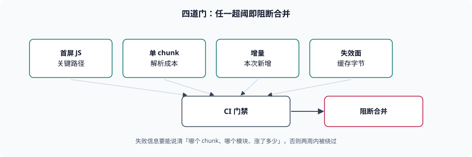

# 产物体积预算

本页判据族 `BBG-A` ~ `BBG-H`，共 8 条。

「我们做过了体积优化」这句话几乎无法反驳，因为它没有门槛：从 2 MB 优化到 1.9 MB 也是优化。预算的作用就是把这句话变成**可判定的**：「首屏关键路径的传输字节不得超过 180 KB，超过则构建失败」——这一句能被机器执行，也能被反驳（如果它不合理，会有人拿数据来吵）。本页讲三件事：预算按什么数定、卡在哪一步、以及为什么「只卡总量」是无效预算。

::: tip 一句话理解
预算不是「目标值」，是**否决权**：一个没有在 CI 里红过的预算，等于没有预算。
:::



## 一、四个必须分开的维度

| 维度 | 度量 | 典型阈值形态 | 只卡这一维会怎样 |
| --- | --- | --- | --- |
| 首屏 JS | 首屏渲染链路上**必须**加载的 JS 传输字节 | 绝对值（如 ≤ 180 KB gzip） | 用户实际感受不到「总量降了」，因为首屏没变 |
| 单 chunk 上限 | 任一 chunk 的传输字节 | 绝对值（如 ≤ 250 KB） | 一个巨型 chunk 让首次解析卡住主线程 |
| 增量 | 本次改动**新增**的传输字节 | 相对值（如 ≤ +5% 或 ≤ +8 KB） | 总量缓慢爬升，每次都能「刚好通过」 |
| 缓存失效面 | 本次改动导致**缓存失效**的字节 | 相对值（如 ≤ 10% 的已缓存字节） | 发布越频繁，用户越常全量重下 |

第四行是最少被量化、影响最大的一维。本机做过一组切分仿真（120 个模块、8 条路由、`seed=20261112`，按模块内容哈希算 chunk URL），改**一个模块**后的缓存失效比例如下：

| 切分策略 | 改一个单路由模块 | 改一个被 3+ 路由共享的模块 |
| --- | --- | --- |
| 单包 | 100.0% | 100.0% |
| `vendor` 分包 | 97.1% | 2.9% |
| 按路由分包 | **11.2%** | **38.5%** |

这组数字解释了两个常见误判：

- 「上了 `vendor` 分包，缓存就好了」——只对**依赖不变**的场景成立。改业务模块时 `vendor` 策略失效 97.1%，因为业务代码全在那一个 chunk 里。
- 「切得越细越好」——共享模块一改，按路由分包要失效 38.5%。**切分粒度应该匹配「改动频率」**：经常改的按路由切，几乎不改的（框架运行时、polyfill）单独切。

## 二、按哪个数卡：raw、gzip 还是 brotli

三个口径的差别不是几个百分点。本机取 `vitepress` 客户端构建产物中最大的五个 JS 文件实测：

| 文件 | raw | gzip | gzip 占比 |
| --- | --- | --- | --- |
| `app/router.js` | 10,377 B | 2,906 B | 28.0% |
| `theme-default/composables/outline.js` | 5,771 B | 1,914 B | 33.2% |
| `shared.js` | 5,679 B | 2,201 B | 38.8% |
| `app/index.js` | 5,120 B | 1,663 B | 32.5% |
| `theme-default/composables/sidebar.js` | 4,287 B | 1,191 B | 27.8% |

三个结论：

1. **压缩率不是固定常数**，本机样本在 27.8%~38.8% 之间浮动。用「raw ÷ 3」估算传输体积，误差可达 ±20%。
2. **跨口径比较没有意义**：A 版本 raw 900 KB / gzip 260 KB，B 版本 raw 800 KB / gzip 275 KB，说「B 更小」取决于看哪一列。**预算必须锁定一个口径**，本册建议用 **gzip 传输字节**（兼容性最好；brotli 可在 CDN 侧额外协商，但不宜作为唯一口径）。
3. **CI 里要能算出这个数**。构建工具输出的是 raw 大小，gzip 需要额外一步（`gzip -9 -c`、`zlib.gzipSync`、或插件的 `reportCompressedSize`）。**没有这一步的预算检查，卡的其实是 raw**。

## 三、预算怎么写才有人看

预算文件建议长这样（数值按业务填，形态比数值重要）：

| 项 | 阈值 | 口径 | 失败时打印什么 |
| --- | --- | --- | --- |
| 首屏 JS | 180 KB | gzip，关键路径 | 超出的文件名 + 各自字节 + 相比上次的差 |
| 单 chunk | 250 KB | gzip | 该 chunk 内体积前 10 的模块 |
| 增量 | +8 KB 或 +5% | gzip | 本次新增/变更的模块及其来源 |
| 缓存失效面 | ≤ 10% | 已缓存字节中变 URL 的比例 | 变 URL 的 chunk 列表与原因（哪个模块改了） |

第三列「失败时打印什么」是关键。一条只会说「budget exceeded by 3.2 KB」的检查，在真实项目里会在两周内被 `--force` 掉；一条能说「`echarts` 从 82 KB 涨到 118 KB，因为 `pages/report/index.ts` 新引入了 `charts/scatter`」的检查，会被认真对待。

::: danger 四个无效预算
1. **只卡总量**——总量是所有 chunk 之和，首屏退化会被「按需加载的新页面」掩盖。**正确做法**：首屏与总量分别设阈。
2. **阈值写成绝对值且从不修订**——业务涨了 3 倍，阈值还在原地，等于永久红；永久红等于没有检查。**正确做法**：每季度复核一次阈值，修订要留动机说明。
3. **只在本地跑**——本地跑 = 不跑。**正确做法**：进 CI，且失败会阻断合并。
4. **用 raw 卡、用 gzip 汇报**——两个口径混用，团队会失去对数字的信任。**正确做法**：全链路一个口径，报告里注明。
:::

## 四、归因：涨了之后谁负责

预算红了之后，第一个问题永远是「为什么涨」。三种归因手段，从便宜到贵：

| 手段 | 能回答什么 | 成本 |
| --- | --- | --- |
| 产物 diff（对比两个构建目录的文件列表与大小） | 哪个 chunk 涨了、涨了多少 | 极低 |
| 构建元数据（`--metafile` / `stats.json`） | chunk 内模块体积排序、依赖来源 | 低（要留档） |
| 模块级比对（两次构建的模块图 diff） | 具体是哪一行 import 引起的 | 中 |

最实用的组合是「产物 diff + 元数据」：前者回答「哪个 chunk 涨」，后者回答「chunk 里谁涨」。本机可跑的最小版本见验证第 2 条（用 `--metafile` 输出 JSON，再按 `outputs` 里的 `bytesInOutput` 排序）。

## 五、预算与兼容的相互作用

预算不是孤立指标，它和另外三件事互相拉扯：

| 调整 | 体积 | 缓存失效面 | 兼容性 |
| --- | --- | --- | --- |
| 抬基线（`es2015` → `es2020`） | 降 38.4%（本机 983 → 606 B 同源夹具） | 不变 | **变窄**（放弃旧内核） |
| 加 polyfill | 升（小片段还会「压缩变大」） | 通常不变 | 变宽 |
| 按路由切分 | 总量略升（重复的共享代码） | 改善（11.2% vs 100%） | 不变 |
| 双包（`module` + `nomodule`） | 升 2.51×（本机实测） | 变差（两套都要维护） | 最宽 |

第四行是「用体积买兼容」的极端形态：本机双包实测达现代单包的 **2.51 倍**。所以「要不要支持旧内核」不是一个技术偏好问题，它有明确的价签——把这张表贴进技术方案，讨论会快很多。

## 本页判据


| 判据 | 约定 | 定错了会怎样 | 怎么验证 |
| --- | --- | --- | --- |
| `BBG-A` | 预算至少覆盖首屏、单 chunk、增量三个维度 | 总量达标而首屏退化，用户实际更慢 | 预算文件里有三类阈值 |
| `BBG-B` | 全链路统一口径（建议 gzip 传输字节），报告注明 | raw 与 gzip 混用，团队不信数字 | 检查脚本与报告使用同一口径 |
| `BBG-C` | 预算检查在 CI 中执行，失败阻断合并 | 本地跑等于不跑 | CI 配置里有该步骤及其阻断行为 |
| `BBG-D` | 失败信息必须能定位到 chunk 与模块 | 只说「超了 3 KB」，两周内被绕过 | 失败输出含文件名与体积排序 |
| `BBG-E` | 记录「缓存失效面」这一维 | 发布越频繁，用户越常全量下载 | 发布记录里有失效字节或比例 |
| `BBG-F` | 切分粒度匹配改动频率（热点按路由、冷点共享） | 共享模块一改，路由 chunk 大面积失效（38.5%） | 有切分策略说明与实测失效比 |
| `BBG-G` | 阈值每季度复核，修订留动机说明 | 永久红导致检查被关闭 | 阈值文件有修订历史 |
| `BBG-H` | 兼容相关的体积变化（抬档 / 加 polyfill / 双包）在方案里量化 | 用「差不多」决定是否支持旧内核 | 方案里有前后字节对比 |

## 验证方式

```shell
# 1. 统计产物 raw 与 gzip（两个口径同时看）
for f in dist/assets/*.js; do
  raw=$(wc -c < "$f"); gz=$(gzip -9 -c "$f" | wc -c)
  echo "$gz $raw $f"
done | sort -rn | head -10
# 期望：能看到最大的几个 chunk，gzip 占比约 28%~39%

# 2. 用构建元数据做归因（esbuild）
node_modules/.pnpm/@esbuild+win32-x64@0.21.5/node_modules/@esbuild/win32-x64/esbuild.exe \
  src/main.ts --bundle --minify --metafile=/tmp/bb-meta.json --outfile=/tmp/bb-out.js
node -e "const m=require('/tmp/bb-meta.json');\
const rows=Object.entries(m.outputs).flatMap(([o,v])=>Object.entries(v.inputs||{}).map(([k,i])=>[i.bytesInOutput,k,o]));\
rows.sort((a,b)=>b[0]-a[0]).slice(0,10).forEach(r=>console.log(r[0],r[1]))"
# 期望：按贡献字节排序的模块列表

# 3. 检查预算是否进了 CI
grep -rn 'budget\|size-limit\|bundlewatch' .github/workflows package.json 2>/dev/null | head
# 期望：有对应步骤；无输出说明预算只存在于文档里

# 4. 看本页判据族定义完整
grep -c 'BBG-[A-H]' docs/Frontend/BuildBaseline/Budget/index.md
# 期望：≥ 8
```

## 参考资料

- [Vite — `build.reportCompressedSize` 与产物报告](https://vite.dev/config/build-options)
- [esbuild — Metafile 格式（模块级字节归因）](https://esbuild.github.io/api/#metafile)
- [web.dev — 压缩与传输体积的基础概念](https://web.dev/articles/reduce-network-payloads-using-text-compression)
- [RFC 9111 — HTTP Caching（缓存与体积的关系）](https://www.rfc-editor.org/rfc/rfc9111)
- [本册目录页](../index.md)
