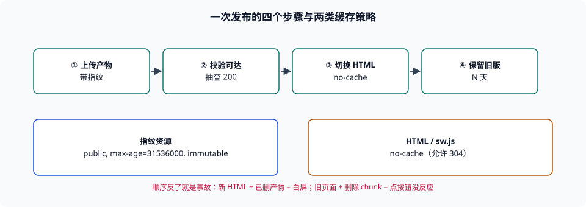

# 分发、缓存头与部署原子性

本页判据族 `BBE-A` ~ `BBE-H`，共 8 条。

产物生成正确，只完成了一半。另一半是**它怎么到达用户**：文件名里有没有内容指纹、缓存头允不允许长期缓存、压缩在谁的机器上发生、发布时旧页面还在跑的用户会拿到什么。这一半的失败形态特别有欺骗性——本地全对、CDN 全绿、只有一部分用户「白屏或点了没反应」，而错误日志里只有一行 `Failed to fetch dynamically imported module`。

::: tip 一句话理解
缓存的正确用法只有一句话：**内容变则 URL 变，URL 不变则内容永不变**。做到这一句，就可以给静态资源一年的 `immutable`；做不到，任何 `max-age` 都是在赌。
:::



## 一、文件名：哈希的输入是什么

主流构建器的 `[hash]` / `[contenthash]` 有三种输入，差别在「什么变了才换名字」：

| 输入 | 什么情况下名字会变 | 风险 |
| --- | --- | --- |
| 内容哈希（推荐） | 文件字节变了 | 无 |
| chunk 图哈希 | 依赖图变了（哪怕自身字节没变） | 一次小改动可能连带多个 chunk 换名（缓存失效面变大） |
| 构建哈希（全局） | 每次构建都变 | **所有缓存全废**，等于关闭长期缓存 |

本机在[体积预算](../Budget/index.md)那页量过缓存失效面：改一个单路由模块，单包策略失效 100%，按路由分包失效 11.2%。同一份数据在这里换个角度读——**失效面的大小取决于「哪些 chunk 的名字依赖了被改的模块」**。所以「哈希输入」与「切分策略」是同一件事的两面。

::: danger 三个常见错误
1. **给 HTML 加长期缓存**——`index.html` 一旦被缓存一年，用户永远看不到新版本。**正确做法**：HTML 用 `no-cache`（允许缓存但每次要回源校验），静态资源用长缓存。
2. **`immutable` 配在没指纹的 URL 上**——`/app.js` 配 `max-age=31536000, immutable`，等于把这一年的发布能力交出去了。**正确做法**：`immutable` 只用于带内容指纹的路径。
3. **压缩放在「有缓存的那一层」之前却忘了 `Vary`**——同一个 URL 返回 gzip 或 brotli 两种字节，若缓存键不含 `Accept-Encoding`，会把 gzip 版本发给只接受 br 的客户端（或反之）。**正确做法**：要么在 CDN 层统一压缩并正确处理 `Vary: Accept-Encoding`，要么让每种编码有不同 URL。
:::

## 二、缓存头组合表

| 资源 | `Cache-Control` | 理由 |
| --- | --- | --- |
| `index.html`、`sw.js` | `no-cache` | 必须每次校验；`no-store` 也可以但会放弃 304 的带宽优势 |
| 带指纹的 JS / CSS / 字体 | `public, max-age=31536000, immutable` | URL 变即内容变（见 RFC 8246） |
| 不带指纹的公共库（CDN） | `public, max-age=604800` | 无法保证「URL 不变内容不变」，中等缓存期 |
| API 响应 | 按业务，通常 `no-store` 或短 `max-age` + `Vary` | 数据时效性优先 |
| 图片（带指纹） | 同静态资源 | 同上 |

第三行容易被忽略：很多「公共 CDN 上的 jQuery」类资源没有指纹，却配了 `immutable`，一旦被投毒或升级，客户端一年内拿不到新版本——这也是「公共 CDN 不可信」的技术原因之一，与[API 补齐](../Polyfill/index.md)那页讲的供应链风险是同一件事。

## 三、部署原子性：先上产物，再切 HTML

一次发布涉及两类对象：**不可变的产物文件**（带指纹）与**可变的入口**（HTML）。顺序只有一种是对的：

| 步骤 | 动作 | 做错的后果 |
| --- | --- | --- |
| 1 | 上传所有带指纹的产物到 CDN | — |
| 2 | 校验产物可访问（随机抽几个 URL 取 200） | 漏传一个 chunk，用户在动态 `import()` 时 404 |
| 3 | 切换 HTML 指向新产物 | 顺序反了：用户拿到新 HTML、旧产物已删 → 白屏 |
| 4 | 保留上一版产物 N 天 | 停留在旧页面的用户，点「下一页」时 chunk 404 |

第 4 步是最容易漏的：**发布不是瞬时完成的**，总有用户在你发布的那一刻打开着旧页面。他们的 HTML 指向旧 chunk，而旧 chunk 已经被你删了。表现是「点某个按钮没反应」，控制台里是 `Failed to fetch dynamically imported module`。

三种处置，按成本排序：

| 处置 | 成本 | 效果 |
| --- | --- | --- |
| 保留 N 个历史版本产物（如 7 天） | 存储成本极低 | 基本消除旧 chunk 404 |
| 捕获动态导入失败并整页重载 | 一次页面刷新 | 用户丢失当前未提交的输入 |
| 提示「有新版本，点击刷新」 | 要写 UI + 版本探测 | 体验最好，实现最重 |

第一行几乎总是值得做的：它把一类「偶发、无法复现、只在发布窗口出现」的故障直接消掉。

## 四、SRI 与预加载：两个容易被用错的加速器

**子资源完整性（SRI）**用 `integrity` 属性校验脚本字节，防止 CDN 被篡改。两个约束必须同时满足：

1. **跨域资源必须带 `crossorigin`**，否则浏览器不会做完整性校验（脚本能加载，但校验被跳过，等于没配）。
2. **动态 `import()` 不支持 `integrity`**。也就是说：`<script src integrity>` 能校验，代码里 `await import('./chunk.js')` 不能。**所以 SRI 只能保护入口脚本，保护不了路由级 chunk**——这是一个真实的能力边界，不要把它当成「全站完整性」。

**预加载**（`preload` / `modulepreload`）解决的是「关键资源晚发现」：

| 指令 | 适用 | 误用后果 |
| --- | --- | --- |
| `<link rel="modulepreload" href="...">` | ESM 入口与首屏依赖 | 预加载了用不到的大 chunk，抢带宽 |
| `<link rel="preload" as="style">` | 首屏 CSS | 与 `onload` 切换写法混用导致样式闪烁 |
| `<link rel="prefetch">` | 下一页可能用到的资源 | 抢占首屏带宽，低端网络下反而更慢 |

判据只有一条：**预加载清单必须来自「首屏实际请求链」的测量，不能凭感觉写**。

## 五、可核对的最小流程

```shell
# 1. 看缓存头（对线上域名执行，逐类资源各取一个）
curl -sI https://example.com/ | grep -i 'cache-control\|etag\|vary'
curl -sI https://example.com/assets/app.3f2a1b9c.js | grep -i 'cache-control\|content-encoding'
# 期望：HTML 为 no-cache 且带 ETag；带指纹的 JS 为 immutable + 长 max-age

# 2. 看压缩协商（Accept-Encoding 不同，返回不同字节）
curl -sI -H 'Accept-Encoding: br' https://example.com/assets/app.3f2a1b9c.js | grep -i 'content-encoding\|vary'
# 期望：content-encoding: br，且响应头含 Vary: Accept-Encoding

# 3. 检查产物指纹是否存在
ls dist/assets | head -5
# 期望：文件名含 8 位以上哈希片段

# 4. 发布后抽查产物可达性（防止漏传）
for u in $(ls dist/assets/*.js | head -5 | sed 's#dist#https://example.com#'); do
  echo -n "$u "; curl -s -o /dev/null -w '%{http_code}\n' "$u"
done
# 期望：全部 200
```

第 2 步是很多团队从未做过的一次检查：它同时验证了「压缩生效」与「缓存键正确」。如果返回 `content-encoding: br` 但**没有** `Vary`，说明缓存层可能把 br 版本发给不支持 br 的客户端。

## 本页判据


| 判据 | 约定 | 定错了会怎样 | 怎么验证 |
| --- | --- | --- | --- |
| `BBE-A` | 静态资源文件名带内容指纹，HTML 不带长期缓存 | 用户永远看不到新版本，或缓存全废 | 产物名含哈希；HTML 响应头为 `no-cache` |
| `BBE-B` | `immutable` 只用于带指纹的 URL | 一年内无法更新无指纹资源 | 检查响应头与文件名是否配对 |
| `BBE-C` | 压缩协商与缓存键正确（`Vary: Accept-Encoding` 或在边缘统一压缩） | 把 br 发给不支持的客户端 | `curl -H 'Accept-Encoding: br'` 看响应头 |
| `BBE-D` | 发布顺序为「先产物、校验、再切 HTML」 | 用户拿到新 HTML 而产物缺失，白屏 | 发布脚本的步骤顺序可读 |
| `BBE-E` | 保留 N 个历史版本产物 | 停留在旧页面的用户动态导入 404 | 回源策略里有保留窗口 |
| `BBE-F` | 动态导入失败有兜底（重载或提示） | 「点按钮没反应」且无法归因 | 代码里有 `import()` 的 `catch` 分支 |
| `BBE-G` | 跨域脚本若声明 `integrity` 必须同时带 `crossorigin` | 完整性校验被静默跳过 | 标签属性成对出现 |
| `BBE-H` | 预加载清单来自首屏请求链测量，不凭猜测 | 抢占带宽，低端设备更慢 | 有首屏请求链记录 |

## 验证方式

```shell
# 1. 本地预览并检查产物指纹
pnpm docs:build && ls .vitepress/dist/assets | head -8
# 期望：文件名形如 app.<hash>.js

# 2. 起本地静态服务后看缓存头（示例用 Vite 预览）
pnpm docs:preview &
curl -sI http://localhost:4173/ | grep -i 'cache-control\|etag'
# 期望：有 ETag；若为 no-store，说明 HTML 的缓存策略需调整

# 3. 检查代码里的动态导入是否有兜底
grep -rn "import(" src --include='*.ts' --include='*.vue' | head
# 期望：关键路径的 import() 外层有 try/catch 或全局 unhandledrejection 兜底

# 4. 看本页判据族定义完整
grep -c 'BBE-[A-H]' docs/Frontend/BuildBaseline/Delivery/index.md
# 期望：≥ 8
```

## 参考资料

- [RFC 9111 — HTTP Caching（`no-cache` / `max-age` / `Vary`）](https://www.rfc-editor.org/rfc/rfc9111)
- [RFC 8246 — HTTP Immutable Responses](https://www.rfc-editor.org/rfc/rfc8246)
- [W3C — Subresource Integrity（含 `crossorigin` 要求）](https://www.w3.org/TR/SRI/)
- [MDN — `modulepreload`](https://developer.mozilla.org/docs/Web/HTML/Attributes/rel/modulepreload)
- [web.dev — 文本压缩与 `Content-Encoding`](https://web.dev/articles/reduce-network-payloads-using-text-compression)
- [本册目录页](../index.md)
