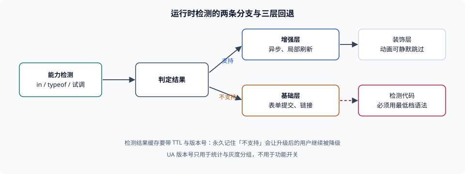

# 特性检测与渐进增强

本页判据族 `BBH-A` ~ `BBH-H`，共 8 条。

编译期定基线解决的是「大部分用户」，运行时检测解决的是「剩下的那部分」——它要回答的不是「你是哪个版本」，而是「**你现在能不能做这件事**」。这两者的差别不是学术问题：一个内核可能支持 `?.` 但不支持 `Array.prototype.at`，也可能在某个版本里 `Promise.allSettled` 存在但行为不对。「按版本猜」在这种「部分支持」面前没有任何胜算，而检测天生就是按能力判的。

::: tip 一句话理解
特性检测的本质是**问一次再决定**，不是**猜一次再祈祷**。问法的选择（`in`、`typeof`、调一次、`@supports`）比问不问更重要。
:::



## 一、三种判定，按可靠度排序

| 方式 | 依据 | 可靠性 | 什么时候用 |
| --- | --- | --- | --- |
| 能力检测 | `typeof fn === 'function'`、`'at' in Array.prototype`、`CSS.supports(...)` | **高**：直接问「有没有」 | 所有运行时分支 |
| 编译期定档 | 构建 `target` + polyfill 清单 | 中：只覆盖「已知」的能力差 | 产物层面的兜底 |
| UA 版本判断 | `navigator.userAgent` 里的版本号 | **低**：可冻结、可伪装、无法表达部分支持 | 只用于统计与灰度分流，不用于功能开关 |

第三种并非完全不能用：**做统计**（「我们的用户里有多少是某个内核」）是合理用途，因为统计错了只影响决策参考。**做功能开关**就不行——它会把「这个内核能做这件事」简化成「这个内核版本号 ≥ N」，而版本号与能力之间没有一一对应关系。

::: danger 四个检测陷阱
1. **用新语法写检测**——`if (window.foo?.bar)` 这段检测代码本身就要先被解析，旧内核在解析阶段就失败了，检测永远不会执行。**正确做法**：检测代码只能用基线**最低档**的语法写（`var`、`typeof`、`in`），或放在独立文件里用最低档编译。
2. **只判「存在」不判「可用」**——某些 API 在某版本里存在但行为不完整（早期 `IntersectionObserver`、`ResizeObserver` 的边界情况）。**正确做法**：关键 API 在检测后跑一次最小调用（`try { ... } catch`），失败走降级。
3. **`CSS.supports` 与 `@supports` 判的不是同一件事**——`@supports` 判的是**声明是否被解析并接受**，`CSS.supports` 判的是同样的语义；但两者都可能「接受一个不生效的值」。**正确做法**：涉及布局的关键特性，用「实际测量」兜底（读 `getBoundingClientRect`）。
4. **检测结果永久缓存**——把「不支持某特性」写进 `localStorage` 永不更新，浏览器升级后用户仍被降级。**正确做法**：缓存带 TTL，或与版本号绑定。
:::

## 二、四种检测原语

| 原语 | 适用 | 例子 | 注意 |
| --- | --- | --- | --- |
| `typeof` | 全局函数 / 构造器 | `typeof ResizeObserver === 'function'` | 对 `let`/`const` 声明的全局变量可能抛 `ReferenceError`，用 `typeof` 本身安全 |
| `in` | 原型上的方法 | `'at' in Array.prototype` | 只判存在，不判可用 |
| 调用式 | 行为不确定的 API | `try { new Intl.DateTimeFormat('zh-CN', { dateStyle: 'short' }) } catch {}` | 有副作用，别在渲染路径反复调 |
| CSS 侧 | 样式特性 | `@supports (display: grid) { ... }` | 与 JS 侧判定要一致，避免「JS 以为有、CSS 没有」 |

第四行常被忽略：一个页面可能 JS 侧检测到 `aspect-ratio` 支持并走了新布局，CSS 侧却因为写法问题没生效。**判定与实现要用同一个依据**。

## 三、渐进增强的分层

「渐进增强」不是口号，它是一条**可判定的分层结构**：

| 层 | 内容 | 判据 |
| --- | --- | --- |
| 基础层 | 无 JS、无新特性也能完成核心任务（表单提交、链接跳转） | 关掉 JS 后核心流程仍可走通 |
| 增强层 | JS 接管交互、异步提交、局部刷新 | 增强层失败时自动退回基础层（不是白屏） |
| 装饰层 | 动画、过渡、视觉效果 | 不支持时**静默跳过**，不报错 |

三层之间要有明确的**失败回退路径**，而不是「增强层挂了就报错弹窗」。本库的[SSR 专题](../../SSR/index.md)与[移动端 H5](../../MobileH5/Compatibility/index.md)分别从服务端渲染与设备面讲过同一件事，本页只补「构建侧」的判据：**基础层必须由最低档语法与最少 API 实现**，否则「关掉 JS 还能用」这句话在旧内核上不成立（旧内核对基础层的脚本同样解析失败）。

## 四、服务端分流：什么时候值得

如果差异大到「两套实现」，可以在服务端决定发哪一份：

| 方式 | 依据 | 代价 |
| --- | --- | --- |
| `module` / `nomodule` 双包 | 浏览器是否支持 ES 模块 | 体积 2.51×（本机实测），且 `nomodule` 的覆盖面已经很窄 |
| Client Hints（`Sec-CH-UA`） | 客户端主动上报的能力与版本 | 需要 HTTPS 与服务器协商，且受隐私预算约束 |
| 自有埋点 + 边缘规则 | 你自己的真实分布 | 维护成本高，容易与基线脱节 |

第一行在本册的[ES5 兼容线](../LegacyES5/index.md)里作为存量方案保留；第二行今天的实际用途主要是**灰度与统计**，不适合当功能开关——它给的是版本号，不是能力。

::: warning 一条容易忽略的时序
检测与**加载**是两件事。你可以在运行时检测出「需要 polyfill」，但那时业务代码可能已经开始执行了。所以「检测 — 补 — 执行」这三步必须有确定的顺序，最稳的做法是**在构建期就把该补的补上**，把运行时检测留给「构建期无法预知」的差异（如 CSS 特性、`Intl` 数据）。
:::

## 五、可核对的做法

```js
// 1. 最低档语法写的检测（不依赖 ?. / ??）
var canAt = typeof Array.prototype.at === 'function';
var canGrid = window.CSS && CSS.supports && CSS.supports('display', 'grid');

// 2. 调用式检测（带最小调用）
var canDateStyle = false;
try {
  new Intl.DateTimeFormat('zh-CN', { dateStyle: 'short' }).format(new Date(0));
  canDateStyle = true;
} catch (e) {
  canDateStyle = false;
}

// 3. 结果带 TTL 的缓存（不要永久记忆「不支持」）
var KEY = 'cap:v3';           // 版本号进 key，能力集变了就整体失效
var TTL = 7 * 24 * 3600 * 1000;
var saved = null;
try { saved = JSON.parse(localStorage.getItem(KEY) || 'null'); } catch (e) { saved = null; }
var caps = saved && (Date.now() - saved.t < TTL) ? saved.v
  : { at: canAt, grid: canGrid, dateStyle: canDateStyle };
try { localStorage.setItem(KEY, JSON.stringify({ t: Date.now(), v: caps })); } catch (e) {}
```

第三段的 `KEY` 带版本号、缓存带 TTL，是为了避免「浏览器升级了但用户被永久降级」。用 `Date.now()` 算 TTL 在这里是**可接受**的：它算的是「缓存新旧」而不是「两个事件的先后」，即使系统时钟回拨 1 分钟，代价只是多刷一次缓存。

## 本页判据


| 判据 | 约定 | 定错了会怎样 | 怎么验证 |
| --- | --- | --- | --- |
| `BBH-A` | 功能开关用能力检测，不用 UA 版本号 | 同内核不同外壳判错、版本冻结误判 | 代码里无基于 UA 的功能分支 |
| `BBH-B` | 检测代码本身用最低档语法写（`var` / `typeof` / `in`） | 检测代码在旧内核解析失败，永远不会执行 | 检测文件用最低 target 编译或手写 ES5 |
| `BBH-C` | 关键 API 检测后跑一次最小调用 | 「存在但不可用」被当成可用，运行时才炸 | 检测分支里有 `try/catch` 的最小调用 |
| `BBH-D` | JS 侧判定与 CSS 侧 `@supports` 依据一致 | JS 走新布局、CSS 没生效，页面错位 | 同一特性的两侧判定能对上 |
| `BBH-E` | 检测结果缓存带 TTL 与版本号 | 浏览器升级后用户被永久降级 | 缓存 key 含版本，值含时间戳 |
| `BBH-F` | 渐进增强三层各有回退路径，增强层失败不白屏 | 增强层异常导致整页不可用 | 断网或抛错时核心流程仍可用 |
| `BBH-G` | 服务端分流只用于「差异大到需要两套实现」，且有体积与维护成本记录 | 为小差异上双包，付 2.51× 体积 | 方案里有分流理由与代价数据 |
| `BBH-H` | 「检测 — 补 — 执行」的顺序确定，构建期能解决的不留到运行时 | 运行时补得太晚，业务代码已抛错 | 有注入顺序说明或构建期清单 |

## 验证方式

```shell
# 1. 查代码里是否有 UA 版本分支（功能开关的红线）
grep -rn 'navigator\.userAgent' src 2>/dev/null | head
# 期望：仅统计/埋点用途；出现 "version <" 类比较即为缺陷

# 2. 查检测代码是否用了高档语法（应为 0）
grep -rnE "typeof .*\?\.|in .*\?\?" src 2>/dev/null | head
# 期望：无输出（检测代码不该依赖可选链）

# 3. 验证 CSS 侧判定（浏览器控制台）
#   CSS.supports('display', 'grid')
# 期望：true/false 与页面实际布局一致

# 4. 看本页判据族定义完整
grep -c 'BBH-[A-H]' docs/Frontend/BuildBaseline/FeatureDetect/index.md
# 期望：≥ 8
```

## 参考资料

- [MDN — 渐进增强](https://developer.mozilla.org/docs/Glossary/Progressive_enhancement)
- [MDN — CSS `@supports`](https://developer.mozilla.org/docs/Web/CSS/@supports)
- [MDN — `CSS.supports()`](https://developer.mozilla.org/docs/Web/API/CSS/supports_static)
- [web.dev — Baseline 与 polyfill 的取舍](https://web.dev/baseline)
- [本册目录页](../index.md)
