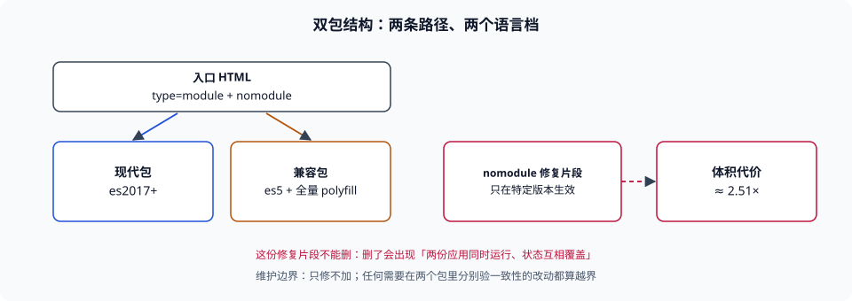

# ES5 兼容线（存量）

本页判据族 `BBL-A` ~ `BBL-H`，共 8 条。

::: danger 版本状态：仅存量项目使用 · 已停止新增
本页描述的是**双包 + ES5 降级**这条旧产物线。它只在「必须支持不支持 `const` 与 `class` 的内核」的存量项目里继续存在；本页不再新增能力，只做安全修复与迁移支撑。新代码与新项目请使用 [现代基线](../ModernES2020/index.md)。
:::

这条线的存在理由只有一个：**有一批用户还在没有 `const` 的内核上**。一旦这个前提不成立，它就只剩成本——本册实测双包体积达现代单包的 **2.51 倍**，而且每次改动都要验两遍。本页把这条线的四条实现要点、维护边界与迁移映射写清，避免后来者「顺手也给它加个新特性」。

::: tip 一句话理解
ES5 线的技术核心不是「把语法降下来」（那是 Babel 的活），而是**「两份产物如何被正确的那一类浏览器各自拿到，且不互相干扰」**。
:::



## 一、双包的两个零件

| 零件 | 作用 | 判据 |
| --- | --- | --- |
| 现代包（`type="module"`） | 给支持 ES 模块的内核 | 语法档 `es2017` 及以上，不注入 ES5 级 polyfill |
| 兼容包（`nomodule`） | 给不支持模块的内核（同时兜住「支持模块但实现有 bug」的内核） | 语法档 `es5`，注入完整 polyfill |

`nomodule` 的历史坑必须写在这里，因为它决定了「要不要额外的修复片段」：早期某内核版本**已经支持 `module`，却仍然执行 `nomodule` 脚本**，导致两份包同时运行、状态互相覆盖。通行做法是加一段**只在那个版本上生效**的修复脚本（判断该内核版本并动态插入一个空的 `nomodule` 脚本，让浏览器的「已执行 nomodule」标记提前置位）。这段代码属于历史补丁，新项目不需要，存量项目不能删——删了会出现「两份应用同时跑」。

## 二、`es5` 只能靠 Babel / SWC / tsc

本册实测（esbuild 0.21.5）：`--target=es5` 对含 `class`、`const`、`async` 的源码**直接报错**，不产出。所以这条线必须用能降到 `es5` 的编译器：

| 配置项 | 存量线的取值 | 为什么 | 换到现代线的取值 |
| --- | --- | --- | --- |
| `targets` | `ie 11` 或更宽的版本列表 | 决定降级深度 | `baseline widely available` |
| `useBuiltIns` | `entry`（入口 import `core-js/stable`） | 旧内核漏补一个 API 就是白屏，宁可多补 | `usage` + 盲区清单 |
| `corejs` | 显式写主版本（如 `3`） | 不写会警告并可能用错数据 | 同 |
| `useDefineForClassFields` | `false` | 与历史编译产物的 `[[Set]]` 语义保持一致，避免同一份代码在两代产物里行为不同 | `true`（跟规范走） |
| helper 注入 | `@babel/runtime` 共享 | 双包 + 多 chunk，内联会翻倍 | 同 |

第四行是这条线**唯一一处「故意不跟规范」**的配置，必须配注释说明：它不是为了兼容浏览器，而是为了**兼容自己上一版的产物**——同一份业务代码在两个包里跑出不同结果，比不规范更难查。

## 三、polyfill：全量注入的代价要自己量

存量线用 `entry` 全量注入，理由是「漏补的代价（白屏）远大于多补的代价（体积）」。但体积不是无限的，所以要量：

```shell
# 1. 量全量注入的规模（以 core-js 模块数为代理指标）
grep -o 'core-js/modules/[a-z0-9._-]*' dist-legacy/assets/*.js | sort -u | wc -l
# 期望：一个可对比的数字；改造前后各记一次

# 2. 量两份产物的体积差（双包真实代价）
echo -n "modern: "; du -sb dist-modern/assets | cut -f1
echo -n "legacy: "; du -sb dist-legacy/assets | cut -f1
# 期望：legacy 明显更大；本册同源夹具测得合计约 2.51 倍
```

这两条命令的产出要写进迁移方案：**「我们为兼容付了多少字节」必须是一个数字**，否则这条线永远不会被评估是否还值得留。

## 四、维护边界：只修不加

| 允许 | 不允许 |
| --- | --- |
| 安全修复（依赖漏洞、XSS 相关） | 新增业务功能、新增页面 |
| 迁移支撑（映射表、兼容层） | 引入新依赖、升级大版本框架 |
| polyfill 的必要增补（新发现的漏补） | 换构建器、换 CSS 方案 |

边界的判据很硬：**任何改动如果需要在两个包里分别验证行为一致性，就说明它越界了**。存量线的改动应该只落在「安全」与「迁移」两类，其余一律进现代线。

## 五、迁移映射表

从这条线迁到现代线，逐项对应如下（完整步骤在[实战：从双包迁到单包](../Practice/index.md)）：

| 旧写法 | 新写法 | 注意 |
| --- | --- | --- |
| `targets: 'ie 11'` | `baseline widely available` | 抬档前先取旧内核真实占比 |
| `module` + `nomodule` 双包 | 单包（`type="module"`） | 同时删掉修复片段 |
| `useBuiltIns: 'entry'` + `import 'core-js/stable'` | `usage` + 盲区清单 | 逐条核对漏补 API |
| `useDefineForClassFields: false` | `true` | 检查是否有依赖 `[[Set]]` 的继承写法 |
| ES5 语法写检测代码 | 可放宽，但检测仍建议用最低档 | 见[特性检测](../FeatureDetect/index.md) |
| 全量 polyfill（含提案） | 按需 + 提案单独评审 | 提案行为跨内核不一致 |

第三、四行是最容易「迁完才发现」的两处：前者漏补在运行时才炸，后者改的是语义（类字段初始化是否触发父类 setter）。

## 本页判据


| 判据 | 约定 | 定错了会怎样 | 怎么验证 |
| --- | --- | --- | --- |
| `BBL-A` | 页顶标注版本状态，且目录页与本页互相可达 | 读者不知道这是旧线，照着写新代码 | 状态容器 + 目录页有入口 |
| `BBL-B` | 双包的两份产物各有明确语法档，不得混档 | 现代包被降到 `es5`，白付体积 | 分别扫描两份产物里的语法特征 |
| `BBL-C` | 历史 `nomodule` 修复片段不得删除 | 两份应用同时运行、状态互相覆盖 | 模板里有该片段且注释说明原因 |
| `BBL-D` | `useDefineForClassFields: false` 必须有注释说明动机 | 两代产物行为不一致且无人知道为什么 | 配置文件里有注释 |
| `BBL-E` | 全量 polyfill 的规模有数字记录 | 无法评估这条线还值不值得留 | 有 core-js 模块数与双包体积对比 |
| `BBL-F` | 维护边界为「只修不加」，越界改动进现代线 | 旧线不断长新功能，双份维护成本失控 | 提交记录里旧线只出现修复类改动 |
| `BBL-G` | 迁移映射表覆盖语法、注入、语义三类 | 迁完才发现语义变了 | 映射表里有 `useDefineForClassFields` 一行 |
| `BBL-H` | 旧内核占比有数据支撑，且定期复核 | 为 0.2% 的用户付 2.51 倍体积 | 有占比数据与复核日期 |

## 验证方式

```shell
# 1. 确认本页的状态标注在容器内
sed -n '1,10p' docs/Frontend/BuildBaseline/LegacyES5/index.md | grep -n '版本状态'
# 期望：命中 1 行，位于 ::: danger 容器内

# 2. 确认目录页有本页入口
grep -n 'LegacyES5/index.md' docs/Frontend/BuildBaseline/index.md
# 期望：命中 1 行

# 3. 确认侧边栏有本页
grep -rn 'BuildBaseline/LegacyES5' .vitepress/frontend.ts
# 期望：命中 1 行

# 4. 看本页判据族定义完整
grep -c 'BBL-[A-H]' docs/Frontend/BuildBaseline/LegacyES5/index.md
# 期望：≥ 8
```

## 参考资料

- [Babel — `@babel/preset-env` 的 `useBuiltIns` 与 `corejs`](https://babeljs.io/docs/babel-preset-env)
- [Babel — `useDefineForClassFields` 的语义差异](https://babeljs.io/docs/babel-plugin-transform-class-properties)
- [Vite — `@vitejs/plugin-legacy`（`nomodule` 与 `safari nomodule fix`）](https://vite.dev/guide/build#legacy-browser-support)
- [core-js — 全量入口与按需引入](https://github.com/zloirock/core-js)
- [本册目录页](../index.md)
- [现代基线（替代方案）](../ModernES2020/index.md)
