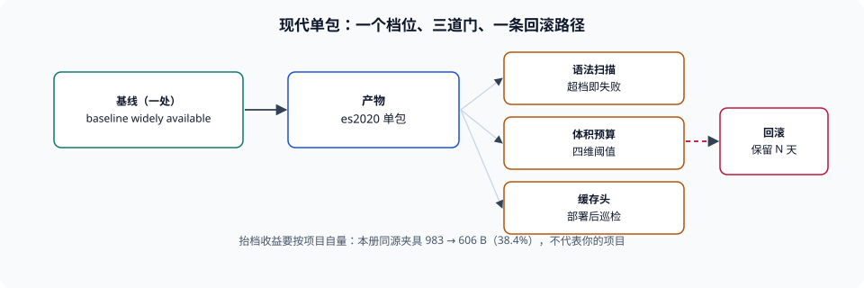

# 现代基线（当前主线）

本页判据族 `BBM-A` ~ `BBM-H`，共 8 条。

::: tip 版本状态：当前主线 · 持续维护
本页是**现代单包产物线**的当前基线：`baseline widely available` 的能力档、`es2020` 的语法档、按需注入的 polyfill，以及三道必须设在 CI 里的门禁。存量双包线保留在 [ES5 兼容线](../LegacyES5/index.md)（仅存量项目使用 · 已停止新增），不做合并。
:::

现代线的价值不是「新」，而是**它让体积、缓存、兼容三笔账同时变好算**：一份产物、一个档位、一套 polyfill 清单。代价是必须接受一个明确的边界——**不支持 `es2020` 之前的内核**，并且要能说出被排除的是谁、有多少。本页把这个边界写成可执行的配置与门禁。

::: tip 一句话理解
现代基线 = **一个语法档（`es2020`）+ 一个能力档（`baseline widely available`）+ 三道门（语法扫描、体积预算、缓存头校验）**。少一道，它就退化回「我们大概支持现代浏览器」。
:::



## 一、两个档位怎么配

| 位置 | 取值 | 作用 | 注意 |
| --- | --- | --- | --- |
| `browserslist`（根） | `baseline widely available` | 唯一定义，供 Babel / autoprefixer / CSS 工具读 | 不要在子包重复定义 |
| `build.target` | `'es2020'`（或从 `browserslist` 派生） | 决定语法降级深度 | 本机 Vite 5.4.21 的默认值是 `es2020` + 四个下限，**默认值不等于你的基线**，要显式写 |
| polyfill 注入 | `usage` + 盲区清单 | 补 API | 见[API 补齐](../Polyfill/index.md) |
| `useDefineForClassFields` | 默认（`true`） | 跟随规范的 `[[Define]]` 语义 | 存量代码若依赖 `[[Set]]`，迁移时会暴露 |

第二行的括号是这一页最容易被跳过的一句：**默认值不是基线**。Vite 的默认目标里包含 `chrome87`、`safari14` 这类具体下限，它与 `baseline widely available` 的成员集并不相同；两边都「看起来是现代」，但产物档位与 polyfill 清单会不一致。**要么显式指定 `target`，要么从 `browserslist` 派生**，不要靠默认值。

## 二、三道门禁

| 门禁 | 检查什么 | 失败即阻断 | 挂在哪一步 |
| --- | --- | --- | --- |
| 语法扫描 | 产物里不得出现超出档位的语法（逻辑赋值、顶层 `await`、装饰器） | 是 | 构建后 |
| 体积预算 | 首屏 / 单 chunk / 增量 / 缓存失效面四个维度 | 是 | 构建后 |
| 缓存头校验 | 指纹资源 `immutable`、HTML `no-cache`、`Vary` 正确 | 是（部署后巡检） | 部署后立刻 |

三者的关系是一条链：语法扫描保证「能执行」，体积预算保证「能接受」，缓存头校验保证「能更新」。缺第三条时最典型的症状是「发了版但用户还在旧版本」，而且**没有任何报错**。

```shell
# 门禁一：产物语法扫描（以 es2020 为档，禁逻辑赋值与顶层 await）
grep -rnE '\?\?=|\|\|=|&&=' dist/assets/*.js && { echo "超出 es2020 档位"; exit 1; }
grep -rnE '^\s*await ' dist/assets/*.js && { echo "出现顶层 await"; exit 1; }
# 期望：两条都无输出

# 门禁二：首屏与总量按 gzip 口径统计（阈值按项目填）
total=0; for f in dist/assets/*.js; do total=$((total + $(gzip -9 -c "$f" | wc -c))); done
echo "gzip total = $total B"
# 期望：低于预算阈值；超出则失败

# 门禁三：部署后首屏缓存头
curl -sI https://example.com/ | grep -i 'cache-control'
# 期望：no-cache（允许 304），不是 max-age 长期缓存
```

## 三、现代线的四个「不再需要」

这条线之所以值得迁，是因为它一次性消掉了四类历史包袱：

| 不再需要 | 原因 | 收益（本册实测） |
| --- | --- | --- |
| `nomodule` 双包与修复片段 | 目标内核都支持 ES 模块 | 体积从 2.51× 回落到 1× |
| ES5 降级链（Babel 全量转译） | `es2020` 只需少量改写 | 同源夹具 gzip 983 → 606 B（省 38.4%） |
| 全量 polyfill 注入 | 大部分 API 已在内核里 | 注入条数下降，具体字节按项目自量 |
| UA 版本判断 | 能力检测 + 构建期清单已足够 | 判定从「猜版本」变成「问能力」 |

第二条的收益常常被高估：38.4% 是**同一份夹具**在 `es2015` 与 `es2020` 之间的差，真实项目的收益取决于「有多少代码用了 `class` 与 `async`」。如果项目大量使用 `async`，收益接近上限；如果是大量同步工具函数，收益会小很多。**这一点必须自己量**，见验证第 2 条。

## 四、什么时候不该用这条线

| 情况 | 判据 | 建议 |
| --- | --- | --- |
| 旧内核占比高于业务可接受线 | 自有埋点里 `es2020` 以下内核的会话占比 | 维持双包，或先做升级引导 |
| 有强制的行业终端（固定版本浏览器、内嵌 WebView） | 终端清单里有明确的不支持项 | 用双包或定向构建 |
| 第三方 SDK 只提供 ES5 产物且体积占比高 | 依赖树里该 SDK 的体积占比 | 它不影响你的语法档（依赖已被编译），但要评估其 polyfill 需求 |
| 团队没有 CI 预算检查能力 | 无构建后检查步骤 | 先补门禁，再抬档 |

第三行是一个常见误解：**依赖是 ES5 产物，不阻止你发 `es2020` 语法的产物**——你的产物可以包含 ES5 的依赖代码与 `es2020` 的业务代码，浏览器会照常执行。真正需要关心的是「依赖是否带来了它自己的 polyfill 需求」。

## 五、与存量线的边界

| 事情 | 落在哪条线 |
| --- | --- |
| 新页面、新依赖、新构建配置 | 现代线 |
| 存量项目安全修复 | ES5 线（只修不加） |
| 「某旧内核用户报障」 | 先按[兼容回归矩阵](../Regression/index.md)定位，再决定是否回滚到双包 |
| 双包体积与维护成本的评估 | 两页都要读，账在[实战](../Practice/index.md)里算 |

::: warning 不要在两页之间「各取一半」
常见错误配置是「语法档抬到 `es2020`，但保留 `nomodule` 双包」。这样既没有拿到抬档的体积收益（兼容包仍在），又放弃了旧内核之外的一致性（现代包里是 `es2020`）。**要幺单包现代、要么双包兼容**，中间态只在「语法够新、API 少数缺失」时才成立，且那时应该用 polyfill 而不是双包。
:::

## 本页判据


| 判据 | 约定 | 定错了会怎样 | 怎么验证 |
| --- | --- | --- | --- |
| `BBM-A` | 基线为 `baseline widely available`（或等价的显式查询），并落在根配置一处 | 两处定义漂移，产物与文档不一致 | 根 `browserslist` 可打印，子包无覆盖 |
| `BBM-B` | `build.target` 显式指定或从基线派生，不依赖工具默认值 | 默认值与基线成员集不同，产物档位错位 | 构建配置里能看到显式取值 |
| `BBM-C` | 三道门禁（语法扫描、体积预算、缓存头）都挂在 CI | 缺一门就有一类问题静默发生 | CI 配置里三项都在 |
| `BBM-D` | 语法扫描覆盖逻辑赋值与顶层 `await` | 超出档位的语法直发旧内核，整包不执行 | 扫描脚本有对应正则 |
| `BBM-E` | 体积按 gzip 口径统计，且分首屏与总量 | raw 与 gzip 混用，决策失真 | 统计脚本逐文件 `gzip -9` |
| `BBM-F` | 部署后立即校验 HTML 与指纹资源的缓存头 | 发了版用户看不到，且无报错 | 有部署后巡检记录 |
| `BBM-G` | 不保留 `nomodule` 双包（除过渡期并明确期限） | 既付双包体积又失去一致性 | 模板里无 `nomodule` 分支 |
| `BBM-H` | 抬档收益按项目自量，不引用他人数字 | 用 38.4% 承诺，实际只省 8% | 有本项目改造前后的 gzip 对比 |

## 验证方式

```shell
# 1. 打印基线解析结果（应含现代浏览器）
pnpm exec browserslist 2>/dev/null | head -10
# 期望：一列现代版本；空输出说明基线未定义

# 2. 量本项目抬档前后的真实收益（改造前后各跑一次）
for f in dist/assets/*.js; do gzip -9 -c "$f" | wc -c; done | awk '{s+=$1} END {print "gzip total:", s}'
# 期望：改造后明显小于改造前；差值即本项目真实收益（本册同源夹具为 38.4%）

# 3. 三道门禁自查
grep -rnE '\?\?=|\|\|=|&&=' dist/assets/*.js | head -3; echo "EXIT=$?"
# 期望：无输出（超出档位即命中）

# 4. 看本页判据族定义完整
grep -c 'BBM-[A-H]' docs/Frontend/BuildBaseline/ModernES2020/index.md
# 期望：≥ 8
```

## 参考资料

- [web.dev — Baseline widely available（30 个月规则）](https://web.dev/baseline)
- [browserslist — `baseline widely available`](https://github.com/browserslist/browserslist#baseline)
- [Vite — `build.target` 与 Build Options](https://vite.dev/config/build-options)
- [RFC 8246 — HTTP Immutable Responses](https://www.rfc-editor.org/rfc/rfc8246)
- [本册目录页](../index.md)
- [ES5 兼容线（存量，迁移来源）](../LegacyES5/index.md)
