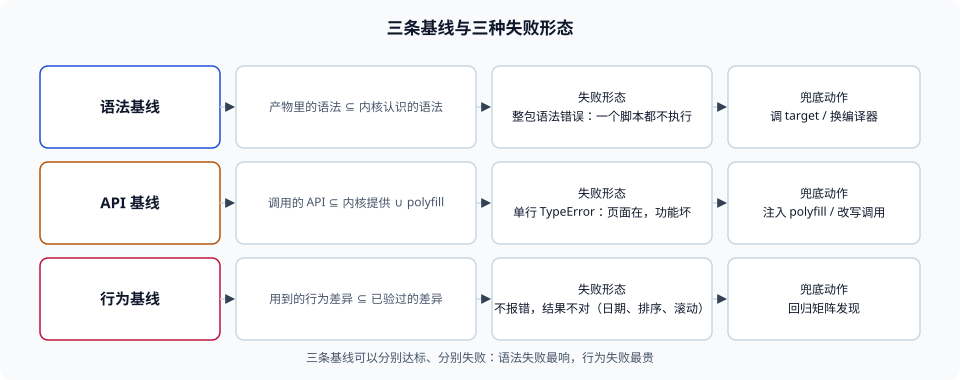

# 总览：三条基线与一句判词

本页判据族 `BBI-A` ~ `BBI-H`，共 8 条。

兼容性讨论之所以经常吵不出结论，是因为「支持」这个词在同一场讨论里被当成了一件东西，而它其实是**三条互不替代的基线**：语法基线（产物里有什么语法）、API 基线（运行时会调用什么内置能力）、行为基线（同一段代码在两端结果是否一致）。三条基线可以分别达标、分别失败，失败的现象也完全不同：语法不达标是**整包不执行**，API 不达标是**某一行抛异常**，行为不达标是**结果不对但不报错**。本页把这三条切开，并给出这个专题里唯一需要背下来的一句判词。

::: tip 一句话理解
兼容不是一个布尔值，是**三份清单的交集**：产物里出现的语法 ⊆ 目标内核认识的语法；运行时调用的 API ⊆ 目标内核提供的 API ∪ polyfill 覆盖；用到的行为差异 ⊆ 你已经验过的行为。
:::



## 一、三条基线，三种失败

| 基线 | 由什么决定 | 不达标时的现象 | 谁来兜 | 本册哪一页 |
| --- | --- | --- | --- | --- |
| 语法基线 | 构建工具的 `target` 与降级能力 | **整包语法错误**，页面上一个脚本都不执行 | 换能降级的工具，或抬高基线 | [语法降级的硬边界](../Transpile/index.md) |
| API 基线 | 源码用到的内置 API + polyfill 覆盖 | 某一行 `TypeError: x.at is not a function` | 补 polyfill，或改写成旧写法 | [API 补齐与注入策略](../Polyfill/index.md) |
| 行为基线 | 规范实现差异（`Intl`、日期、排序、滚动、`scrollIntoView` 的 `behavior`） | **不报错，结果不同**：日期差一天、排序不同、滚动不到位置 | 只能用回归用例发现 | [兼容回归矩阵](../Regression/index.md) |

第三行是最贵的一行：它没有异常、没有堆栈、监控不报，只表现为「有用户说数字不对」。本册八成的篇幅在讲怎么让前两条**不可能悄悄失守**，剩下的讲怎么让第三条**尽量早地暴露**。

## 二、为什么「按版本猜」必然失败

直觉做法是：记住「`Array.prototype.at` 是 ES2022，所以 Safari 15.4 以上才有」，然后按浏览器版本做判断。这条路有三个结构性缺陷：

1. **版本号不是能力号。** 同一个内核版本在不同外壳里能力不同：iOS 上所有浏览器共用 WebKit，但微信内置、App 内嵌页、Safari 的**实际行为**与可用 API 受系统与 App 双重约束；Android 的 System WebView 可以独立于系统更新，也可以被用户停用。同一台机器上「系统很新、内核很旧」是常态。
2. **版本号会被冻结与伪装。** UA 字符串的格式由各厂商自己维护，历史上长期存在「把版本号冻结在某个值」「把多个内核的标识拼在一起」的做法；这类字符串可以用于**统计**，不能用于**判定**。
3. **你的记忆会过期，而工具的数据不会。** caniuse / BCD 的数据随内核发布更新；靠人记「某个 API 从哪个版本开始有」的团队，一定会在某个新 API 上判错，而且判错的方向通常是「以为有、其实没有」。

::: danger 三个常见误判
1. **「我们只支持现代浏览器，所以不用管」**——「现代」如果没有落成 `browserslist` 里的一个查询，它就不是基线，只是一句愿望；CI 里没有任何一步会因为你新写了一个 `Object.groupBy` 而变红。
2. **「target 设成 es5 就兼容了」**——本机实测（esbuild 0.21.5，2026-11-12）：`--target=es5` 对含 `class`、`const`、`let`、`async` 的源码**直接报错**（`Transforming class syntax to the configured target environment ("es5") is not supported yet`），不会静默产出降级代码。**正确做法**：先确认工具能不能降到你要的档，能降再谈降级；esbuild 生态里的 ES5 线必须换 Babel / SWC / tsc。
3. **「有了 polyfill 就没有兼容问题了」**——polyfill 补的是**API 的存在性**，补不了行为差异（`Intl` 的时区数据、`toLocaleString` 的格式、`structuredClone` 的深拷贝语义边界），也补不了「语法根本不被解析」。**正确做法**：polyfill 清单与语法 target 分开维护，行为差异单独立回归用例。
:::

## 三、四条裁决口径

本册所有判据都从这四条派生，遇到没写到的情况按这四条推：

### 3.1 基线只有一处定义

仓库里允许出现多处**引用**，不允许出现多处**定义**。典型的三处定义是：`package.json` 的 `browserslist` 字段、构建器自己的 `target`、CI 脚本里手写的版本号。本机实测的默认值差异就足以造成事故：Vite 5.4.21 的默认构建目标是 `es2020` + `edge88` + `firefox78` + `chrome87` + `safari14`（取自其 `dist/node/constants.js` 的 `ESBUILD_MODULES_TARGET`），而很多仓库的 `browserslist` 字段还写着三年前的 `> 0.5%, last 2 versions`。两处谁生效取决于**读它的人**：Babel 读 `browserslist`，Vite 的 `build.target` 不读它。

### 3.2 降级越界要显式失败

「降不下去」必须是构建失败或至少是一条可被 CI 抓住的 warning，而不是「保留新语法、产物照发」。判据的落点是：**产物里不得出现超出 target 档位的语法**。这一条可以用工具验证（见[语法降级的硬边界](../Transpile/index.md)第 5 节），也可以用一条正则兜底（查产物里有没有 `?.`、`??`、`=>`）。

### 3.3 体积按「增量 + 缓存」两笔算

只报总量的预算会漏掉真正的问题：总量没变，但你把一个大 chunk 拆成了 12 个，于是每次发布用户的缓存命中率掉一半。本机实测（120 个模块、8 条路由的切分仿真，`seed=20261112`）：改一个叶子模块时，单包策略失效 **100%**、`vendor` 分包失效 **97.1%**、按路由分包失效 **11.2%**；改一个被三条以上路由共享的模块时，按路由分包反而失效 **38.5%**。**所以「切得越细越好」是错的，「切得与改动频率匹配」才对。**

### 3.4 回归要有样本量

「我们测了 100 次没出问题」不是证据。本机用二项检验算过（正态近似，`α=0.05`、`power=0.8`）：要把「兼容失败率从 0.5% 涨到 2%」稳定检出，每组需要 **861** 次独立尝试；失败率从 5% 涨到 8% 需要 **1,059** 次。100 次样本、真实失败率 2%、门槛「失败 ≥3 次」时，报警概率只有 **32.3%**——「测了没事」有三分之二的概率是真的有事但没测出来。

## 四、三个「我们的基线是几」

| 名字 | 例子 | 谁读它 | 常见错误 |
| --- | --- | --- | --- |
| 语义档位 | `baseline widely available`、「2024 基线」 | 人、评审、`browserslist` 查询 | 说了但没写进仓库，工具完全不知道 |
| 工具档位 | `build.target: 'es2020'`、`targets: { chrome: '87' }` | 构建工具 | 与语义档位不同步，产物比声明更「新」 |
| 数据档位 | caniuse / BCD 的**数据版本** | 工具链（`caniuse-lite` 等） | 锁定旧数据版本，新 API 被误判为「已支持」 |

第三行最少人管：`caniuse-lite` 这类数据包如果被锁在一年前，工具会认为某个新 API「目标浏览器都支持」，于是**不注入 polyfill**——这是「漏补」最隐蔽的来源。判据是：数据包版本必须能被 `pnpm outdated` 看见，且升级它属于常规维护而不是「大版本升级」。

## 五、这门学问的最小闭环

一个能自我维持的基线，只需要四个动作，缺一个就会退化成口头约定：

1. **定**：在仓库里写一处基线（[目标浏览器清单](../Targets/index.md)）。
2. **降与补**：让产物符合基线，且越界时失败（[语法降级](../Transpile/index.md)、[API 补齐](../Polyfill/index.md)）。
3. **控**：给体积与缓存定阈值，超了就红（[体积预算](../Budget/index.md)、[分发与缓存](../Delivery/index.md)）。
4. **验**：用有样本量的回归矩阵证明它在真实内核里能跑（[兼容回归矩阵](../Regression/index.md)）。

这四步的顺序不能换：先有基线才谈降级，先有产物才谈预算，先有预算才谈回归的判定门槛（因为回归要按「目标内核 × 关键路径」抽样，抽样面由基线决定）。

::: info 本册不涉及什么
- 不讲构建工具本身的安装、插件、HMR、代理——那是[构建工具](../../Basic/BuildTool/index.md)。
- 不讲 TypeScript 编译选项与类型系统——只在「`target` 影响 `useDefineForClassFields`」这一处提到。
- 不讲 CDN 的边缘架构与回源策略——那是[CDN 原理](../../../Ops/EdgeCDN/CDNPrinciple/index.md)。
- 不写死浏览器版本号：版本号半年就过期，查询与档位不会。
:::

## 本页判据


| 判据 | 约定 | 定错了会怎样 | 怎么验证 |
| --- | --- | --- | --- |
| `BBI-A` | 基线必须落成仓库里的**一处**可执行定义，其余位置引用它 | 两处定义漂移，产物与文档说的不是一回事 | 全仓检索 `browserslist` / `target`，确认只有一处是「定义」、其余是引用 |
| `BBI-B` | 语法 / API / 行为三条基线分开记录，不合并成「支持 XX」 | 语法达标被当成整体达标，API 漏补在生产暴露 | 基线文档里有三张清单或三行，各自有负责动作 |
| `BBI-C` | 兼容判定用**能力检测或工具数据**，不用 UA 版本号猜 | 同一内核不同外壳判错、版本冻结导致误判 | 代码里无 `navigator.userAgent` 的版本比较分支（除统计用途） |
| `BBI-D` | 工具降不到目标档时必须失败，不得静默保留新语法 | 旧内核整包语法错误、页面全白且监控只报「JS 错误」 | 构建日志里无「unsupported target」被忽略；产物正则扫描无超档语法 |
| `BBI-E` | 体积预算同时约束**总量**与**增量**，并记录缓存失效面 | 总量达标但每次发布缓存命中率腰斩 | 预算文件里有两条阈值；发布记录里有失效字节数 |
| `BBI-F` | 兼容回归的样本量按待检出差异算，不按「跑过一次」算 | 「测了 100 次没事」掩盖 2% 的真实失败率 | 回归计划里写明目标差异与所需样本量（可复算） |
| `BBI-G` | 依赖的兼容数据包（caniuse / BCD）版本纳入常规升级 | 数据过期导致漏补 polyfill | `pnpm outdated` 能看到该包，且有升级记录 |
| `BBI-H` | 三条基线的变更都要走评审并留下「为什么抬档」的说明 | 抬档无记录，下次故障无法归因 | 基线文件的变更历史里有动机说明（链接或一段话） |

## 验证方式

```shell
# 1. 找出仓库里所有「基线定义」的位置（应只有一处是定义）
grep -rn --include='package.json' '"browserslist"' . | grep -v node_modules
grep -rn --include='*.ts' --include='*.js' --include='*.mjs' 'target:' . \
  | grep -v node_modules | grep -v '\.vitepress/dist'
# 期望：两类各自只有一处「定义」，其余是引用或与本册无关的配置

# 2. 看本机 Vite 的默认构建目标（不要凭记忆）
node -e "const p=require('fs').readFileSync('node_modules/.pnpm/vite@5.4.21/node_modules/vite/dist/node/constants.js','utf8');\
const m=p.match(/ESBUILD_MODULES_TARGET = \[([\s\S]*?)\]/); console.log(m[1].replace(/\s+/g,' '))"
# 期望：'es2020', 'edge88', 'firefox78', 'chrome87', 'safari14'

# 3. 验证「降不下去会硬失败」而不是静默放行
printf 'class A { #x = 1; }\nexport default A;\n' > /tmp/es5-probe.js
node_modules/.pnpm/@esbuild+win32-x64@0.21.5/node_modules/@esbuild/win32-x64/esbuild.exe \
  /tmp/es5-probe.js --target=es5 --bundle --outfile=/tmp/es5-probe.out.js
# 期望：退出码非 0，报错含 "Transforming class syntax ... is not supported yet"

# 4. 看本页判据族定义完整
grep -c 'BBI-[A-H]' docs/Frontend/BuildBaseline/Overview/index.md
# 期望：≥ 8
```

## 参考资料

- [web.dev — Baseline（三档定义、核心浏览器集）](https://web.dev/baseline)
- [MDN — 浏览器兼容性数据（BCD）](https://github.com/mdn/browser-compat-data)
- [caniuse — 特性支持表](https://caniuse.com/)
- [esbuild — Target（含对 ES5 的限制说明）](https://esbuild.github.io/api/#target)
- [Vite — Build Options（`build.target` 默认 `'modules'`）](https://vite.dev/config/build-options)
- [本册目录页](../index.md)
