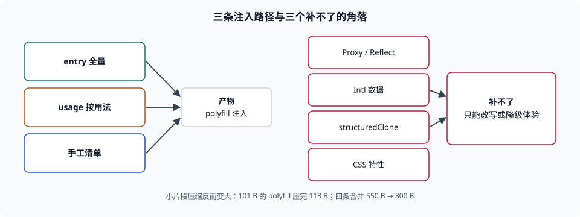

# API 补齐与注入策略

本页判据族 `BBP-A` ~ `BBP-H`，共 8 条。

语法降级解决的是「这段代码能不能被**解析**」，polyfill 解决的是「这段代码能不能被**执行**」。两者的分界线很清楚：`?.` 是语法（解析器认不认识），`Array.prototype.at` 是 API（运行时有没有这个方法）。混为一谈的后果是：把 `target` 调低就以为万事大吉，结果在旧内核上出现 `TypeError: [].at is not a function` ——**页面不白屏，但功能坏了**，这比白屏更难发现。

::: tip 一句话理解
polyfill 补的是**「这个东西存不存在」**，补不了「它存不存在但行为不一样」。前者是注入问题，后者是回归问题。
:::



## 一、三条注入路径

| 策略 | 做法 | 优点 | 代价 |
| --- | --- | --- | --- |
| 全量入口（`useBuiltIns: 'entry'`） | 在入口文件 `import 'core-js/stable'`，按 targets 裁掉不需要的部分 | 一次配好，漏补概率最低 | 用不到的 API 也进产物；清单随 targets 浮动 |
| 按用法（`useBuiltIns: 'usage'`） | 编译时扫描代码用到的 API，自动注入对应 polyfill | 体积最优 | **依赖静态分析**：动态取属性（`obj[fn]()`）、字符串拼出来的方法名、第三方包内部的用法都可能漏 |
| 手工清单 | 自己列一份 polyfill 文件 | 完全可控、可审计 | 靠人记；新增 API 时最容易漏 |

第二行是「看起来最优、实际最危险」的一条：`useBuiltIns: 'usage'` 的漏补不是报错，是**在某些内核上少注入一个方法**。它依赖 Babel 对 API 用法的识别能力，凡是「方法名不是字面量」的写法（`arr[method]()`、`Reflect.get(...)`、被 `eval` 出来的代码）都不在它的视野里。第三方依赖更是盲区——很多包发布时已经编译过，Babel 看不到它的源码。

::: danger 四个注入陷阱
1. **`usage` 当成「一定不漏」**——它对动态属性访问与预编译依赖无效。**正确做法**：`usage` 打底，再手工补一份「已知盲区清单」（第三方 SDK 用到但源码里看不到的 API），清单进仓库。
2. **只补 `stable`，忘了提案阶段的东西**——`core-js` 的提案 API 需要单独引入（`core-js/proposals/...`）。**正确做法**：只要源码用了提案语法（如 `Array.prototype.group`），就在评审里明确「这是提案，不同内核行为可能不同」。
3. **从公共 CDN 动态加载 polyfill**——2024 年 6 月，`polyfill.io` 域名易主后一度被用于向站点注入恶意脚本，多家 CDN 与安全厂商紧急拦截。**正确做法**：polyfill 必须**自托管**、进构建产物、参与 SRI 与版本锁定，不从第三方域名动态拉取。
4. **用 polyfill 掩盖「懒得改代码」**——为了一个 `Array.prototype.at` 引入整包 polyfill，不如把那一处改成 `arr[arr.length - 1]`。**正确做法**：先问「这一处能不能改写」，再问「要不要补」。
:::

## 二、体积账：小片段压缩反而变大

polyfill 的体积常被两个直觉误导：一是「polyfill 很小」，二是「压缩后更小」。本机手写四个最小实现并实测（UTF-8 字节，未压缩 / gzip 级别 9）：

| polyfill | raw | gzip | gzip 相对 raw |
| --- | --- | --- | --- |
| `Array.prototype.at` | 101 B | 113 B | **+11.9%** |
| `Object.hasOwn` | 85 B | 88 B | +3.5% |
| `String.prototype.replaceAll` | 83 B | 95 B | +14.5% |
| `Promise.any` | 216 B | 174 B | −19.4% |
| **四条合计** | **550 B** | **300 B** | −45.5% |

第一、第三行是这张表的价值所在：**单个小片段的 gzip 结果比原文还大**（gzip 有 18 字节头部与 deflate 块开销，几十字节的文本压不动）。所以：

- **别按「每个 polyfill 加多少」估算体积**，要按「合并后整体压多少」估。
- **别把 polyfill 拆成很多小文件**，每个文件各带一次压缩开销与一次请求（HTTP/2 下请求便宜了，但压缩开销不消失）。

另外两个必须区分的口径：**raw（产物字节）**、**传输字节（gzip 或 brotli 后）**。手工写的 polyfill 与压缩后的业务代码混在一起时，raw 的增量会被压缩率放大或缩小，跨版本比较时**只能用同一个口径**。

## 三、补不了的那一部分

以下几类东西**没有可靠的 polyfill**，只能用「改写代码」或「降级体验」处理：

| 能力 | 为什么补不了 | 处置 |
| --- | --- | --- |
| `Proxy` / `Reflect` 的拦截语义 | 无法拦截语言层面的属性访问，只能改写调用方 | 改写成显式 getter，或按基线要求排除旧内核 |
| `Intl` 的完整数据（时区、数字、货币） | 数据量大且随区域更新，polyfill 只能带来一小部分 locale | 按需加载数据子集，或服务端渲染格式化结果 |
| `structuredClone` 的部分语义 | 需要精确复刻结构化克隆算法（循环引用、`transfer`、不可克隆类型抛错） | 用现成库替代（明确其边界），或改用 JSON + 手工处理 |
| CSS 特性（`@container`、`aspect-ratio`、`:has()`） | 属于渲染层，JS 补不了 | 用 `@supports` 做渐进增强（见[特性检测](../FeatureDetect/index.md)） |
| 行为差异（日期解析、`toLocaleString` 格式、滚动平滑） | 规范允许实现差异，polyfill 会把「差异」变成「你的实现」 | 只靠回归用例发现，见[兼容回归矩阵](../Regression/index.md) |

这张表的用法不是「读完记住」，而是**在评审里当检查表**：技术方案里出现这五类能力时，必须写清「基线是否覆盖 + 不覆盖时的替代方案」。

## 四、注入位置：越早越好，但有代价

polyfill 必须在**业务代码执行之前**生效。三种位置各有代价：

| 位置 | 生效时机 | 代价 |
| --- | --- | --- |
| HTML 里单独一个 `<script>`（阻塞） | 最早 | 多一次请求，且阻塞首屏解析 |
| 入口 chunk 顶部 | 早 | 与业务代码同包，无法并行加载 |
| 按需动态 `import()` | 晚（可能已经执行过业务代码） | 时序不可控，容易「补了但已经报错」 |

第一条与第三条之间的取舍很现实：**首屏关键路径上的 API 必须同步补**，非关键路径（例如某个低频页面的重功能）可以按需补。判据是「这个 API 是否在首屏渲染链路上被调用」——不是「这个 API 新不新」。

## 五、可核对的最小流程

```shell
# 1. 看产物里到底注入了哪些 polyfill（core-js 会在产物里留下特征名）
grep -o 'core-js/modules/[a-z0-9._-]*' dist/assets/*.js | sort -u | wc -l
# 期望：一个稳定的数量；若为 0 而基线又很宽，说明根本没注入

# 2. 检查有没有从第三方域名拉 polyfill（供应链红线）
grep -rn 'polyfill\.io\|cdn\.polyfill' src index.html 2>/dev/null
# 期望：无输出

# 3. 复算「小片段压缩反而变大」
printf 'Array.prototype.at=function at(i){var n=this.length;return (i=Math.trunc(i)||0)<0?this[n+i]:this[i]};\n' > /tmp/bb-pf.js
echo -n "raw="; wc -c < /tmp/bb-pf.js
echo -n "gzip="; gzip -9 -c /tmp/bb-pf.js | wc -c
# 期望：gzip 不小于 raw（本机读数 101 / 113）

# 4. 在旧内核里验证「真的补上了」（需真机或云真机）
# 打开目标内核的页面，控制台执行：
#   [1,2,3].at(-1)
# 期望：返回 3；返回 TypeError 说明该 API 未补
```

第 4 步没有替代品：**polyfill 是否生效只能在目标内核里验证**。构建日志、产物扫描、本地 Chrome 都证明不了它。

## 本页判据


| 判据 | 约定 | 定错了会怎样 | 怎么验证 |
| --- | --- | --- | --- |
| `BBP-A` | 语法 target 与 polyfill 清单分开维护，互不替代 | 语法达标被当成 API 达标，运行时 `TypeError` | 配置里两处独立存在，各有负责动作 |
| `BBP-B` | 使用 `usage` 注入时，必须另有一份「盲区清单」 | 动态属性访问与预编译依赖漏补，只在旧内核暴露 | 清单文件存在，且列出第三方包与动态调用点 |
| `BBP-C` | polyfill 必须自托管进产物，禁止从第三方域名动态加载 | 供应链被劫持时全站被注入脚本 | 全仓检索 `polyfill.io` 类域名，结果为 0 |
| `BBP-D` | 体积按「合并后整体压缩」口径统计，不按单条累加 | 小片段相加的估算与实际差 2 倍以上 | 有 raw 与 gzip 两个口径的对比记录 |
| `BBP-E` | 无法 polyfill 的能力（`Proxy`、`Intl` 数据、`structuredClone`、CSS 特性）单独立项 | 以为补了，实际从未生效 | 技术方案里有「补不了的能力与替代方案」一节 |
| `BBP-F` | 首屏链路上的 API 同步注入，非关键路径可动态注入 | 动态注入时序过晚，代码已执行并抛错 | 注入位置与首屏调用链能对应上 |
| `BBP-G` | 提案阶段 API 的使用要显式标注并单独评审 | 不同内核行为不一致，且无回归覆盖 | 源码或方案里有提案标注与评审记录 |
| `BBP-H` | 能在目标内核里跑一次「可用性抽查」 | 所有构建期证据都绿，运行时仍缺方法 | 有云真机或目标内核的抽查记录 |

## 验证方式

```shell
# 1. 统计产物里注入的 core-js 模块数
grep -o 'core-js/modules/[a-z0-9._-]*' dist/assets/*.js 2>/dev/null | sort -u | head -20
# 期望：有输出且条数稳定；空输出 + 宽基线 = 未注入

# 2. 查第三方 polyfill CDN（应为 0）
grep -rn --include='*.html' --include='*.ts' --include='*.js' 'polyfill\.io' . \
  | grep -v node_modules | grep -v dist
# 期望：无输出

# 3. 复算压缩反常
printf 'Object.hasOwn=function hasOwn(o,k){return Object.prototype.hasOwnProperty.call(o,k)};\n' > /tmp/bb-pf2.js
for f in raw gzip; do
  if [ "$f" = raw ]; then wc -c < /tmp/bb-pf2.js; else gzip -9 -c /tmp/bb-pf2.js | wc -c; fi
done
# 期望：两个数字接近，gzip 可能更大

# 4. 看本页判据族定义完整
grep -c 'BBP-[A-H]' docs/Frontend/BuildBaseline/Polyfill/index.md
# 期望：≥ 8
```

## 参考资料

- [core-js — 模块清单与 proposals 目录](https://github.com/zloirock/core-js)
- [Babel — `useBuiltIns: 'usage'` 的识别边界](https://babeljs.io/docs/babel-preset-env#usebuiltins)
- [Cloudflare — 关于 polyfill.io 供应链事件的说明](https://blog.cloudflare.com/polyfill-io-now-available-on-cloudflare/)
- [MDN — `structuredClone` 的可克隆类型与限制](https://developer.mozilla.org/docs/Web/API/structuredClone)
- [W3C — Subresource Integrity](https://www.w3.org/TR/SRI/)
- [本册目录页](../index.md)
