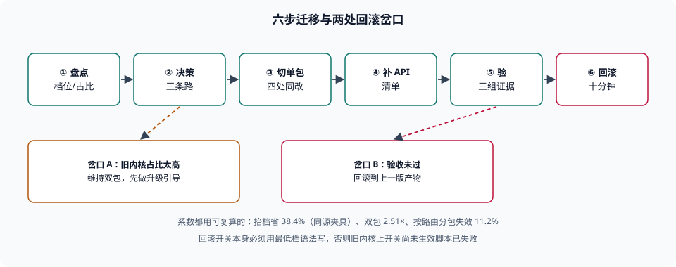

# 实战：从双包迁到单包

本页判据族 `BBA-A` ~ `BBA-H`，共 8 条。

前面几页把「基线、降级、补齐、预算、分发、回归」拆开讲了。这一页把它们串成一次真实改造：**一个还在发 `module` + `nomodule` 双包的项目，如何判断能不能切成现代单包，切完怎么证明没切坏，出问题怎么退回去**。全程只用可跑的命令与本册实测过的系数，不给「大概能省一半」这种话。

::: tip 一句话理解
迁移的判据不是「新产物能构建」，而是三件事同时成立：**旧内核占比可接受、体积账算得清、回滚路径能在十分钟内走完**。
:::



## 一、账面：先算清「省多少、放弃谁」

本册实测的两个系数先摆出来（同源夹具、同一台机器、gzip 级别 9）：

| 系数 | 本机读数 | 来源 |
| --- | --- | --- |
| 抬档收益（`es2015` → `es2020`） | gzip 983 B → 606 B，**省 38.4%** | [语法降级的硬边界](../Transpile/index.md) |
| 双包代价（现代 + 兼容两份） | 现代单包的 **2.51×** | [语法降级](../Transpile/index.md) 第 5 节 |
| 缓存失效面（改一个单路由模块） | 单包 100%、按路由分包 11.2% | [体积预算](../Budget/index.md) |

用这三个系数算一次账。假设项目当前 JS 传输体积 300 KB（gzip）——**这是示例规模，不是本机实测的项目**，代入你自己项目的真实数字即可：

| 形态 | 传输体积 | 说明 |
| --- | --- | --- |
| 现代包（现状） | 300 KB | 主流用户下载这一份 |
| 兼容包（现状） | 300 KB × 1.5 ≈ 450 KB | 双包时代价约 1.5 倍（按本机 `es2017` 对 `es2020` 的 1.51× 估） |
| 切单包后 | 300 KB × 0.62 ≈ 186 KB | 按抬档收益 38.4% 反推 |

结论不是「省了 38%」，而是**「放弃旧内核，换回 38% 体积与一半的构建时间」**。这笔交易的代价要写在方案里：**旧内核的用户会看到什么**（白屏、还是被引导升级），这才是需要评审的部分。

## 二、第一步：盘点，把「旧内核占比」变成数字

没有这个数字，后面每一步都是在猜。

```shell
# 1. 现有产物里有多少份包（双包的证据）
ls -1 dist/assets/*.js | wc -l
grep -c 'nomodule' dist/index.html
# 期望：nomodule 出现 1 次以上 = 双包形态

# 2. 现有产物用了哪些现代语法（判断真实档位）
grep -oE '\?\?=|\|\|=|&&=|\?\.[a-zA-Z_]' dist/assets/*.js | sort | uniq -c | head
# 期望：若为 0，说明产物已被降到较低档

# 3. 现有 polyfill 规模
grep -o 'core-js/modules/[a-z0-9._-]*' dist/assets/*.js | sort -u | wc -l
# 期望：一个可对比的基线数字
```

第二、三步的产出要记进方案：**当前实际档位**（不是配置里写的）与**当前注入的 polyfill 数量**。很多团队的配置写着 `es2015`，而产物里因为某个依赖带着 `es2020` 语法，实际上已经把旧内核排除了——这种「假装兼容」的双包是最坏的状态：付了双倍体积，还没真正兼容。

## 三、第二步：决策，三条路各自的价签

| 路线 | 体积 | 维护成本 | 什么时候选 |
| --- | --- | --- | --- |
| 维持双包 | 最贵（≈2.51×） | 每份改动都要验两遍 | 旧内核占比 > 业务可接受线，且短期内降不下来 |
| 切单包（现代档） | 最省（省 38.4%） | 一套 pipeline | 旧内核占比低，且能接受这批用户降级 |
| 中间态：单包 + 少量 polyfill | 居中 | 一套 pipeline + 一份清单 | 差异只在少数 API 而非语法档 |

第三条是大多数项目的实际答案：**语法档抬到 `es2020`（放弃真旧内核），API 侧保留 3~5 个 polyfill（照顾「语法够新但 API 略旧」的中间层）**。它比「全抬」温和，比「双包」便宜。

## 四、第三步：切单包，改四处

| 位置 | 改什么 | 判据 |
| --- | --- | --- |
| 构建配置 | `target` 从双档改为单档（或从 `browserslist` 派生） | 只有一处定义，见[目标浏览器清单](../Targets/index.md) |
| HTML 模板 | 去掉 `nomodule` 分支与对应的 legacy 入口 | 产物里不再出现 `nomodule` |
| 兼容插件 | 移除 `@vitejs/plugin-legacy` 一类插件及其 polyfill 清单 | 依赖里不再有该插件 |
| polyfill 注入 | 从「全量 entry」改为「按用法 + 盲区清单」 | 注入条数下降但有清单兜底 |

改完之后必然有一批 API 会漏：插件带来的全量 polyfill 一走，源码里那些「本来靠插件补上」的调用就暴露了。所以第四步必须紧跟。

## 五、第四步：补 API，按清单而不是按感觉

```shell
# 1. 找出源码里用到、且基线可能不覆盖的 API（示例：几个高频新 API）
grep -rnE '\.at\(|Object\.hasOwn|replaceAll|structuredClone|\.groupBy\(|Promise\.any' src | head -20
# 期望：一份真实调用点清单

# 2. 生成最小 polyfill 并量体积（自托管，不从 CDN 拉）
#    合并成一个文件后再压缩，不要按条评估（单片压缩可能变大）
cat src/polyfills/*.js > /tmp/pf-all.js
echo -n "raw="; wc -c < /tmp/pf-all.js
echo -n "gzip="; gzip -9 -c /tmp/pf-all.js | wc -c
# 期望：本机四条最小实现合计 raw 550 B / gzip 300 B（同口径可比）
```

两个必须遵守的细节：**合并后压缩**（本册实测单片 101 B 的 polyfill 压完变 113 B）；**清单里写明每个 polyfill 服务的 API 与依据**，否则半年后没人敢删。

## 六、第五步：验，三组证据缺一不可

| 证据 | 怎么取 | 通过判据 |
| --- | --- | --- |
| 语义未变 | 同一份源码编译 `es2015` 与 `es2020`，跑同一组探针（见[语法降级](../Transpile/index.md)第 5 节） | 两次输出完全一致 |
| 体积达标 | 首屏与总量按 gzip 口径对比改造前后 | 落在预算内，且增量有归因 |
| 分发正确 | `curl -I` 看缓存头与 `Vary` | HTML `no-cache`、指纹资源 `immutable` |

再加一组**必须做但不能自动化**的：在目标内核的真机（或云真机）上走一遍关键路径。样本量按[兼容回归矩阵](../Regression/index.md)算——想排除「2% 的会话失败」，每组需要约 861 次尝试，所以真机那一步通常只能覆盖「能不能用」，不能覆盖「稳不稳」。

## 七、第六步：回滚，十分钟内能退回去

| 回滚方式 | 生效时间 | 前提 |
| --- | --- | --- |
| 重新发布上一版产物（HTML 指向旧包） | 分钟级 | 旧产物仍在 CDN 保留窗口内（见[分发与缓存](../Delivery/index.md)） |
| 边缘规则切回旧版本目录 | 秒级 | 部署按版本目录隔离 |
| 功能开关关闭新入口 | 秒级 | 有开关，且开关本身不依赖新语法 |

第三条有一个隐藏前提值得写下来：**开关的判读代码必须用最低档语法写**，否则在旧内核上开关还没生效，脚本已经解析失败了。

::: danger 迁移里最容易翻车的三处
1. **只改了 `target`，没改 polyfill 注入方式**——插件移除后 API 漏补，旧内核报 `TypeError`，而新内核一切正常。**正确做法**：第四步与第三步同批上线，并对每个漏补 API 有真机抽查。
2. **旧产物当天就被清理**——发布后 10 分钟内，仍有用户在旧页面上点「下一页」。**正确做法**：保留至少 N 天历史版本产物。
3. **用「总量错误率没变」当验收**——主要内核占 95% 时，长尾内核翻三倍也看不出来。**正确做法**：灰度指标按内核分组，见[兼容回归矩阵](../Regression/index.md)第 4 节。
:::

## 本页判据


| 判据 | 约定 | 定错了会怎样 | 怎么验证 |
| --- | --- | --- | --- |
| `BBA-A` | 改造前先产出「旧内核占比」数字，来自自有埋点而非假设 | 拍脑袋决定放弃谁，事故后被反问 | 方案里有占比数据与统计口径 |
| `BBA-B` | 账面必须用可复算的系数（抬档收益、双包倍数），标注来源 | 「大概能省一半」无法评审 | 方案里每个系数可指回本册某页 |
| `BBA-C` | 盘点「当前实际档位」而不只看配置 | 配置写 `es2015`、产物其实已是 `es2020`，白付双倍体积 | 产物正则扫描结果与配置一起记录 |
| `BBA-D` | 切单包同时处理四处（配置 / 模板 / 插件 / 注入方式） | 只改 target，API 漏补 | 四处改动在同一批上线 |
| `BBA-E` | polyfill 合并后压缩计量，并写明每条服务的 API | 按条累加高估，或半年后无人敢删 | 有合并体积与清单说明 |
| `BBA-F` | 验收要有语义探针、体积、分发三组证据 | 只验「能构建」，发布后才发现问题 | 三组证据都有记录 |
| `BBA-G` | 回滚路径能在十分钟内走完，且开关代码用最低档语法 | 出事时退不回去，或开关在旧内核不生效 | 有回滚演练记录 |
| `BBA-H` | 旧产物保留 N 天，且发布顺序为「产物先、HTML 后」 | 停留在旧页面的用户动态导入 404 | 回源保留策略与发布脚本可查 |

## 验证方式

```shell
# 1. 确认双包形态（改造前）与单包形态（改造后）
grep -c 'nomodule' dist/index.html 2>/dev/null
# 期望：改造前 ≥ 1；改造后 0

# 2. 复算抬档收益（同一份夹具，两档对比）
printf 'const a={b:{c:1}};class K{#x=1;get x(){return this.#x}}\nexport const y=a?.b?.c;export default K;\n' > /tmp/bb-mig.js
for t in es2015 es2020; do
  node_modules/.pnpm/@esbuild+win32-x64@0.21.5/node_modules/@esbuild/win32-x64/esbuild.exe \
    /tmp/bb-mig.js --bundle --minify --target=$t --outfile=/tmp/bb-mig-$t.js
  echo -n "$t gzip="; gzip -9 -c /tmp/bb-mig-$t.js | wc -c
done
# 期望：本机 983 与 606（省 38.4%，比值随源码变化）

# 3. 检查回滚开关的语法档（不能依赖可选链）
grep -rn '?\?\?\|??=\|?\.' src/feature-flags 2>/dev/null | head
# 期望：无输出

# 4. 看本页判据族定义完整
grep -c 'BBA-[A-H]' docs/Frontend/BuildBaseline/Practice/index.md
# 期望：≥ 8
```

## 参考资料

- [Vite — `@vitejs/plugin-legacy` 的作用与移除影响](https://vite.dev/guide/build#legacy-browser-support)
- [browserslist — 从版本条件迁到 `baseline` 查询](https://github.com/browserslist/browserslist#baseline)
- [RFC 8246 — `immutable` 与长期缓存](https://www.rfc-editor.org/rfc/rfc8246)
- [web.dev — Baseline 三档](https://web.dev/baseline)
- [本册目录页](../index.md)
