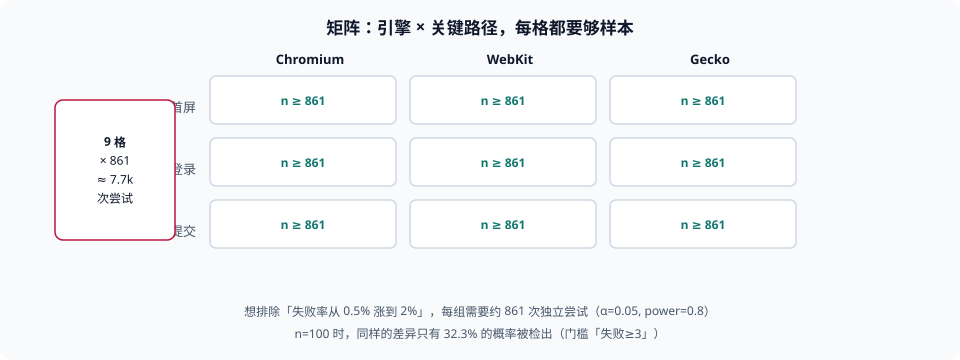

# 兼容回归矩阵

本页判据族 `BBR-A` ~ `BBR-H`，共 8 条。

兼容回归最容易做成两件事之一：**跑一个「主流浏览器都过」的 E2E**，然后宣称兼容性有保障；或者**在发布后靠用户报错**发现某内核不行。前者的问题是没有样本量概念——「跑过了」不构成「没有问题」；后者的问题是不叫回归，叫事故复盘。本页把这件事拆成三块可计算的：**覆盖哪些格子、每个格子要多少样本、怎么在发布前而不是发布后知道**。

::: tip 一句话理解
兼容回归的产出不是「通过率」，是**「在多大的样本上、以多大的把握、排除了多大的差异」**。少了后两个数字，通过率没有意义。
:::



## 一、矩阵的两个维度

| 维度 | 取什么 | 数量控制 | 常见错误 |
| --- | --- | --- | --- |
| 引擎/宿主 | Chromium、WebKit、Gecko，加上「同内核不同外壳」（微信内置、App 内嵌） | 按基线取 3~5 个，不按设备型号 | 用「iPhone 15」当维度，实际差异在内核版本而不在机型 |
| 关键路径 | 首屏渲染、登录、支付/提交、核心列表与详情 | 3~6 条，按业务风险选 | 把全部页面都塞进矩阵，最后只跑首页 |

两个维度相乘就是格子数。**格子数是成本，也是分辨率**：8 个格子意味着 8 份样本，每份都要满足样本量要求。

关于「引擎」这一维有一个必须说清的事实：**Playwright 的 WebKit 不等于 iOS Safari**。它跑在桌面 WebKit 构建上，不做 iOS 的 JIT 限制与系统版本绑定；而 iOS 上所有浏览器（含第三方外壳）都用系统 WebKit，行为随系统版本变化。所以「WebKit 通过」只能说明「大概率不是引擎级 bug」，不能替代真机。

## 二、样本量：先算，再测

「测了 100 次没问题」这句话，可以用二项检验换算成「能以多大把握排除多大的问题」。本机按正态近似算（`α=0.05`、`power=0.8`）：

| 想检出的差异 | 每组需要的独立样本 |
| --- | --- |
| 失败率 0.5% → 2.0% | **861** |
| 失败率 1.0% → 3.0% | **769** |
| 失败率 5.0% → 8.0% | **1,059** |

反方向算一次更直观：**n=100、真实失败率 2%**（也就是每 50 次里有 1 次失败）时：

| 判定门槛 | 报警（检出）概率 | 误报概率（真实失败率 0.5% 时） |
| --- | --- | --- |
| 失败 ≥ 1 次即红 | 86.7% | 39.4% |
| 失败 ≥ 3 次才红 | **32.3%** | 极低 |

这张表解释了团队里最常见的两种错觉：

- **「门槛放松一点，别老误报」** → 门槛设成「≥3 次」时，真实的 2% 失败率只有 32.3% 能被抓到。
- **「一有失败就红」** → 误报率 39.4%，两周内所有人都会开始忽略这条检查。

::: warning 这不是「测试不够努力」
样本量是**统计事实**，不是执行力问题。一个影响 2% 会话的兼容缺陷，在 100 次访问里期望只出现 2 次；要把它与「0.5% 的偶发噪声」区分开，就必须有几百个样本。**要么加样本（自动化、云真机、合成流量），要么承认「这类问题我们靠线上发现」并为此准备回滚**——两者都比「测了 100 次没事」诚实。
:::

## 三、四个格子的成本，与三个省法

| 手段 | 单格成本 | 能覆盖什么 | 不能覆盖什么 |
| --- | --- | --- | --- |
| 本地/CI 的 Playwright（Chromium / Firefox / WebKit） | 低（分钟级） | 语法错误、API 缺失、明显的渲染差异 | iOS 特有行为、真机字体与滚动、外壳限制 |
| 云真机（按分钟计费） | 中 | 真实内核、真实系统版本 | 长尾机型、弱网与低端设备性能 |
| 合成监控（线上定时跑关键路径） | 低（长期） | 发布后的真实可用性、CDN 与网络差异 | 发布前的拦截 |
| 真实用户监控（RUM） | 极低（被动） | 全量用户的真实分布 | 只能事后，且需要足够的采样 |

三个省法，按性价比排序：

1. **把矩阵从「全页面」收窄到「关键路径」**——格子数从几十降到 8，样本量立刻可达。
2. **用「引擎 × 一次」替代「机型 × 多次」**——机型差异 90% 落在内核版本上（这条在本库[移动端 H5 兼容](../../MobileH5/Compatibility/index.md)里有更细的机型矩阵）。
3. **把「通过率」换成「差异清单」**——一次跑完记录「哪些格子有差异」，比反复重跑追求 100% 绿更有信息量。

## 四、灰度的三个档位

| 档位 | 放量 | 观察指标 | 回滚判据 |
| --- | --- | --- | --- |
| 内部 | 员工 / 测试账号 | JS 错误率、白屏率 | 任一关键路径不可用立即回滚 |
| 小流量 | 1%~5% 真实用户 | 分内核的错误率（不是总量） | 某内核错误率显著高于其他内核 |
| 全量 | 100% | 与上一版对比 | 同上，阈值更严 |

第二行的括号是重点：**看总量会被主要内核稀释**。如果 95% 的用户是 Chromium，那么「总量错误率没变」完全可能掩盖「WebKit 用户的错误率翻了三倍」。所以灰度的观察指标必须**按内核分组**，而分组的前提是前端上报里带了内核信息（这属于[异常监控](../../ErrorTelemetry/Overview/index.md)的范畴，本页只提需求）。

## 五、可核对的最小清单

```shell
# 1. 列出当前的 E2E 引擎覆盖（Playwright 项目配置）
grep -rn "projects:" -A 20 playwright.config.ts 2>/dev/null | grep -E "name:|use:" | head -20
# 期望：至少 2 个引擎；只有一个说明矩阵退化成单点

# 2. 查 E2E 是否按引擎分组统计（而不是只报总通过率）
grep -rn "reporter\|json" playwright.config.ts 2>/dev/null | head
# 期望：有可解析的报告输出，能按 project 名分组

# 3. 线上错误是否带内核信息（用于灰度按内核看）
grep -rn "userAgentData\|navigator.userAgent" src 2>/dev/null | head -3
# 期望：上报字段里有内核/版本（仅用于分组统计）

# 4. 发布记录里是否有「按内核分组的错误率」
grep -rn "webkit\|gecko\|chromium" docs 2>/dev/null | head -3
# 期望：能查到历史对比记录
```

## 本页判据


| 判据 | 约定 | 定错了会怎样 | 怎么验证 |
| --- | --- | --- | --- |
| `BBR-A` | 矩阵维度是「引擎/宿主 × 关键路径」，不用机型当维度 | 格子数爆炸且分辨率低 | 配置或计划里能看到两个维度 |
| `BBR-B` | 每个格子写明样本量，且样本量能对应到「想排除多大的差异」 | 「跑过了」无法支撑任何结论 | 有目标差异与 n 的对应表（可复算） |
| `BBR-C` | 报告按引擎分组统计，不只报总通过率 | 主要内核稀释掉长尾内核的退化 | 报告可解析且含 project 维度 |
| `BBR-D` | 明确 Playwright WebKit ≠ iOS Safari 的边界 | 用桌面 WebKit 通过替代真机结论 | 计划里有真机/云真机的补充项 |
| `BBR-E` | 灰度观察指标按内核分组，阈值分档 | 某个内核退化被总量掩盖 | 灰度看板有内核维度 |
| `BBR-F` | 关键路径覆盖首屏、登录、核心提交等业务风险点 | 矩阵全绿但核心流程在旧内核不可用 | 清单里能对上业务关键动作 |
| `BBR-G` | 有回滚判据与回滚演练记录 | 发现问题后无法快速恢复 | 发布单里有判据与演练日期 |
| `BBR-H` | 兼容缺陷的线上发现通道有兜底（错误上报 + 白屏检测） | 只能等用户投诉 | 有对应告警规则或采样方案 |

## 验证方式

```shell
# 1. 看 E2E 引擎覆盖
grep -c "name:" playwright.config.ts 2>/dev/null
# 期望：≥ 2

# 2. 复算「100 次样本能查出 2% 失败率吗」（纯数学，无需环境）
python3 - <<'PY'
import math
def power(n, k, p):
    return sum(math.comb(n, i) * p**i * (1-p)**(n-i) for i in range(k, n+1))
print("n=100, p=2%, 门槛>=1:", round(power(100, 1, 0.02)*100, 1), "%")
print("n=100, p=2%, 门槛>=3:", round(power(100, 3, 0.02)*100, 1), "%")
print("n=861, p=2%, 门槛>=14:", round(power(861, 14, 0.02)*100, 1), "%")
PY
# 期望：约 86.7 / 32.3 / 80 左右（后一项随门槛取值浮动）

# 3. 看本页判据族定义完整
grep -c 'BBR-[A-H]' docs/Frontend/BuildBaseline/Regression/index.md
# 期望：≥ 8
```

## 参考资料

- [Playwright — 浏览器与引擎说明](https://playwright.dev/docs/browsers)
- [web.dev — Baseline 与目标浏览器集](https://web.dev/baseline)
- [MDN — 浏览器兼容性数据（BCD）](https://github.com/mdn/browser-compat-data)
- [web-platform-tests — 跨引擎一致性测试套件](https://github.com/web-platform-tests/wpt)
- [本册目录页](../index.md)
