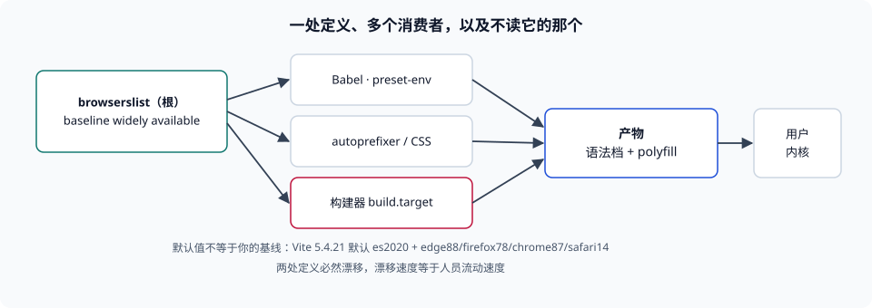

# 目标浏览器清单：把「支持」写成一条查询

本页判据族 `BBT-A` ~ `BBT-H`，共 8 条。

基线这件事最容易做错的地方不是「选哪一档」，而是**写在哪**。写在一份没人读的文档里，工具链完全不知道；写在 `package.json` 的 `browserslist` 字段里，Babel、autoprefixer 会读，但构建器的 `target` 不一定读；写在构建器的 `target` 里，IDE 与评审看不见。本页把「基线」落成一条**可执行、可打印、可复算**的查询，并给出四种最贵写法各自的失败形态。

::: tip 一句话理解
目标浏览器清单的合格标准只有一条：**敲一条命令就能打印出「到底包含哪些浏览器版本」**。打印不出来，它就不是清单，是愿望。
:::



## 一、四种写法，四种失败

| 写法 | 谁读它 | 失败形态 | 本册建议 |
| --- | --- | --- | --- |
| 文档里一句「支持主流浏览器」 | 人（也许） | 无任何工具读，等于没定 | 删除，改写成查询 |
| `package.json` 的 `browserslist` 字段 | Babel、autoprefixer、部分构建器 | 构建器的 `target` 不读它，产物比声明更「新」 | 保留为**唯一定义**，并让构建器引用它 |
| 构建器 `target` 字符串 | 构建器 | 与 `browserslist` 不同步，两处漂移 | 从 `browserslist` 派生，不手写第二份 |
| CI 脚本里手写版本号 | 那个脚本 | 升级基线时漏改，检查变成安慰剂 | 检查逻辑读同一处定义 |

第三种与第一种的组合最常见，也最危险：`package.json` 写着 `> 0.5%, last 2 versions`，而 Vite 的 `build.target` 默认是 `es2020` + 四个下限（本机 Vite 5.4.21 实读：`es2020`、`edge88`、`firefox78`、`chrome87`、`safari14`）。**构建产物听 `target` 的，类型与评审听 `browserslist` 的**，于是「我们支持到 Chrome 87」和「产物里全是 `es2020` 语法」同时成立，直到有人在 Chrome 80 上打开。

## 二、查询语法：能组合，但组合有代价

`browserslist` 的查询是一组用 `and` / `or` / `not` 连接的条件。仓库里出现频率最高的四个片段，含义经常被记反：

| 片段 | 真实含义 | 容易记成 |
| --- | --- | --- |
| `defaults` | `> 0.5%`、`last 2 versions`、`Firefox ESR`、`not dead` 四者的并集 | 「浏览器默认支持」 |
| `> 0.5%` | **全球**使用量占比大于 0.5% 的版本 | 「国内占比」——基数不同结果差很多 |
| `last 2 versions` | 每个浏览器**最近两个已发布版本** | 「最近两个大版本」或「所有浏览器的最后两个」 |
| `not dead` | 排除官方已停止支持的版本 | 「排除老版本」——它不按年龄算 |

`defaults` 的三个隐含后果值得单独说清：

1. **它随数据漂移。** `> 0.5%` 的成员每季度都在变，`last 2 versions` 每次内核发布都会变。用 `defaults` 的项目，基线是**浮动的**，构建产物会随一次 `pnpm install` 而改变——这在「同样的提交为什么产物变了」的排查里是常见答案。
2. **它包含移动端。** 全球占比里 Android WebView 与 Android Chrome 的权重很高，所以 `defaults` 的语法档通常落在 `es2017`~`es2020` 之间，而不是你以为的「最新」。
3. **它不包含「小众但重要」的宿主。** 企业内网固定版本浏览器、某些车机与一体机、部分嵌入式的 Chromium 都不在统计里，占比低于阈值就会被 `> 0.5%` 排除。**如果业务真的要支持它们，必须显式 `or` 进去。**

与 `defaults` 相对的是**档位查询**：`baseline widely available` 表示「所有核心浏览器都支持，且互操作已满 30 个月」（核心浏览器集为 Chrome 桌面与 Android、Edge、Firefox 桌面与 Android、Safari macOS 与 iOS）。它的好处是不写版本号、语义稳定；代价是**它也是一个浮动目标**（30 个月前滚），只是滚动速度比 `last 2 versions` 慢得多。

::: danger 四个必须避免的写法
1. **`last 2 versions` 单独使用**——它会包含一些几乎没人用的浏览器的最后两个版本，却**不保证**覆盖你的真实用户。**正确做法**：以 `defaults` 或 `baseline widely available` 为底，再按业务加 `or`。
2. **`not ie 11` 当作「已经不支持 IE」**——如果基线里本来就没有 IE，这条 `not` 是无操作；如果有（例如通过 `> 0.5%` 带进来的），它只在这一处生效，而 `build.target` 仍按自己的档位产出。**正确做法**：删掉 IE 的方式是改定义处，不是到处加 `not`。
3. **在不同包里写不同的 `browserslist`**——monorepo 里子包的字段会覆盖根字段，于是「同一个仓库两个基线」。**正确做法**：只在根写一处，子包不写。
4. **把 `engines.node` 当成浏览器基线**——`engines` 约束的是**运行构建的 Node 版本**，与产物目标无关。**正确做法**：两件事分开写，并在评审里分开讨论。
:::

## 三、宽一档要付多少字节

「把基线放窄一点更安全」是对的，但安全是要付钱的。本机用同一份 44 行源码（含可选链、空值合并、类字段、`async`、异步生成器）分别编译到不同档位，压缩后体积如下（esbuild 0.21.5，`--minify`，gzip 级别 9）：

| 目标档 | raw | gzip | 相对 `es2022` |
| --- | --- | --- | --- |
| `es2015` | 1,864 B | 983 B | **2.30×** |
| `es2016` | 1,864 B | 983 B | 2.30× |
| `es2017` | 1,636 B | 916 B | 2.14× |
| `es2018` | 1,137 B | 655 B | 1.53× |
| `es2019` | 1,137 B | 655 B | 1.53× |
| `es2020` | 1,012 B | 606 B | 1.42× |
| `es2022` | 630 B | 428 B | 1.00× |

两个可直接用的结论：

- **`es2015` → `es2020` 的差价是 62.2%（983 → 606）。** 这段差价几乎全部来自「类与 `async` 的降级重写」，不是压缩器的问题。
- **`es2016` 与 `es2015` 完全同体积、`es2019` 与 `es2018` 完全同体积**：说明这两档之间没有你用到的新语法，抬档是**免费**的。抬档前先查「这一档到底解锁了什么」，很多时候可以从 `es2015` 直接跳到 `es2017`。

## 四、数据版本：比查询更容易过期的东西

查询是一条表达式，它的求值依赖**数据**（`caniuse-lite` 之类的数据集）。数据有三个特性，决定了它必须进维护流程：

| 特性 | 后果 | 判据 |
| --- | --- | --- |
| 数据集按周更新 | 锁死版本会让新特性被误判为「已支持」，从而**漏补 polyfill** | 数据包能被 `pnpm outdated` 看见，且升级不需要动业务代码 |
| 数据带「未来版本」占位 | `last 1 version` 可能包含尚未广泛部署的版本 | 需要「保守」时用档位查询，不用 `last` |
| 数据是**全球**口径 | 与本地真实流量结构不同 | 用自有埋点校正一次，把差异写进基线文件 |

第三行是很多团队忽略的一步：`> 0.5%` 是全球占比，而你的用户可能集中在某个地区或某个行业。校正方法很朴素——把自有埋点的 UA 分布与查询结果对一次，把「我们有 8% 用户在这个版本、而查询里没有」这类差异显式 `or` 进基线，并注明来源与核对日期。

## 五、把基线钉进 CI

基线要能挡住人，必须有一条会在 PR 上变红的检查。三条最小可用的：

```shell
# 1. 打印解析结果（离线即可，读本地数据）
pnpm exec browserslist
# 期望：一列「浏览器 版本」，条数稳定；若报 "Cannot find module"，说明数据包没装

# 2. 断言产物里没有超出档位的语法（以 es2020 为例，禁 ?. 与 ?? 之外的新语法）
grep -rnE '\?\?=|\|\|=|&&=' dist/assets/*.js && echo "出现逻辑赋值，超出 es2020" && exit 1
# 期望：无输出（未超出档位）

# 3. 记录基线的指纹，防止「悄悄变了」
pnpm exec browserslist | sha256sum
# 期望：与上一次发布记录的指纹比对；不同即需在 PR 里说明原因
```

第 3 条是很多团队缺的那一环：它把「基线漂移」从**每次安装依赖时的静默变化**变成**一次需要解释的差异**。

## 本页判据


| 判据 | 约定 | 定错了会怎样 | 怎么验证 |
| --- | --- | --- | --- |
| `BBT-A` | 基线在仓库里只有一处定义（根 `browserslist` 或构建器 target），子包不覆盖 | monorepo 内两套基线，产物与文档不一致 | 全仓检索 `browserslist` 字段，非根位置为 0 |
| `BBT-B` | 基线必须能被一条命令打印成「浏览器 + 版本」列表 | 基线只是文字，工具与人都无法核对 | `pnpm exec browserslist` 有输出且条数稳定 |
| `BBT-C` | 不使用裸 `last 2 versions`，必须与档位或占比条件组合 | 覆盖了没人用的版本，却漏掉真实用户 | 定义处能看到 `defaults` / `baseline ...` 或显式版本条件 |
| `BBT-D` | `engines.node` 与浏览器基线分开维护，互不引用 | 升级 Node 被误当成抬档，或反之 | 两处字段各自存在，注释说明用途 |
| `BBT-E` | 基线变更要在 PR 里说明「为什么抬档」，并更新指纹 | 抬档无记录，故障无法归因 | 发布记录里有基线指纹与变更说明 |
| `BBT-F` | 兼容数据包（`caniuse-lite` 等）纳入常规升级并可见 | 数据过期导致漏补 polyfill | `pnpm outdated` 中包含该包 |
| `BBT-G` | 用自有流量的 UA 分布校正一次全球口径，差异显式写进基线 | 覆盖了全球 0.5%，却漏掉本地 8% | 基线文件里有校正记录（日期 + 差异项） |
| `BBT-H` | 不得用 UA 版本号在运行时替代基线判断 | 同内核不同外壳判错、版本冻结导致误判 | 代码里无基于 UA 的版本分支（统计用途除外） |

## 验证方式

```shell
# 1. 打印本仓库的基线解析结果
pnpm exec browserslist 2>/dev/null | head -20
# 期望：形如 "chrome 141" / "safari 18.2" 的列表；无输出说明基线未定义

# 2. 检查是否存在多处定义
grep -rn --include='package.json' '"browserslist"' . | grep -v node_modules | wc -l
# 期望：1（只有根包定义）

# 3. 复算「宽一档的字节代价」（需要本机 esbuild，路径按实际安装版本调整）
printf 'const a={b:{c:1}};class K{#x=1;get x(){return this.#x}}\nexport const y=a?.b?.c;export default K;\n' > /tmp/bb-probe.js
for t in es2015 es2020 es2022; do
  node_modules/.pnpm/@esbuild+win32-x64@0.21.5/node_modules/@esbuild/win32-x64/esbuild.exe \
    /tmp/bb-probe.js --bundle --minify --target=$t --outfile=/tmp/bb-$t.js
  echo -n "$t "; gzip -9 -c /tmp/bb-$t.js | wc -c
done
# 期望：es2015 明显大于 es2020，es2020 大于 es2022（比值随源码而变，方向不变）

# 4. 看本页判据族定义完整
grep -c 'BBT-[A-H]' docs/Frontend/BuildBaseline/Targets/index.md
# 期望：≥ 8
```

## 参考资料

- [browserslist — 完整查询语法](https://github.com/browserslist/browserslist#full-list)
- [browserslist — `baseline widely available` 查询](https://github.com/browserslist/browserslist#baseline)
- [web.dev — Baseline 三档与核心浏览器集](https://web.dev/baseline)
- [caniuse — 使用量数据口径说明](https://caniuse.com/usage-table)
- [Vite — `build.target`](https://vite.dev/config/build-options#build-target)
- [本册目录页](../index.md)
