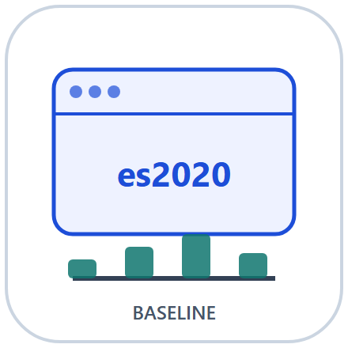
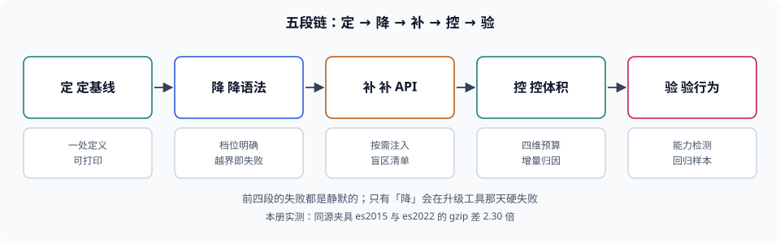

# 构建产物与运行时兼容基线

<p style="text-align:center;"></p>

「这份代码能在用户机器上跑吗」这个问题，答案不在源码里，而在**产物**里：源码写的是你想要的语法与 API，产物里剩下的是目标浏览器**恰好认识**的那一部分。中间那一步（降级到哪一档、补哪些 API、体积控制在多少、怎么证明它真的能跑）如果没人负责，就会出现本册要解决的三种典型状态：代码在开发者机器上全绿、在 CI 里全绿、在 3% 的用户那里白屏，而监控只报「JS 错误数轻微上升」。

本册讲的是**从源码到用户浏览器之间那段确定性**：基线定在哪、语法怎么降、API 怎么补、体积怎么卡、行为怎么验。至于「构建工具本身怎么配」（Vite / Webpack / esbuild 的插件、HMR、代理），属于[构建工具](../Basic/BuildTool/index.md)那一册；至于「移动端 H5 的机型与内核差异」，属于[移动端 H5](../MobileH5/Compatibility/index.md)。

::: info 本册定位与读数口径
适用对象：要为「产物能否在目标用户群里跑」负责的前端工程师、基建工程师与质量工程师；读者已经会跑 `pnpm build`，但需要在评审里回答「我们支持到哪一档、凭什么是这一档、超了怎么发现」。

事实已按官方来源与**本机实读**核对（2026-11-12）：Baseline 的三档定义与「widely available = 互操作满 30 个月」取自 [web.dev Baseline](https://web.dev/baseline)；`browserslist` 查询语法与 `baseline widely available` 支持取自 [browserslist 仓库](https://github.com/browserslist/browserslist)；HTTP 缓存语义取自 [RFC 9111](https://www.rfc-editor.org/rfc/rfc9111) 与 [RFC 8246](https://www.rfc-editor.org/rfc/rfc8246)（`immutable`）；子资源完整性取自 [W3C SRI](https://www.w3.org/TR/SRI/)。

本册的**体积、降级与缓存命中读数全部来自本机实测**（Node v22.22.2 / esbuild 0.21.5 / Vite 5.4.21，Python 3.13 计算 gzip 与哈希，固定种子 `20261112`），脚本不入库、读者可按各页命令复现。涉及「某个浏览器版本支持什么」的结论一律以 caniuse / Baseline 的数据为准，本册**不写死浏览器版本号**——写死的版本号是这类文档最快过期的地方。
:::

## 一、为什么单独开一册：兼容失败是「静默」的

本库已经有[构建工具](../Basic/BuildTool/index.md)、[ECMAScript](../Basic/ECMAScript/ES6/Overview/index.md)、[移动端 H5 兼容](../MobileH5/Compatibility/index.md)、[测试](../Testing/index.md)四册写到边上，但它们各自只覆盖一段：

| 已有专题 | 它回答的问题 | 与本册的边界 |
| --- | --- | --- |
| [构建工具](../Basic/BuildTool/index.md) | Vite / Webpack / esbuild 怎么装、怎么配、怎么快点 | 它讲**工具怎么用**；本册讲**这些工具的 target 该定成什么、定错了怎么发现** |
| [ECMAScript 6](../Basic/ECMAScript/ES6/Overview/index.md) | 新语法怎么写、语义是什么 | 它讲**语法本身**；本册讲**这些语法在降级后还剩下多少语义** |
| [移动端 H5 兼容](../MobileH5/Compatibility/index.md) | 机型、内核、真机排障 | 它讲**设备面**；本册讲**同一份产物在不同能力面上的行为差异** |
| [测试](../Testing/index.md) | 单测、集成、E2E 怎么写 | 它讲**用例怎么写**；本册讲**兼容回归要多少样本才够判定** |

逐词检索（`git grep`，2026-11-12，限定 `docs/**/*.md` 与 `project/**/*.md`）：`browserslist` 命中 **11 篇**、`polyfill` **13 篇**、`bundle 预算`/`体积预算` **0 篇**、`Baseline`（指 Web 平台基线）**0 篇**、`immutable` **2 篇**。打开逐一核对：那 11 处 `browserslist` 全部是「配一下就行」的**一行配置**（`package.json` 里加个字段），13 处 `polyfill` 里 11 处是「需要 polyfill」的**结论句**，**没有一处回答「定到哪一档、凭什么、超了怎么拦、怎么证明它真的能跑」**。

::: warning 判「已覆盖」要看它停在哪一层
`polyfill` 命中 13 篇，看着像写过了。实际都停在「低版本浏览器需要 polyfill」这句结论上：没有一篇给出「补哪几个 API 要多少字节」「按需注入和全量注入差多少」「有些东西 polyfill 根本补不了」这三件事的答案。**空白不在主题，在层**——本册写这一层。
:::

## 二、五段链：定 → 降 → 补 → 控 → 验



| 段 | 做什么 | 安静的失败 | 本册读数 |
| --- | --- | --- | --- |
| 定 | 定支持面：哪些浏览器、哪一档能力，写进仓库 | 没有基线，只有「大家都装最新版」的口头共识 | 同一份 44 行源码，`es2015` 与 `es2022` 的 gzip 差 **2.30 倍**（983 B vs 428 B） |
| 降 | 语法降级到目标档 | 降不下去时工具**直接失败**，但没人看 warning | esbuild 0.21.5 对 `es5` **完全降不了**：class / const / let / async 全部报错 |
| 补 | API 补齐（polyfill） | 补了 80% 就当补完了，剩下的在旧内核里抛 `undefined is not a function` | 4 条最小 polyfill 的 gzip 合计 **300 B**，而单片压缩反而**变大**（101 B → 113 B） |
| 控 | 体积预算与门禁 | 只报总量，不报增量；预算永远刚好超一点点 | 改一个叶子模块：单包 **100%** 缓存失效、按路由分包 **11.2%** |
| 验 | 兼容回归与灰度 | 用 100 次访问判「有没有问题」，结论随机 | 失败率 0.5% → 2.0% 要检出需 **n = 861**；n=100 时检出率仅 **32.3%** |

五段里**四段的失败是安静的**：基线没定不报错、polyfill 漏了两个不报错、体积涨了 8% 不报错、回归样本不足只是结论不可信。只有「降」这一段会硬失败——而且往往失败在**升级工具的那一天**，而不是写代码的那一天。

## 三、三个「支持」

「我们支持 Chrome」这句话，在四个不同场合指的其实是四件事，混用是兼容类事故的第一来源：

| 名字 | 定义 | 谁决定 | 典型偏差 |
| --- | --- | --- | --- |
| 声明基线 | 仓库里写下的支持面（`browserslist` 字段或 Baseline 档位） | 团队约定 | 写了但没人读——工具读的是另一处配置 |
| 语法基线 | 产物里实际出现的语法档（`target` 决定） | 构建工具的 target | 比声明基线**更宽**时，旧内核直接语法错误、整包不执行 |
| API 基线 | 产物运行时会调用的内置 API 集合 | 源码用到的 API + polyfill 覆盖 | 语法降级了但 API 没补，报的是运行时 `TypeError` |
| 行为基线 | 同一段代码在各内核里**结果一致**的那部分 | 规范 + 内核实现 | 语法与 API 都够，但 `Intl`、日期、排序、`scroll` 行为不同 |

第一列与第二列的漂移最常见：`package.json` 写了 `browserslist`，而构建器用的是自己的 `target` 默认值（本机 Vite 5.4.21 的默认值是 `es2020` 加四个浏览器下限，取自 `dist/node/constants.js` 的 `ESBUILD_MODULES_TARGET`）。两处不一致时，**产物听工具的，文档听仓库的**，于是「我们支持 Safari 14」这句话会在某台机器上变成白屏。

## 四、三条贯穿全册的主张

1. **基线是一个可执行的文件，不是一句共识。** 它必须落在仓库里（`browserslist` 字段、`build.target`、CI 的预算阈值），且**只能有一处定义**，其余位置引用它。两处定义必然漂移，漂移的速度等于人员流动的速度。
2. **降级有硬边界，越界要显式失败。** 语法降级不是万能的：本机 esbuild 0.21.5 连 `const` 都降不到 `es5`。要在低档上跑就必须换工具（Babel / SWC / tsc），而不是把 target 改小之后祈祷。**工具降不下去时，报错比「静默保留新语法」好一万倍**——后者是「旧内核整包白屏」的唯一来源。
3. **体积与缓存是一笔账，不能只看第一行。** 首屏体积降 40%，可能让缓存命中率从 89% 掉到 62%（切分越细，改一个模块失效的面越大或越小，取决于它被几条路由共享）。本册把这两件事放在同一张表里算（见[体积预算](Budget/index.md)与[分发与缓存](Delivery/index.md)）。

::: tip 一句话理解
构建工具册回答「怎么把源码变成产物」，本册回答「**这份产物凭什么能在用户的浏览器上跑，以及它跑不了的时候你怎么先知道**」。
:::

## 五、与其他专题的分工

| 邻页 | 它回答什么 | 本册不重复什么 |
| --- | --- | --- |
| [构建工具 · Vite 构建优化](../Basic/BuildTool/Vite/BuildOptimize/index.md) | 怎么让构建更快、chunk 更合理 | 不讲插件与 HMR，只讲 target 与体积口径 |
| [构建工具 · Webpack 配置](../Basic/BuildTool/Webpack/Config/index.md) | `babel-loader`、`target` 字段怎么配 | 不讲 loader 链，只讲「配置写在哪、谁读它」 |
| [ECMAScript 6 概述](../Basic/ECMAScript/ES6/Overview/index.md) | 新语法的语义 | 不讲语法，只讲降级后的语义残留（class 字段、私有字段） |
| [移动端 H5 兼容](../MobileH5/Compatibility/index.md) | 机型与内核矩阵、真机排障 | 不讲设备，只讲同一产物在不同能力面上的降级层级 |
| [前端测试](../Testing/index.md) | 单测 / 集成 / E2E 的组织 | 不讲用例写法，只讲兼容回归的样本量与引擎覆盖 |
| [CDN 原理](../../Ops/EdgeCDN/CDNPrinciple/index.md) | 边缘节点、回源、缓存键 | 不讲边缘架构，只讲产物文件名与缓存头的配对 |
| [异常监控](../ErrorTelemetry/Overview/index.md) | 错误怎么采、怎么聚合 | 不讲采集，只讲「怎么在发布前而不是发布后知道」 |

## 六、版本目录：按「产物形态的代际」拆两条线

本主题存在**同一份源码、两套产物形态**，且两套形态的判据不同（一条要「能在没有 `const` 的内核里跑」，另一条要「不为用不到的内核付字节」）。按 `AGENTS.md` 第 3 节「大版本管理」建两个版本目录，旧内容原样保留、标注状态、不覆盖：

| 目录 | 覆盖内容 | 维护状态 | 新项目是否使用 |
| --- | --- | --- | --- |
| [ES5 兼容线（仅存量项目使用）](LegacyES5/index.md) | Babel + core-js `entry` 注入、`module`/`nomodule` 双包、`useDefineForClassFields: false`、浏览器下限到 IE11 时代的写法 | **仅存量项目使用 · 已停止新增** | 否，只用于维护存量与做迁移映射 |
| [现代基线（当前主线）](ModernES2020/index.md) | `baseline widely available` + `es2020` 单包、按需 polyfill、体积预算与缓存配对 | **当前主线 · 持续维护** | 是 |

三条理由写在这里，避免后来者误判：

1. **换代的是产物形态，不是判据。** 本册 11 族判据（基线、查询、降级、补齐、预算、检测、分发、回归、实战……）在两条线上都成立，按「问题」切成正文；若按产物形态把 11 章各抄一遍，八成正文会重复。
2. **真正需要版本目录的是「同一件事两套写法」。** ES5 线的双包是 `module` + `nomodule` 两份产物、现代线是单包；同一个「兼容 Safari 14」在两套里分别落在 `target` 与 `polyfill 清单` 上——这不是「加个配置」，是两套交付物。
3. **不是所有差异都值得开目录。** `es2020` 与 `es2022` 的差别（顶层 `await`、`.at()`、`Object.hasOwn`）只是**能力增减**，写在[语法降级](Transpile/index.md)一页里用表格说明即可，不需要第三个目录。

::: warning 旧版目录的处置纪律
`LegacyES5/` 的内容不改写、不删除、不与新版合并；目录页与侧边栏同时保留入口，并在该页顶部标注「仅存量项目使用 · 已停止新增」。需要新增能力时一律写进 `ModernES2020/`，需要迁移说明时只在旧页补一张映射表。
:::

## 七、本册结构与判据族

| 页 | 判据族 | 这一族管什么 | 条数 |
| --- | --- | --- | --- |
| [总览：三条基线](./Overview/index.md) | `BBI-A` ~ `BBI-H` | 边界、术语与判定语言 | 8 |
| [目标浏览器清单](./Targets/index.md) | `BBT-A` ~ `BBT-H` | 基线写在哪、查询怎么写、怎么防漂移 | 8 |
| [语法降级的硬边界](./Transpile/index.md) | `BBJ-A` ~ `BBJ-H` | 降到哪一档、降不下去怎么办 | 8 |
| [API 补齐与注入策略](./Polyfill/index.md) | `BBP-A` ~ `BBP-H` | 补什么、怎么补、补不了的怎么办 | 8 |
| [产物体积预算](./Budget/index.md) | `BBG-A` ~ `BBG-H` | 预算怎么定、卡在哪一步、按什么数卡 | 8 |
| [特性检测与渐进增强](./FeatureDetect/index.md) | `BBH-A` ~ `BBH-H` | 运行时判能力，而不是猜版本 | 8 |
| [分发、缓存头与部署原子性](./Delivery/index.md) | `BBE-A` ~ `BBE-H` | 文件名、缓存头、压缩与切换顺序 | 8 |
| [兼容回归矩阵](./Regression/index.md) | `BBR-A` ~ `BBR-H` | 引擎覆盖、样本量与灰度 | 8 |
| [实战：从双包迁到单包](./Practice/index.md) | `BBA-A` ~ `BBA-H` | 可复跑的迁移与回滚 | 8 |
| [ES5 兼容线（存量）](./LegacyES5/index.md) | `BBL-A` ~ `BBL-H` | 旧写法、维护边界与迁移映射 | 8 |
| [现代基线（当前主线）](./ModernES2020/index.md) | `BBM-A` ~ `BBM-H` | 当前基线与三道必设门禁 | 8 |

全册共 **11 族 / 88 条判据**。判据表列序固定为「页 | 判据族 | 这一族管什么 | 条数」，它是巡检契约的一部分，不是排版自由。

## 八、如何验证本册

所有命令都在仓库根目录执行；实战页的脚本可整段复制后单独运行，不依赖仓库内任何文件。

```shell
# 1. 看 11 族判据是否都能在本册里找到定义
grep -oE 'BB[A-Z]-[A-H]' docs/Frontend/BuildBaseline/*/index.md | sort -u | wc -l
# 期望：88

# 2. 看每页是否都声明了判据族
grep -l '本页判据族' docs/Frontend/BuildBaseline/*/index.md | wc -l
# 期望：11

# 3. 看每页是否都有配图
grep -l 'assets/bb-' docs/Frontend/BuildBaseline/*/index.md | wc -l
# 期望：11
```

```shell
# 4. 站点构建（含死链检查）
pnpm docs:build
# 期望：build complete，0 条死链

# 5. 只跑本册相关巡检
python3 utils/audit/judgesumcheck.py --root docs/Frontend/BuildBaseline
python3 utils/audit/svgviewboxcheck.py
python3 utils/audit/svgrefcheck.py
# 期望：三条都 EXIT=0
```

## 参考资料

- [web.dev — Baseline：三档定义与核心浏览器集](https://web.dev/baseline)
- [browserslist — 查询语法与 `baseline widely available`](https://github.com/browserslist/browserslist)
- [MDN — 浏览器兼容性数据（BCD）](https://github.com/mdn/browser-compat-data)
- [Vite — `build.target` 与 `@vitejs/plugin-legacy`](https://vite.dev/config/build-options)
- [Babel — `@babel/preset-env` 的 `targets` / `useBuiltIns`](https://babeljs.io/docs/babel-preset-env)
- [core-js — 按需注入与 stable / proposals](https://github.com/zloirock/core-js)
- [RFC 9111 — HTTP Caching](https://www.rfc-editor.org/rfc/rfc9111)
- [RFC 8246 — HTTP Immutable Responses](https://www.rfc-editor.org/rfc/rfc8246)
- [W3C — Subresource Integrity](https://www.w3.org/TR/SRI/)
- [本库：构建工具](../Basic/BuildTool/index.md)
- [本库：移动端 H5 兼容](../MobileH5/Compatibility/index.md)
