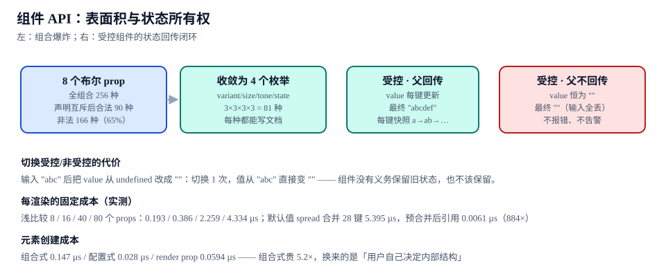

# 组件 API：表面积与状态所有权

本页判据族 `DSA-A` ~ `DSA-H`，共 8 条。

一个组件的 API 有两条独立的成本线：**表面积**（有多少种用法要写文档、要测）与**状态所有权**（值存在谁那里）。前者决定文档与测试的工作量，后者决定「用户输入半天突然全丢」这类事故会不会发生。两条线都可以量化，且量化结果经常与直觉相反。

::: tip 一句话理解
布尔 prop 是一种**乘法**：8 个布尔就是 256 种组合，而其中只有 90 种是合法的。把布尔换成互斥的枚举，256 就变成 81，且每一种都能写进文档。
:::



## 一、表面积：布尔 prop 的乘法爆炸

以本专题那 12 个组件里的 `Button` 为例，最初的 8 个布尔 prop 是：`primary`、`secondary`、`ghost`、`outline`、`small`、`large`、`loading`、`block`。

| 计法 | 数量 | 说明 |
| --- | --- | --- |
| 全组合 | **256** | 2⁸，任意布尔可同时为真 |
| 声明互斥后合法 | **90** | 声明了「四种 variant 只能选一个」「两种 size 只能选一个」 |
| 非法组合 | **166**（**65%**） | 同一时刻可以同时 `primary && ghost && small && large` |

65% 的组合是非法的，这个比例意味着：**文档不可能写全**（写 256 行没人看），**测试不可能测全**（测 90 种已是上限），而用户仍然可以写出那 166 种非法组合——组件要么报错，要么静默取第一个匹配的样式。

改成 4 个互斥枚举之后：

```tsx [packages/react/src/Button.tsx]
type Variant = "solid" | "outline" | "ghost"
type Size = "sm" | "md" | "lg"
type Tone = "neutral" | "accent" | "danger"
type State = "idle" | "loading" | "disabled"

export interface ButtonProps {
  variant?: Variant   // 3
  size?: Size         // 3
  tone?: Tone         // 3
  state?: State       // 3
  block?: boolean     // 剩下的最后一个布尔：真·二值
}
```

| 计法 | 数量 | 说明 |
| --- | --- | --- |
| 全组合 | 3 × 3 × 3 × 3 × 2 = **162** | 枚举维度相乘，再加唯一保留的布尔 |
| 需要写文档的组合 | **81**（不含 `state` 维度） | 每种 variant/size/tone 都能写一行表格 |
| 类型系统能拦住的非法组合 | 全部 | `variant="primary"` 直接编译失败 |

::: tip 判断一个布尔该不该变成枚举
问一句：**这个布尔与另一个布尔能否同时为真且都有意义？** 能，保留布尔（`block`、`disabled`）；不能（互斥的视觉变体、互斥的尺寸），必须合并成枚举。
:::

## 二、状态所有权：受控的三种结局

受控组件的契约是「值由父传进来，变化由回调传出去」。它有三种结局，只有第一种是设计意图：

| 结局 | 父组件的行为 | 用户看到 | 有没有报错 |
| --- | --- | --- | --- |
| **正常** | 收到 `onChange` 就 `setValue` | 输入 `abcdef` 逐个出现 | 无 |
| **父不回传** | 只在 `onChange` 里 `console.log`，不回写 `value` | 输入框**永远为空**，按键无反应 | **无**，也没有警告 |
| **父回传但延迟** | 异步校验后才 `setValue` | 输入卡顿、光标跳位 | 无 |

第二种是设计系统里最常见的事故：组件本身完全正确，父组件少写了一行 `setValue`，界面表现为「输入框坏了」，排查方向通常错在组件上。

```tsx [packages/react/src/Input.tsx]
export function Input({ value, onChange, ...rest }: InputProps) {
  const isControlled = value !== undefined
  if (process.env.NODE_ENV !== "production" && isControlled && !onChange) {
    console.warn("[Input] 传了 value 但没有 onChange：输入将无法修改")
  }
  return (
    <input
      {...rest}
      value={isControlled ? value : undefined}
      defaultValue={isControlled ? undefined : rest.defaultValue}
      onChange={onChange}
    />
  )
}
```

::: danger 切换受控/非受控的代价，比想象中大
1. **切换一次就丢一次值**：输入 `"abc"` 之后把 `value` 从 `undefined` 改成 `""`，输入框内容立刻变成空——组件**没有义务**保留旧状态，React 也会重新挂载内部的 DOM 值来源。
2. **不要在同一个组件生命周期里切换**：`value={data?.name}` 这种写法，`data` 加载完成前是 `undefined`（非受控），加载后变成字符串（受控）——首屏那几百毫秒里用户如果已经在输入，值会被覆盖。
3. **正确做法**：要么一开始就 `value={data?.name ?? ""}`（始终受控），要么整块 `key` 换实例（明确重置语义）。
:::

## 三、每渲染的固定成本：props 越多越贵

组件每次渲染都要做一次 props 比较（`memo` 的浅比较）与一次默认值合并。这两件事的成本随 props 数量上升，且**默认值合并比比较贵得多**。

| 场景 | 读数 | 说明 |
| --- | --- | --- |
| 浅比较 8 个 props | **0.193 µs** | 基线 |
| 浅比较 16 个 props | **0.386 µs** | 线性 |
| 浅比较 40 个 props | **2.259 µs** | 5.9× / 8 props 的 11.7 倍 |
| 浅比较 80 个 props | **4.334 µs** | 22.5× |
| 默认值合并（每次 spread 28 键） | **5.395 µs** | 每次渲染都做一次对象展开 |
| 默认值预合并（模块级常量 + 引用） | **0.0061 µs** | **884×** 差距 |

关键结论不是「组件要少 props」，而是：**默认值不要写在渲染路径里**。

```tsx [packages/react/src/Button.tsx]
// 反例：每次渲染都新建对象并 spread 合并
function ButtonBad({ variant = "solid", size = "md", tone = "neutral", ...rest }: ButtonProps) {
  const props = { variant, size, tone, ...rest }   // 5.395 µs / 次
  return <button {...props} />
}

// 正例：默认值在模块级冻结，渲染路径只做引用替换
const DEFAULTS = Object.freeze({ variant: "solid", size: "md", tone: "neutral" } as const)
function Button({ variant, size, tone, ...rest }: ButtonProps) {
  const v = variant ?? DEFAULTS.variant
  const s = size ?? DEFAULTS.size
  const t = tone ?? DEFAULTS.tone
  return <button data-variant={v} data-size={s} data-tone={t} {...rest} />
}
```

::: warning 这三个读数怎么用
它们是**单次渲染的固定开销**，不是「组件慢了」的证明。一个列表渲染 1,000 个按钮时，5.395 µs × 1,000 = 5.4 ms，占 60 fps 帧预算（16.7 ms）的 **32%**——这才是它成为问题的规模。如果你的组件一次只渲染十几个，这一项可以忽略，优先优化别处。
:::

## 四、元素创建成本：组合、配置、render prop

同一个外观的三种写法，创建成本差 5 倍，换来的是不同的能力边界：

| 写法 | 单次创建成本 | 用户能改什么 | 什么时候用 |
| --- | --- | --- | --- |
| **配置式**（一堆 props） | **0.028 µs** | 只能改 props 暴露的 | 变体有限、内部结构稳定（Button、Badge、Tag） |
| **render prop**（`renderIcon`） | **0.0594 µs** | 能替换指定插槽 | 只有 1~2 个插槽需要定制（Select 的 option 渲染） |
| **组合式**（`<Card><Card.Header/></Card>`） | **0.147 µs** | 能决定内部结构顺序 | 结构会变（Card、Modal、Tabs） |

组合式贵 **5.2 倍**（相对配置式），换来的是「用户自己决定内部结构」。这个交换在结构稳定的组件上是纯浪费——`Button` 用组合式写，用户仍然只会传 `variant`，却付出了 5 倍的创建成本与一套没有意义的子组件 API。

## 五、状态所有权的三档与选择

| 档 | 值在哪 | 典型组件 | 代价 |
| --- | --- | --- | --- |
| **完全受控** | 父组件 | `Input`、`Select`、`DatePicker` | 父必须回传，否则输入无效 |
| **完全非受控** | 组件内部 + DOM | `Accordion`（默认展开项）、`Tabs`（默认选中） | 父无法读当前值，除非 `onChange` 上报 |
| **混合（推荐）** | 受控可选，非受控兜底 | 大多数交互组件 | 需要处理「切换」语义，且必须显式声明 |

混合档的标准写法：`value` 与 `defaultValue` 同时存在，`value !== undefined` 即为受控。问题在于**切换语义**——一旦用户在生命周期中从非受控切到受控，组件必须选择「保留旧值」还是「以新值为准」。React 生态的惯例是**新值为准、旧值丢弃**，这也是第 2 节那条「切换一次丢一次值」的来源。

## 六、判据 `DSA-A` ~ `DSA-H`

| 编号 | 判据 | 怎么验证 |
| --- | --- | --- |
| `DSA-A` | 互斥的视觉变体用枚举表达，不用多个布尔 | 组件 props 类型里 `boolean` 数量 ≤ 2，其余为联合类型 |
| `DSA-B` | 枚举组合数 ≤ 100，且每种组合都能在文档表格里列一行 | 计算 `3×3×3×3` 之类的乘积，与文档行数比对 |
| `DSA-C` | 受控组件在「传了 `value` 没传 `onChange`」时给出开发期警告 | 单测里断言 `console.warn` 被调用一次 |
| `DSA-D` | 不出现「生命周期中途切换受控/非受控」：`value` 初值就确定为受控或非受控 | `grep "value={data?\."` 命中处逐个确认有 `?? ""` |
| `DSA-E` | 默认值在模块级常量里，渲染路径不做对象展开合并 | 组件函数体内不出现 `{ ...defaults, ...props }` 形态 |
| `DSA-F` | 结构稳定的组件用配置式，结构会变的才用组合式 | `Button`/`Badge` 无子组件；`Card`/`Modal` 有 |
| `DSA-G` | 每个组件的 props 数量 ≤ 20（含继承的 HTML 属性不计） | 用 TS 类型展开统计自有 props |
| `DSA-H` | 状态所有权在组件文档里写明三档中的哪一档 | 每个组件的文档首屏有「受控 / 非受控」一行 |

## 七、验证方式

```typescript [packages/react/src/__tests__/api.test.tsx]
// ① 受控且父不回传：值不变，且给出警告
const warn = vi.spyOn(console, "warn").mockImplementation(() => {})
render(<Input value="abc" />)
await userEvent.type(screen.getByRole("textbox"), "d")
expect(screen.getByRole("textbox")).toHaveValue("abc")   // 没有回传，值不变
expect(warn).toHaveBeenCalledTimes(2)                    // mount + change 各一次

// ② 受控且父回传：值随输入增长（最终 "abcdef"）
function Parent() {
  const [v, setV] = useState("")
  return <Input value={v} onChange={(e) => setV(e.target.value)} />
}
await userEvent.type(screen.getByRole("textbox"), "abcdef")
expect(screen.getByRole("textbox")).toHaveValue("abcdef")

// ③ 切换受控/非受控：旧值必须丢（这是预期行为，不是 bug）
const { rerender: swap } = render(<Input defaultValue="abc" />)
await userEvent.type(screen.getByRole("textbox"), "d")    // "abcd"
swap(<Input value="" onChange={() => {}} />)
expect(screen.getByRole("textbox")).toHaveValue("")        // 旧值被丢弃
```

```shell [表面积与默认值的三条静态检查]
# ④ 布尔 prop 数量（应 ≤ 2）
grep -cE "^\s+[a-zA-Z]+\?: boolean" packages/react/src/Button.tsx

# ⑤ 渲染路径里的默认值合并（应为 0 命中）
grep -rn "\.\.\.defaults\|\.\.\.DEFAULT" packages/react/src --include="*.tsx" || echo "OK: 无渲染期合并"

# ⑥ 枚举乘积（配合文档行数核对）
node -e "console.log('combos=',3*3*3*3*2)"   # 162
```

## 八、相关页面与下一篇

- 下一篇：[文档与代码同源](../DocsSync/index.md)——props 表怎么从这份类型定义自动长出来。
- 上游：[状态管理与数据流](../../StateDataFlow/Overview/index.md)（应用级状态与组件级状态的分界）、[表单与校验工程](../../FormValidation/StateModel/index.md)（受控写法的另一视角）。
- 相邻必读：[低代码平台 · 物料体系](../../LowCode/Materials/index.md)（组件的另一种「API」：schema 与 setter）。

## 参考资料

- [React · 受控组件与非受控组件](https://react.dev/reference/react-dom/components/input#controlling-an-input-with-a-state-variable)
- [React · `memo` 与浅比较](https://react.dev/reference/react/memo)
- [React · 组合模式与 `children`](https://react.dev/learn/passing-props-to-a-component#passing-jsx-as-children)
- [TypeScript · 联合类型与字面量类型](https://www.typescriptlang.org/docs/handbook/2/everyday-types.html#union-types)
- [web.dev · 渲染性能（帧预算）](https://web.dev/articles/rendering-performance)
