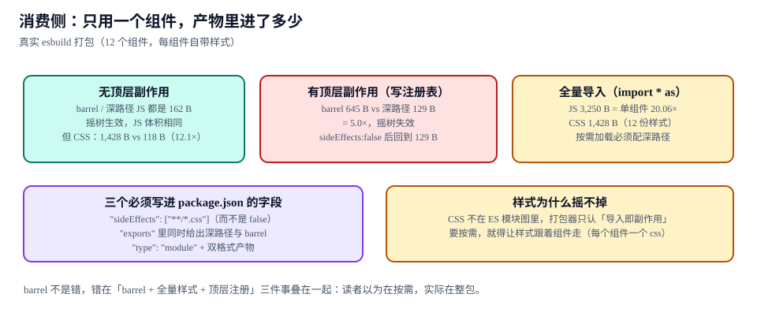

# 产物体积：摇树、样式与 exports

本页判据族 `DSDT-A` ~ `DSDT-H`，共 8 条。

「支持按需引入」这句话在组件库 README 里出现频率极高，但它是否成立**只能由打包结果证明**。同一个库、同一段消费代码，只因为 `package.json` 里少写一个字段，打包体积就能差 5 倍；而 CSS 的体积差异通常是 JS 的 12 倍——因为 CSS 根本不参与摇树。

::: tip 一句话理解
`import { Button } from "lib"` 能不能只打包一个按钮，取决于三件事：**有没有顶层副作用、有没有深路径入口、样式是不是跟着组件走**。三件缺一件，读者以为在按需，实际在整包。
:::



## 一、真实打包的六组读数

12 个组件，每个组件自带一份样式，用 esbuild（`--bundle --minify`）真实打包，消费代码只用一个 `Button`：

| 场景 | JS | CSS | 相对单组件 |
| --- | --- | --- | --- |
| 深路径导入，无顶层副作用 | **162 B** | **118 B** | 基准 |
| barrel 导入，无顶层副作用 | **162 B** | **1,428 B** | CSS **12.1×** |
| 深路径导入，有顶层副作用（写注册表） | **129 B** | 118 B | JS 略小，因为不含注册表 |
| barrel 导入，有顶层副作用 | **645 B** | 1,428 B | JS **5.0×** |
| barrel + `sideEffects: false` | **129 B** | 1,428 B | JS 摇树恢复，CSS 没有 |
| 全量导入（`import * as DS`） | **3,250 B** | 1,428 B | JS **20.06×** |

三条结论，每条都与直觉相反：

1. **JS 的摇树在「无顶层副作用」时是有效的**：barrel 与深路径都是 162 B，说明打包器确实把未使用的 11 个组件删掉了。
2. **CSS 的差异与 JS 无关**：无论 barrel 还是深路径，只要样式是「一个总文件」，CSS 就是 1,428 B（12 份样式）。摇树对 CSS 完全无效。
3. **顶层副作用会让 JS 摇树失效**：barrel 从 162 B 涨到 645 B，因为索引文件里执行了「注册全部组件」的代码，打包器不敢删。

## 二、为什么 CSS 摇不掉

CSS 不在 ES 模块图里。打包器看到的是一条 `import "./styles.css"` 语句，它只知道「导入即副作用」，不知道这个文件里有 12 个组件的样式、更不知道消费方只用了一个。

| 方案 | 做法 | 结果 |
| --- | --- | --- |
| 样式集中一个文件 | `import "lib/dist/styles.css"` | 无论用几个组件，都是全量 1,428 B |
| 每个组件一个 CSS | `import "lib/button.css"` | 用几个进几个，单组件 118 B |
| CSS-in-JS | 样式随组件代码 | 随 JS 一起摇，但有运行时成本 |
| 原子类 / 工具类 | 样式由类名决定，构建期扫描 | 只进实际用到的类，但需要扫描配置 |

要让 CSS 跟着组件走，就必须**每个组件一个 CSS 文件**，并在 `package.json` 里声明 `"sideEffects": ["**/*.css"]`。这个写法的含义是：「JS 文件都可以摇，CSS 文件不许摇」——写反（`false`）会让 CSS 被整包删掉，界面全裸。

## 三、三个必须写进 package.json 的字段

```json [packages/react/package.json]
{
  "name": "@acme/ui",
  "version": "1.4.0",
  "type": "module",
  "sideEffects": ["**/*.css"],
  "exports": {
    ".": {
      "types": "./dist/index.d.ts",
      "import": "./dist/index.js",
      "require": "./dist/index.cjs"
    },
    "./button": {
      "types": "./dist/button/index.d.ts",
      "import": "./dist/button/index.js",
      "require": "./dist/button/index.cjs"
    },
    "./button/style.css": "./dist/button/style.css",
    "./styles.css": "./dist/styles.css",
    "./package.json": "./package.json"
  },
  "files": ["dist"]
}
```

| 字段 | 作用 | 漏了会怎样 |
| --- | --- | --- |
| `sideEffects: ["**/*.css"]` | 告诉打包器「CSS 不许摇、JS 可以摇」 | 写 `false`：CSS 被删，样式全丢；不写：JS 也不敢摇，体积回到 3,250 B |
| `exports` 里的深路径 | 提供 `@acme/ui/button` 这种入口 | 读者只能从 barrel 导入，CSS 必然全量 |
| `"type": "module"` + 双格式 | ESM 为主、CJS 兼容 | 纯 CJS 包无法被摇树（`require` 是动态的）；纯 ESM 包在旧工具链里报错 |

::: danger `exports` 的三个常见写错方式
1. **只给 `"."`，不给深路径**：`@acme/ui/button` 直接报 `ERR_PACKAGE_PATH_NOT_EXPORTED`，读者只能退回 barrel。
2. **深路径漏了 `types`**：TS 在 `moduleResolution: "bundler"` 下找不到类型，编辑器里一片 `any`。
3. **`sideEffects` 写成 `false` 而不是数组**：CSS 被摇掉；这种 bug 在开发环境（Vite dev 不摇树）完全看不出来，只在生产构建后出现——**必须用生产构建验证**。
:::

## 四、barrel 不是错，错在三件事叠加

barrel（`index.ts` 里 `export * from "./button"`）本身是必要的：它让 `import { Button, Card } from "@acme/ui"` 这种写法成立。问题出在**barrel + 全量样式 + 顶层注册**三件事叠在一起：

| 叠加 | 后果 |
| --- | --- |
| barrel + 全量样式 | JS 摇掉了，CSS 没摇，12.1× |
| barrel + 顶层注册（`registerComponents()`） | JS 也摇不掉了，5.0× |
| 三者齐备 + 读者用 `import * as` | 20.06× |

正确的组合是：**保留 barrel 给便利，同时提供深路径给性能敏感场景，样式按组件拆分，绝不在模块顶层做注册**。注册表改成函数调用（`createRegistry()`），让消费者显式调用——它就变成了「用户要才执行」的副作用，而不是「导入即执行」。

```typescript [packages/react/src/index.ts]
// 反例：顶层执行 → 整个 barrel 变成副作用模块
// registerComponents([Button, Card, Modal /* …12 个 */])

// 正例：导出函数，由消费者决定何时注册
export { Button } from "./button"
export { Card } from "./card"
export { createRegistry } from "./registry"
```

## 五、体积上限怎么定

| 组件类型 | JS 上限 | CSS 上限 | 依据 |
| --- | --- | --- | --- |
| 纯展示（Button、Badge、Tag） | 300 B | 400 B | 本专题实测 162 B / 118 B，留 2 倍余量 |
| 带交互（Input、Select、Checkbox） | 800 B | 700 B | 交互逻辑与焦点样式 |
| 复合（Modal、Tabs、Table） | 2,500 B | 1,800 B | 多子组件 + 状态样式 |
| 整包（barrel 全量） | 6 KB | 3 KB | 兜底上限，超过说明有依赖被误打进包 |

上限的作用不是「卡住谁」，而是**让体积变化成为一次显式决策**：某次提交让 Button 从 162 B 变成 420 B，CI 红灯，作者必须在 PR 里解释这 258 B 是什么。

## 六、判据 `DSDT-A` ~ `DSDT-H`

| 编号 | 判据 | 怎么验证 |
| --- | --- | --- |
| `DSDT-A` | `sideEffects` 是数组且包含 `**/*.css`，不是 `false` | 读 `package.json` 断言；生产构建后 CSS 非空 |
| `DSDT-B` | `exports` 同时提供 barrel 与每个组件的深路径，且都带 `types` | `node -e "console.log(Object.keys(require('./package.json').exports))"` |
| `DSDT-C` | 每个组件有独立 CSS 文件，单组件导入的 CSS ≤ 200 B | 打包 Button，读 CSS 体积 |
| `DSDT-D` | 模块顶层没有注册、没有 `document.*`、没有 `window.*` 调用 | `grep -nE "^(register\|document\.\|window\.)" dist/index.js` 为 0 |
| `DSDT-E` | 深路径与 barrel 在无副作用前提下 JS 体积相等（证明摇树生效） | 两种入口各打一次包，体积差 ≤ 10% |
| `DSDT-F` | 生产构建（而非 dev）验证样式，dev 不摇树会掩盖问题 | 验证脚本显式带 `--minify` 与 `NODE_ENV=production` 定义 |
| `DSDT-G` | 每个组件有体积上限，CI 中超限即失败 | 体积报告与上限表逐行比对 |
| `DSDT-H` | 双格式产物（ESM + CJS）都由同一份源码生成，且 `exports` 指向正确 | `require("@acme/ui/button")` 与 `import` 各跑一次冒烟 |

## 七、验证方式

```shell [产物验证的六步]
# ① 构建（生产模式，务必 minify）
node scripts/build.mjs --minify

# ② 单组件深路径打包
node scripts/bundle-size.mjs --entry=@acme/ui/button
# 期望：js=162B css=118B

# ③ barrel 打包（应只有 CSS 变大）
node scripts/bundle-size.mjs --entry=@acme/ui
# 期望：js≈162B css=1428B

# ④ 全量导入（反面基线）
node scripts/bundle-size.mjs --entry=@acme/ui --mode=namespace
# 期望：js≈3250B

# ⑤ 顶层副作用检查
grep -nE "^(register\|document\.\|window\.)" packages/react/dist/index.js || echo "OK: 无顶层副作用"

# ⑥ exports 完整性
node -e "
const e=require('./packages/react/package.json').exports;
for (const k of Object.keys(e)) if (k!=='.' && !e[k].types) console.log('缺 types:',k);
" || true
# 期望：无输出
```

```text [体积报告示例]
entry=@acme/ui/button   js=162B  css=118B   limits 300/400  PASS
entry=@acme/ui          js=162B  css=1428B  limits 6000/3000 PASS
entry=namespace         js=3250B css=1428B  ratio 20.06x    INFO
side-effects=[]         OK
```

## 八、相关页面与下一篇

- 下一篇：[视觉回归：8 个变体与 6 种口径](../VisualRegression/index.md)——体积对了，还要确认「看起来没变」。
- 上游：[前端工程化](../../Others/FrontendEngineering/index.md)（构建流水线）、[Token：三层、双产物](../Tokens/index.md)（CSS 变量的落盘方式）。
- 相邻必读：[Webpack 深入 · 代码分割](../../Basic/BuildTool/Webpack/Overview/index.md)（打包器视角的摇树）、[Vite 深入](../../Basic/BuildTool/Vite/Overview/index.md)（dev 不摇树的原因）。

## 参考资料

- [Node.js · Packages（`exports` / `imports`）](https://nodejs.org/api/packages.html)
- [webpack · Tree Shaking（`sideEffects`）](https://webpack.js.org/guides/tree-shaking/)
- [esbuild · 打包与 tree shaking 说明](https://esbuild.github.io/api/#tree-shaking)
- [Vite · 依赖预构建与生产构建差异](https://vite.dev/guide/dep-pre-bundling)
- [npm · `package.json` 字段说明](https://docs.npmjs.com/cli/v11/configuring-npm/package-json)
