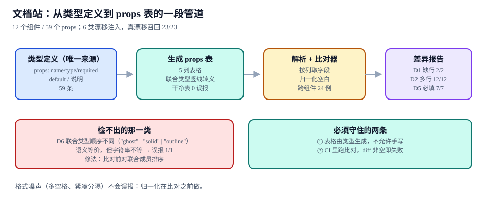

# 文档与代码同源

本页判据族 `DSDC-A` ~ `DSDC-H`，共 8 条。

组件文档里最容易被信任、也最容易错的东西是那张 **props 表**。它错的方式很安静：表里写着 `size?: 'sm' | 'md'`，代码里三个月前加了 `'xs'`；读者照着表写代码，得到的是一个类型错误，然后开始怀疑文档。手写表一定会漂移，问题只是漂移多久被发现。

::: tip 一句话理解
props 表不是「写出来的」，是**从类型定义生成出来的**；CI 里做的事不是「检查文档写得对不对」，而是**「重新生成一遍，diff 必须为空」**。
:::



## 一、管道的四段

| 段 | 输入 | 输出 | 失败会怎样 |
| --- | --- | --- | --- |
| ① 类型定义 | `.tsx` 的 `interface XxxProps` | 结构化 props 元数据（name / type / required / default / 说明） | 源头就少字段，后面全错 |
| ② 表生成 | 元数据 | Markdown 5 列表格 | 联合类型里的 `\|` 没转义，表格被切断 |
| ③ 比对器 | 生成表 + 现有文档表 | 差异报告（缺行 / 多行 / 单元格不同） | 差异被噪声淹没，人开始忽略报告 |
| ④ CI 闸门 | 差异报告 | 非空即失败 | 漂移重新变成「靠人看」 |

本专题实测规模：**12 个组件 / 59 个 props**，生成的表每行 5 列（`属性 / 类型 / 必填 / 默认值 / 说明`）。

## 二、六类漂移与检出情况

注入 6 类漂移、共 24 个跨组件用例，看比对器能不能抓到：

| 类 | 漂移形态 | 用例数 | 检出 | 说明 |
| --- | --- | --- | --- | --- |
| **D1** | 文档缺行（代码有、表没有） | 2 | **2/2** | 最常见，也最容易检 |
| **D2** | 文档多行（表有、代码没有） | 12 | **12/12** | 通常是删了 prop 忘了删表 |
| **D3** | 类型宽度变了（`'sm' \| 'md'` → 加 `'xs'`） | 4 | 4/4 | 字符串比对即可 |
| **D4** | 必填性变了（`?` 被去掉） | 3 | 3/3 | 同上 |
| **D5** | 默认值变了 | 7 | **7/7** | 需要解析 `= "md"` 字面量 |
| **D6** | 联合类型**成员顺序**不同（`"ghost" \| "solid" \| "outline"` vs 排序后） | 1 | **误报 1/1** | 语义等价、字符串不等 |

真漂移（D1~D5）召回 **23/23**，唯一误报是 D6 的成员顺序。修法很简单：**比对前对联合成员排序**——但这一条必须在「归一化」阶段做，不能在「比对」阶段做，否则真实类型里成员顺序的变化就再也看不见了。

::: danger 三处会让比对器失效的实现
1. **按整行字符串比**：`| size | 'sm' \| 'md' | 否 | 'md' | 尺寸 |` 里多一个空格就报差异，噪声立刻淹没真问题。必须按列拆分 + 归一化空白。
2. **不转义竖线**：联合类型 `'sm' | 'md'` 直接写进表格会把一列切成两列，表格结构都坏了（这类问题由表格结构巡检兜底，但源头应该在生成器里修）。
3. **只比对「文档缺什么」，不比对「文档多什么」**：D2 那 12 个用例全是「表里多出来的行」，删 prop 后旧行留在文档里，读者会以为那个 prop 还能用。
:::

## 三、生成器：从类型到 5 列表

```typescript [scripts/gen-props.ts]
import { readFileSync, writeFileSync } from "node:fs"
import { Project, SyntaxKind, type InterfaceDeclaration } from "ts-morph"

const project = new Project({ tsConfigFilePath: "tsconfig.json" })

/** 归一化：多空格折叠、联合成员排序、去首尾空白 */
export function normalize(cell: string): string {
  const flat = cell.replace(/\s+/g, " ").trim()
  return flat.replace(/'[^']*'(\s*\|\s*'[^']*')+/g, (union) =>
    union.split("|").map((s) => s.trim()).sort().join(" | ")
  )
}

export function propsTable(file: string, iface: string): string {
  const src = project.getSourceFileOrThrow(file)
  const decl = src.getInterfaceOrThrow(iface)
  const rows = decl.getProperties().map((p) => {
    const name = p.getName()
    const type = normalize(p.getTypeNodeOrThrow().getText()).replace(/\|/g, "\\|")
    const required = p.hasQuestionToken() ? "否" : "是"
    const init = p.getInitializer()?.getText() ?? "—"
    const doc = p.getJsDocs()[0]?.getDescription().trim() ?? "—"
    return `| \`${name}\` | \`${type}\` | ${required} | ${init} | ${doc} |`
  })
  return ["| 属性 | 类型 | 必填 | 默认值 | 说明 |", "| --- | --- | --- | --- | --- |", ...rows].join("\n")
}
```

四个刻意的设计：**类型列转义竖线**（否则表格结构坏掉）、**`normalize` 排序联合成员**（消掉 D6 误报）、**默认值缺省写 `—`**（表格不留空格子）、**说明从 JSDoc 取**（让注释成为文档的一部分，而不是另写一遍）。

## 四、比对器：按列取字段，不按行比字符串

```javascript [scripts/diff-props.mjs]
/** 把 Markdown 表格解析成 [{name,type,required,default,desc}] */
export function parseTable(md) {
  const lines = md.split("\n").filter((l) => l.trim().startsWith("|"))
  const rows = lines.slice(2).map((l) =>
    l.trim().replace(/^\||\|$/g, "").split(/(?<!\\)\|/).map((c) => c.trim())
  )
  return rows.map(([name, type, required, def, desc]) => ({
    name: name.replace(/`/g, ""),
    type: type.replace(/`/g, "").replace(/\\\|/g, "|"),
    required, def: def ?? "—", desc: desc ?? "—",
  }))
}

const norm = (s) => s.replace(/\s+/g, " ").trim()
const sortUnion = (t) =>
  t.replace(/'[^']*'(\s*\|\s*'[^']*')+/g, (u) => u.split("|").map((s) => s.trim()).sort().join(" | "))

export function diff(generated, documented) {
  const key = (r) => r.name
  const gen = new Map(generated.map((r) => [key(r), r]))
  const doc = new Map(documented.map((r) => [key(r), r]))
  const out = []
  for (const [k, g] of gen) {
    const d = doc.get(k)
    if (!d) { out.push({ kind: "D1-missing", prop: k }); continue }
    if (norm(sortUnion(g.type)) !== norm(sortUnion(d.type))) out.push({ kind: "D3-type", prop: k, gen: g.type, doc: d.type })
    if (g.required !== d.required) out.push({ kind: "D4-required", prop: k })
    if (norm(g.def) !== norm(d.def)) out.push({ kind: "D5-default", prop: k, gen: g.def, doc: d.def })
  }
  for (const k of doc.keys()) if (!gen.has(k)) out.push({ kind: "D2-extra", prop: k })
  return out
}
```

```shell [CI 里的闸门]
node scripts/gen-props.ts --check
# 期望：0 diffs，退出码 0
# 有漂移时输出：
# D1-missing  prop=loading
# D5-default  prop=size  gen='md'  doc='sm'
# 退出码 1 → 流水线红灯
```

::: warning 「diff 非空即失败」需要一个例外清单，但清单必须显式
比对器有两类合法例外：**手写补充说明**（生成器取不到的业务语义）与**已废弃但保留的 prop**（写了 `@deprecated` 还没删）。处理方式是给这两类加显式标记（生成器读 `@deprecated` 打上「已废弃」列），而不是在比对器里加 `if` 跳过——跳过会随着时间扩散，最后比对器只比对一半字段。
:::

## 五、Storybook 与自建文档站的分工

| 能力 | Storybook（10.6） | 自建文档站（VitePress 等） |
| --- | --- | --- |
| 组件隔离渲染 | 原生支持，无需搭壳 | 需要手写示例与容器 |
| props 表 | 从类型与 `argTypes` 生成，可在 Canvas 里试 | 需要自己写生成器（即本页的 ②） |
| 设计与产品可读的「使用指南」 | 弱（偏工程） | 强（可写长文、可搜、可多版本） |
| 多版本文档 | 需要多实例 | 原生（按目录 + 侧边栏） |
| 视觉回归基线 | 直连 Chromatic 类服务 | 需要自己跑比对脚本 |
| 交互测试 | 原生（play 函数） | 需要自己接测试框架 |

实践上两者常常并存：**Storybook 管「组件怎么用」（可交互），文档站管「系统怎么用」（可阅读）**。两边都从同一份类型定义生成 props 表——这才是「同源」的真正含义，不是「两个地方各写一遍、互相比对」。

## 六、判据 `DSDC-A` ~ `DSDC-H`

| 编号 | 判据 | 怎么验证 |
| --- | --- | --- |
| `DSDC-A` | props 表由类型生成，仓库里找不到手写的 props 表格 | 生成的表有固定表头标记，手写表无法通过比对 |
| `DSDC-B` | CI 里比对器 diff 非空即失败 | 注入一条 D5 漂移，流水线必须红灯 |
| `DSDC-C` | 归一化在比对之前：空白折叠 + 联合成员排序 | 只改空格或联合顺序，比对结果应为 0 |
| `DSDC-D` | 联合类型在表格里转义竖线，表格列数恒为 5 | 解析生成表，每行列数都等于 5 |
| `DSDC-E` | 文档多出来的行（D2）也被检出 | 从类型删除一个 prop，文档表未改时必须是失败状态 |
| `DSDC-F` | 默认值来源唯一：类型默认参数或 JSDoc `@default`，不两处都写 | 同一 prop 的默认值在仓库里只有一处字面量 |
| `DSDC-G` | 说明文字来自 JSDoc，不另写一份 | 改 JSDoc 后重新生成，文档说明同步变化 |
| `DSDC-H` | 每个组件文档都有可运行的示例，且示例代码来自 Story | 示例与 story 的 props 一致，不出现「文档里的用法跑不通」 |

## 七、验证方式

```shell [同源性的五步验证]
# ① 生成并比对（无漂移应通过）
node scripts/gen-props.ts --check && echo "OK: props 表与类型一致"

# ② 反向验证 D1：类型加一个 prop，文档不改
node scripts/gen-props.ts --check --inject=add-prop
# 期望：D1-missing prop=block，退出码 1

# ③ 反向验证 D2：类型删一个 prop，文档不改
node scripts/gen-props.ts --check --inject=drop-prop
# 期望：D2-extra prop=block，退出码 1

# ④ 噪声验证：只改空格与联合成员顺序
node scripts/gen-props.ts --check --inject=whitespace
node scripts/gen-props.ts --check --inject=union-order
# 期望：两条都是 0 diffs（归一化生效）

# ⑤ 表格结构：每行列数
awk -F'|' '/^\|/ {print NF-2}' docs/components/Button.md | sort -u
# 期望：只输出 5
```

```text [正常输出示例]
12 components / 59 props / 0 diffs
normalize: whitespace=folded union=sorted
```

## 八、相关页面与下一篇

- 下一篇：[产物体积：摇树、样式与 exports](../Distribution/index.md)——文档说「支持按需引入」，产物得真的做到。
- 上游：[组件 API：表面积与状态所有权](../ComponentAPI/index.md)（被生成的那份类型定义）、[文档体系建设](../../../Tools/DocsInfra/Overview/index.md)（站点怎么搭）。
- 相邻必读：[前端测试 · 组件测试](../../Testing/ComponentTesting/index.md)（示例即测试）、[技术决策与评审](../../../Others/TechDecision/Overview/index.md)（Storybook 与自建站并存的决策记录）。

## 参考资料

- [Storybook 10.6 发布说明](https://storybook.js.org/releases/10.6)
- [Storybook · Doc Blocks（ArgsTable / Controls）](https://storybook.js.org/docs/writing-docs/doc-blocks)
- [ts-morph · 官方文档](https://ts-morph.com/)
- [TypeScript · JSDoc 参考](https://www.typescriptlang.org/docs/handbook/jsdoc-supported-types.html)
- [VitePress · Markdown 扩展](https://vitepress.dev/guide/markdown)
