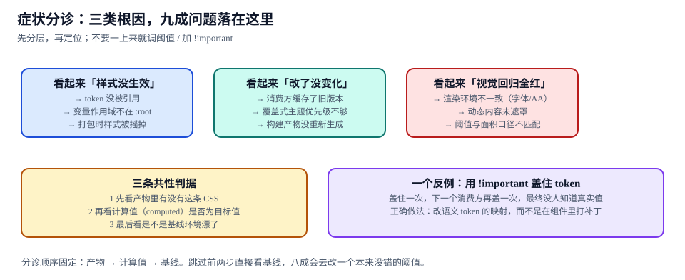

# 常见问题与分诊

本页判据族 `DSFQ-A` ~ `DSFQ-H`，共 8 条。

设计系统的问题有一个共同特征：**症状出现的位置，几乎从来不是根因所在的位置**。「按钮颜色不对」可能出在 token 定义、CSS 变量作用域、打包摇树、消费方缓存、主题覆盖优先级——五个地方，五种修法，看起来一模一样。

本页给一张固定的分诊顺序：**先看产物、再看计算值、最后看基线**。

::: tip 一句话理解
不要一上来就调阈值、加 `!important`、怀疑浏览器。按「产物 → 计算值 → 基线」三步走，九成问题在前两步就能定位，剩下的一成才是真的需要改基线。
:::



## 一、分诊表：九种症状与它们的根因

| 症状 | 先查什么 | 可能的根因 | 去哪一页 |
| --- | --- | --- | --- |
| **S1** 样式完全没生效 | 产物里有没有这条 CSS | token 未被引用 / 样式被摇掉 / 选择器拼错 | [Token](../Tokens/index.md)、[产物体积](../Distribution/index.md) |
| **S2** 只有部分颜色不对 | 计算值（computed）是不是目标值 | 变量作用域不在 `:root` / 被局部覆盖 | [主题](../Theming/index.md) |
| **S3** 深色主题下局部还是浅色 | 该元素的变量从哪继承 | 组件内部写死了裸色值 | [Token](../Tokens/index.md) 判据 `DSTN-A` |
| **S4** 改了 token 但界面没变 | 消费方用的是哪个版本 | 缓存了旧版本 / 产物没重新生成 | 本页第四节 |
| **S5** 主题覆盖不生效 | CSS 优先级与加载顺序 | 覆盖式主题被组件样式压过 | [主题](../Theming/index.md) |
| **S6** 只用一个组件，包却很大 | 打包产物的 JS 与 CSS 各多少 | barrel + 全量样式 / 顶层副作用 | [产物体积](../Distribution/index.md) |
| **S7** 生产环境样式全丢，开发环境正常 | 生产构建后的 CSS 文件 | `sideEffects: false` 把 CSS 摇掉了 | [产物体积](../Distribution/index.md) 判据 `DSDT-A` |
| **S8** 视觉回归全红 | 基线生成环境 | 环境漂移 / 动态内容未遮罩 / 阈值口径 | [视觉回归](../VisualRegression/index.md) |
| **S9** 文档里的 prop 用不了 | 类型定义与文档表 | 表是手写的、已漂移 | [文档同源](../DocsSync/index.md) |

## 二、三条共性判据

不管哪一类症状，都按这三步查，顺序不要换：

| 步 | 查什么 | 命令 | 判断 |
| --- | --- | --- | --- |
| **① 产物** | 发出去的 CSS 里有没有这条规则 | `grep -o -- "--accent-solid:[^;]*" dist/*.css` | 没有 → 问题在构建（S1/S7） |
| **② 计算值** | 浏览器最终用了什么值 | DevTools → Computed → 搜变量名；或 `getComputedStyle(el).getPropertyValue("--accent-solid")` | 有值但不是目标值 → 问题在覆盖（S2/S5） |
| **③ 基线** | 基线是不是在另一个环境生成的 | 读 `baseline.manifest.json` 的 `env` | 环境不一致 → 问题在基线（S8） |

::: danger 跳过前两步直接看基线，八成会去改一个本来没错的阈值
视觉回归报红时，人的第一反应是「阈值太严」。但实测里最典型的两次全红都不是阈值问题：一次是基线在 DPR=1 的环境生成、比对在 DPR=2 跑（V4 抗锯齿 13.798%）；一次是时间戳没遮罩（39 px）。这两次如果去调阈值，会把真实的色差缺陷一起放过。
:::

## 三、十二问速查

| 问题 | 结论 |
| --- | --- |
| 语义 token 能不能直接写在组件里？ | 能，但组件层应作为「映射声明」存在，不要在每个组件里重复字面量 |
| 组件层要不要落盘？ | 默认不落盘（省 72% 体积、避免双写）；差异确实是结构性的才落盘并记录决策 |
| 主题该用覆盖式还是编译式？ | 算「主题增量 / 基础产物」，< 10% 覆盖式，否则升级成构建目标 |
| 一个组件最多几个布尔 prop？ | ≤ 2；互斥的视觉变体必须合并成枚举（8 布尔 = 256 组合，其中 65% 非法） |
| 受控组件值丢了，是组件 bug 吗？ | 多数不是：父组件没回传 `value`，组件只能保持旧值。开发期应有 `console.warn` |
| props 表能手写吗？ | 不能。手写必然漂移，且漂移是静默的（读者照着写才报错） |
| 为什么 CSS 摇不掉？ | CSS 不在 ES 模块图里，打包器只认「导入即副作用」；要按需就得每个组件一个 CSS |
| `sideEffects` 该写什么？ | `["**/*.css"]`，不是 `false`（写 `false` 会把样式摇掉，且只在生产构建暴露） |
| 视觉回归阈值定多少？ | 面积 0.05%、容差 0（默认）；容差 2 只在噪声压不下去时用，并登记漏报风险 |
| 改默认值该发什么版本？ | minor，但必须更新基线 + 在 changeset 正文写明「默认值变了」 |
| 废弃一个 prop 要等多久？ | 两个 minor；少于两个等于没有过渡期 |
| 只有一个前端应用，要做设计系统吗？ | 做组件目录即可，不建包、不发版、不写治理流程 |

## 四、S4 专项：「改了但没变化」的四个层次

这是最高频、也最容易误判的一类。

| 层 | 检查 | 常见原因 | 修法 |
| --- | --- | --- | --- |
| 源 | token 源文件真的改了吗 | 改的是 `dist/` 里的产物，源文件没动 | 改源文件，重新构建 |
| 构建 | 产物里是新值吗 | 构建缓存 / 增量构建跳过了（**假命中**），或产物本身不可复现 | 先按「有缓存 vs 无缓存」对照构建判断：产物不同 = 假命中（清缓存并查指纹漏了哪个输入）；产物一致但仍旧值 = 源文件没进构建（[构建缓存 · 正确性](../../../Tools/BuildCache/Correctness/index.md)） |
| 发布 | 消费方拿到的是新版吗 | 版本没升 / 私有源没同步 | `npm view @acme/ui version` 与本地对比 |
| 运行时 | 浏览器用的是新 CSS 吗 | CDN 缓存 / Service Worker 缓存旧文件 | 强刷 + 检查 `Cache-Control` 与 SW 版本 |

四层里任何一层没走通，界面都不会变，而**每一层的症状完全相同**。所以「改了没变化」这个描述本身没有诊断价值——必须按层往下查。

```shell [四层逐层确认]
# ① 源
grep -o '"accent-solid"[^}]*' packages/tokens/src/semantic.tokens.json
# ② 构建产物
grep -o -- "--accent-solid:[^;]*" packages/tokens/dist/tokens.css
# ③ 已发布版本
npm view @acme/ui version && cat package.json | grep '"version"'
# ④ 运行时（浏览器控制台执行）
# getComputedStyle(document.documentElement).getPropertyValue("--accent-solid")
```

## 五、反例：用 `!important` 盖住 token

```css [反例：不要这么写]
.button { background: var(--accent-solid) !important; }
```

看起来解决了「按钮颜色被覆盖」的问题，实际制造了三个新问题：

1. **下一个消费方要覆盖品牌色时，只能再加一个 `!important`**，最终没人知道按钮的真实取值来自哪里；
2. **主题切换失效**：`[data-theme]` 层的变量改动被组件层的 `!important` 压住，深色模式局部不生效（S3 的成因之一）；
3. **视觉回归基线被掩盖**：基线跟着 `!important` 的固定值走，token 真的改了反而看不出来。

正确做法是**改语义 token 的映射**（`--button-bg: var(--accent-solid)`），而不是在组件里打补丁。这也是 [主题](../Theming/index.md) 判据 `DSTH-C` 要检查「组件里没有 `data-theme` 选择器」的原因。

## 六、判据 `DSFQ-A` ~ `DSFQ-H`

| 编号 | 判据 | 怎么验证 |
| --- | --- | --- |
| `DSFQ-A` | 分诊按「产物 → 计算值 → 基线」顺序，日志里能看出走了哪几步 | 故障记录含三步的实际输出，缺一步即视为跳步 |
| `DSFQ-B` | 「样式没生效」先确认产物里有这条规则，再怀疑浏览器 | `grep` 产物为 0 命中时，不得进入 DevTools 排查 |
| `DSFQ-C` | 「改了没变化」必须定位到源/构建/发布/运行时四层中的具体一层 | 结论必须写出层号与证据 |
| `DSFQ-D` | 组件样式中不出现 `!important` 覆盖 token 变量 | `grep -rn "!important" packages/react/src` 命中处逐个说明 |
| `DSFQ-E` | 视觉回归报红时先查环境指纹与遮罩，再考虑调阈值 | 调阈值的提交必须附「环境已核对」 |
| `DSFQ-F` | 十二问的每一条都能在专题内找到对应页面 | 逐条走链接，无死链 |
| `DSFQ-G` | 每类症状都有可复现的最小复现步骤 | 按记录能复现，且复现不依赖具体业务代码 |
| `DSFQ-H` | 分诊表更新过至少一次（真实故障回填） | 表内有来自实际故障的条目，而非纯推演 |

## 七、验证方式

```shell [分诊演练：四类故障各复现一次]
# S1 样式没生效：把 sideEffects 改成 false 后生产构建
node scripts/build.mjs --minify --set-side-effects=false
ls -l dist/styles.css   # 期望：文件存在但为空 → 复现 S7

# S6 只用一个组件但包很大：barrel 全量导入
node scripts/bundle-size.mjs --entry=@acme/ui
# 期望：css=1428B（12.1×）→ 复现 S6

# S8 视觉回归全红：用 DPR=1 的基线比 DPR=2 的截图
node scripts/visual-diff.mjs --baseline=baseline-dpr1 --current=current-dpr2
# 期望：area≈13.798% → 复现 S8 的第一类根因

# S2 计算值不对：在页面注入一个局部覆盖
# 控制台：document.querySelector(".btn").style.setProperty("--accent-solid", "red")
# 期望：按钮变红但其它按钮不变 → 说明变量作用域在组件级
```

```text [一次合格的分诊记录]
symptom: 深色模式下卡片仍是浅色
step1 产物: dist/tokens.css 含 --bg-surface（命中）
step2 计算值: 卡片 computed --bg-surface = #ffffff（非深色值）
root cause: card.css 里写死 background:#fff，未引用变量（S3）
fix: 改为 var(--bg-surface) + 补一条 DSTN-A 的裸值扫描
```

## 八、相关页面

- 起点：[总览：一条链、七环与三张账](../Overview/index.md)——先看整条链，再回来分诊。
- 高频三联：[Token](../Tokens/index.md)（值从哪来）、[产物体积](../Distribution/index.md)（样式去哪了）、[视觉回归](../VisualRegression/index.md)（看起来变没变）。
- 相邻必读：[CSS 进阶 · 层叠与优先级](../../Basic/CSS/Advanced/index.md)、[前端测试 · 组件测试](../../Testing/ComponentTesting/index.md)。

## 参考资料

- [MDN · CSS 自定义属性与 `var()` 作用域](https://developer.mozilla.org/en-US/docs/Web/CSS/Using_CSS_custom_properties)
- [MDN · 层叠与优先级](https://developer.mozilla.org/en-US/docs/Web/CSS/CSS_cascade/Cascade)
- [webpack · Tree Shaking（`sideEffects` 与 CSS）](https://webpack.js.org/guides/tree-shaking/)
- [Playwright · 截图断言与环境一致性](https://playwright.dev/docs/test-snapshots)
- [MDN · `Window.getComputedStyle`](https://developer.mozilla.org/en-US/docs/Web/API/Window/getComputedStyle)
