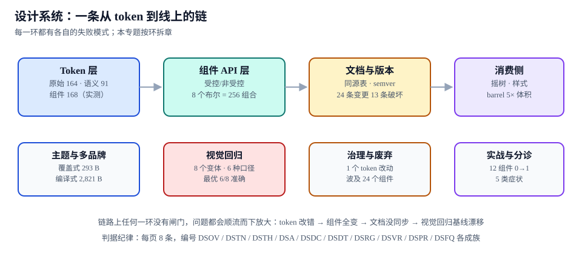

# 总览：一条链、七环与三张账

本页判据族 `DSOV-A` ~ `DSOV-H`，共 8 条。

团队说「我们要做设计系统」时，通常指的是三件完全不同的事：**做一套好看的组件**、**统一视觉规范**、**让多个产品共用同一份决定**。前两件一个月能出成果，第三件要一年，且失败率最高——因为它不是写代码的问题，是「谁的改动会影响到谁」看不见的问题。

本页把设计系统拆成一条链上的七环，并给出三张必须对得上的账。

::: tip 一句话理解
设计系统的价值不在「组件有多少个」，而在**「改一个值之后，谁能被通知到、谁会被拦住、谁需要动手」**。链条断一环，这条信息就传不下去。
:::



## 一、七环与各自的失败模式

| 环 | 这一环产出什么 | 断了会怎样（真实症状） | 在哪一页讲透 |
| --- | --- | --- | --- |
| ① Token | 一份可解析的取值图 + 编译产物 | 组件里出现 `#3b82f6` 硬编码，改主题时漏掉三处 | [Token：三层、双产物与解析](../Tokens/index.md) |
| ② 组件 API | 一组有契约的组件 | 8 个布尔 prop 排出 256 种组合，文档写不完、测试测不全 | [组件 API](../ComponentAPI/index.md) |
| ③ 文档 | 与代码同源的 props 表 | 表里写着 `size?: 'sm' \| 'md'`，代码早已加了 `xs` | [文档与代码同源](../DocsSync/index.md) |
| ④ 版本 | 一次改动对应一个号 | 改了默认值却发 patch，消费方升级后界面全变 | [版本、废弃与发布治理](../ReleaseGovernance/index.md) |
| ⑤ 消费 | 可被按需引入的产物 | 只用一个按钮，包里进了 12 个组件的样式 | [产物体积](../Distribution/index.md) |
| ⑥ 主题 | 第二套取值映射 | 第二个品牌要 2,821 B 的整份重写，10 个品牌 28 KB | [主题与多品牌](../Theming/index.md) |
| ⑦ 视觉回归 | 一组基线图 + 比对口径 | 全绿发版，用户截图说「按钮变高了」 | [视觉回归](../VisualRegression/index.md) |

这七环的顺序不是流程顺序，而是**依赖顺序**：后一环的判据都建立在前一环的产物上。所以第 ⑦ 环出问题，根因经常在第 ① 环——基线全红往往不是阈值定错了，而是 token 被改过、基线没跟着重建。

## 二、三张账：设计账、代码账、产物账

设计系统最难对齐的不是审美，是**同一件事在三处的记录方式不同**。

| 账 | 记在哪 | 记什么 | 谁在看 | 漂移的典型形态 |
| --- | --- | --- | --- | --- |
| **设计账** | 设计工具的变量 / token 源文件 | 名字、取值、别名关系、说明 | 设计师 | 设计里加了 `brand-2`，代码里没有 |
| **代码账** | `packages/tokens` 的源 JSON + 组件里的引用 | 谁引用了谁、组件消费了哪些 token | 前端 | 组件里出现裸值，绕过了 token |
| **产物账** | 构建输出的 CSS/JS + 包体积报告 | 最终发出去的字节 | 消费方 / 性能负责人 | 产物比上版大 12%，没人知道为什么 |

三张账对不上的三种典型：

1. **设计账有、代码账无**：设计稿用了新色，代码里没有对应 token，工程师只好写 `#0f766e`。这一处裸值会在下一次主题切换时变成一块不变色的区域。
2. **代码账有、设计账无**：工程师为了解决一个边距问题临时加了 `--gap-13`。三个月后它被 6 个组件引用，设计侧完全不知道它的存在。
3. **两账都有、产物账不符**：token 定义正确、引用也正确，但构建时被摇掉了（见 [产物体积](../Distribution/index.md) 的 `sideEffects` 一节），线上读到的是浏览器默认值。

::: danger 三张账最常见的对账方式是「人眼比对」，它一定会失败
1. **不要用截图对账**：截图只能证明「这一屏现在长这样」，证明不了「这个值来自哪个 token」。
2. **不要用「组件数量」当进度**：12 个组件的系统可以比 60 个组件的系统更完整——前者链是通的，后者只是组件多。
3. **对账要落到可执行的命令**：产物账用包体积报告、代码账用 `grep` 查裸值、设计账用 token 源文件的 diff。三样都能在 CI 里跑，才叫对账。
:::

## 三、三种规模，三种做法

同一个词在三种团队里指的不是一件事。规模判断错了，做法一定错。

| 规模 | 典型特征 | 该做什么 | 明确不该做什么 |
| --- | --- | --- | --- |
| **单产品**（1 个前端应用，≤ 5 人） | 组件 20~40 个，只有一套主题 | 只做两层 token + 一个组件目录 + 一份视觉基线 | 不要建 monorepo、不要独立发版、不要写治理流程 |
| **多产品**（3~10 个应用，多团队） | 需要第二套主题、需要版本共存 | 三层 token + 独立包 + 语义化版本 + 灰度通道 | 不要在一个仓库里放业务代码；不要用路径别名共享源码 |
| **对外开源**（外部消费者不可控） | 破坏性变更要写迁移指南 | 上面全部 + 双版本并存 + codemod + 影响面公开 | 不要靠「通知一下」代替重大版本号 |

判断依据只有一条：**消费者是否可控**。消费者在同一栋楼里，你可以靠沟通解决 80% 的问题；消费者在外部，沟通渠道不存在，只能靠契约。

## 四、什么时候不该做设计系统

这一节是刻意写的，因为「上设计系统」在很多团队里是**成本最高的错误决定**。

| 情形 | 为什么不该做 | 更合适的做法 |
| --- | --- | --- |
| 产品还在找 PMF，界面每周重画 | 规范会追着改，维护成本全部沉没 | 先用一个组件目录 + 两三个人工约定 |
| 只有一个前端，且没有第二个产品 | 复用的收益不存在，只有抽象的成本 | 抽公共组件目录即可，不建包、不发版 |
| 团队没有视觉回归能力 | 改 token 的影响面无法被发现，等于蒙眼改全局 | 先做基线（1 天可完成），再谈 token 化 |
| 设计侧不参与 | token 会退化成「工程师猜的名字」，第二个月就失真 | 先约定命名与职责，再动手 |

::: tip 一个可执行的判断
问三个问题：**有没有第二个消费者？改一个颜色需要通知几个人？上一次改主色花了多久？** 三个答案都是「小」，就只做组件目录；有一个答案是「大」，再考虑设计系统。
:::

## 五、一条链的最小可运行版本

不用等所有环都建好。下面这个最小集可以在一周内跑通，之后每一环都能独立加固。

```text [设计系统的最小链路]
tokens/src/*.tokens.json       # 唯一来源（DTCG 2025.10 格式）
  └─ build → tokens/dist/tokens.css     # 两层落盘：raw + semantic
  └─ build → tokens/dist/tokens.json    # 扁平 JSON，给设计工具读

packages/react/src/Button.tsx  # 只消费 var(--*) 或语义 token
  └─ 类型即契约 → docs 的 props 表（生成，不手写）
  └─ story → 视觉基线（每个变体一张）

CI 四道：
  1) token 解析（无环、无悬空引用）
  2) props 表与类型比对（diff 非空即失败）
  3) 包体积上限（单组件 ≤ 300 B，超过即失败）
  4) 视觉回归（差异面积 > 阈值即失败）
```

这四道闸门对应四类事故，且**每一道都能在本地用一条命令复现**——这是设计系统与「组件库」最实际的区别：前者可以在提交前就告诉你「你刚改的这行会让 24 个组件变样」。

## 六、判据 `DSOV-A` ~ `DSOV-H`

| 编号 | 判据 | 怎么验证 |
| --- | --- | --- |
| `DSOV-A` | 七环里至少五环有**自动**闸门，且每道闸门能在本地一条命令内复现 | 列出四道 CI 步骤，逐条在本地跑通；靠人眼检查的环节不计入 |
| `DSOV-B` | 三张账各有**机器可读**的记录（token 源文件、裸值扫描、包体积报告） | `grep -rnE "#[0-9a-fA-F]{6}" packages/*/src` 的每条命中都能说明理由 |
| `DSOV-C` | 规模判断有书面结论，且与仓库结构一致 | 单产品团队却建了 monorepo，或反之，都算不合格 |
| `DSOV-D` | 「不该做」的四条情形有明确判断记录 | 找不到判断记录即视为默认「该做」，需补一次评审 |
| `DSOV-E` | 最小链路能独立跑通：token 构建、组件引用、文档生成、基线比对 | 新机器上按 README 执行，四步全部成功 |
| `DSOV-F` | 每一环的产物都有**版本号或指纹**，能回答「线上是哪个版本」 | 产物里能找到 version 字段或内容哈希 |
| `DSOV-G` | 链上每一环的失败都是**显式失败**（红灯），不出现「静默降级」 | 故意注入一处错误，确认对应闸门失败而不是跳过 |
| `DSOV-H` | 新人能在半天内跑通链路，且不需要口头补充 | 让未参与的人只看文档执行一次，记录卡点 |

## 七、验证方式

```shell [最小链路的四步验证]
# ① token 解析：应输出 423 条、0 缺陷（见 Tokens 页的解析脚本）
node scripts/tokens-check.mjs
# 期望：tokens=423 defects=0

# ② 裸值扫描：组件源码里不应出现十六进制色值
grep -rnE "#[0-9a-fA-F]{3,8}\b" packages/react/src --include="*.tsx" || echo "OK: 无裸色值"

# ③ 包体积：单组件深路径导入的 JS + CSS 上限
node scripts/bundle-size.mjs --entry=button
# 期望：js=162B css=118B（上限 300B / 400B）

# ④ 视觉回归：基线比对，差异面积阈值 0.2%
node scripts/visual-diff.mjs --baseline=baseline/ --current=current/
# 期望：8 个变体全部通过，假阳性 0
```

```text [四步全绿时的判据输出（示例）]
tokens=423 defects=0
bare-colors=0
bundle: js=162B css=118B  (limits 300/400)  PASS
visual: 8 variants, diff=0, false-positive=0  PASS
```

四条里任何一条红灯，都说明某一环的闸门没接上——**不要继续往下做新组件**，先修链。这条纪律看着慢，实际是唯一能避免「第 4 个月推倒重来」的做法。

## 八、相关页面与下一篇

- 下一篇：[Token：三层、双产物与解析](../Tokens/index.md)——整条链的起点，也是唯一必须由人来维护的一环。
- 上游：[CSS 进阶](../../Basic/CSS/Advanced/index.md)（变量与层叠机制）、[前端工程化](../../Others/FrontendEngineering/index.md)（流水线怎么搭）。
- 相邻必读：[低代码平台 · 物料体系](../../LowCode/Materials/index.md)（另一种「组件被复现」的方式，协议不同、问题相同）。

## 参考资料

- [Design Tokens Format Module 2025.10](https://www.designtokens.org/tr/2025.10/format/)
- [Style Dictionary · 官方文档](https://styledictionary.com/)
- [Storybook · Why Storybook](https://storybook.js.org/docs/get-started/why-storybook)
- [webpack · Tree Shaking 指南](https://webpack.js.org/guides/tree-shaking/)
- [Node.js · Packages](https://nodejs.org/api/packages.html)
- [本仓 · 低代码平台的物料协议](../../LowCode/Materials/index.md)
