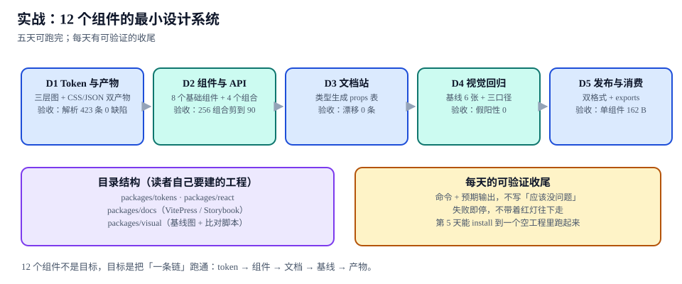

# 实战：12 个组件的最小设计系统

本页判据族 `DSPR-A` ~ `DSPR-H`，共 8 条。

前面八页分别讲了一环。这一页把它们串成**五天可跑完**的施工顺序，每天的收尾都是一个可执行的命令 + 一个明确的预期输出。目标不是「做完 12 个组件」，而是**把整条链跑通一次**——链通了，第 13 个组件只是复制流程；链不通，做 60 个组件也只是把问题放大 60 倍。

::: tip 一句话理解
五天里最容易搞错的顺序是「先写组件、后补 token」。正确顺序是**倒过来**：token 先把值定死，组件才有东西可消费；否则第二周就要回头改所有组件的硬编码。
:::



## 一、工程结构与五天排期

```text [读者自己要建的工程（本仓不提交代码）]
design-system/
├─ packages/
│  ├─ tokens/            # D1：DTCG 源文件 + 构建脚本 + 双产物
│  │  ├─ src/*.tokens.json
│  │  └─ dist/tokens.css | tokens.json
│  ├─ react/             # D2：12 个组件 + 类型
│  │  ├─ src/button/…    # 每个组件目录，自带 style.css
│  │  └─ dist/           # ESM + CJS + 每组件 css
│  ├─ docs/              # D3：文档站（VitePress 或 Storybook）
│  └─ visual/            # D4：基线图 + 比对脚本
└─ package.json          # workspace：pnpm / npm workspaces
```

| 天 | 主题 | 产出 | 验收（命令 + 预期） |
| --- | --- | --- | --- |
| **D1** | Token 与产物 | 三层 token 源 + CSS/JSON 双产物 | `tokens-check` → **423 条、0 缺陷** |
| **D2** | 组件与 API | 8 个基础 + 4 个组合 | 组合数从 **256** 剪到 **90**，文档可枚举 |
| **D3** | 文档站 | 类型生成 props 表 | 漂移 **0 条**（12 组件 / 59 props） |
| **D4** | 视觉回归 | 6 张基线 + 三口径 | **假阳性 0**，注入 4 类缺陷全拦 |
| **D5** | 发布与消费 | 双格式 + `exports` | 单组件深路径 **162 B** |

五天不是「五个模块」，而是**五道闸门依次点亮**：D1 亮之前不做 D2，D2 亮之前不做 D3。任何一天红着往下走，后面三天都会在错误的基线上工作。

## 二、D1：Token 与产物

目标：423 条 token（raw 164 / semantic 91 / component 168），产出两份产物。

```shell [D1 的收尾]
node packages/tokens/scripts/build.mjs
# 期望：
# tokens=423 (raw=164 semantic=91 component=168)
# css=7644B gzip=1556B
# json=14036B

node packages/tokens/scripts/check.mjs
# 期望：defects=0  depth={"0":164,"1":91,"2":168}
```

D1 的三个停止条件（任一不满足就不要进 D2）：

1. 语义层条数 ≤ 120（本专题 91）——超了说明语义层被当组件层用；
2. 深度分布只有 0/1/2 三档——出现 3 跳说明中间层被插了一层；
3. 组件层**没有**落盘（产物里 `grep button-bg` 为 0）。

理由见 [Token：三层、双产物与解析](../Tokens/index.md)。

## 三、D2：组件与 API

目标：8 个基础组件（Button、Input、Select、Checkbox、Radio、Badge、Tag、Avatar）+ 4 个组合组件（Card、Modal、Tabs、Table）。

```tsx [packages/react/src/button/index.tsx]
export interface ButtonProps {
  variant?: "solid" | "outline" | "ghost"   // 3
  size?: "sm" | "md" | "lg"                 // 3
  tone?: "neutral" | "accent" | "danger"    // 3
  block?: boolean                            // 唯一保留的布尔
  loading?: boolean
}
```

```shell [D2 的收尾]
node packages/react/scripts/combos.mjs --component=Button
# 期望：boolean=2 full=162 documented=81

node packages/react/scripts/check-api.mjs
# 期望：components=12 boolean-le2=12 render-merge=0
```

三条停止条件：

1. 每个组件的布尔 prop ≤ 2（互斥变体必须合并成枚举）；
2. 每个组件的文档行数 = 组合数（81 行，可枚举）；
3. 渲染路径里没有 `{ ...defaults }` 合并（见 [组件 API](../ComponentAPI/index.md) 的 5.395 µs 读数）。

## 四、D3：文档站

目标：props 表从类型生成，12 个组件 / 59 个 props。

```shell [D3 的收尾]
node packages/docs/scripts/gen-props.mjs --check
# 期望：components=12 props=59 diffs=0

# 反向验证：注入一条默认值漂移
node packages/docs/scripts/gen-props.mjs --check --inject=default
# 期望：D5-default prop=size gen='md' doc='sm'，退出码 1
```

停止条件：**diff 非空即失败必须真的让流水线红**。如果 `--check` 在有 diff 时退出码仍是 0，D3 等于没做。

## 五、D4：视觉回归

目标：6 张基线覆盖 12 个组件的关键变体，三种口径各跑一遍。

| 口径 | 容差 | 面积阈值 | 用途 |
| --- | --- | --- | --- |
| 严格 | 0 | 0.05% | 主力口径，拦真实缺陷 |
| 宽松 | 2 | 0.05% | 只在噪声确实压不下去时用，需登记 |
| 感知（YIQ） | 0.05 | 0.05% | 参考口径，不单独作为门禁 |

```shell [D4 的收尾]
node packages/visual/scripts/shoot.mjs --env=chromium-131 --dpr=2
node packages/visual/scripts/diff.mjs --baseline=baseline --current=current
# 期望：6/6 PASS  false-positive=0

# 反向验证：四类缺陷
for f in shift-1px color-2-255 font-15-to-16 text-change; do
  node packages/visual/scripts/diff.mjs --baseline=baseline --current=faults/$f || echo "$f BLOCKED"
done
# 期望：四条全部 BLOCKED
```

停止条件：**同环境重跑两次 diff 必须为 0**。不为 0 说明噪声没治，先治噪声（遮罩 + 环境指纹），不要调阈值。

## 六、D5：发布与消费

目标：双格式产物 + `exports` 深路径，单组件 162 B。

```shell [D5 的收尾]
node packages/react/scripts/build.mjs --minify
node packages/visual/scripts/bundle-size.mjs --entry=@acme/ui/button
# 期望：js=162B css=118B

node packages/visual/scripts/bundle-size.mjs --entry=@acme/ui
# 期望：js=162B css=1428B（说明样式没按需）

node packages/visual/scripts/bundle-size.mjs --entry=@acme/ui --mode=namespace
# 期望：js=3250B（20.06×，作为反面基线留档）
```

最后一步是在一个**空工程**里 `install` 这个包并跑起来：

```shell [D5 的最终验收：在空工程里消费]
mkdir /tmp/ds-consumer && cd /tmp/ds-consumer
npm init -y
npm i /path/to/design-system/packages/react
node -e "
const { Button } = require('@acme/ui/button');
console.log(typeof Button);            // function
console.log(require('@acme/ui/package.json').version);  // 1.0.0
"
# 期望：输出 function 与 1.0.0（CJS 通道与深路径都通）
```

## 七、五天里最容易返工的三处

| 返工点 | 症状 | 代价 | 预防 |
| --- | --- | --- | --- |
| 组件层落盘 | D3 之后发现改语义 token 组件没变 | 回头改 168 条映射 | D1 就定「组件层不落盘」 |
| 样式集中一个文件 | D5 才发现在按需引入下 CSS 12.1× | 拆 12 个 CSS + 改构建 | D2 就按组件拆样式 |
| 基线跨环境生成 | D4 全红，误以为是代码问题 | 重拍全部基线 + 重定阈值 | D4 第一天就存环境指纹 |

## 八、判据 `DSPR-A` ~ `DSPR-H`

| 编号 | 判据 | 怎么验证 |
| --- | --- | --- |
| `DSPR-A` | 五天顺序不可换：D1 的验收命令通过后才进 D2 | 每日的收尾命令输出留档，前一天的退出码为 0 |
| `DSPR-B` | 每天的验收都是「命令 + 预期输出」，不写「应该没问题」 | 抽查全部命令，每条都有可断言的输出 |
| `DSPR-C` | token 层验收：423 条、0 缺陷、深度只有 0/1/2 | `check.mjs` 输出三行全部匹配 |
| `DSPR-D` | 组件层验收：布尔 ≤ 2、组合可枚举、无渲染期合并 | `check-api.mjs` 三项全绿 |
| `DSPR-E` | 文档层验收：diff 为 0，且注入漂移能失败 | 注入一次，退出码必须为 1 |
| `DSPR-F` | 基线层验收：同环境重跑 0 差异，四类缺陷全拦 | 两轮命令，一轮 PASS 一轮 4/4 BLOCKED |
| `DSPR-G` | 消费层验收：深路径 JS + CSS 都在上限内，且在空工程可安装 | 空工程 `npm i` 后 `require` 成功 |
| `DSPR-H` | 返工点三处有书面决策（组件层落盘、样式拆分、基线环境） | 找到三条决策记录，缺一条即视为默许返工 |

## 九、验证方式：一条总命令

```shell [五天全链路回归]
pnpm -r build \
  && node packages/tokens/scripts/check.mjs \
  && node packages/react/scripts/check-api.mjs \
  && node packages/docs/scripts/gen-props.mjs --check \
  && node packages/visual/scripts/diff.mjs --baseline=baseline --current=current \
  && node packages/visual/scripts/bundle-size.mjs --entry=@acme/ui/button
# 期望（逐行）：
# defects=0
# components=12 boolean-le2=12 render-merge=0
# components=12 props=59 diffs=0
# 6/6 PASS false-positive=0
# js=162B css=118B
```

这条命令就是这套系统的「体检」：**任何一环断了，它会在这里停下**，而不是等三个月后某个消费方报「升级后界面全乱」。

## 十、相关页面与下一篇

- 下一篇：[常见问题与分诊](../FAQ/index.md)——五天里最常卡住的九种症状。
- 上游：[总览：一条链、七环与三张账](../Overview/index.md)（为什么是这五步）。
- 相邻必读：[低代码平台 · 物料体系](../../LowCode/Materials/index.md)（另一条把组件复现出来的路线）。

## 参考资料

- [pnpm · Workspaces](https://pnpm.io/workspaces)
- [Design Tokens Format Module 2025.10](https://www.designtokens.org/tr/2025.10/format/)
- [Style Dictionary · 构建配置](https://styledictionary.com/reference/config/)
- [Storybook 10.6 发布说明](https://storybook.js.org/releases/10.6)
- [Playwright · 截图断言](https://playwright.dev/docs/test-snapshots)
