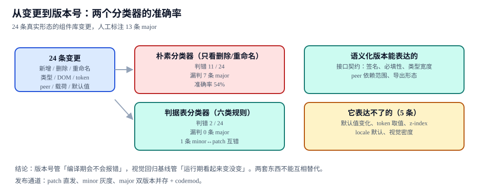
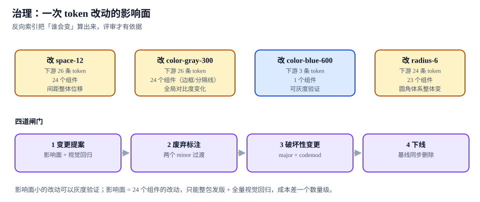

# 版本、废弃与发布治理

本页判据族 `DSVR-A` ~ `DSVR-H`，共 8 条。

一次组件库改动要同时回答两个问题：**「这算不算破坏性变更」**（决定版本号）与**「会惊动多少人」**（决定发版通道）。前者靠分类规则，后者靠影响面计算。两个问题分开答，就会出现「明明只改了一个默认值却发了 major」或者「明明动了 24 个组件却悄悄发了 patch」。

::: tip 一句话理解
版本号管的是**编译期会不会报错**，视觉基线管的是**运行期看起来变没变**。默认值、token 取值、`z-index` 这些变化不报错但会变样，语义化版本表达不了它们——所以它们必须靠另一条通道（基线 + 影响面）来兜。
:::



## 一、24 条真实变更里，13 条是破坏性的

用 24 条真实形态的组件库变更做标注（人工判定 **13 条 major**），比较两个分类器：

| 分类器 | 规则 | 判错 | 漏判 major | 准确率 |
| --- | --- | --- | --- | --- |
| **朴素分类器** | 只看「有没有删除 / 重命名」 | **11 / 24** | **7 条** | **54%** |
| **判据表分类器** | 六类规则（见下表） | **2 / 24** | **0 条** | **92%** |

朴素分类器漏掉的 7 条 major 全部是**「看起来没删东西、实际契约变了」**的类型：类型变窄（`string` → `'sm' | 'md'`）、必填性变化（可选变必填）、`peerDependencies` 范围收窄、载荷结构变化、默认值变化导致的视觉差异、导出形态从 ESM 变 CJS。

判据表分类器剩下的 2 条错，1 条是 minor ↔ patch 互错（不影响消费方，属于口径争议），另 1 条是分类器把「新增可选 prop」判成 minor 而人工标了 patch。

## 二、六类规则：什么算破坏性

| 类 | 变更形态 | 判定 | 依据 |
| --- | --- | --- | --- |
| **① 删除 / 重命名** | 删 prop、删组件、重命名导出、删除 CSS 变量 | **major** | 消费方代码直接编译失败或运行时报错 |
| **② 类型收窄** | `string` → `'sm' \| 'md'`；`number` → `1 \| 2` | **major** | 原来合法的调用变成类型错误 |
| **③ 必填性** | 可选 → 必填 | **major** | 原来能编译的调用缺参数 |
| **④ DOM 结构** | 包裹层增减、`<button>` 变 `<a>`、`aria-*` 语义变化 | **major** | 选择器、无障碍、测试查询全部受影响 |
| **⑤ 依赖与产物** | `peerDependencies` 范围收窄、去掉 CJS 产物、`exports` 路径改 | **major** | 安装或解析直接失败 |
| **⑥ 默认值与 token 取值** | `size` 默认 `md` → `lg`；`--accent-solid` 换值 | **minor（但必须配基线）** | 不报错、编译通过，但视觉变了 |

第六类是这一页的核心：它在语义化版本里**只能是 minor**（因为不破坏编译），但它对用户的影响可能比第五类更大。所以它的治理不能只靠版本号——必须同时满足「基线更新 + 影响面报告」。

## 三、语义化版本表达不了的 5 件事

| 变化 | 版本号反应 | 实际影响 | 兜底手段 |
| --- | --- | --- | --- |
| 默认值变化（`size: md → lg`） | 只能 minor | 所有未显式传 `size` 的按钮变大 | 视觉基线 + 变更日志明写「默认值变了」 |
| token 取值变化（主色偏移） | 只能 minor | 全站主色变，可能影响对比度合规 | token diff + 对比度断言 |
| `z-index` 层级调整 | 只能 patch | 弹层被遮挡，回归测试不一定覆盖 | 页面级基线（含弹层） |
| `locale` 默认值（`zh-CN` → `en-US`） | 只能 minor | 文案语言变，日期格式变 | 文案快照 + i18n 断言 |
| 视觉密度（间距整体收紧 2px） | 只能 minor | 24 个组件同时变样 | 影响面报告 + 全量基线 |

反过来，语义化版本能表达而基线表达不了的是：**签名、必填性、类型宽度、`peer` 范围、导出形态**。两套东西必须并存，不能互相替代。

## 四、影响面：决定走哪条发布通道

| 改动 | 下游 token | 组件 | 通道 |
| --- | --- | --- | --- |
| `color-blue-600` | **3** | **1** | 可灰度：5% 流量 → 全量 |
| `radius-6` | 24 | 23 | 整包发版 + 全量基线 |
| `color-gray-300` | 26 | 24 | 整包发版 + 全量基线 |
| `space-12` | **26** | **24** | 整包发版 + 全量基线 |

影响 1 个组件的改动可以灰度验证；影响 24 个组件的改动**只能整包发版 + 全量视觉回归**，成本差一个数量级。这不是流程洁癖：影响 24 个组件的改动如果只灰度 5% 流量，剩下 95% 的用户会在全量时同时看到变化，灰度失去了意义。



## 五、四道闸门

| 闸门 | 触发时机 | 要交什么 | 不通过的后果 |
| --- | --- | --- | --- |
| **① 变更提案** | 任何 token / 组件 API 改动前 | 影响面（token 数 / 组件数）+ 基线计划 | 改动进主干后才发现影响 24 个组件 |
| **② 废弃标注** | 决定移除某 prop 时 | `@deprecated` + 替代写法 + **两个 minor 的过渡期** | 直接删 → 消费方升级即崩 |
| **③ 破坏性变更** | major 发布 | 迁移指南 + codemod + 双版本并存 | 消费方只能手改，升级率归零 |
| **④ 下线** | 过渡期结束 | 基线同步删除、文档移除、变更日志归档 | 文档里留着已删的 prop，读者照着写报错 |

「两个 minor 过渡期」的判据是可数的：`1.4.0` 标注废弃 → `1.5.0`、`1.6.0` 仍在 → `2.0.0` 删除。少于两个 minor 就删，等于没有过渡。

## 六、发布通道与分类器的接线

```json [.changeset/config.json]
{
  "$schema": "https://unpkg.com/@changesets/config@3/schema.json",
  "changelog": "@changesets/cli/changelog",
  "commit": false,
  "access": "public",
  "baseBranch": "main",
  "updateInternalDependencies": "patch"
}
```

```markdown [.changeset/brave-lions-wait.md]
---
"@acme/ui": minor
---

`size` 的默认值从 `md` 改为 `lg`（视觉密度调整）。

**这一条是 minor，但会改变所有未显式传 size 的按钮高度**：
- 影响面：14 个组件、6 个页面模板
- 基线：全量重跑（`visual/` 下 6 张基线已更新）
- 若需保持旧尺寸，请显式传 `size="md"`
```

变更集（changeset）的三条纪律：

1. **一条变更一个 changeset**，不要「一版一个大 changeset」——后者无法回溯「哪次改动导致了这个 minor」。
2. **默认值变化必须在正文里明写**，因为版本号不会告诉你。
3. **major 的 changeset 必须带迁移步骤**（旧写法 → 新写法），CI 检查 major changeset 正文是否包含「迁移」小节。

## 七、判据 `DSVR-A` ~ `DSVR-H`

| 编号 | 判据 | 怎么验证 |
| --- | --- | --- |
| `DSVR-A` | 变更分类用六类规则，不靠「有没有删东西」判断 | 构造一个「只收窄类型」的变更，分类器必须判 major |
| `DSVR-B` | 分类器对 24 条样本的漏判 major 数为 0 | 跑分类器测试集，断言 `missed_major === 0` |
| `DSVR-C` | 默认值与 token 取值变化即使只发 minor，也必须更新基线并写明 | changeset 正文含「默认值」或「token」时，PR 必须带基线 diff |
| `DSVR-D` | 废弃走两个 minor 过渡期，`@deprecated` 带替代写法 | 统计标注版本与删除版本，间隔 ≥ 2 个 minor |
| `DSVR-E` | major 发布有迁移指南 + codemod，且 codemod 在样本仓库跑通 | codemod 在 3 个样本仓库执行，改完能构建 |
| `DSVR-F` | 发布通道与影响面匹配：影响 ≥ 10 个组件不得灰度 | 发版脚本读影响面报告，超阈值时禁用灰度开关 |
| `DSVR-G` | 变更日志保留「表达不了的那 5 类」的记录 | 日志里能查到默认值、token、z-index、locale、密度的历史变化 |
| `DSVR-H` | 下线时基线同步删除，不留孤儿基线 | 删除组件后，`visual/` 里无对应文件（孤图巡检为 0） |

## 八、验证方式

```shell [版本与治理的六步验证]
# ① 分类器测试集：24 条样本、13 条 major
node scripts/classify.mjs --fixtures=fixtures/changes-24.json
# 期望：total=24 major=13 naive-wrong=11 table-wrong=2 missed-major=0

# ② 反向验证：只收窄类型也必须判 major
node scripts/classify.mjs --input='{"kind":"narrow-type","from":"string","to":"\"sm\"|\"md\""}'
# 期望：major

# ③ 废弃过渡期
node scripts/deprecations.mjs --check
# 期望：每条 @deprecated 的 introduced 与 removeAt 间隔 ≥ 2 minor

# ④ 影响面 → 通道
node scripts/impact.mjs --token=space-12 --decide-channel
# 期望：components=24 channel=full-release（禁止灰度）

node scripts/impact.mjs --token=color-blue-600 --decide-channel
# 期望：components=1 channel=canary

# ⑤ major changeset 必带迁移节
node scripts/check-changeset.mjs
# 期望：所有 major changeset 含「## 迁移」小节，否则退出码 1

# ⑥ 下线后无孤儿基线
node utils/audit/orphanassetcheck.py --root docs
# 期望：E=0（组件删除后基线一并删除）
```

```text [一次 major 的发布记录（示例）]
version: 2.0.0  (from 1.6.2)
breaking: 删除 size="xs"（自 1.4.0 起废弃，满两个 minor）
migration: 脚本 scripts/codemod/size-xs.mjs，样本仓库 3/3 构建通过
impact: 12 tokens → 9 components（低于全量阈值，可灰度）
baseline: 6 张基线重生成，视觉回归 8/8 PASS
```

## 九、相关页面与下一篇

- 下一篇：[实战：12 个组件的最小设计系统](../Practice/index.md)——把这套判据在五天里跑一遍。
- 上游：[Token：三层、双产物](../Tokens/index.md)（影响面从哪来）、[视觉回归](../VisualRegression/index.md)（minor 的兜底闸门）。
- 相邻必读：[技术决策与评审](../../../Others/TechDecision/Overview/index.md)（破坏性变更的决策记录）、[依赖与安全治理](../../../Tools/DependencyGovernance/index.md)（`peerDependencies` 范围与许可证）。

## 参考资料

- [Semantic Versioning 2.0.0](https://semver.org/)
- [Changesets · 官方文档](https://github.com/changesets/changesets)
- [npm · `peerDependencies` 说明](https://docs.npmjs.com/cli/v11/configuring-npm/package-json#peerdependencies)
- [Node.js · Packages（`exports` 的兼容性影响）](https://nodejs.org/api/packages.html)
- [Storybook 10.6 发布说明（版本与迁移节奏参考）](https://storybook.js.org/releases/10.6)
