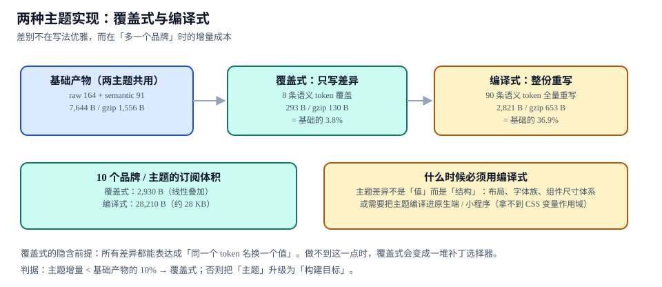

# 主题与多品牌：覆盖式与编译式

本页判据族 `DSTH-A` ~ `DSTH-H`，共 8 条。

「支持多主题」这句话在需求文档里只占一行，在实现上要选一条路：**覆盖式**（同一份 CSS，只改语义层的一小组值）还是**编译式**（每个主题单独编译一份完整产物）。两者的差别不在写法优雅，而在**多一个品牌时的增量成本**。

::: tip 一句话理解
覆盖式的前提是「所有差异都能表达成同一个 token 名换一个值」。做不到这一点时，覆盖式会退化成一堆补丁选择器；而补丁选择器的数量一旦超过某个阈值，它已经比编译式更贵了。
:::



## 一、两种实现的账

基准是第 2 页那份两层产物：raw 164 + semantic 91，**7,644 B / gzip 1,556 B**。

| 实现 | 写什么 | 产物体积 | gzip | 占基础产物 |
| --- | --- | --- | --- | --- |
| **覆盖式** | 只写差异：8 条语义 token | **293 B** | **130 B** | **3.8%** |
| **编译式** | 整份重写：90 条语义 token 全量 | **2,821 B** | **653 B** | **36.9%** |

单看一个主题，覆盖式便宜 9.6 倍。但真正的差别在数量上：

| 品牌数 | 覆盖式 | 编译式 | 差 |
| --- | --- | --- | --- |
| 1（默认主题） | 7,644 B | 7,644 B | — |
| 2 | 7,937 B | 10,465 B | 1.3× |
| 10 | 增量 **2,930 B**（10 × 293 B），加基础共 **10,574 B** | **28,210 B**（10 × 2,821 B） | **2.7×** |

覆盖式的增量是**线性叠加**且每份只有几百字节；编译式是**按主题整份复制**，10 个品牌时就是 10 份 2.8 KB。这就是为什么大部分 SaaS 产品选覆盖式：品牌多、差异小。

## 二、覆盖式的隐含前提

覆盖式成立需要三个条件同时满足，缺一条就会开始堆积补丁：

| 前提 | 不满足时的症状 | 补丁形态 |
| --- | --- | --- |
| 差异能用「同名换值」表达 | 品牌 B 的按钮是**圆角 + 图标在左**，品牌 A 是直角 + 图标在右 | 组件里加 `[data-brand="b"] .btn { flex-direction: row-reverse }` |
| 差异只落在语义层 | 品牌 B 的间距基准是 6px 而不是 4px | 覆盖 26 条 `space-*`，等于重写整个间距体系 |
| 组件不为某个品牌特判 | 品牌 B 的卡片阴影有三层，语义层只有一个 `shadow-card` | 组件层加 `brand-b` 分支 |

一旦补丁选择器超过 **15~20 条**，维护成本就反超编译式了：每条补丁都要跟着组件改版走，而编译式只需要维护一份主题源文件。

::: danger 「先用覆盖式，撑不住了再换编译式」是错的顺序
1. **覆盖式的补丁会污染组件源码**：`[data-brand="b"]` 这类选择器一旦写进组件样式，组件就不再是「与品牌无关」的，之后换回编译式还要清理一遍。
2. **正确顺序是先判据后实现**：先用第 5 节的判据算出「主题增量 / 基础产物」，小于 10% 才落覆盖式。
3. **不要用 `!important` 补覆盖**：它的优先级会打断消费方的主题定制链，第三个品牌进来时没人知道真实值（见 [常见问题与分诊](../FAQ/index.md) 的反例）。
:::

## 三、什么时候必须用编译式

| 场景 | 为什么覆盖式不行 |
| --- | --- |
| 主题差异是**结构**（布局方向、字体族、组件尺寸体系） | 结构差异不是「值」，覆盖式只能靠选择器重排 DOM 顺序或改尺寸，属于补丁 |
| 要编译进**原生端 / 小程序** | 这些环境拿不到 CSS 变量的作用域继承，需要把值直接内联进样式表 |
| 主题需要**独立的产物指纹**（合规审计要求「这一版用的是哪个主题包」） | 覆盖式产物里所有主题共用一个文件，无法按主题追溯 |
| 主题数量 > 15 且差异不小 | 覆盖式的 `<style>` 体积线性增长，首屏要下载全部主题的覆盖规则（除非按需注入） |

编译式的代价也很实在：**每加一个主题就多一份完整产物**，且 token 改动后要重新编译全部主题（10 个主题 × 2.8 KB 的重建 + 视觉回归）。

## 四、落地：三种切换机制与各自的坑

| 机制 | 写法 | 适用 | 坑 |
| --- | --- | --- | --- |
| **类名 / 属性** | `<html data-theme="dark">` + `[data-theme="dark"] { --bg-canvas: … }` | 用户可切换的主题 | 首屏有闪烁（见下） |
| **媒体查询** | `@media (prefers-color-scheme: dark) { :root { … } }` | 跟随系统、无手动切换 | 用户手动切换后无法覆盖（除非加 `data-theme` 双轨） |
| **运行时注入** | JS 把 token 对象写成 `<style>` 或 `CSSStyleSheet` | 主题来自后端配置、可在不发版时改 | 注入时机晚于首屏渲染 → 必定闪烁；且 SSR 无法预知 |

双轨（媒体查询 + 属性）是目前最稳的写法：默认跟随系统，用户选过就写属性，属性优先级高于媒体查询。

```css [src/styles/theme.css]
/* 基础：跟随系统 */
:root {
  color-scheme: light dark;
  --bg-canvas: var(--color-gray-50);
  --fg-default: var(--color-gray-900);
  --accent-solid: var(--color-blue-600);
}

@media (prefers-color-scheme: dark) {
  :root:not([data-theme]) {
    --bg-canvas: var(--color-gray-950);
    --fg-default: var(--color-gray-100);
    --accent-solid: var(--color-blue-400);
  }
}

/* 手选：属性优先，且必须覆盖媒体查询的结果 */
[data-theme="dark"] {
  --bg-canvas: var(--color-gray-950);
  --fg-default: var(--color-gray-100);
  --accent-solid: var(--color-blue-400);
}

[data-theme="light"] {
  --bg-canvas: var(--color-gray-50);
  --fg-default: var(--color-gray-900);
  --accent-solid: var(--color-blue-600);
}
```

```html [index.html]
<!-- 首屏前同步执行：避免深色用户看到一帧白屏 -->
<script>
  try {
    var saved = localStorage.getItem("theme"); // "light" | "dark" | null
    if (saved) document.documentElement.dataset.theme = saved;
  } catch (e) {
    /* 隐私模式下 localStorage 可能抛错，忽略即可 */
  }
</script>
```

::: warning 首屏脚本的三条纪律
1. **必须内联、必须在样式表之前**：外链脚本会被样式表阻塞，等于没优化。
2. **必须 try/catch**：Safari 隐私模式下访问 `localStorage` 会抛异常，脚本一挂，主题就永远停在默认值。
3. **不要在脚本里读 `prefers-color-scheme` 再写属性**：那会把「跟随系统」变成「固定在系统当前值」，用户之后改系统设置就不生效了。
:::

## 五、判据：什么时候该把主题升级成构建目标

| 指标 | 阈值 | 超过之后 |
| --- | --- | --- |
| 主题增量 / 基础产物 | **< 10%** → 覆盖式 | 把主题升级为构建目标（编译式） |
| 覆盖的语义 token 条数 | **≤ 15 条** | 说明差异已进入「体系级」，不是「值级」 |
| 品牌特判选择器条数 | **≤ 20 条** | 补丁维护成本超过编译成本 |
| 主题数 | **≤ 15** | 覆盖规则总量超过一份完整产物 |

本专题实测的覆盖式是 293 B / 7,644 B = **3.8%**，8 条覆盖，0 条品牌特判选择器——三个指标都在安全区内，所以这个系统选覆盖式是对的。换个前提：某个客户要求「圆角全部改成 2px、间距基准 6px、按钮图标在左」，覆盖式要改 24 条以上 token，指标立刻越过阈值，此时应走编译式。

## 六、判据 `DSTH-A` ~ `DSTH-H`

| 编号 | 判据 | 怎么验证 |
| --- | --- | --- |
| `DSTH-A` | 主题实现方式有判据支撑：算出「主题增量 / 基础产物」，并记录阈值比较 | 提交里能找到那一次计算的命令与读数 |
| `DSTH-B` | 覆盖式只覆盖语义层，不覆盖原始层与组件层 | `grep -c "color-gray" theme/*.css` 应为 0 |
| `DSTH-C` | 组件样式里没有 `[data-theme]` / `[data-brand]` 选择器 | 组件包内 `grep -rn "data-theme\|data-brand" src` 为 0 命中 |
| `DSTH-D` | 三种切换机制只有一种生效路径，双轨时属性优先于媒体查询 | 手选深色后强制系统浅色，界面仍为深色 |
| `DSTH-E` | 首屏无主题闪烁：内联脚本在样式表之前执行且带 `try/catch` | 深色偏好下强制刷新 10 次，无白帧（录屏逐帧检查） |
| `DSTH-F` | 主题切换不触发整页重渲染（只改变量） | 切换时用 Performance 面板确认无 Layout 大范围重排 |
| `DSTH-G` | 每个主题都有独立视觉基线，且基线数量 = 主题数 × 变体数 | 2 主题 × 8 变体 = 16 张基线，缺一即不合格 |
| `DSTH-H` | 主题产物体积有上限并在 CI 中拦截 | `wc -c theme/*.css` 的增量不超过基础产物的 10%（覆盖式） |

## 七、验证方式

```shell [主题实现的四步验证]
# ① 体积判据：覆盖式增量占比
node -e "
const fs=require('fs');
const base=fs.statSync('tokens/dist/tokens.css').size;
const t=fs.statSync('theme/brand-b.css').size;
console.log('base='+base+' theme='+t+' ratio='+(t/base*100).toFixed(1)+'%');
"
# 期望：base=7644 theme=293 ratio=3.8%   → 小于 10%，覆盖式成立

# ② 覆盖层是否越界
grep -nE "color-gray|btn-|card-" theme/brand-b.css || echo "OK: 只覆盖语义层"

# ③ 组件内是否出现品牌特判
grep -rn "data-theme\|data-brand" packages/react/src || echo "OK: 组件与主题解耦"

# ④ 多品牌总量
for f in theme/*.css; do wc -c "$f"; done | awk '{s+=$1} END {print "total="s"B"}'
# 期望：10 个品牌 ≈ 2930B 增量（覆盖式），而非 28210B（编译式）
```

```text [深色主题切换的手工验收]
1. 系统设为浅色 → 打开页面 → 背景应为 --color-gray-50 对应值
2. 页面内切到深色 → 刷新 → 仍为深色（localStorage 生效）
3. 系统切到深色、页面手选浅色 → 界面保持浅色（属性优先）
4. 清除 localStorage + 系统深色 → 刷新 → 深色（媒体查询生效）且无白帧
```

## 八、相关页面与下一篇

- 下一篇：[组件 API：表面积与状态所有权](../ComponentAPI/index.md)——主题只改值，组件 API 决定「哪些值可被改」。
- 上游：[Token：三层、双产物与解析](../Tokens/index.md)（语义层是主题的唯一入口）。
- 相邻必读：[微交互与动效工程 · 时长](../../Motion/Timing/index.md)（动效 token 进主题的注意点）、[常见问题与分诊](../FAQ/index.md)（「改了没变化」的三类根因）。

## 参考资料

- [MDN · `prefers-color-scheme`](https://developer.mozilla.org/en-US/docs/Web/CSS/@media/prefers-color-scheme)
- [MDN · `color-scheme`](https://developer.mozilla.org/en-US/docs/Web/CSS/color-scheme)
- [web.dev · 避免主题闪烁（color-scheme 与内联脚本）](https://web.dev/articles/prefers-color-scheme)
- [Tailwind CSS · Dark mode](https://tailwindcss.com/docs/dark-mode)
- [Design Tokens Format Module 2025.10 · 别名与分组](https://www.designtokens.org/tr/2025.10/format/)
