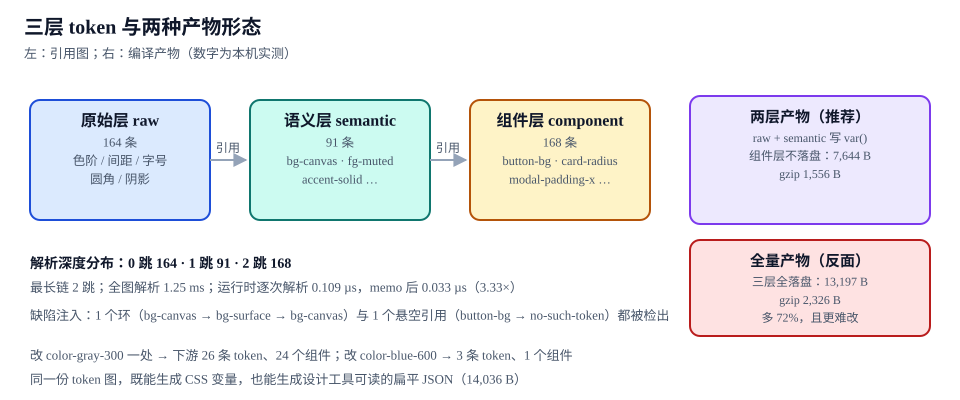

# Token：三层、双产物与解析

本页判据族 `DSTN-A` ~ `DSTN-H`，共 8 条。

Token 层是整条链里**唯一必须由人维护**的一环：组件是代码、文档是生成物、基线是截图，只有 token 的名字与取值是纯人工决定。它也是最容易失控的一环——一年之后没人记得 `--color-gray-300` 到底该不该直接用，于是组件里开始出现它的直接引用，第二套主题进来时全线崩。

::: tip 一句话理解
三层 token 的分工只有一条判据：**改动这一层，应该惊动多少人**。原始层改动惊动全库（几乎不改），语义层改动惊动一个主题（按季改），组件层改动惊动一个组件（随手改）。
:::



## 一、三层各自的职责与条数

| 层 | 这一层回答 | 本专题的实测条数 | 命名形态 | 允许引用谁 | 谁有权改 |
| --- | --- | --- | --- | --- | --- |
| **原始层** `raw` | 「调色板上有什么颜色」 | **164** | `color-gray-300`、`space-12`、`font-size-14` | 只能写字面值 | 设计系统维护者，按季度 |
| **语义层** `semantic` | 「这个颜色用在哪」 | **91** | `bg-canvas`、`fg-muted`、`accent-solid` | 只能引用原始层 | 设计系统维护者 + 设计 |
| **组件层** `component` | 「这个组件的这个部位」 | **168** | `button-bg`、`card-radius`、`modal-padding-x` | 只能引用语义层 | 组件作者，随手 |

三层合计 **423** 条。这个数字本身不重要，重要的是**比例**：原始 164 : 语义 91 : 组件 168。

- 语义层只有 91 条，说明**可复用的决定是有限的**——一个产品真正需要的语义角色大概就是这个量级（背景 8、文字 10、边框 6、强调 5、状态 8、间距 12、字号 12、圆角 4、阴影 3、动效 6……）。
- 组件层 168 条比语义层还多，说明**大部分组件差异是通过组件层表达的**，不是通过语义层加开关。这符合预期：语义层越薄越稳，组件层越厚越容易随组件改版而改。
- 如果原始层只有 20 条而组件层有 400 条，几乎一定意味着有人在组件层写死了值（`button-bg: #3b82f6` 而不是 `{accent-solid}`）。

## 二、DTCG 2025.10 的格式要点

2025-10 是 DTCG 的第一个稳定版。它把「token 是什么」定死了，理解四条就够用：

```json [tokens/src/semantic.tokens.json]
{
  "bg": {
    "canvas": {
      "$type": "color",
      "$value": "{color.gray.50}",
      "$description": "页面最底层背景，卡片之下"
    }
  },
  "space": {
    "card-gap": {
      "$type": "dimension",
      "$value": { "value": 12, "unit": "px" },
      "$description": "卡片内元素间距"
    }
  },
  "motion": {
    "enter": {
      "$type": "duration",
      "$value": { "value": 160, "unit": "ms" }
    }
  }
}
```

| 要点 | 具体规定 | 迁移时的坑 |
| --- | --- | --- |
| 键名前缀 | `$value` / `$type` / `$description` / `$deprecated` / `$extensions` | 旧格式是裸 `value` / `type`，混用会导致解析器把 `$value` 当成分组 |
| 引用语法 | `"{color.gray.50}"` 花括号包全路径 | 只支持全路径，不支持 `./` 相对写法与通配 |
| 结构化取值 | `dimension` / `duration` 是 `{value, unit}` 对象；`cubicBezier` 是 4 元数组 | 旧文件里 `"16px"` 是字符串，直接喂给 v5 会报类型不符 |
| 类型清单 | 13 种：7 原始（`color` `dimension` `fontFamily` `fontWeight` `duration` `cubicBezier` `number`）+ 6 复合（`strokeStyle` `border` `transition` `shadow` `gradient` `typography`） | 复合类型内部可引用其他 token，解析器要做**递归展开** |
| 文件扩展名 | `.tokens.json` | 用 `.json` 不会报错，但工具链（Figma 插件、Tokens Studio）会按扩展名过滤 |
| 规范地位 | 社区组规范，**不是 W3C 标准** | 不要写成「W3C 标准」，也不要在合规文档里当强制依据 |

::: danger 结构化取值是升级时最容易踩的一处
1. **不要用正则替换**把 `"16px"` 改成 `{"value":16,"unit":"px"}`——`fontFamily` 里也有数字，`shadow` 字符串里也有 `px`，正则会一起改坏。
2. **按 `$type` 分流处理**：只有 `dimension` / `duration` 需要拆对象，其余类型保持字符串。
3. **`cubicBezier` 不要写成 `"cubic-bezier(.2,0,0,1)"`**：规范要的是 `[0.2, 0, 0, 1]`，字符串形式在生成 CSS 时才拼成函数。
:::

## 三、解析：深度分布与环检测

token 图是一张有向图，节点是 token，边是引用。解析要做三件事：**拓扑展开、环检测、悬空检测**。

```javascript [scripts/tokens-check.mjs]
// 解析 + 校验：返回 { flat, depth, defects }
import { readFileSync, readdirSync } from "node:fs"

const SRC = "tokens/src"
const files = readdirSync(SRC).filter((f) => f.endsWith(".tokens.json"))

/** 把嵌套对象压平：{ "bg.canvas": { $type, $value } } */
function flatten(obj, prefix = "", out = {}) {
  for (const [k, v] of Object.entries(obj)) {
    if (k.startsWith("$")) continue
    const path = prefix ? `${prefix}.${k}` : k
    if (v && typeof v === "object" && "$value" in v) out[path] = v
    else if (v && typeof v === "object") flatten(v, path, out)
  }
  return out
}

const tokens = files.reduce((acc, f) => {
  const raw = JSON.parse(readFileSync(`${SRC}/${f}`, "utf8"))
  return Object.assign(acc, flatten(raw))
}, {})

const ALIAS = /^\{([^}]+)\}$/
const depth = {}
const defects = []

/** DFS：沿途把路径压栈，命中栈内节点即环 */
function resolve(name, stack = []) {
  if (depth[name] !== undefined) return depth[name]
  if (stack.includes(name)) {
    defects.push({ kind: "cycle", at: [...stack, name].join(" -> ") })
    return 0
  }
  const t = tokens[name]
  if (!t) return 0
  const m = typeof t.$value === "string" && ALIAS.exec(t.$value)
  if (!m) return (depth[name] = 0)
  const target = m[1]
  if (!tokens[target]) {
    defects.push({ kind: "dangling", at: `${name} -> ${target}` })
    return (depth[name] = 0)
  }
  return (depth[name] = 1 + resolve(target, [...stack, name]))
}

const t0 = performance.now()
for (const name of Object.keys(tokens)) resolve(name)
const ms = performance.now() - t0

const dist = Object.values(depth).reduce((a, d) => ((a[d] = (a[d] ?? 0) + 1), a), {})
console.log(`tokens=${Object.keys(tokens).length} defects=${defects.length}`)
console.log(`depth=${JSON.stringify(dist)} full-parse=${ms.toFixed(2)}ms`)
if (defects.length) console.log(defects)
```

本机读数（Node 22.22.2）：

| 指标 | 读数 | 说明 |
| --- | --- | --- |
| 解析总数 | **423** | 164 + 91 + 168 |
| 解析深度分布 | 0 跳 **164**、1 跳 **91**、2 跳 **168** | 原始层 0 跳、语义层 1 跳、组件层 2 跳，**最长链只有 2 跳** |
| 全图解析耗时 | **1.25 ms** | 冷启动 + 首次读文件，可忽略 |
| 单次解析（未 memo） | **0.109 µs** | 运行时把 `{a.b}` 换成实际值的场景 |
| 单次解析（memo 后） | **0.033 µs** | 3.33× ——缓存的是「名字 → 最终值」，不是整张图 |
| 注入缺陷检出 | 环 1/1、悬空 1/1 | `bg-canvas → bg-surface → bg-canvas` 与 `button-bg → no-such-token` |

**「最长链只有 2 跳」是三层结构的直接证据**：一旦出现 4 跳以上的链，说明有人在原始层和自己的别名之间又插了一层，或者组件层引用了组件层——这两种都会让「改一个原始值影响谁」变得不可预测。

::: danger 环检测的三处实现细节，错一处就会漏
1. **栈要在递归里传，不能用全局 visited**：全局 visited 只能判「访问过」，判不了「在当前的环上」，A→B→A 会被漏掉。
2. **memo 要在检测之后写**：先 `depth[name] = ...` 再递归，遇到环时读到的是未完成值，会把环算成正常。
3. **同一名字可能同时是「悬空」与「落在环里」**：只要 `defects` 里去重，不要在遇到第一个缺陷时就 `return`——后面的引用关系仍有诊断价值。
:::

## 四、双产物 vs 全量产物：为什么要少落一层

| 产物 | 内容 | 体积 | gzip | 相对 |
| --- | --- | --- | --- | --- |
| **两层落盘**（推荐） | raw + semantic 写成 `var()` | **7,644 B** | **1,556 B** | 基准 |
| **全量落盘** | raw + semantic + component 全部落盘 | **13,197 B** | **2,326 B** | **+72%** |
| 扁平 JSON（给设计工具） | 423 条扁平的 `名字 → 值` | **14,036 B** | — | 只读产物，不进前端包 |

组件层不落盘的理由不是省 5.5 KB，而是**维护成本**：

- 落了盘的组件层，改一个语义 token 要改两处（语义层 + 组件层里那些硬写的引用值），第二个月就会出现「语义层改了、组件层没改」的分裂；
- 组件层如果不落盘，组件里写 `var(--btn-bg, var(--accent-solid))` 这种「组件层默认值 = 语义层引用」的写法，取值仍然能在 CSS 里覆盖，但**默认关系由 YAML 声明**，改语义层自动生效；
- 反过来，如果你们的组件层差异确实需要落盘（比如要给每个组件单独覆盖、且不能引用语义层），那就落盘——但要接受 72% 的体积与双写成本，并把它写进决策记录。

::: tip 一个判断口径
组件层的 168 条里，有多少条的取值**不是**某个语义 token 的引用？如果这个比例低于 20%，组件层就应该作为「映射声明」存在，不落盘；高于 40%，说明组件有独立的视觉体系，落盘更诚实。
:::

## 五、命名：三层各自的名字长什么样

| 层 | 好名字 | 坏名字 | 判断依据 |
| --- | --- | --- | --- |
| 原始层 | `color-gray-300`、`space-12`、`radius-6` | `color-light-border`、`space-small` | 原始层**不带语义**，只描述「是多少」 |
| 语义层 | `bg-canvas`、`fg-muted`、`border-subtle`、`accent-solid` | `gray-bg`、`light-text`、`brand-color` | 语义层**只描述角色**，不描述取值 |
| 组件层 | `button-bg`、`card-radius`、`modal-padding-x` | `btn-blue`、`card-6` | 组件层**由组件名 + 部位**构成，不带取值形容词 |

另一条硬规则：**语义层的名字里不出现方向与状态**（`hover`、`active`、`disabled`）。状态变化属于组件层或 CSS 伪类，进语义层会让 91 条变成 300 条，且每个组件都要重写一遍同名状态。

## 六、影响面：改一条 token 会惊动谁

反向索引是 token 层最值钱的产物。它是「组件 → token」的正向引用反过来算出来的。

| 改动 | 下游 token 数 | 受影响组件数 | 可灰度 | 该走的通道 |
| --- | --- | --- | --- | --- |
| `space-12` | **26** | **24** | 否 | 整包发版 + 全量视觉回归 |
| `color-gray-300` | **26** | **24** | 否 | 整包发版 + 全量视觉回归 |
| `radius-6` | **24** | **23** | 否 | 整包发版 + 全量视觉回归 |
| `color-blue-600` | **3** | **1** | 是 | 可灰度到 5% 流量验证 |

这张表改变的是**发版成本的数量级**：影响 1 个组件的改动可以灰度、可以只跑那 1 个基线；影响 24 个组件的改动必须全量跑、全量发。第 8 页 [版本、废弃与发布治理](../ReleaseGovernance/index.md) 会把这套判据接到发版流程上。

```shell [生成影响面表]
# 输入：组件 → 引用清单（由编译期扫描得到），token 反向索引
node scripts/impact.mjs --token=space-12
# 期望：space-12 → 26 tokens → 24 components
```

## 七、判据 `DSTN-A` ~ `DSTN-H`

| 编号 | 判据 | 怎么验证 |
| --- | --- | --- |
| `DSTN-A` | 三层职责不越界：原始层不含语义词、语义层只引用原始层、组件层只引用语义层 | 解析时按前缀检查引用目标所在层，越层引用计数应为 0 |
| `DSTN-B` | 解析结果无环、无悬空，且缺陷注入能被检出 | 注入 `A→B→A` 与 `x → no-such-token`，脚本必须各报 1 条 |
| `DSTN-C` | 最长引用链 ≤ 3 跳 | 输出深度分布；出现 4 跳即不合格 |
| `DSTN-D` | 语义层条数 ≤ 120，组件层条数 ≤ 语义层 × 2 | 超出说明语义层被当组件层用，或组件层在写死值 |
| `DSTN-E` | 组件层不落盘（或已书面决策落盘并接受 +72% 体积） | 产物里 `grep "button-bg"` 应为 0 命中（落盘方案则需有决策记录） |
| `DSTN-F` | 源文件为 DTCG 2025.10 格式：`.tokens.json` + `$value` + 结构化 `dimension`/`duration` | 解析器严格模式下能全量通过，无类型警告 |
| `DSTN-G` | 扁平 JSON 产物可被设计工具直接读取，且条数与源一致 | `jq 'keys \| length' tokens/dist/tokens.json` = 423 |
| `DSTN-H` | 任一 token 的影响面可在 1 秒内算出 | `impact.mjs` 单次执行 < 1 s，输出 token 数与组件数 |

## 八、验证方式

```shell [token 层的五条验证]
# ① 解析与缺陷检出
node scripts/tokens-check.mjs
# 期望：tokens=423 defects=0  depth={"0":164,"1":91,"2":168}  full-parse≈1.3ms

# ② 注入一个环，确认脚本会失败（反向验证）
node scripts/tokens-check.mjs --inject=cycle
# 期望：tokens=423 defects=1（kind=cycle），退出码 1

# ③ 注入一个悬空引用
node scripts/tokens-check.mjs --inject=dangling
# 期望：defects=1（kind=dangling button-bg -> no-such-token）

# ④ 产物条数与体积
jq 'keys | length' tokens/dist/tokens.json     # 期望 423
wc -c tokens/dist/tokens.css                    # 期望 ≈7644

# ⑤ 组件层是否被落盘
grep -c "button-bg" tokens/dist/tokens.css      # 期望 0
```

```text [正常输出示例]
tokens=423 defects=0
depth={"0":164,"1":91,"2":168} full-parse=1.25ms
flat-json=14036B  css=7644B
```

## 九、相关页面与下一篇

- 下一篇：[主题与多品牌：覆盖式与编译式](../Theming/index.md)——第二套取值怎么叠在 91 条语义层上。
- 上游：[CSS 进阶 · 自定义属性](../../Basic/CSS/Advanced/index.md)（`var()` 的作用域与继承规则）、[原子化 CSS](../../Basic/CSS/AtomicCSS/index.md)（`@theme` 与 token 的关系）。
- 相邻必读：[产物体积](../Distribution/index.md)（为什么 CSS 摇不掉）、[版本与发布治理](../ReleaseGovernance/index.md)（影响面怎么进评审）。

## 参考资料

- [Design Tokens Format Module 2025.10（类型与引用语法）](https://www.designtokens.org/tr/2025.10/format/)
- [Style Dictionary · Token 与 Transform](https://styledictionary.com/info/tokens/)
- [Style Dictionary v5 迁移说明（DTCG 2025.10）](https://styledictionary.com/info/migration/)
- [MDN · CSS 自定义属性（`var()`）](https://developer.mozilla.org/en-US/docs/Web/CSS/Using_CSS_custom_properties)
- [Tailwind CSS · Theme variables](https://tailwindcss.com/docs/theme)
- [webpack · Tree Shaking](https://webpack.js.org/guides/tree-shaking/)
