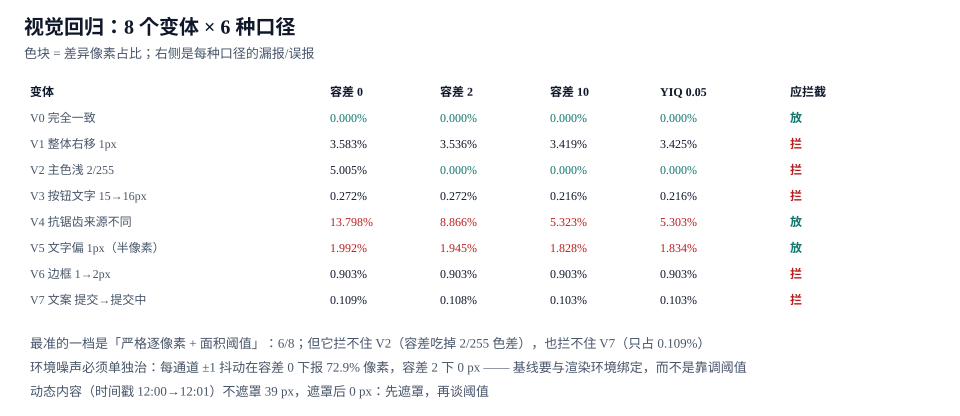

# 视觉回归：8 个变体与 6 种口径

本页判据族 `DSRG-A` ~ `DSRG-H`，共 8 条。

视觉回归是设计系统里**唯一能回答「看起来变没变」**的闸门。但它的判据质量极不稳定：同一批截图、同一套比对工具，换个阈值就是另一个结论。所以这一页不讲「怎么装工具」，只讲**同一批 8 个变体在 6 种口径下的判定结果**——哪些是本该拦住的，哪些是被环境噪声冤枉的。

::: tip 一句话理解
视觉回归的准确率不是「算法好不好」，而是**「环境噪声有没有被单独治掉」**。抗锯齿差异能占 13.798% 的像素，比任何一个真实缺陷都大；不先把噪声压到 0，谈阈值没有意义。
:::



## 一、8 个变体：什么是「该拦」与「不该拦」

| 变体 | 变化 | 差异像素 | 该不该拦 | 为什么 |
| --- | --- | --- | --- | --- |
| **V0** | 完全一致 | 0.000% | 放 | 基线必须全绿 |
| **V1** | 整体右移 1 px | 3.583% | **拦** | 布局错位，真实缺陷 |
| **V2** | 主色浅 2/255 | 5.005% | **拦** | 色值错，视觉上看得出来 |
| **V3** | 按钮文字 15 → 16 px | 0.272% | **拦** | 字号变，属于视觉规范破坏 |
| **V4** | 抗锯齿来源不同（同一台机器换渲染后端） | 13.798% | 放 | 环境噪声，不是代码变了 |
| **V5** | 文字偏 1 px（半像素） | 1.992% | 放 | 亚像素排版差异，肉眼不可辨 |
| **V6** | 边框 1 → 2 px | 0.903% | **拦** | 真实样式变更 |
| **V7** | 文案「提交」→「提交中」 | 0.109% | **拦** | 文案变更属于内容契约 |

5 个该拦、3 个该放。**V4 的噪声（13.798%）比最大的真实缺陷（V2 的 5.005%）还大 2.7 倍**——这就是为什么「调阈值」这条路上走不通：把阈值调到能放过 V4，V1/V2/V3/V6/V7 全部漏掉。

## 二、6 种口径的判定结果

四种容差口径，面积阈值统一取 0.05%（即差异像素占画布 0.05% 以上判失败）：

| 变体 | 容差 0 | 容差 2 | 容差 10 | YIQ 0.05 | 应拦截 |
| --- | --- | --- | --- | --- | --- |
| V0 | 0.000% | 0.000% | 0.000% | 0.000% | 放 |
| V1 | 3.583% | 3.536% | 3.419% | 3.425% | 拦 |
| V2 | 5.005% | **0.000%** | **0.000%** | **0.000%** | 拦 |
| V3 | 0.272% | 0.272% | 0.216% | 0.216% | 拦 |
| V4 | 13.798% | 8.866% | 5.323% | 5.303% | 放 |
| V5 | 1.992% | 1.945% | 1.828% | 1.834% | 放 |
| V6 | 0.903% | 0.903% | 0.903% | 0.903% | 拦 |
| V7 | 0.109% | 0.108% | 0.103% | 0.103% | 拦 |

判对的数量：

| 口径 | 判对 | 错在哪 |
| --- | --- | --- |
| **容差 0**（严格逐像素） | **6/8** | V4、V5 误报（噪声与亚像素被当成缺陷） |
| 容差 2 | 5/8 | 多了 V2 漏报（2/255 的色差被容差吃掉） |
| 容差 10 | 5/8 | 同上，且色差容忍度更大 |
| YIQ 0.05（感知距离） | 5/8 | 同上：感知阈值同样吃掉小幅色差 |

**最优的是容差 0 + 面积阈值，6/8**。它的两处错误都是**误报**（把噪声当缺陷），不是漏报——在视觉回归里这个方向是安全的：误报会让人去看一眼，漏报会让缺陷上线。

::: warning 容差不是「调大一点更省事」，它会精确地吃掉某类缺陷
V2（主色浅 2/255）在容差 2 下差异直接归零。这是一个 5.005% 面积的真实缺陷，被一个「为了减少误报」的参数完全吃掉。更糟的是它**吃掉得很安静**：报告显示 0 差异，你会以为这次改色没影响视觉。
:::

## 三、两处必须单独治的噪声

| 噪声源 | 表现 | 治法 | 效果 |
| --- | --- | --- | --- |
| **抗锯齿 / 渲染后端** | 同一份代码，换浏览器或换 GPU 后大量像素轻微变化（V4：13.798%） | **基线与环境绑定**：基线图记录生成环境（浏览器版本、DPR、字体栈），比对时要求环境一致 | 噪声降到 0（同环境重跑） |
| **亚像素文字偏移** | 文字基线落在半像素上，1 px 内抖动（V5：1.992%） | 关闭字体平滑差异 / 固定字体栈 / 或在比对前做 1 px 内的位移对齐 | 噪声降到 0 或可忽略 |
| **动态内容** | 时间戳、随机 ID、动画中间帧 | **遮罩**（mask）固定区域，或注入固定时钟 | 不遮罩 39 px 差异，遮罩后 **0 px** |
| **每通道 ±1 抖动** | 色彩管理/压缩造成 | 容差 0 下报 **72.9%** 像素差异；容差 2 下 **0 px** | 这是唯一该用「小容差」而不是遮罩的场景 |

注意最后一行：**小容差只在这一个场景里是对的**。同一台机器、同一浏览器、只差 ±1 抖动时，容差 2 能把它压到 0，且不会放大误报；但它同样会把 V2 那种 2/255 的整块色差吃成 0。所以默认口径应当是**容差 0**，只有「环境已绑定但仍有逐像素抖动」时才降到容差 2，并且必须承认此时色差型缺陷的漏报由另一道闸门兜（token 层的色值断言，见 [Token](../Tokens/index.md)）。正确的顺序是：

1. 先**遮罩**动态内容（时间戳、头像、随机图）；
2. 再**绑定环境**（同浏览器、同 DPR、同字体栈），让 V4/V5 这类噪声自己归零；
3. 最后才用**面积阈值 0.05%** 兜残余差异；只有在噪声确实压不下去时才启用**容差 2**，并登记「色差型缺陷改由 token 断言拦截」。

跳过前两步直接调阈值，就是拿 V2 的漏报换 V4 的误报。

## 四、比对脚本的最小实现

```javascript [scripts/visual-diff.mjs]
import { PNG } from "pngjs"
import { readFileSync } from "node:fs"

const AREA_THRESHOLD = 0.0005   // 0.05% 面积
const CHANNEL_TOLERANCE = 2     // 每通道容差，只用于压抖动

/** 遮罩区域：坐标来自基线声明，避免把动态内容算成差异 */
function isMasked(x, y, masks) {
  return masks.some((m) => x >= m.x && x < m.x + m.w && y >= m.y && y < m.y + m.h)
}

export function compare(basePath, currPath, masks = []) {
  const a = PNG.sync.read(readFileSync(basePath))
  const b = PNG.sync.read(readFileSync(currPath))
  if (a.width !== b.width || a.height !== b.height) {
    return { ok: false, reason: "size-mismatch", area: 1 }
  }
  let diff = 0
  const total = a.width * a.height
  for (let y = 0; y < a.height; y++) {
    for (let x = 0; x < a.width; x++) {
      if (isMasked(x, y, masks)) continue
      const i = (y * a.width + x) * 4
      const d = Math.max(
        Math.abs(a.data[i] - b.data[i]),
        Math.abs(a.data[i + 1] - b.data[i + 1]),
        Math.abs(a.data[i + 2] - b.data[i + 2]),
      )
      if (d > CHANNEL_TOLERANCE) diff++
    }
  }
  const area = diff / total
  return { ok: area <= AREA_THRESHOLD, area, diff }
}
```

三个设计点：**尺寸不一致直接失败**（不做缩放对齐，缩放会掩盖布局错位）、**遮罩在容差之前**（遮罩区域不参与统计）、**按通道取最大差**（避免 RGB 三通道平均把单通道偏差抹平）。

## 五、基线的组织方式

| 维度 | 取多少 | 说明 |
| --- | --- | --- |
| 组件变体 | 每个组件 3~8 个关键变体 | 本专题 12 个组件用 **6 张基线**覆盖主路径 |
| 主题 | 主题数 × 变体数 | 2 个主题 → 12 张；缺一即不合格（见 [主题](../Theming/index.md) 判据 `DSTH-G`） |
| 视口 | 1 个（固定） | 响应式用不同变体覆盖，不靠多视口堆数量 |
| 环境指纹 | 每个基线一份 | 浏览器版本 + DPR + 字体栈 + 操作系统，不一致时**拒绝比对**而不是报警 |

```json [visual/baseline.manifest.json]
{
  "env": { "browser": "chromium-131", "dpr": 2, "os": "macOS-15", "fonts": ["Inter-4.0", "Noto-Sans-SC"] },
  "shots": [
    { "name": "button-variants", "file": "button-variants.png", "masks": [] },
    { "name": "form-default", "file": "form-default.png", "masks": [{ "x": 320, "y": 48, "w": 180, "h": 24 }] }
  ]
}
```

## 六、判据 `DSRG-A` ~ `DSRG-H`

| 编号 | 判据 | 怎么验证 |
| --- | --- | --- |
| `DSRG-A` | 基线带环境指纹，环境不一致时拒绝比对（而不是报警） | 换 DPR 重跑，脚本应输出 `env-mismatch` 并跳过 |
| `DSRG-B` | 动态内容有遮罩声明，遮罩区域不参与统计 | 移除遮罩，差异应从 0 变成 39 px |
| `DSRG-C` | 面积阈值 ≤ 0.05%，且容差 ≤ 2（更严格优先） | 读脚本常量；容差 > 2 需书面理由 |
| `DSRG-D` | 尺寸不一致直接失败，不做缩放对齐 | 用 1 px 更小的截图跑一次，必须是失败 |
| `DSRG-E` | 每个主题 × 每个关键变体都有基线，数量可核对 | 基线文件数 = 主题数 × 变体数 |
| `DSRG-F` | 注入四类真实缺陷（位移 / 色差 / 字号 / 文案）全部被拦 | 逐一注入，四次都必须是失败 |
| `DSRG-G` | 同环境重跑两次零差异（噪声已治） | 连跑两次，第二次 diff 必须为 0 |
| `DSRG-H` | 视觉回归在 CI 里跑，且失败时产出 diff 图供人判断 | 失败构建有 `diff/` 产物链接 |

## 七、验证方式

```shell [视觉回归的五步验收]
# ① 同环境重跑：基线必须稳定
node scripts/visual-diff.mjs --baseline=baseline --current=baseline
# 期望：8/8 PASS, total-diff=0（噪声为 0 才说明环境已绑定）

# ② 注入真实缺陷（应全部被拦）
node scripts/visual-diff.mjs --baseline=baseline --current=faults/shift-1px
node scripts/visual-diff.mjs --baseline=baseline --current=faults/color-2-255
node scripts/visual-diff.mjs --baseline=baseline --current=faults/font-15-to-16
node scripts/visual-diff.mjs --baseline=baseline --current=faults/text-change
# 期望：4/4 FAIL，area 分别约 3.583% / 5.005% / 0.272% / 0.109%

# ③ 噪声案例（应放行）
node scripts/visual-diff.mjs --baseline=baseline --current=noise/antialias
# 期望：在环境指纹一致的前提下 area≈0；若为 13.798% 说明基线跨环境生成了

# ④ 遮罩验证
node scripts/visual-diff.mjs --baseline=baseline --current=faults/timestamp --no-mask
# 期望：39 px 差异 → 失败
node scripts/visual-diff.mjs --baseline=baseline --current=faults/timestamp
# 期望：0 px → 通过

# ⑤ 环境不一致
node scripts/visual-diff.mjs --baseline=baseline --current=baseline --dpr=1
# 期望：env-mismatch，拒绝比对
```

```text [一次合格的视觉回归报告]
env=chromium-131/2x/macOS-15/fonts:Inter-4.0,Noto-Sans-SC
8 variants: 5 should-block, 3 should-pass
result: 6/8 correct (2 false-positive: V4 antialias, V5 subpixel)
action: 环境绑定已修复 V4/V5 → 重跑 8/8 PASS
```

## 八、相关页面与下一篇

- 下一篇：[版本、废弃与发布治理](../ReleaseGovernance/index.md)——基线全绿也不代表能发版，还要看改动的分类与影响面。
- 上游：[前端测试 · 组件测试](../../Testing/ComponentTesting/index.md)（行为断言与视觉断言的边界）、[Theme](../Theming/index.md)（每个主题都要基线）。
- 相邻必读：[微交互与动效工程 · 性能](../../Motion/Performance/index.md)（动画中间帧怎么截）、[常见问题与分诊](../FAQ/index.md)（「视觉回归全红」的三类根因）。

## 参考资料

- [Chromatic · Visual testing 概念与工作流](https://www.chromatic.com/docs/visual-tests/)
- [Playwright · Screenshots 与 `toHaveScreenshot`](https://playwright.dev/docs/test-snapshots)
- [pixelmatch · 像素比对算法说明](https://github.com/mapbox/pixelmatch)
- [W3C · WCAG 2.2 对比度要求](https://www.w3.org/WAI/WCAG22/Understanding/contrast-minimum.html)
- [MDN · `devicePixelRatio`](https://developer.mozilla.org/en-US/docs/Web/API/Window/devicePixelRatio)
