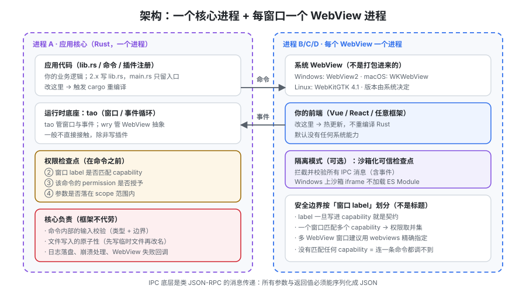

# 架构与进程模型

「Rust 核心 + 系统 WebView」这句话太短了，短到不足以解释你后面会遇到的每一个现象：为什么前端改一行 CSS 不用重编译、为什么一次 `invoke` 是异步的、为什么窗口的 label 决定它能调什么、为什么 macOS 上关掉窗口进程还在。这一页把这条边界讲清楚：**哪部分代码在哪里运行、它们之间怎么说话、以及这条边界被踩错时会出现什么。**



## 一、三个层次：核心、运行时、WebView

| 层 | 是什么 | 跑在哪 | 换掉它的代价 |
| --- | --- | --- | --- |
| **应用核心（Rust）** | 你的业务逻辑、命令实现、插件注册、窗口管理 | 一个**独立的操作系统进程**（"core process"） | 改一行要重新编译 Rust 侧（秒级到分钟级） |
| **运行时底座** | `tao`（跨平台窗口/事件循环）+ `wry`（WebView 抽象） | 与应用核心同进程 | 不直接接触，除非你写插件 |
| **WebView** | 系统提供的浏览器控件：WebView2 / WKWebView / WebKitGTK | **每个窗口（严格说是每个 WebView）一个独立进程** | 前端改动走热更新；跨平台差异是它的固有属性 |

这条划分带来三个立刻能观察到的现象：

1. **前端热更新快，Rust 侧慢。** `tauri dev` 里改 `.vue` 是前端构建工具在起作用，改 `lib.rs` 会触发 `cargo` 重编译。**不要把业务逻辑随手塞进前端又随手塞进 Rust**——每跨一次边界都要付出「重编译」或「一次序列化」的代价。
2. **WebView 崩溃不会带走核心进程。** 页面渲染进程挂掉时，Rust 核心还活着，可以重建 WebView 或提示用户。反过来，核心进程退出等于整个应用退出。
3. **WebView 是操作系统的一部分，不是你打包进去的。** 它的版本、补丁、渲染行为由系统或 WebView2 Updater 决定。**这是 Tauri 体积小的原因，也是「三平台渲染不一致」的根因**——详见[概述的三条路线判据](../Overview/index.md)。

::: info Tauri 1.x 与 2.x 的一处结构差异
1.x 的应用入口在 `src-tauri/src/main.rs`；2.x 把应用逻辑放到 **`lib.rs`**，`main.rs` 只留一行 `app_lib::run()`。原因是 **2.x 支持移动端**，iOS/Android 把应用作为**库**加载，而不是作为可执行文件启动。

所以：**你的代码写在 `lib.rs`，不要写回 `main.rs`**——写回去在桌面端能跑，移动端会找不到入口。
:::

## 二、目录结构：哪块归谁

```text
da-notes/
├── src/                     # 前端：完全复用 Web 工程结构
├── index.html
├── package.json
└── src-tauri/               # 桌面侧，与前端同级
    ├── Cargo.toml           # tauri / tauri-build / tauri-plugin-*
    ├── build.rs             # tauri_build::build()
    ├── tauri.conf.json      # 唯一配置入口：identifier / windows / build / bundle / plugins
    ├── capabilities/        # 权限授予，默认拒绝
    │   └── default.json
    ├── icons/               # 各平台图标（构建期由 CLI 生成多尺寸）
    └── src/
        ├── lib.rs           # 应用代码入口：commands / plugins / setup
        └── main.rs          # 桌面端可执行入口，保持原样
```

三条容易混淆的边界：

- **`tauri.conf.json` 是「结构」，不是「值」。** 路径、窗口标题、bundle 目标放这里；端口、密钥、环境相关的地址应该由构建期变量或运行时配置提供（与仓库[完整项目交付](../../../Others/ProjectDelivery/Delivery/index.md)里的「结构进仓库、值进环境变量、密钥进密钥管理」是同一套划分）。
- **平台差异走同名覆盖文件。** `tauri.windows.conf.json` / `tauri.macos.conf.json` / `tauri.linux.conf.json` 会与主配置**合并**。

  ::: danger 平台覆盖文件里数组是「整体替换」而不是「追加」
  如果主配置的 `app.windows` 有两个窗口、覆盖文件里只写了一个，**结果是只剩那一个**，而不是三个。凡是数组型配置（`windows`、`bundle.targets`、`capabilities`），在覆盖文件里必须写全。
  :::

- **`icons/` 不要手改单个文件。** 用 `npm run tauri icon path/to/source.png` 一次性生成全平台尺寸；手动替换容易造成「macOS 正常、Windows 任务栏糊」。

## 三、两种 IPC 模式：brownfield 与 isolation

Tauri 2 提供两种前端与核心的通信模式。**它们不是「新旧」关系，而是两种威胁模型假设。**

| 维度 | brownfield（默认） | isolation |
| --- | --- | --- |
| 配置 | 不需要额外配置 | 需要一个隔离应用目录（`app.security.pattern.options.dir`） |
| 消息路径 | 前端 → 核心 | 前端 → **沙箱 iframe 里的隔离应用** → 核心 |
| 能做什么校验 | 只能在**命令内部**（Rust 侧）校验 | 可以在**可信 JS** 里拦截、校验、改写**所有** IPC 消息（含事件） |
| 加密 | 无 | 消息用 `SubtleCrypto` 加密（AES-GCM），**密钥每次应用启动重新生成** |
| 性能 | 最快 | 有轻微开销 |
| 适用 | 内部工具、前端代码完全可信、原型 | **对外分发、处理敏感数据、依赖大量第三方前端包** |

::: danger 用 isolation 时要避开的三个坑
1. **隔离应用里不能有第三方代码。** 它是整条 IPC 的检查点，**攻破它等于绕过整个模式**。所以：保持它极简、零依赖、不放任何你无法逐行读懂的代码。
2. **Windows 上沙箱 iframe 不加载 ES Module。** 隔离应用的脚本必须**内联/打包成单文件**，不能依赖 `<script type="module">` 与模块解析。
3. **不要用 bundler 处理隔离应用。** 官方明确建议跳过打包器，走「直接产出单个 JS 文件」的路径——引入打包器会带来「构建产物与源码不一致」的风险，而这正是隔离模式要防的东西。
:::

选择判据一句话：**「如果前端被别人控制了，最坏结果是什么？」** 如果答案是「读走应用自己的数据」，brownfield + 严格 scope 足够；如果答案是「执行任意命令」，先补 scope，再考虑 isolation。

## 四、与 Electron 的逐项对照

两张表分开看，因为这四个维度是**独立**的、很容易被混为一谈。

**表一：进程与引擎**

| 维度 | Electron | Tauri 2 |
| --- | --- | --- |
| 渲染引擎 | 自带 **Chromium**（随 Electron 44 为 Chromium 152） | **系统 WebView**：WebView2 / WKWebView / WebKitGTK 4.1 |
| 主进程语言 | Node.js | **Rust** |
| 渲染进程能力 | 默认有 Node（`nodeIntegration` 可关） | **默认没有任何系统能力**，必须显式授权 |
| 引擎升级方式 | 你决定，跟随 Electron 大版本（支持最近三个大版本） | 由系统 / WebView2 Updater 决定，**你无法 pin 版本** |
| 端到端一致性 | 高（三平台同一引擎） | 低（三平台三引擎），需真机验收 |
| 典型包体积 | 百 MB 级 | **可到 600KB 级**（不含前端资源与 sidecar） |

**表二：安全模型的基本方向相反**

| 问题 | Electron 的做法 | Tauri 2 的做法 |
| --- | --- | --- |
| 默认状态 | 相对开放，靠**关掉**危险开关（`nodeIntegration`、`contextIsolation`、`sandbox`）收紧 | **默认全关**，靠 capability 文件**逐条开** |
| 授权粒度 | 到 API/开关一级，主要靠 preload 白名单自己兜 | **到命令 + 资源 scope 一级**（`fs:allow-read-file` 还能限定 `$APPDATA/*`） |
| 前端被攻破的后果 | 取决于你关掉了多少 | 取决于你**授予了多少** |
| 主要失败模式 | 「忘了关」 | 「给多了」 |

::: tip 一个反直觉但很重要的推论
Electron 的安全工作量**随功能增加而增加**（每加一个能力都要问「我是不是又开了什么」）；Tauri 的安全工作量**随功能增加而增加，但增长是显式的**（每加一个能力都要写一行 JSON）。

**「显式」的价值在于审计**：你可以直接 diff `capabilities/` 目录看权限变化，而 Electron 里权限散落在各处的构造参数中。
:::

## 五、窗口与 WebView：label 是安全边界

| 概念 | 说明 | 关键点 |
| --- | --- | --- |
| Window | 操作系统窗口 | 可以用 `windows` 配置预声明，也可以运行时 `WebviewWindowBuilder` 创建 |
| WebView | 窗口内的网页容器 | **一个窗口可以有多个 WebView** |
| label | 窗口/WebView 的**字符串标识**（不是标题） | **capability 靠它匹配**；`windows: ["main"]` 里的 `main` 是 label，标题改了不影响 |

由此得到三条工程纪律：

1. **label 一旦写进 capability 就是契约。** 改 label 等于改权限归属。**不要把 label 写成用户可见的标题**（标题会变，label 不该变）。
2. **多窗口应用的权限必须分组授。** 值班窗口、设置窗口、预览窗口按「需要碰什么」分成不同 capability，而不是全体共用一个大 capability。

   ::: danger 一个窗口同时属于多个 capability 时，权限是「并集」
   官方文档明确提示：**参与多个 capability 的窗口，会合并所有相关 capability 的安全边界与权限**。所以「给设置窗口单独开个 capability」并不等于「设置窗口权限更少」——只要它还匹配到那个宽 capability，宽权限照样生效。
   :::

3. **优先用 `webviews` 而不是 `windows` 做多 WebView 窗口的授权。** 官方建议：多 WebView 窗口用 `webviews` 精确指定，避免 `windows` 一次性放大范围。

## 六、七步数据流（一次「保存笔记」的完整路径）

| 步 | 发生什么 | 失败时表现 |
| --- | --- | --- |
| ① | 前端调用 `invoke("save_note", { note })` | 命令名拼错 → 拒绝，且错误里通常只告诉你命令不存在 |
| ② | Tauri 检查**当前窗口 label** 有没有匹配到 capability | 没有 capability → **直接拒绝，命令代码一行都不执行** |
| ③ | 检查该命令的 permission 是否被授予（`allow-*`） | 未授予 → 拒绝；这条最常见的原因是「忘了把插件/命令加进 permissions」 |
| ④ | 检查参数是否落在 **scope** 允许范围内 | 路径不在 `$APPDATA/*` → 拒绝，报错来自 scope 校验而非你的代码 |
| ⑤ | 反序列化成 Rust 类型并调用你的 `#[tauri::command]` 函数 | 参数名/类型不匹配 → 反序列化错误（见 [IPC](../IPC/index.md) 的命名规则） |
| ⑥ | 你的函数执行**并自己做输入校验** | 这一层只有你能兜（见[安全模型](../Security/index.md)的「不防什么」） |
| ⑦ | 返回值序列化为 JSON 回传前端 | 返回类型不可序列化 → 编译期就该发现；运行时错误则通过 `Result` 的 `Err` 传回 |

**排查顺序固定为 ② → ③ → ④ → ⑤**：这四步都在你的代码之前，而且都是「静默拒绝 + 泛化错误」。先确认权限被命中，再看 scope，最后才怀疑业务逻辑。

## 验证方式

1. **确认权限检查发生在你的代码之前**：注册一个只做 `println!` 的命令，**先不授予权限**，从前端调用 → 观察 Rust 侧**没有任何输出**（说明命令根本没进函数），前端拿到拒绝错误。补上权限后重试 → Rust 侧出现输出。
2. **确认 label 决定权限**：在配置里加一个第二个窗口（label 改为 `settings`），只让 `main` 拥有某条命令的权限 → 在 `settings` 窗口里调用同一命令，应被拒绝。
3. **观察 WebView 是独立进程**：`npm run tauri dev` 启动后，用系统进程查看器确认**窗口数量与实际进程数**的关系（macOS/Linux 可用 `ps`；Windows 用任务管理器按进程树看）。
4. **确认 `main.rs` 保持原样**：检查 `src-tauri/src/main.rs` 只调用 `lib` 里的 `run()`，应用逻辑在 `lib.rs`。

::: warning 第 3、4 条的实测列纪律
第 3 条依赖你本机的进程查看工具与运行中的窗口，**不同平台输出差异较大**，实际项目里应把「进程数 = 1 核心 + N WebView（N 可能因平台合并而不同）」写成观察记录而非硬断言。第 4 条本机可判。
:::

## 相关专题

- [概述：桌面应用的六条真实约束](../Overview/index.md)：为什么先想演进边界
- [IPC 与命令](../IPC/index.md)：命令、事件、Channel 三种原语的具体写法
- [安全模型](../Security/index.md)：capability / permission / scope 三层的完整规则
- [Electron 专题](../../Frame/Electron/index.md)：另一条路线的进程模型与 IPC（对照读）
- [跨端开发 · 桌面端跨端](../../Frame/CrossPlatform/Desktop/index.md)：选型阶段的一句话判据

## 参考资料

- Tauri 官方文档 · 进程间通信：https://v2.tauri.app/concept/inter-process-communication/
- Tauri 官方文档 · 隔离模式：https://v2.tauri.app/concept/inter-process-communication/isolation/
- Tauri 官方文档 · 窗口与 WebView：https://v2.tauri.app/learn/window-customization/
- Tauri 官方文档 · 配置参考（含平台覆盖文件合并规则）：https://v2.tauri.app/reference/config/
- Electron 官方文档 · 进程模型：https://www.electronjs.org/docs/latest/tutorial/process-model
