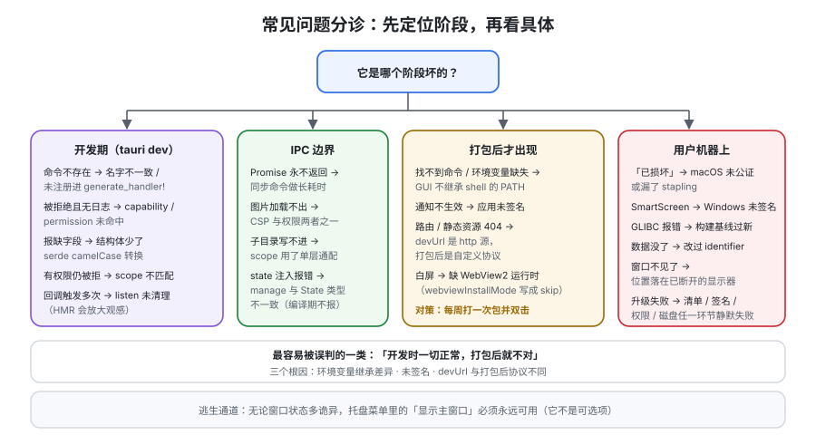

# 常见问题

这一页按「现象 → 最可能原因 → 处置」组织。前半部分是可分诊的运维问题（**先查表，再看后面**），中间是十二个高频疑问，最后是上线自查清单、最佳实践与术语表。

## 一、分诊表

| 现象 | 最可能的原因 | 先看哪里 |
| --- | --- | --- |
| 调用命令报「命令不存在」 | 命令名两端不一致 / 没注册进 `generate_handler!` | [IPC](../IPC/index.md) 第八节 |
| 调用被拒绝、Rust 侧无任何日志 | capability 未匹配窗口 label / permission 未授予 | [安全模型](../Security/index.md) 第一节 |
| 参数报缺字段、类型不符 | 结构体没加 `#[serde(rename_all = "camelCase")]` | [IPC](../IPC/index.md) 规则 1 |
| 报权限错误但权限明明已给 | **scope 不匹配**（路径层级 / URL / 参数） | [安全模型](../Security/index.md) 第三节 |
| 前端 Promise 永远不返回 | 同步命令里做了长耗时操作，或命令内 panic | [IPC](../IPC/index.md) 规则 3、4 |
| 事件回调触发多次 | `listen` 的返回值没清理（HMR 会放大） | [IPC](../IPC/index.md) 第四节 |
| 图片 / 资源加载不出来 | CSP 不允许该协议 **或** 缺对应权限（两者都要） | [IPC](../IPC/index.md) 第七节 |
| 子目录里的文件写不进去 | scope 写的是 `$APPDATA/*`，只匹配一层 | [原生能力](../NativeCapabilities/index.md) 坑 1 |
| 换台机器就白屏 | WebView2 运行时缺失（装了 `skip` 模式） | [打包与分发](../Packaging/index.md) 第二节 |
| 用户下载后提示「已损坏」 | macOS **未公证**（或漏了 stapling） | [打包与分发](../Packaging/index.md) 第四节 |
| 用户安装时被 SmartScreen 拦 | Windows 未签名 | [打包与分发](../Packaging/index.md) 第四节 |
| 老 Linux 上报 `GLIBC_2.xx not found` | 在过新的系统上构建 | [打包与分发](../Packaging/index.md) 第三节 |
| 从 Dock/图标启动后找不到命令 | GUI 应用不继承 shell 的 `$PATH` | [原生能力](../NativeCapabilities/index.md) 坑 4 |
| 更新装不上 / 装上了但没生效 | 清单、签名、权限、磁盘任一环节失败且被静默吞掉 | [自动更新](../Updater/index.md) 第四节 |
| 「升级后数据没了」 | **改过 `identifier`** | [打包与分发](../Packaging/index.md) 第一节 |
| 窗口打开后「不见了」 | 位置落在已拔掉的显示器上 | 本页「窗口不见了」小节 |
| 托盘图标在 Linux 上不显示 | 缺 `libayatana-appindicator3` 等依赖 | [打包与分发](../Packaging/index.md) 第三节 |

## 二、十二个高频疑问

**1. 「我到底该选 Tauri 还是 Electron？」**

看一个判据：**你能不能接受「三平台渲染引擎不同」这件事**。不能接受 → Electron（自带 Chromium，你可以自己决定引擎版本）。能接受、且对体积/内存敏感 → Tauri。其余维度都是次要的。完整判据见[概述](../Overview/index.md)第三节。

**2. 「前端代码完全不用改吗？」**

页面代码基本可以复用，但**有三处一定要改**：路由（多窗口场景）、存储（`localStorage` 与文件系统要选一个）、以及所有涉及系统能力的调用（从 Web API 换成 Tauri 命令）。见[跨端开发 · 桌面端跨端](../../Frame/CrossPlatform/Desktop/index.md)的复用对照表。

**3. 「为什么我的权限配置看起来给了，还是调不通？」**

按顺序查四个地方：① 窗口 **label** 是否匹配 capability 的 `windows`；② permission 的 identifier 拼写；③ **scope** 是否覆盖实际参数；④ 如果目标是你自己的命令，是否在 `build.rs` 里用 `AppManifest::commands` 声明过。见[安全模型](../Security/index.md)第二节末尾的警告——**自研命令默认对所有窗口开放**，这是最反直觉的一条。

**4. 「体积真的能到 600KB 吗？」**

那是**不含前端资源与 sidecar 的空壳量级**。真实应用 = 空壳 + 前端产物 + 图标 + sidecar + 可能的 WebView2 离线安装器（127MB）。**优化顺序应该是：先减 sidecar，再减前端产物，最后才调 Rust 编译参数。**

**5. 「没有 Rust 基础能做吗？」**

能起步，但**一定会在三处卡住**：打包（Cargo 配置与 `[profile.release]`）、签名（CI 与平台工具链）、以及任何需要自定义原生的地方（sidecar、平台 API、深度链接）。官方说法是「多数情况不用写 Rust」，**没说「不用懂构建与发布」**。

**6. 「`convertFileSrc` 给了路径但图还是不出来？」**

两个独立条件都要满足：**CSP 允许该协议** + **有对应权限**。只满足一个都不行。另外注意路径里的特殊字符要做 URL 编码（用 `convertFileSrc` 而不是手拼字符串）。

**7. 「开发时一切正常，为什么打包后就不对？」**

这是桌面开发最经典的困惑。三个高频根因：

| 根因 | 为什么开发期看不到 |
| --- | --- |
| `$PATH` / 环境变量差异 | 开发时从终端启动，继承了 shell 环境 |
| 未签名（通知、部分系统 API 需要签名） | 本机构建无 quarantine 属性，签名缺失不报错 |
| `devUrl` 与打包后协议不同（`http://localhost` vs `tauri://`） | 前者是 HTTP 源，后者是自定义协议，**相对路径、Cookie、CORS、`fetch` 行为都可能不同** |

**处置原则：从第 1 周开始，每周至少打一次包并双击运行一次。** 把「打包后验证」变成习惯，而不是发布前的惊喜。

**8. 「`state` 注入报类型错误是怎么回事？」**

`manage()` 注册的类型必须与命令参数 `State<T>` 的 `T` **完全一致**。用 `Mutex` 就两边都用 `Mutex`；**Tauri 已自动用 `Arc` 包装，不要再自己包 `Arc`**。建议用类型别名把「注册」与「取用」绑到同一个名字上。见 [IPC](../IPC/index.md) 第三节。

**9. 「能不能只用前端做一个完整的桌面应用，不碰 Rust？」**

可以做到「读写文件 + 对话框 + 通知 + 托盘 + 存储 + 更新」，因为都有官方插件与 JS API。**但一旦出现「插件没有的能力」或「需要高性能的本地计算」，就必须写 Rust 命令。** 另外 `build.rs` 的命令声明、CI 的签名与环境变量，也都在 Rust/配置侧。

**10. 「需不需要给桌面应用做 E2E 测试？」**

要，但**范围和 Web 不同**：Web E2E 里「输入框能写字」这类用例在桌面端价值很低（那是系统 WebView 在干活）。桌面端真正需要覆盖的是**跨进程**的部分：命令调用的成功与拒绝路径、文件真的落盘、更新检查的行为。可用的路径是 `WebDriver` + 平台的 WebView 驱动（tester 与驱动在[测试](../../Testing/index.md)专题的 E2E 一节有通用口径）。**性价比最高的其实是「判据清单 + 手工按清单走一遍」**，见[实战](../Practice/index.md)的 V1~V15。

**11. 「更新失败会不会把应用搞坏？」**

取决于你的流程。**中途失败的下载不会损坏现有安装**（安装是整体替换）；真正的风险在「换上新版本后启动即崩」——此时用户既丢了旧版本又没有可用版本。**所以两条纪律：更新包在发布前必须在干净机器上装过一次；以及「能快速发一个修复版本」的能力比「回滚」更重要**（低版本号不会被接受为更新）。见[自动更新](../Updater/index.md)第五节。

**12. 「怎么知道用户装的是哪个版本？」**

**唯一可靠的办法是让用户能告诉你**：界面上显示版本号（「关于」页），并且有「导出诊断包」入口。**不要指望有后台数据**——除非你自己做了隐私合规的上报通道，而这在桌面端是一个需要单独设计的模块。

## 三、「窗口不见了」专项处置

这是桌面端特有的、用户最常反馈、也最容易被当成「应用崩了」的问题。

| 可能原因 | 判别 | 处置 |
| --- | --- | --- |
| 窗口被移到已断开的显示器上 | 用户说「接外显时正常，拔了就没了」 | 启动时校验窗口坐标是否落在**当前**可见区域内，否则回到主屏；`window-state` 类插件通常已处理 |
| 窗口被关闭但进程还在 | 托盘/任务管理器里进程仍在 | 这是**期望行为**（托盘应用）：托盘左键唤出；并在首次关窗口时给一次「已最小化到托盘」的提示 |
| 窗口尺寸被恢复成 0 或极小 | 用户手工改过状态文件 | 恢复时对宽高设下限 |
| 窗口在其他工作区/虚拟桌面 | 系统行为 | 唤出时调用 `set_focus`，必要时先 `show` |
| 全局快捷键冲突导致唤不出来 | 快捷键被别的软件占用 | **必须对注册失败给出可见反馈**，见[原生能力](../NativeCapabilities/index.md)第六节 |

::: tip 一条预防性设计
**「无论窗口状态多诡异，用户总能重新打开它」**——所以托盘菜单里的「显示主窗口」是必备项，不是可选项。它是一条**逃生通道**。
:::

## 四、上线自查清单（21 项）

**交付物与签名**

1. 三平台目标格式产物齐全（`.dmg`/`.msi`/`.deb`…）。
2. `identifier` 与本产品**历史版本完全一致**。
3. `version` 与发布 tag 一致，且已递增。
4. macOS：签名通过 `codesign -vvv --deep --strict`。
5. macOS：`xcrun stapler validate` 通过（**不只是公证提交成功**）。
6. Windows：`Get-AuthenticodeSignature` 为 `Valid`。
7. Linux：发布页提供 SHA256 校验值。
8. 安装包在**干净机器/虚拟机**上装过一次并成功启动。

**安全**

9. `capabilities/` 里**没有** `$HOME/**`、`args: true`、`windows: ["*"]`、`url: "*"` 这类宽范围写法。
10. 自研命令已在 `build.rs` 用 `AppManifest::commands` 声明。
11. `csp` 非空，且 `connect-src` 只列必要的源；**没有 `unsafe-eval`**。
12. `shell:execute` 若被使用，scope 是**枚举的参数白名单**（不是 `args: true`）。
13. **仓库内检索不到私钥内容**（`TAURI_SIGNING_PRIVATE_KEY` 的值、minisign 私钥文件）。

**更新**

14. `bundle.createUpdaterArtifacts` 已开启，产物里有 `latest.json` 与 `*.sig`。
15. `plugins.updater.pubkey` 是**真实公钥**（不是占位串）。
16. **篡改签名后应用会拒绝安装**（`V13` 实测过）。
17. 更新端点只走 HTTPS，且清单本身也被签名校验。
18. 界面上能**看到当前版本号**，并能手动触发「检查更新」。

**数据与运维**

19. 用户数据在**应用数据目录**，不在安装目录；卸载不删数据（并在文档中说明如何手动清理）。
20. 日志**落盘且轮转**；日志中**不含**路径中的用户名、正文内容、token。
21. 有「导出诊断包」入口；WebView 进程失败有显式处理（不是白屏）。

## 五、十二条最佳实践

1. **`identifier` 在第一次发布前定死，之后永不修改。**
2. **权限从最小开始，一次提交加一项**，让权限变更是可审计的 diff。
3. **`capabilities/` 视为安全策略文件**，改动走评审。
4. **自研命令全部在 `build.rs` 声明**，别依赖「默认对所有窗口开放」。
5. **所有跨进程参数都做类型化 + 边界校验**，`Result` 返回，不用 `unwrap`。
6. **本地存储用「临时文件 + rename」**，别直接覆盖写。
7. **从第 1 周开始每周打一次包**，把「打包后验证」变成习惯。
8. **前端所有 `invoke` 集中在 `src/ipc/`**，并用脚本校验命令名集合一致。
9. **界面上永远显示版本号**，并提供「检查更新」与「导出诊断包」。
10. **签名与公证的采购在第 1 周启动**（Apple 账号、Windows 证书/Azure 审核都有提前期）。
11. **Linux 用最老基线系统构建**（容器或固定版本 CI runner）。
12. **托盘/快捷键这类「全局占用」的东西必须可配置、可关闭**，且注册失败要有可见反馈。

## 六、术语表

| 术语 | 含义 |
| --- | --- |
| **WebView** | 操作系统提供的网页渲染控件。Windows 用 WebView2，macOS/iOS 用 WKWebView，Linux 用 WebKitGTK |
| **WebView2** | Microsoft 的 Edge/Chromium 内核 WebView，随 Windows 10 1803+ 与 Windows 11 分发 |
| **WebKitGTK 4.1** | Linux 侧 WebView 实现，Tauri v2 的硬依赖，决定 Linux 基线系统 |
| **Capability** | 把一组权限授予**特定窗口/WebView** 的配置单元 |
| **Permission** | 某条命令的开关（`allow-*` / `deny-*`），插件与自研命令统一命名 |
| **Scope** | 权限的资源范围（路径 / URL / 参数），是「能调用」到「对什么调用」的那一层 |
| **Brownfield** | 默认 IPC 模式，前端直连核心 |
| **Isolation pattern** | 在前端与核心之间插入沙箱化的可信 JS 检查点，拦截所有 IPC 消息 |
| **Command** | 前端调用 Rust 的请求/响应式原语（`invoke`） |
| **Event** | 单向、双向可发的通知式消息 |
| **Channel** | 核心向**发起者**推送多次消息的流式原语 |
| **Sidecar** | 随应用一起分发的第三方可执行文件 |
| **minisign** | 基于 Ed25519 的签名工具，Tauri 更新签名的实现（与平台代码签名独立） |
| **`latest.json`** | 更新清单，含各平台条目的 `url` 与 `signature` |
| **hardened runtime** | macOS 的运行时加固开关，公证的前提之一 |
| **stapling** | 把公证票据钉进产物，使首次打开无需联机校验 |
| **MSRV** | 最低支持的 Rust 版本；Tauri 2.12 起为 **1.90**，策略是 `stable − 3` |
| **`identifier`** | 反向域名形式的应用唯一标识，同时是签名标识、数据目录名与路径前缀 |

## 相关专题

- [概述：桌面应用的六条真实约束](../Overview/index.md)
- [架构与进程模型](../Architecture/index.md)
- [IPC 与命令](../IPC/index.md)
- [原生能力](../NativeCapabilities/index.md)
- [安全模型](../Security/index.md)
- [打包与分发](../Packaging/index.md)
- [自动更新](../Updater/index.md)
- [实战：一个可安装的本地笔记应用](../Practice/index.md)

## 参考资料

- Tauri 官方文档 · 常见问题与调试：https://v2.tauri.app/develop/
- Tauri 官方文档 · 安全：https://v2.tauri.app/security/
- Tauri 官方文档 · 分发：https://v2.tauri.app/distribute/
- Tauri 官方文档 · Updater：https://v2.tauri.app/plugin/updater/
- Microsoft WebView2 分发文档：https://learn.microsoft.com/microsoft-edge/webview2/concepts/distribution
