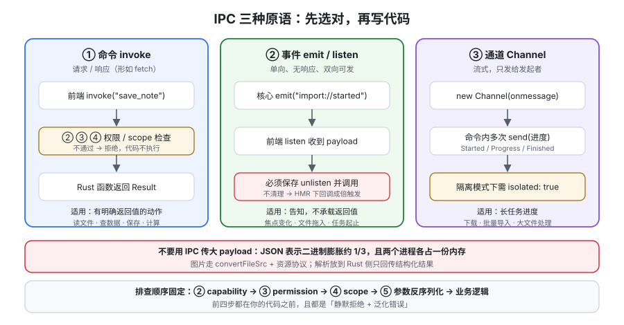

# IPC 与命令

前端与 Rust 核心之间的所有通信都走 IPC。它有三个原语——**命令（Command）、事件（Event）、通道（Channel）**，选错原语会导致「能跑但结构不对」，而结构不对的代价会在第 3 周以「状态不同步」「重复请求」「内存不释放」的形式集中爆发。这一页把三个原语的适用场景、参数传递的硬规则、错误传播方式和大数据量的边界讲清楚。



## 一、三个原语：先选对，再写代码

| 原语 | 方向 | 形态 | 适用 | 不适用 |
| --- | --- | --- | --- | --- |
| **命令 `invoke`** | 前端 → 核心 → 前端 | 请求/响应（类似 `fetch`） | **有明确返回值**的动作：读文件、查数据、保存、计算 | 核心主动通知前端、持续推送 |
| **事件 `emit` / `listen`** | **双向**，单向广播 | 一次性、无响应 | 生命周期与状态变化：窗口获得焦点、文件被拖入、任务开始/结束 | 需要返回值、需要严格顺序 |
| **通道 `Channel`** | 核心 → 前端（定向） | 流式、只给发起者 | **长任务的进度推送**：下载、批量导入、大文件处理 | 全局广播 |

::: tip 选择顺序
**能返回值的用命令；事件只用来「告知」；进度用 Channel 而不是高频事件。**
用事件代替命令的返回值是最常见的错误：你会被迫发明「请求 id + 回调表」，而这正是命令已经帮你做好的事。
:::

## 二、命令：五条硬规则

```rust [src-tauri/src/lib.rs]
use serde::{Deserialize, Serialize};

#[derive(Debug, Deserialize)]
#[serde(rename_all = "camelCase")]
struct SaveNoteArgs {
    note_id: String,
    content: String,
}

#[derive(Debug, Serialize)]
#[serde(rename_all = "camelCase")]
struct SaveResult {
    note_id: String,
    saved_bytes: usize,
}

// 返回 Result：所有可预期失败都走 Err，不要 panic
#[tauri::command]
fn save_note(args: SaveNoteArgs) -> Result<SaveResult, String> {
    if args.note_id.is_empty() || args.note_id.contains("..") {
        return Err("invalid note id".into());
    }
    let bytes = args.content.len();
    // ... 真正的落盘逻辑
    Ok(SaveResult { note_id: args.note_id, saved_bytes: bytes })
}

#[cfg_attr(mobile, tauri::mobile_entry_point)]
pub fn run() {
    tauri::Builder::default()
        .invoke_handler(tauri::generate_handler![save_note])
        .run(tauri::generate_context!())
        .expect("error while running tauri application");
}
```

**规则 1：参数名默认在边界处做 camelCase ↔ snake_case 转换。** 前端按 JS 习惯写 camelCase，Rust 侧按习惯写 snake_case，Tauri 会自动转换。**但如果参数是一个结构体，字段名的转换要你自己声明 `#[serde(rename_all = "camelCase")]`** —— 漏掉它，错误是反序列化失败，报错信息不会告诉你「是因为字段名大小写」。

**规则 2：所有参数与返回值必须能序列化成 JSON。** 这是 IPC 底层协议（类 JSON-RPC）决定的。不能序列化的类型（含生命周期的引用、原生句柄、`Rc` 等）**在编译期就会被挡下**，这是好事：它逼你把「能过边界的数据」和「只在 Rust 内用的数据」分开。

**规则 3：可预期失败一律用 `Result`，不要用 `panic!`/`unwrap()`。** `Err(e)` 会作为 reject 传回前端；`panic` 在命令线程上的行为与平台/运行时相关，可能表现为「命令永远不返回」，而前端只能看到一个挂住的 Promise。

**规则 4：`async` 命令在异步运行时上执行，同步命令不要做长耗时的事。** 一个同步命令里做 5 秒的文件扫描，会阻塞它所在的执行上下文。**判据：命令内出现 I/O 或超过 ~10ms 的计算，就改成 `async`。**

**规则 5：命令名就是前端与后端的公共契约。** 用**稳定的语义名**（`save_note` 而不是 `doThing2`），并在改名前全局搜索前端调用点。命令名改动**不会**被 TypeScript 检查出来——见本页第六节的类型同步方案。

前端调用（注意 `invoke` 的参数名与 Rust 参数名的对应关系）：

```ts [src/ipc/notes.ts]
import { invoke } from "@tauri-apps/api/core";

export async function saveNote(noteId: string, content: string) {
  // Rust 侧 save_note(args: SaveNoteArgs)，args 字段用 camelCase
  return invoke<{ noteId: string; savedBytes: number }>("save_note", {
    args: { noteId, content },
  });
}
```

::: danger 三个静默失败的名字问题
1. **Rust 函数名与前端 `invoke` 的字符串不一致。** 编译通过、运行时报「命令不存在」，且**不提示最接近的名字**。改名后必须全库搜索。
2. **结构体字段没加 `rename_all = "camelCase"`。** 前端传 `noteId`、Rust 期望 `note_id` → 反序列化失败，错误信息是 `missing field` 而不是「大小写问题」。
3. **把参数名写成 `_` 前缀或与 Tauri 保留名冲突。** 带 `window` / `app` / `state` 等注入参数时，**这些参数是自动注入的、不需要前端传**，把它们写进前端 `invoke` 的 payload 会被当成未知字段。
:::

## 三、注入参数：不用前端传的东西

命令可以声明一些**由 Tauri 自动注入**的参数，前端完全不用管：

| 参数类型 | 拿到什么 | 典型用途 |
| --- | --- | --- |
| `AppHandle` | 应用句柄 | 注册事件、读配置、操作其他窗口 |
| `Window` / `WebviewWindow` | 当前窗口 | 读取 **label**（权限与上下文判断的依据） |
| `State<T>` | 通过 `.manage()` 注册的共享状态 | 数据库连接池、配置、缓存 |

```rust [src-tauri/src/lib.rs（注入示例）]
use tauri::{AppHandle, State, Window};

struct AppState { db_path: std::path::PathBuf }

#[tauri::command]
fn current_context(window: Window, state: State<'_, AppState>) -> Option<String> {
    // label 是安全边界，用它判断「这个窗口该给什么」
    Some(format!("{}|{}", window.label(), state.db_path.display()))
}

pub fn run() {
    tauri::Builder::default()
        .manage(AppState { db_path: "/tmp/da-notes.sqlite".into() })
        .invoke_handler(tauri::generate_handler![current_context])
        .run(tauri::generate_context!())
        .expect("error while running tauri application");
}
```

::: danger `State` 的类型必须与 `manage` 时完全一致
官方明确点出过这个坑：**用 `manage(Mutex::new(state))` 注册，却把命令参数写成 `State<AppState>`（漏了 `Mutex`），编译通过但运行时 panic**。

可靠做法是定义一个类型别名（`type Shared = Mutex<AppState>;`），让「注册」与「取用」都引用同一个别名——这样类型不一致会在编译期暴露。

另外：**Tauri 已经替你用 `Arc` 包了一层，不要再自己包 `Arc`。**
:::

## 四、事件：双向广播，但要自己防重

事件是**单向、无响应**的，前端与核心**都可以发**。

```rust [src-tauri/src/lib.rs（核心发事件）]
use tauri::{AppHandle, Emitter};

#[tauri::command]
async fn import_notes(app: AppHandle, dir: String) -> Result<usize, String> {
    app.emit("import://started", &dir).map_err(|e| e.to_string())?;
    let mut count = 0usize;
    // ... 逐个导入
    count += 1;
    app.emit("import://finished", count).map_err(|e| e.to_string())?;
    Ok(count)
}
```

```ts [src/ipc/events.ts（前端监听）]
import { listen } from "@tauri-apps/api/event";

// 关键：一定要在组件卸载时 unlisten，否则会累积重复监听
export async function onImportFinished(handler: (n: number) => void) {
  return listen<number>("import://finished", (e) => handler(e.payload));
}
```

三条纪律：

1. **事件名用 `域://动作` 形式**（`import://started`、`window://blur`），避免与插件内置事件撞名——插件事件通常是 `plugin-name://event`。
2. **`listen` 返回的是取消函数，必须持有并调用。** 在 Vue/React 里放在 `onUnmounted` / 清理函数里。**热更新（HMR）会放大这个问题的观感**：不清理时你会看到回调触发 2 次、3 次，很容易误判成「后端发了多次」。
3. **事件不保证顺序性与投递保证。** 不要用「先收到 A 再收到 B」推断状态；需要顺序与进度就用 Channel。

## 五、Channel：长任务的进度

Channel 是**只发给发起者**的流式通道，专为「一个命令推送多次进度」设计，避免用高频事件污染全局。

```rust [src-tauri/src/lib.rs（Channel 用法）]
use tauri::ipc::Channel;

#[derive(Clone, serde::Serialize)]
#[serde(rename_all = "camelCase", tag = "event", content = "data")]
enum ImportProgress {
    Started { total: usize },
    Progress { done: usize, total: usize },
    Finished { done: usize },
}

#[tauri::command]
async fn import_with_progress(dir: String, on_progress: Channel<ImportProgress>) -> Result<(), String> {
    let total = 100usize;
    on_progress.send(ImportProgress::Started { total }).map_err(|e| e.to_string())?;
    for done in 1..=total {
        on_progress.send(ImportProgress::Progress { done, total }).map_err(|e| e.to_string())?;
    }
    on_progress.send(ImportProgress::Finished { done: total }).map_err(|e| e.to_string())?;
    Ok(())
}
```

```ts [src/ipc/import.ts（前端接收）]
import { invoke, Channel } from "@tauri-apps/api/core";

export async function importDir(dir: string, onEvent: (e: unknown) => void) {
  const onProgress = new Channel<unknown>();
  onProgress.onmessage = onEvent;
  return invoke<void>("import_with_progress", { dir, onProgress });
}
```

::: warning Channel 的 `isolated` 选项
用隔离模式（isolation pattern）时，Channel 会强制要求显式声明：`new Channel(onEvent, { isolated: true })`。漏掉它会在隔离模式下拿不到消息，而在 brownfield 下**一切正常**——所以这个坑只在切换模式后才暴露。
:::

## 六、类型同步：让「命令名写错」在编译期报错

IPC 的天然缺陷是**前后端靠字符串约定**。两个可行的收敛手段，任选其一即可，不要两个都不做：

| 方案 | 做法 | 代价 |
| --- | --- | --- |
| 手写生成 | 用 `specta` / `tauri-specta` 之类的工具从 Rust 类型生成 TS | 需要引入工具并接进构建流程 |
| 约定 + 门禁 | 所有 `invoke` 调用集中在 `src/ipc/` 下的少数文件，并用**一条测试或脚本**校验「前端调用的命令名集合 ⊆ Rust 注册的命令名集合」 | 需要写一个很小的解析脚本 |

::: tip 一条 20 行的门禁脚本就够用
从 `lib.rs` 里 `grep` 出 `tauri::generate_handler![...]` 的命令名集合，从 `src/ipc/**.ts` 里 `grep` 出 `invoke("...")` 的字符串集合，比对差集。**它能挡住「改名只改了半边」这个最高频的低级错误**，且不引入任何新依赖。
:::

## 七、大 payload 的边界：不要用 IPC 传文件

IPC 的底层是消息传递 + JSON 序列化。**JSON 表示二进制会膨胀约 1/3**（base64 编码），并且整块数据要在内存里构造、序列化、跨进程传输、再反序列化——**一份 100MB 的文件会在两个进程里各占一份内存**。

| 场景 | 不要这样做 | 应该这样做 |
| --- | --- | --- |
| 前端要显示本地图片 | `invoke` 返回 base64 | 用 `convertFileSrc` 得到可被 WebView 加载的 URL，交给 `` |
| 前端要读大文件内容 | 一次 `invoke` 返回全文字符串 | 分块读 + Channel 推进度；或**把解析放到 Rust 侧，只回传结构化结果** |
| 后端要把大对象给前端 | 直接返回 | 落成临时文件 / 走资源协议，只回传标识 |

::: danger `convertFileSrc` 不是「任意路径都能访问」
它把文件路径转成 WebView 能加载的 URL，**但能否真正加载仍受**：
1. **CSP**（`app.security.csp` 必须允许对应协议，如 `asset:` / `http://asset.localhost`）；
2. **权限**（`core:asset` 相关权限或对应插件的 scope）。

在 Tauri 2.12 起，Rust 侧也有对应方法（`Webview::convert_file_src`），它**按 WebView 配置的 scheme 生成 URL**（含 `useHttpsScheme` 场景），比在前端手拼 URL 更可靠——手拼容易在某个平台上生成 WebView 加载不了的 scheme。
:::

## 八、一次调用的完整判读路径

排查「调用不生效」时，按这个顺序看，**不要跳步**：

| 现象 | 最可能的原因 | 定位方法 |
| --- | --- | --- |
| 前端报命令不存在 | 名字不一致 / 没注册进 `generate_handler!` | 比对两端名字；确认在 `invoke_handler` 里 |
| 前端被拒绝、Rust 侧无任何输出 | **capability 未命中 / permission 未授予** | 检查 `capabilities/*.json` 的 `windows`/`webviews` 与 `permissions` |
| 报反序列化错误、缺字段 | 结构体字段没做 camelCase 转换 | 加 `#[serde(rename_all = "camelCase")]` |
| 报权限错误但权限已给 | **scope 不匹配**（路径/URL 不在允许范围） | 检查 scope 的路径变量（`$APPDATA` 等）与通配符 |
| Promise 永远不返回 | 同步命令里做了长耗时操作 / 内部 panic | 改 `async`；检查是否有 `unwrap()` |
| 回调触发多次 | 事件监听未清理（HMR 放大了它） | 保存 `unlisten` 并在卸载时调用 |

## 验证方式

1. **本机可判：默认拒绝是真的。** 注册 `save_note`，**不给任何权限**调用 → 前端 reject、Rust 侧无日志；补上权限后调用成功。这是[架构与进程模型](../Architecture/index.md)验证 1 的同一判据在具体命令上的落地。
2. **本机可判：字段名转换。** 把 `#[serde(rename_all = "camelCase")]` 注释掉，从前端按 camelCase 调用 → 观察错误类型（缺字段），再加回来 → 成功。**把两种错误原文记进项目笔记**，下次一眼能认。
3. **本机可判：事件监听会被 HMR 放大。** 故意不清理 `listen` 的返回值，反复热更新 → 观察回调次数递增；补上清理逻辑 → 次数恒为 1。
4. **本机可判：Channel 进度只在发起者收到。** 两个窗口同时监听同一个 Channel 场景（或同窗口双面板），确认只有发起方收到进度消息。

::: info 第 4 条的实测列说明
Channel 的「只发给发起者」在单窗口单面板的应用里不容易构造对照组。**做法是记录行为而非断言数字**：把观察到的「另一个面板没有收到任何 `Progress`」如实写进项目文档，不要写成「Channel 广播给了所有窗口」。
:::

## 相关专题

- [架构与进程模型](../Architecture/index.md)：IPC 为什么必须是异步消息传递
- [原生能力](../NativeCapabilities/index.md)：命令最常包装的就是这些系统能力
- [安全模型](../Security/index.md)：permission 与 scope 是怎么卡在命令前面的
- [实战：一个可安装的本地笔记应用](../Practice/index.md)：把本页的三种原语各用一次
- [测试](../../Testing/index.md)：如何给 IPC 边界写测试

## 参考资料

- Tauri 官方文档 · 进程间通信：https://v2.tauri.app/concept/inter-process-communication/
- Tauri 官方文档 · 调用 Rust（命令）：https://v2.tauri.app/develop/calling-rust/
- Tauri 官方文档 · 调用前端（事件与 Channel）：https://v2.tauri.app/develop/calling-frontend/
- Tauri 官方文档 · 状态管理：https://v2.tauri.app/develop/state-management/
- Tauri 官方文档 · 读取资源（`convertFileSrc`）：https://v2.tauri.app/develop/calling-rust/#returning-assets
