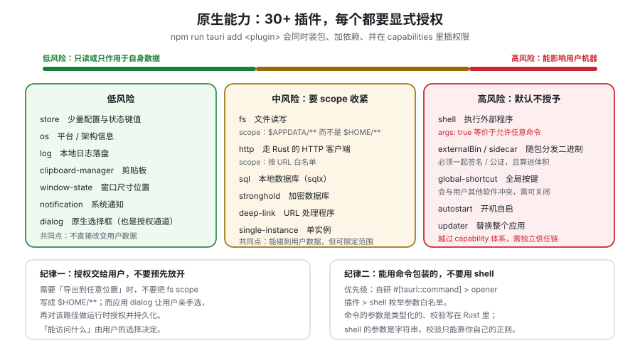

# 原生能力

桌面应用真正的价值不在「有个窗口」，而在**它能碰系统上的东西**。Tauri 把这些能力拆成 30+ 个官方插件，每个插件都要在 `capabilities/` 里显式授权，并且大多支持 **scope**（限定能碰哪些路径/URL/命令）。这一页按「你最可能先用到」的顺序过一遍，每一项都给出：什么时候用、权限怎么给、以及最容易踩的那一下。



## 一、能力总览与「用不用得着」判据

| 能力 | 官方插件 | 一句话判据 | 移动端 |
| --- | --- | --- | --- |
| 文件读写 | `fs` | 需要**持续**读写文件（不是一次选择） | ✅ |
| 文件/目录选择框 | `dialog` | **用户亲手选**的路径才能被信任 | ✅ |
| 在外部程序/浏览器打开 | `opener` | 打开一个 URL 或文件，不执行任意命令 | ✅（部分） |
| 系统托盘 | `system-tray`（核心 `tray`） | 需要「关掉窗口仍在后台」 | ❌ |
| 应用菜单 | 核心 `menu` | 桌面端有菜单栏才像原生应用 | ❌ |
| 系统通知 | `notification` | 用户不在看应用时也要告知 | ✅ |
| 剪贴板 | `clipboard-manager` | 读写文本/图片 | ✅（有平台差异） |
| 全局快捷键 | `global-shortcut` | 应用不在前台也要响应按键 | ❌ |
| 执行外部程序 | `shell` + sidecar | **必须极其谨慎**，见第五节 | ⚠️ |
| 单实例 | `single-instance` | 双击图标不该开出第二个应用 | ❌ |
| 记住窗口位置 | `window-state` | 用户拉过的窗口大小不该每次都重置 | ❌ |
| 本地数据库 | `sql`（基于 sqlx） | 结构化数据、需要事务 | ✅ |
| 键值存储 | `store` | 少量配置与状态 | ✅ |
| 加密数据库 | `stronghold` | 需要存密钥/凭据 | ✅ |
| 自动启动 | `autostart` | 开机常驻（谨慎，默认关闭） | ❌ |
| 深度链接 | `deep-link` | 需要从浏览器/其他应用跳进本应用 | ✅ |
| 日志 | `log` | **必备**，见第七节 | ✅ |
| 系统信息 | `os` | 判断平台/架构，做差异化行为 | ✅ |
| 进程控制 | `process` | 重启应用、退出（2.12 起核心也可直接 `exit`） | ✅（部分） |

::: tip 安装与注册是两件事
`npm run tauri add fs` 会同时做三件事：装 npm 包、加 Cargo 依赖、**在 `capabilities/default.json` 里插权限**。手写依赖时容易只做前两步，然后卡在「调用被拒绝」上。
:::

## 二、文件系统：`fs` 的两个必须理解的概念

**概念一：`baseDir`。** 前端 API 支持传 `baseDir` 把相对路径锚定到系统目录（`AppConfig`、`AppData`、`AppLocalData`、`AppCache`、`Home`、`Documents`、`Temp` 等）。**优先用它而不是绝对路径**——它让「路径穿越」在语义上就无从发生。

**概念二：scope。** 权限可以带 scope，限定能碰哪些路径，支持通配与变量。

```json [src-tauri/capabilities/default.json]
{
  "$schema": "../gen/schemas/desktop-schema.json",
  "identifier": "main-capability",
  "description": "主窗口：只能读写应用自己的数据目录",
  "windows": ["main"],
  "permissions": [
    "core:default",
    {
      "identifier": "fs:allow-read-text-file",
      "allow": [{ "path": "$APPDATA/*" }, { "path": "$APPDATA/**" }]
    },
    {
      "identifier": "fs:allow-write-text-file",
      "allow": [{ "path": "$APPDATA/**" }]
    },
    "dialog:allow-open",
    "dialog:allow-save"
  ]
}
```

```ts [src/ipc/files.ts（前端读写）]
import { readTextFile, writeTextFile, BaseDirectory } from "@tauri-apps/plugin-fs";

export async function readDoc(name: string) {
  return readTextFile(name, { baseDir: BaseDirectory.AppData });
}

export async function writeDoc(name: string, content: string) {
  return writeTextFile(name, content, { baseDir: BaseDirectory.AppData });
}
```

::: danger 文件能力的四个坑
1. **`$APPDATA/*` 与 `$APPDATA/**` 不是一回事。** 前者只匹配一层，后者才递归。写 `*` 后「子目录写不进去」是最常见的困惑。
2. **不要为了「让用户能导入任意位置的文件」把 scope 写成 `$HOME/**`。** 正确做法是：**用 `dialog` 让用户亲手选文件，然后由用户选择结果动态授权**（Tauri 支持运行时扩展 scope，`persisted-scope` 插件还能把选择结果持久化）。这样「能访问什么」由用户决定，而不是由你预先放开。
3. **「用户选的路径」不能直接拿去做字符串拼接。** 用户完全可以选一个名为 `../../etc/passwd` 的文件（在允许创建奇怪文件名的系统上）。**路径永远交给系统 API 去规范化并校验**，不要自己 `format!("{}/{}", dir, name)`。
4. **在 macOS / Linux 上，GUI 应用不继承 shell 的 `$PATH`。** 从 Finder/Dock 启动时，`~/.zshrc` 里加的路径**不会生效**。如果你的应用要调用用户安装的命令行工具，需要显式处理（官方点出 `fix-path-env-rs` 这个 crate 就是为这件事）。**这个坑在开发期完全不出现**，因为开发时你从终端启动。
:::

## 三、对话框：把「授权」交给用户

`dialog` 插件提供原生的打开/保存文件、消息、确认框。它的**设计价值不只是「原生好看」**，而是它是「让用户来授权路径」的合法通道。

```ts [src/ipc/dialog.ts]
import { open, save, message, ask } from "@tauri-apps/plugin-dialog";

export async function pickMarkdown() {
  // 返回用户选中的路径（取消时返回 null）
  return open({
    multiple: false,
    directory: false,
    filters: [{ name: "Markdown", extensions: ["md"] }],
  });
}

export async function confirmDelete(title: string) {
  return ask(`确定要删除「${title}」吗？此操作不可撤销。`, {
    title: "确认删除",
    kind: "warning",
  });
}
```

三条纪律：

1. **破坏性操作必须用 `ask` 二次确认**，且确认文案要写清**后果与可否撤销**，而不是「确定吗？」。
2. **取消是正常路径，不是异常。** `open`/`save` 在用户取消时返回 `null`，不要当成错误弹提示。
3. **过滤器是体验，不是安全边界。** `filters` 只影响对话框里显示什么，用户仍可手工输入任意路径——安全边界在 scope。

## 四、托盘、菜单与窗口状态

**托盘（system-tray）**：让应用「关掉窗口仍在后台」，这是很多工具型应用的基本预期。

| 决策 | 建议 |
| --- | --- |
| 关窗口 = 退出还是隐藏 | **默认隐藏到托盘**（因为用户装了托盘应用就是要常驻）；同时提供菜单里的「退出」 |
| 托盘图标 | 用 `npm run tauri icon` 生成的一套图标，不要单独替换托盘图标尺寸 |
| 点击行为 | 左键显示/隐藏主窗口，右键弹菜单（`show_menu_on_left_click` 可关） |
| 权限 | 需要 `core:tray:default`（及 `core:menu:default`，如果带菜单） |

**应用菜单（core menu）**：macOS 上菜单栏是应用的一部分（第一个菜单永远是应用名）；Windows/Linux 上菜单挂在窗口内。**平台差异最大的一处是 macOS 的标准快捷键与「退出应用」的位置**——不要自己发明，跟随系统习惯。

**窗口状态（window-state）**：保存窗口大小与位置。注意事项：

::: warning `window-state` 的两处反直觉行为
1. **它会把「最大化」状态一起记住。** 如果用户上次是最大化后关闭，下次启动就是最大化——这是期望行为，但如果你自己也在启动时调 `set_size`，两者会打架。**规则：要么交给插件，要么自己管，不要都管。**
2. **多显示器拔掉后位置可能落在屏幕外。** 插件通常会做越界修正，但如果你手动存坐标到自己配置文件里，就必须自己处理。见[FAQ](../FAQ/index.md)的「窗口不见了」分诊。
:::

## 五、`shell` 与 sidecar：最危险的一项

`shell` 插件能做的事包括：用系统默认程序打开 URL/文件（`open`），以及**执行外部程序**（`execute`）。

**这是整个 Tauri 能力清单里唯一能直接导致「在用户机器上执行任意代码」的一项。**

```json [不推荐：宽范围 execute]
{
  "identifier": "shell:allow-execute",
  "allow": [{ "name": "sh", "args": true }]
}
```

上面这段配置的意思是「允许前端以**任意参数**执行 `sh`」——**等价于把用户机器的 shell 交给前端**。一旦前端有任何 XSS 或恶意依赖，后果是本地任意命令执行。

正确做法，按优先顺序：

| 优先级 | 做法 | 说明 |
| --- | --- | --- |
| 1（首选） | **把功能写成 `#[tauri::command]`** | 参数是类型化的、逻辑在 Rust 里、你能校验每一个输入 |
| 2 | 用 `opener` 插件打开 URL/文件 | 它不做命令拼接，只是「交给系统默认程序」 |
| 3（最后手段） | `shell:execute` + **枚举白名单** | 只允许固定的几个程序，`args` 用**数组白名单**而不是 `true` |

```json [受限白名单：只允许 git 的这一种用法]
{
  "identifier": "shell:allow-execute",
  "allow": [
    { "name": "git", "args": ["status", "--porcelain"] }
  ]
}
```

**sidecar（外部二进制）**：把第三方可执行文件随应用一起分发。配置在 `bundle.externalBin`，权限同样走 `shell` 插件的 scope。要点：

1. **它是你发布的一部分，必须一起签名/公证**——否则 macOS 上会因未签名被你自己的硬化运行时挡下。
2. **平台三份**，用 `externalBin` 的 target triple 后缀区分（如 `-x86_64-apple-darwin`、`-aarch64-apple-darwin`、`-x86_64-pc-windows-msvc.exe`）。
3. **体积会算进安装包**，别把 200MB 的二进制悄悄塞进去。

## 六、通知、剪贴板与全局快捷键

| 能力 | 关键注意点 |
| --- | --- |
| **通知** | 需要**用户授权**（首次会弹系统询问）；macOS 上**应用必须被签名**，未签名应用的通知会直接失败——这条在开发期不明显、发布后必现 |
| **剪贴板** | 桌面端可读写文本与图片；移动端有平台差异。**不要把剪贴板当数据通道**（内容可能被其他应用篡改） |
| **全局快捷键** | 「全局」意味着**应用不在前台也生效**，因此极易与用户其他软件冲突。**必须提供自定义与关闭入口**，并提供「注册失败」的可见反馈（被占用时注册会失败，静默失败体验极差） |

```rust [src-tauri/src/lib.rs（全局快捷键 + 失败可见）]
use tauri_plugin_global_shortcut::{Code, Modifiers, Shortcut, ShortcutState};

pub fn run() {
    tauri::Builder::default()
        .plugin(
            tauri_plugin_global_shortcut::Builder::new()
                .with_handler(|app, shortcut, event| {
                    if event.state == ShortcutState::Pressed {
                        // 按快捷键唤出主窗口
                        if let Some(w) = tauri::Manager::get_webview_window(app, "main") {
                            let _ = w.show();
                            let _ = w.set_focus();
                        }
                        let _ = shortcut; // 真实项目里按 shortcut 分发不同动作
                    }
                })
                .build(),
        )
        .setup(|app| {
            // 注册失败要把错误暴露到界面上，而不是 unwrap
            let sc = Shortcut::new(Some(Modifiers::ALT), Code::Space);
            if let Err(e) = tauri::Manager::global_shortcut(app).register(sc) {
                eprintln!("global shortcut register failed: {e}");
            }
            Ok(())
        })
        .run(tauri::generate_context!())
        .expect("error while running tauri application");
}
```

## 七、日志：桌面端没有「服务端日志」，只有你自己

这是桌面应用与 Web 应用最大的运维差异：**出事时你拿不到现场**。用户说「它坏了」，你手上只有一个版本号。

必备三件事：

| 能力 | 做法 | 为什么必须有 |
| --- | --- | --- |
| **本地日志落盘** | `log` 插件 + 轮转 | 无日志 = 无法排查。进程退出后内存里的日志就没了 |
| **崩溃上报** | 捕获 panic 与 WebView 进程失败事件 | WebView 崩了不会自动通知你；**要显式处理 webview 进程失败回调**，否则用户只看到白屏 |
| **「导出诊断包」入口** | 一个按钮，把日志+版本+平台信息打包给用户发送 | 让用户能自助提供现场，比远程调试可靠得多 |

::: danger 三个「看起来做了、其实没做」的日志反模式
1. **只 `console.log`。** 打包后前端控制台用户看不到，日志随进程退出消失。**关键路径必须落到 Rust 侧的文件日志。**
2. **日志里写入敏感内容。** 本地日志会被用户发给客服。**路径里的用户名、笔记正文、token 一律不要进日志。**
3. **日志文件无限增长。** 没有轮转策略的日志最终会占满用户磁盘——这是一个**你自己制造的用户事故**。必须限制单文件大小与保留文件数。
:::

## 相关专题

- [IPC 与命令](../IPC/index.md)：这些能力最终都是通过命令与权限暴露给前端的
- [安全模型](../Security/index.md)：scope 的完整规则与「不防什么」
- [打包与分发](../Packaging/index.md)：sidecar 与签名的关系
- [实战：一个可安装的本地笔记应用](../Practice/index.md)：`fs` + `dialog` + `store` + `log` 的完整组合
- [跨端开发 · 多端兼容与差异处理](../../Frame/CrossPlatform/Compatibility/index.md)：端间能力差异的处理思路

## 参考资料

- Tauri 官方文档 · 插件总览与支持矩阵：https://tauri.app/plugin/
- Tauri 官方文档 · 文件系统插件：https://v2.tauri.app/plugin/file-system/
- Tauri 官方文档 · 对话框插件：https://v2.tauri.app/plugin/dialog/
- Tauri 官方文档 · Shell 插件与 sidecar：https://v2.tauri.app/plugin/shell/
- Tauri 官方文档 · 全局快捷键插件：https://v2.tauri.app/plugin/global-shortcut/
- Tauri 官方文档 · 日志插件：https://v2.tauri.app/plugin/logging/
